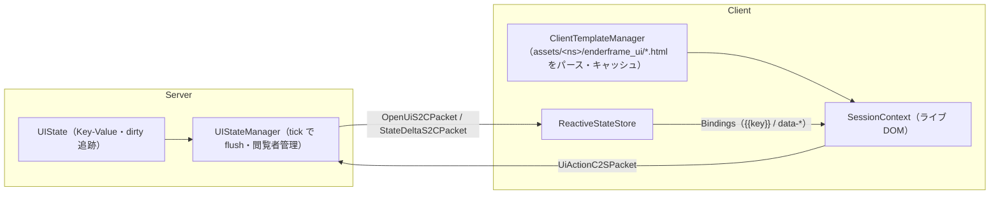
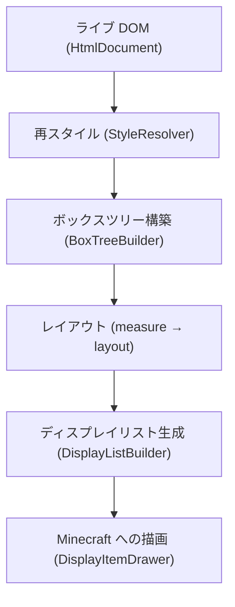

# EnderFrameLib アーキテクチャ設計書

EnderFrameLib は NeoForge 1.21.1 向けに、ブラウザ標準（HTML / CSS / UI Events / WHATWG DOM）に沿った
パイプラインを純 Java で自前実装し、その上に Minecraft との連携層を載せたゲーム内 UI フレームワークです。

本書は、構造整理（T0〜T7）と Headless State（H0〜H4）を経た**現在の**システムの全体像、パッケージ構成、
責務分担、設計原則、および機械的に守っている管理指標を記述します。

- これから何をどの順でやるか: [REFACTORING_PLAN.md](REFACTORING_PLAN.md)
- 性能の基準値と実測: [BENCHMARK.md](BENCHMARK.md)
- ブラウザとの差異の台帳: [FIDELITY.md](FIDELITY.md)
- 規約（言語・コメント・テスト）: [CONTRIBUTING.md](CONTRIBUTING.md)

---

## 1. 層と依存の向き

```
 client/   server/            （Minecraft / NeoForge に依存する実行系）
    │  ╲     │   ╲
    │   network/  ── 登録時だけ server のハンドラを参照
    ↓      ↓
 common/                      （文書の読み込み・パイプライン）
    ↓
 core/  ──→ api/dom, api/event（純 Java の DOM / イベントのインターフェース）
    ✕
 net.minecraft / net.neoforged / com.mojang
```

| パッケージ | 依存先 | 役割・責務 |
|:---|:---|:---|
| **`core/`** | `api/dom`・`api/event` のみ | **ブラウザエンジンのコア**。HTML パーサと DOM、CSS（構文・カスケード・値）、ボックスツリーとレイアウト、描画モデル、テキストの測定。Minecraft・上位パッケージの参照は禁止（`ArchitectureTest`）。 |
| **`api/`** | Minecraft / NeoForge | **公開 API**。下流 Mod がコンパイルする面。実装パッケージ（`core` / `common` / `client` / `server` / `network`）を参照しない（`ApiBoundaryTest`）。<br>`api/dom`・`api/event` は Web IDL の形をした純 Java のインターフェースで、`core/dom` がこれを実装する。 |
| **`common/`** | `core/`, `api/` | 文書の読み込み（`DocumentLoader`・`UiDocumentCompiler`・`CustomTagExpander`・`CssResources`）、描画パイプラインの組み立て（`RenderPipeline`）、devkit の書き出し（`WebDevKitExporter`）。 |
| **`client/`** | `core/`, `api/`, `common/`, `network/` | **クライアント側の実行系**。セッション（`SessionContext`）、入力（`SessionInput`）、宣言的バインディングの状態（`ReactiveStateStore`）、テンプレート（`client/template`）、描画（`client/renderer`）、画面ホスト（`client/gui`）。 |
| **`server/`** | `core/`, `api/`, `common/`, `network/` | **サーバー側の実行系**。Headless State（`server/state`）、互換モードのセッション（`WebSession` / `WebSessionManager`）、Pub/Sub、コマンド、データパック、アクセス制御とレート制限。 |
| **`network/`** | `core/`, `api/` | ペイロードの型と登録（`EnderFrameNetwork`）、Headless State の値と NBT の変換とパケット上の番号化（`StateNbtConverter`。キー辞書 `KeyTable`・受信側の辞書。サーバーとクライアントの両方が使う）。登録時に `server.ServerPayloadHandler` を受け口として参照する。 |
| **`gametest/`** | `api/`, `server/` | サーバー側ライフサイクルのゲームテスト（`WebScreenGameTest`）。 |

---

## 2. 実行モデル

UI は 3 つの駆動方式で開ける。どれもクライアントの**同じライブ DOM と同じパイプライン**で描かれ、違うのは
「どこから何が届くか」だけ。

| 方式 | 入口 | サーバーが持つもの | 通信 |
|:---|:---|:---|:---|
| **Headless State**（推奨。機械 UI など定型画面） | `EnderFrameAPI.open(player, Ui.template(..))` + `UIState` | Key-Value の状態だけ（DOM ノード 0） | 初回 `OpenUiS2CPacket`（テンプレート ID + 初期状態 + キー辞書）、以後 `StateDeltaS2CPacket`（変わったキーだけを番号で。状態の破棄も知らせる）。操作は `UiActionC2SPacket` |
| **互換モード**（Ad-hoc。HTML をサーバーから送る） | `EnderFrameAPI.open(player, Ui.html/datapack)` / `hud`、`WebSessionHandle.patch*` | 文書の DOM（`WebSession`） | 初回 `WebSyncS2CPacket`（DOM の直列化）、以後 `dom_mutations`（`DomMutationRecord` の列）。操作は `WebActionC2SPacket` |
| **クライアント駆動** | `EnderFrameClientAPI.open` / `hud`（`ClientSession`） | なし | 0 |

これに加えて、Pub/Sub（`PubSubUpdateS2CPacket` / `SubscribeC2SPacket`）がチャンネル単位の値を購読者に配る。

### Headless State（`api/state` / `server/state` / `client/template`）



- サーバーは HTML を字句解析せず、DOM をヒープに置かない。状態の差分だけを tick ごとに閲覧者へ送る
  （実測は [BENCHMARK.md](BENCHMARK.md) §7）。
- テンプレートはクライアントのリソース（`assets/<namespace>/enderframe_ui/<path>.html`）から読む。
  テンプレート文書の既定の所有権はクライアント。
- アクションは閲覧者であることを `UIStateManager.handleAction` が確かめ、`ServerPayloadHandler` のレート制限を通る。

### 互換モードの同期と所有権

- 単一のライブ DOM を直接変える。以前の 3 コピー（テンプレート木・仮想木・実体木）と仮想 diff エンジンは無い。
- サーバーの更新は `DomMutationRecord`（子の挿入・削除、属性、文字データ、style）の列。全木の再同期は
  `SessionContext.adoptServerTree` が受け、文書のハンドルは変えずに中身を差し替える。
- 部分木ごとにサーバー所有 / クライアント所有を持つ（`core/dom/node/Ownership`、`data-owner`）。
  クライアント所有の部分木へのサーバー変異は適用しない。
- イベントのサーバー転送は宣言で行う（`core/dom/EventForwardDeclaration`：`data-forward` / `data-forward-action`、
  `onclick="server:…"` はその糖衣）。サーバーは送出した DOM が宣言したアクション名だけを受け付ける（`WebSession.declaresAction`）。

---

## 3. コア（`core/`）

`core/` は Minecraft に依存しないので、すべてヘッドレス（JUnit）で検証できる。

```
core/
├── css/      CSS Syntax 3 のトークンとコンポーネント値（CssSyntax）、規則の積み上げ（CssParser / AtRuleProcessor）、
│             セレクタ（SelectorParser / SelectorMatcher / InvalidationSets）、カスケード（StyleResolver）、
│             値（ValueComputer / LengthResolver / ColorParser / CustomPropertyRegistration）、
│             プロパティの知識（PropertyRegistry / ShorthandExpanders）
├── dom/      ライブ DOM（node/）、パーサ（parser/: HtmlParser・MarkdownParser）、
│             Bindings、InteractionState、MutationObserverManager、フォーム（ConstraintValidator など）
├── event/    DOM のイベントディスパッチ（EventDispatcher / CoreEvent / StandardDefaultActions）
├── layout/   ボックスツリー（BoxTreeBuilder）と整形コンテキスト（Block / Flex / Grid / Table）、LayoutBox、model/
├── paint/    描画モデル（DisplayItem・BoxDecorations・Gradients・AnimationSpec）
└── text/     テキストの測定（TextShaper）、書体（model/FontFace・BitmapFontFace）、
              システム書体（font/: SystemFonts・OutlineFontFace・LoadedFace・KerningTable）
```

### ライブ DOM と単一所有権
- **Single DOM**: 1 つの `HtmlDocument` を Java のクライアントコード・サーバーの変異・宣言的バインディングの全員が同じ API で変える。
- **オブジェクト同一性**: 対話状態（`:hover` / `:focus` など、`InteractionState`）とスクロール量（`core/layout/model/ScrollState`）は
  ノードのインスタンスをキー（弱参照）にする。文字列 ID はネットワークと描画の境界でだけ使い、`getNodeById` で解決する。
- **`getElementById`** は id 索引だけで引く（線形探索のフォールバックは無い）。

### CSS
- 値は `CssSyntax` のコンポーネント値として読み、正規表現で再パースしない。
- カスケードは CSS Cascade 5 の順（重要度 → オリジン → レイヤー → 詳細度 → 出現順）。`@layer`・CSS ネスト・`@container`・
  `@property`・`:has()` を含む。対応範囲の一覧は README の "Supported CSS"。
- 規則は右端の複合セレクタの id / class / tag で振り分けて照合する（`StyleSheet`）。
- セレクタから作る無効化セット（`InvalidationSets`）は `StyleSheet.invalidationSets()` で組めるが、
  再スタイルの範囲決めにはまだ使っていない（R5 の dirty ビットとともに接続する）。

### テキスト
- **測定の出所は `TextShaper` 1 つ。** 描画側は測り直さない。
- `font-family` は既定でシステムの書体（`SystemFonts`、CSS Fonts 4 §5.2 の照合）に解決し、`minecraft:*` などの名前と
  `@font-face` で登録した書体だけが Minecraft のビットマップ書体（`BitmapFontFace`）で描かれる。

---

## 4. クライアント（`client/`）

### セッション状態の単一集約（`SessionContext`）
以前 10 クラス以上に分散していたセッション ID キーの static マップ（hover・drag・focus・input・scheduler など）は、
すべて 1 つの `SessionContext` インスタンスのフィールドになった。
- **`ClientWebManager`**: セッションの登録簿（取得・作成・破棄・描画キュー）だけを持つ。
- **`SessionContext.close()`**: タイマー・アニメーション・キャンバス・購読を 1 箇所で破棄する。
- **`InteractionState`**: フォーカス・ホバー・アクティブなノードの唯一の保持者。

### 入力経路の一本化（`SessionInput`）と画面の基底
GUI 画面（`AbstractEnderScreen` / `AbstractEnderContainerScreen`、共通部分は `EnderScreenDelegate` と `EnderScreenHost`）と
ワールド内 UI（ブロック面・手持ちアイテム・HUD）は、同じ `SessionInput` を通る。
- 各ホストは「ホスト固有の座標 → Web 空間の (x, y)」の変換だけを受け持つ。
- ヒットテスト、`pointerdown` / `mousedown`、解放時の `click` 合成、打鍵（`beforeinput` → 編集 → `input` / `change`）、
  ホイール、サーバーへの転送（互換モードは `WebActionC2SPacket`、Headless State は `UiActionC2SPacket`）はすべてここを通る。

### 宣言的バインディング（`core/dom/Bindings`）
`{{key}}`、`data-model` / `data-bind` / `data-if` / `data-show` / `data-for` / `data-list` / `data-class` / `data-i18n` などの評価は
`Bindings` の 1 箇所で行う。`ReactiveStateStore`（Headless State の状態もここに入る）と `ClientPubSubManager` は値を提供するスコープ。
`data-for` の行は鍵（`data-row-key` か添字）で既存ノードを再利用する。

### 描画（`client/renderer`）
`DisplayListBuilder` がレイアウト結果をディスプレイリストにし、`DisplayItemDrawer` が描く。角丸・グラデーション・角丸クリップは
SDF シェーダー（`WebSdfShader`）で 1 枚の四角形に描き、システム書体の文字は `OutlineTextRenderer` がデバイスピクセルで
ラスタライズして描く。

---

## 5. 描画パイプライン（`common/RenderPipeline`）

スタイル解決から描画要素の生成までは `RenderPipeline` の 1 箇所で組み立てる（M5）。



### 差分レイアウトと近道（R5 の実装済み部分）
- **差分レイアウト**: 再レイアウトのたびに箱の木を作り直さず、DOM の節ごとに前回の `LayoutBox` を使い回す。
  measure の入力（制約・親が決めた寸法・ビューポート・書体）と中身の署名（算出スタイル・文字・属性・子の並び）が
  変わらず、子孫も変わっていなければ `measure` を飛ばす。表とその中、`display: none` の部分木は作り直す。
- **近道**:
  - スクロール: 箱の木を作り直さず `layout`（位置決め）だけ。
  - `left` / `top` のドラッグ: 再スタイルの後に `layout` だけ。
  - ウィンドウのリサイズ: 文書を保ち、ビューポート単位を使う要素だけ再スタイル。直前のレイアウト時間に応じて間引く
    （`SessionContext.RESIZE_THROTTLE_FACTOR`）。
- 正しさは「全部作り直したときと同じディスプレイリストになる」ことで固定する（`IncrementalLayoutTest`・`IncrementalPipelineTest`・
  `ServerClientLayoutParityTest`）。

---

## 6. 設計原則（崩さない不変条件）

- **測定の出所は 1 つ。** テキストの幅・ベースライン・折り返しは `TextShaper` が決め、描画はそれをそのまま描く。
- **幾何は float、丸めは描画の 1 箇所。**
- **プロパティの知識は 1 箇所**（`PropertyRegistry`）。
- **DOM と箱は別物**（レイアウトの入力はボックスツリー）。
- **描画順は木で決める**（CSS 2.2 付録 E のスタッキングコンテキスト）。描画とヒットテスト（`HitTestIndex`）は同じ順序を使う。
- **差は台帳に書く。** FIDELITY.md・コードの `LIMITATION`・README の "Not supported" の 3 点セット。
- **同じ処理の 2 つめの入口を作らない。** 入口が使いにくければ入口のほうを直す。

---

## 7. 管理指標とアーキテクチャの番人（ラチェット）

コードの肥大化と責務の重複の再発を防ぐため、次の指標を
[`ArchitectureTest`](src/test/java/com/nishiyu/enderframelib/core/ArchitectureTest.java) で機械的に検査し、
上限を超えたらビルドを落とす。上限は下げる方向にだけ動かす（[CONTRIBUTING.md](CONTRIBUTING.md)）。

| 指標 | 検査対象 | 上限 |
|:---|:---|:---:|
| **M1** | セッション ID をキーにした static な状態を持つクラス | 1（`ClientWebManager` の登録簿） |
| **M2** | フォーカス状態の持ち場 | 1（`InteractionState`） |
| **M3** | `ClientWebManager` の public static メソッド | 8 |
| **M4** | テンプレート・バインディング（`{{…}}` / `data-*`）を解釈するクラス | 1（`Bindings`） |
| **M5** | スタイル → ボックス → レイアウト → ディスプレイリストを組み立てる場所 | 1（`RenderPipeline`） |
| **M6** | 入力をイベントに変える経路 | 1（`SessionInput`） |
| **M7** | 2 つ以上のパッケージから参照される入れ子型（`api` は除く） | 0（トップレベルへ出す） |
| **M8** | CSS の値を文字列で分割する自前の関数 | 8（新しく書かない。`CssSyntax` を使う） |
| **M9** | トップレベルのファイル数（参考値） | 193 |

指標の外にも、次を同じテストで検査している。

- `core/` が Minecraft・NeoForge・上位パッケージを参照しない（import でも完全修飾名でも）。
- `client/` が `server/` を参照しない（両側で使う型は `network/` か `common/` に置く）。
- `api/` が実装パッケージを参照しない（`ApiBoundaryTest`）。
- テストのパッケージが本体のパッケージに対応する（WPT の移植ハーネスを除く）。
- README・CONTRIBUTING・FIDELITY・REFACTORING_PLAN・ARCHITECTURE・BENCHMARK に、消した型の名前が残っていない。
- サーバーのセッション属性を並行マップで持たない（`WebSession` のフィールドに集約）、`EnderFrameScriptingBridge` が
  グローバルな登録簿を持たない、差分の送り方が `dom_mutations` の 1 系統である。

## 面（Surface）の描画経路

セッションを面に描くホスト（画面・コンテナ画面・HUD・ビルボード・ブロック・ホログラム・アイテム・地図）は、
姿勢（`PoseStack`）だけを作って `SurfaceRenderer.draw` を呼ぶ。同期の確認・空の判定・ホバーの取得・描画パスの
組み立ては `SurfaceRenderer` の 1 か所にあり、`PaintRequest` はその内部の値になった。描き方（ライト・描く部品・
奥行き・音・遠距離の塗り）は `SurfaceStyle` に集まり、場所ごとの既定（`gui` / `hud` / `billboard` / `world` / `item` / `overlay`）
から `with*` で 1 項目ずつ変える。世界に出す登録口は `client/Surfaces`（`block` / `item` / `map` / `hologram`）の 1 つ。
