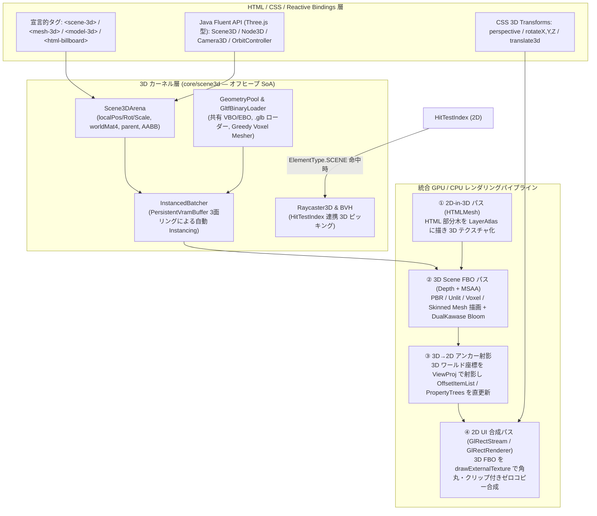

# EnderFrameLib Core：Three.js 型 3D シーングラフ統合・本格 2D/3D ゲームエンジン化設計書

**対象モジュール**: `D:\Dev\Personal\enderframelib-1.21.1\core`  
**前提ドキュメント**: [`ENGINE_REARCHITECTURE_PLAN.md`](file:///D:/Dev/Personal/enderframelib-1.21.1/core/ENGINE_REARCHITECTURE_PLAN.md)  
**設計方針**: **追加の外部依存ゼロ・JVM 起動フラグ不要・オフヒープ SoA 駆動・HTML/CSS と 3D 空間の双方向ゼロコピー融合**

---

## 1. エグゼクティブサマリ：なぜ「HTML/CSS + Three.js 型 3D カーネル」なのか

ブラウザ上の Three.js（JavaScript + WebGL）や React Three Fiber は表現力に優れる一方、**「HTML/CSS の DOM レイアウト木」と「WebGL の 3D `Object3D` 木」が別々のメモリ空間・描画パイプラインに分断されている**という根本的な制約を抱えています。そのため、UI の中に複数の 3D ビューポートを並べたり、3D 空間内のオブジェクトに HTML/CSS の HUD を追従させたりすると、コンテキスト切り替えや `CSS2DRenderer` / `CSS3DRenderer` の DOM 再計算によってフレームレートが急落します。

一方、現在の `enderframelib-core` にはすでに以下の **4 つの強力な土台** が揃っています。

1. **追加依存なしで 3D 数学・JSON・OpenGL が `core` に完備されている**:
   - [`core/build.gradle:36-43`](file:///D:/Dev/Personal/enderframelib-1.21.1/core/build.gradle#L36-L43) には既に `org.joml:joml:1.10.5`（SIMD/高速行列演算）、`com.google.code.gson:gson:2.10.1`（glTF JSON パース用）、`it.unimi.dsi:fastutil:8.5.12`、`org.lwjgl:lwjgl-opengl:3.3.3` が標準 API 依存として含まれており、**新たな外部ライブラリを 1 つも足さずに 3D エンジンを構築できる**。
2. **オフヒープ SoA 列と 3 面永続マップ VRAM リングが稼働している**:
   - [`OffHeapColumns`](file:///D:/Dev/Personal/enderframelib-1.21.1/core/src/main/java/com/nishiyu/enderframelib/core/kernel/memory/OffHeapColumns.java)、[`PersistentVramBuffer`](file:///D:/Dev/Personal/enderframelib-1.21.1/core/src/main/java/com/nishiyu/enderframelib/core/kernel/gpu/PersistentVramBuffer.java)（3 面リング）、[`GlFenceRing`](file:///D:/Dev/Personal/enderframelib-1.21.1/core/src/main/java/com/nishiyu/enderframelib/core/paint/gl/GlFenceRing.java) をそのまま 3D のワールド行列・ボーン行列・インスタンシングバッファとして使える。
3. **外部 FBO テクスチャを CSS ボックスとしてゼロコピー合成する経路が既にある**:
   - [`GlRectStream.drawExternalTexture`](file:///D:/Dev/Personal/enderframelib-1.21.1/core/src/main/java/com/nishiyu/enderframelib/core/paint/gl/GlRectStream.java#L194-L214) と [`LwjglGlRenderBackend.drawExternalTexture`](file:///D:/Dev/Personal/enderframelib-1.21.1/core/src/main/java/com/nishiyu/enderframelib/core/paint/gl/LwjglGlRenderBackend.java#L1294-L1320) により、3D パスが描画した FBO カラーテクスチャを CPU 読み戻しゼロで CSS の角丸（`border-radius`）・多段クリップ・不透明度・変形の中に合成できる。
4. **`ElementType.SCENE` の予約枠が既にパイプラインを一貫して通っている**:
   - [`ElementType.SCENE`](file:///D:/Dev/Personal/enderframelib-1.21.1/core/src/main/java/com/nishiyu/enderframelib/core/paint/model/ElementType.java#L18) はパーサー・[`BoxMeasurer`](file:///D:/Dev/Personal/enderframelib-1.21.1/core/src/main/java/com/nishiyu/enderframelib/core/layout/BoxMeasurer.java#L252)・[`DisplayListBuilder`](file:///D:/Dev/Personal/enderframelib-1.21.1/core/src/main/java/com/nishiyu/enderframelib/core/paint/DisplayListBuilder.java#L766)・[`HitTestIndex`](file:///D:/Dev/Personal/enderframelib-1.21.1/core/src/main/java/com/nishiyu/enderframelib/core/paint/HitTestIndex.java#L207) に既に配線されている。
   - しかし現状は `core` 側に 3D レンダラが無いため、[`SoftwareRenderBackend.java:575`](file:///D:/Dev/Personal/enderframelib-1.21.1/core/src/main/java/com/nishiyu/enderframelib/core/paint/software/SoftwareRenderBackend.java#L575) では空実装（`case SCENE -> {}`）になっており、Minecraft 側の [`CoreGpuSurface.java:176`](file:///D:/Dev/Personal/enderframelib-1.21.1/src/main/java/com/nishiyu/enderframelib/client/renderer/CoreGpuSurface.java#L176) でも `SCENE` 要素が 1 つでもあると**画面全体を旧来の `DisplayItemDrawer` へフォールバックさせている**。`core` 自身に汎用 3D カーネルを持たせることで、この最後のフォールバック壁も同時に撤去できる。

---

## 2. 全体アーキテクチャ：2D HTML/CSS と 3D 空間の「4 つの融合モード」

本設計では、単なる「HTML の中に 3D キャンバスを貼る」だけでなく、2D と 3D が双方向に融合する **4 つのレンダリングモード** を単一パイプラインで提供します。



### 4 つの融合モード

| モード | 概要 | 具体的なユースケース | 内部データフロー |
| :--- | :--- | :--- | :--- |
| **Mode A: 3D-in-2D**<br/>（UI 内 3D ビューポート） | HTML の Flex/Grid レイアウト内の `<scene-3d>` ボックスに 3D シーンを描画。CSS の `border-radius`, `box-shadow`, `opacity`, `filter`, `overflow: hidden` がそのまま効く。 | ・インベントリの 3D アイテム／装備プレビュー<br/>・機械・マルチブロック構造の 3D ガイド (`<mc-scene>`)<br/>・スキルツリーの 3D 背景や立体グラフ | `GlScene3DRenderer` が Depth 付き FBO（または共有 Scene Atlas）へ描画 → カラーテクスチャ ID を [`GlRectStream.drawExternalTexture`](file:///D:/Dev/Personal/enderframelib-1.21.1/core/src/main/java/com/nishiyu/enderframelib/core/paint/gl/GlRectStream.java#L194-L214) に渡して 1 パス合成。 |
| **Mode B: 2D-in-3D**<br/>（3D 空間内の HTML パネル） | 任意の HTML/CSS 要素（ボタン・入力欄・カード）をテクスチャとして 3D 空間内の平面メッシュや曲面メッシュに貼り付ける（Three.js の `HTMLMesh` 上位互換）。 | ・3D 空間に浮かぶ SF ホログラム端末<br/>・ゲーム内のモニター画面や看板の上で動く対話可能な HTML UI | 対象 DOM 部分木を [`LayerAtlas`](file:///D:/Dev/Personal/enderframelib-1.21.1/core/src/main/java/com/nishiyu/enderframelib/core/kernel/gpu/LayerAtlas.java) のサブ矩形へ描画 → 3D メッシュの BaseColor / Emissive テクスチャとして参照。クリック時は `Raycaster3D` の交差点 UV $(u, v)$ を 2D 座標に変換して `HitTestIndex` へ転送。 |
| **Mode C: 3D-Anchored 2D**<br/>（3D 座標追従 HUD） | 3D ノード（敵・ブロック・ピン）のワールド座標 $(x, y, z)$ に、高精細な 2D HTML 要素を毎フレーム追従させる。 | ・敵の頭上の HP バー・ダメージポップアップ<br/>・[`WebSceneContext.setBlockLabel`](file:///D:/Dev/Personal/enderframelib-1.21.1/src/main/java/com/nishiyu/enderframelib/client/renderer/WebSceneContext.java#L118-L123) のブロック解説ピン | `Scene3DArena` のワールド座標を `Camera3D.projectToViewport()` で 2D 座標 $(sx, sy, depth)$ に変換 → [`OffsetItemList`](file:///D:/Dev/Personal/enderframelib-1.21.1/core/src/main/java/com/nishiyu/enderframelib/core/paint/OffsetItemList.java)（または `PropertyTrees`）の移動量だけを `0 B/frame` で更新。 |
| **Mode D: CSS 3D Transforms**<br/>（DOM 要素自体の立体変形） | 通常の HTML 要素に対する `transform: perspective(800px) rotateY(25deg) translateZ(40px)`。 | ・マウス位置に応じて立体的に傾くカード UI（Tilt Card）<br/>・カルーセルメニューや 3D フリップ演出 | [`PropertyTrees`](file:///D:/Dev/Personal/enderframelib-1.21.1/core/src/main/java/com/nishiyu/enderframelib/core/kernel/gpu/PropertyTrees.java) の Transform スロットを 2D アフィンから 3×4 / 4×4 射影対応に拡張し、[`GlRectRenderer`](file:///D:/Dev/Personal/enderframelib-1.21.1/core/src/main/java/com/nishiyu/enderframelib/core/paint/gl/GlRectRenderer.java) で透視投影描画。 |

---

## 3. コアモジュール詳細設計（`com.nishiyu.enderframelib.core.scene3d`）

### 3.1 `Scene3DArena`：オフヒープ SoA シーングラフ（Three.js `Scene` / `Object3D` 相当）

Three.js では各 `Object3D` が `Vector3 position`, `Quaternion quaternion`, `Vector3 scale`, `Matrix4 local`, `Matrix4 matrixWorld`, `ArrayList<Object3D> children` をヒープオブジェクトとして抱えるため、数千ノードの更新でキャッシュミスが発生します。  
本エンジンでは [`DocumentArena`](file:///D:/Dev/Personal/enderframelib-1.21.1/core/src/main/java/com/nishiyu/enderframelib/core/kernel/memory/DocumentArena.java) と同じ [`OffHeapColumns`](file:///D:/Dev/Personal/enderframelib-1.21.1/core/src/main/java/com/nishiyu/enderframelib/core/kernel/memory/OffHeapColumns.java) を用いて、全 3D ノードを連続オフヒープ列で管理します。

* **オフヒープ列レイアウト（ノード ID = `int nodeId`）**:
  - **トポロジー列 (`OffHeapColumns.Ints`)**: `parent`, `firstChild`, `nextSibling`, `depth`, `topoOrder`（親が必ず子より先に来るトポロジカル順序配列）
  - **局所変換列 (`OffHeapColumns.Floats`)**: `tx, ty, tz`（位置）、`qx, qy, qz, qw`（回転クォータニオン）、`sx, sy, sz`（スケール）
  - **ワールド行列列 (`OffHeapColumns.Floats`)**: `worldMat`（1 ノードあたり連続 `16 floats` = 64 Bytes）
  - **境界 & 描画属性列**: `localAabb` (`6 floats`), `worldAabb` (`6 floats`), `meshId` (`int`), `materialId` (`int`), `skinId` (`int`), `flags` (`VISIBLE | CAST_SHADOW | INTERACTIVE | DIRTY_LOCAL | DIRTY_WORLD | BILLBOARD`)
* **分岐なし 1 パス行列更新 (`updateWorldMatrices()`)**:
  - `topoOrder` 配列を先頭から順に走査すると、どのノード `i` を見る時点でもその親 `p = parent[i]` の `worldMat[p]` は必ず計算済みであることが保証される。
  - 再帰呼び出しを一切使わず、`DIRTY_LOCAL` または親が `DIRTY_WORLD` のノードだけを線形ループで `worldMat[i] = worldMat[p] * TRS(tx..sz)` として一括計算する。

---

### 3.2 `GeometryPool` & `InstancedBatcher`（Three.js `BufferGeometry` / `InstancedMesh` 相当）

1. **標準頂点レイアウト（36 Bytes / Vertex）**:
   - `position` (`float3`, 12B)
   - `normal` (`snorm10_10_10_2` または `half4` / `float3`, 12B)
   - `uv` (`float2`, 8B)
   - `color` (`ubyte4` 正規化 RGBA, 4B)
   - ※スキニング用メッシュは追加ストリームとして `joints` (`ubyte4`, 4B) + `weights` (` half4`/`float4`, 8〜16B) をバインド。
2. **組み込みプロシージャル・ジオメトリ**:
   - `Geometries.box(w, h, d)`、`Geometries.sphere(radius, widthSeg, heightSeg)`、`Geometries.plane(w, h)`、`Geometries.cylinder(...)`、`Geometries.torus(...)`
   - **`GreedyVoxelMesher`（ボクセル構造体の高速メッシュ化）**:
     - 現在の [`WebSceneContext`](file:///D:/Dev/Personal/enderframelib-1.21.1/src/main/java/com/nishiyu/enderframelib/client/renderer/WebSceneContext.java#L51-L106) のようなブロック配置（$X \times Y \times Z$ グリッド）に対して、隣接する遮蔽面を除去（Face Culling + Greedy Meshing）して単一の軽量メッシュへ変換するビルダーを `core` 標準で備える。
3. **3 面 VRAM リングによる自動インスタンシング (`InstancedBatcher`)**:
   - カメラ視錐台カリング（Frustum Culling：6 平面と `worldAabb` の判定）を通過した可視ノードを、`(materialId, meshId)` の 64-bit ソートキーでバケットソート（不透明は手前から奥、半透明は奥から手前）。
   - 同じ `(materialId, meshId)` を持つノード群の `worldMat`（16 floats）とインスタンス色（4 floats）を [`PersistentVramBuffer`](file:///D:/Dev/Personal/enderframelib-1.21.1/core/src/main/java/com/nishiyu/enderframelib/core/kernel/gpu/PersistentVramBuffer.java)（3 面リング TBO）へ連続書き込みし、**1 回の `glDrawElementsInstanced` で数千個のオブジェクトを描画**する。

---

### 3.3 `MaterialPool` & シェーダーパイプライン（Three.js `Material` / `Lights` 相当）

OpenGL 3.3 Core Profile（LWJGL 3.3.3）で確実に動作し、かつ Three.js の主要マテリアルを網羅する 3 種のシェーダープログラムを提供します。

| マテリアル種別 | Three.js 対応物 | 主なユニフォーム・パラメータ | 用途 |
| :--- | :--- | :--- | :--- |
| **`UnlitMaterial`** | `MeshBasicMaterial` / `LineBasicMaterial` | `baseColor`, `baseColorTex`, `opacity`, `wireframe`, `emissive` | ホログラム UI、2D-in-3D パネル (`HTMLMesh`)、グリッド線、ギズモ、エフェクト |
| **`StandardPbrMaterial`** | `MeshStandardMaterial` | `baseColor`, `metallic` (0..1), `roughness` (0..1), `albedoTex`, `normalTex`, `metallicRoughnessTex`, `emissive` | glTF 3D モデル、装備・武器・機械のリアルなプレビュー（Cook-Torrance BRDF + 半球環境光 IBL + 最大 4 灯の Directional/Point Light） |
| **`CustomShaderMaterial`** | `ShaderMaterial` | ユーザー定義の頂点・フラグメント GLSL + カスタム `float`/`vec4`/`sampler2D` ユニフォーム表 | 水面、エネルギーシールド、走査線シェーダーなどのゲーム固有演出 |

* **ポストプロセス連携（[`DualKawase`](file:///D:/Dev/Personal/enderframelib-1.21.1/core/src/main/java/com/nishiyu/enderframelib/core/kernel/gpu/DualKawase.java) の活用）**:
  - 既に `core/kernel/gpu` に実装済みの [`DualKawase`](file:///D:/Dev/Personal/enderframelib-1.21.1/core/src/main/java/com/nishiyu/enderframelib/core/kernel/gpu/DualKawase.java) ダウンサンプル／アップサンプル計算を 3D パスの輝度抽出（Emissive バッファ）に接続し、Three.js の `UnrealBloomPass` 相当の発光エフェクトを最小コストで実現する。

---

### 3.4 `GltfBinaryLoader`：外部依存ゼロの純 Java `.glb` ローダー

Three.js エコシステムの中心である **glTF 2.0 (`.glb` / `.gltf`)** を、追加ライブラリなしで直接読み込むローダーです。

* **なぜ外部ライブラリ不要で書けるのか**:
  - `.glb` ファイルの構造は極めて単純で、先頭 12 バイトのヘッダ（`magic = 0x46546C67`, `version = 2`, `length`）に続き、**Chunk 0（JSON テキスト）** と **Chunk 1（生のバイナリ頂点・インデックス・画像バイト列）** が並んでいるだけです。
  - Chunk 0 は既に `core` に含まれている `com.google.code.gson.JsonParser` でパースでき、Chunk 1 は `ByteBuffer.slice().order(ByteOrder.LITTLE_ENDIAN)` で**コピーなしのまま直接 OpenGL の `glBufferData` や `ImageDecoder` に渡せます**。
* **対応スコープ**:
  - `meshes` / `primitives` / `accessors` / `bufferViews`（頂点・法線・UV・インデックスのゼロコピー抽出）
  - `materials`（`pbrMetallicRoughness`, `baseColorFactor`, 埋め込み PNG/JPEG テクスチャ）
  - `nodes`（親子階層と `translation` / `rotation` / `scale` / `matrix` の `Scene3DArena` への展開）
  - `animations` & `skins`（キーフレーム補間とボーン逆バインド行列の再生）

---

### 3.5 `Raycaster3D` & `OrbitController`：2D `HitTestIndex` との完全統合

3D ビューポートを「ただの絵」ではなく「触れる UI」にするため、2D のヒットテストと 3D のレイキャストを直結します。

1. **2D → 3D シームレス・ピッキング**:
   - マウス移動・クリック時、まず [`HitTestIndex`](file:///D:/Dev/Personal/enderframelib-1.21.1/core/src/main/java/com/nishiyu/enderframelib/core/paint/HitTestIndex.java) が 2D ボックスを判定する。
   - 命中した要素が `<scene-3d>`（`ElementType.SCENE`）だった場合、要素内の正規化デバイス座標 $\text{ndcX}, \text{ndcY} \in [-1, 1]$ を算出し、`Camera3D.unprojectRay(ndcX, ndcY)` で 3D レイ $\mathbf{r}(t) = \mathbf{o} + t\mathbf{d}$ を生成する。
   - `Scene3DArena` の `worldAabb` 列に対してスラブ法（Slab Method）で高速に一次フィルタリングし、交差した候補メッシュの三角形（またはボクセル）に対して最近接交差点 $(t, u, v, \text{nodeId})$ を求める。
2. **3D オブジェクトへの DOM イベント・CSS 擬似クラス連携**:
   - `<scene-3d>` 内の子要素として宣言された `<mesh-3d id="gear-1">` にレイが命中した場合、その DOM ノードに対して通常の HTML 要素と全く同じく `:hover` / `:active` 状態遷移や `onClick` コールバックを発火させる。
3. **組み込み `OrbitController`（Three.js `OrbitControls` 相当）**:
   - `<scene-3d orbit-controls="true">` 属性（または Java API）を有効にするだけで、左ドラッグで回転（Pitch/Yaw 減衰付き）、右ドラッグでパン、ホイールでズームが標準動作する。

---

### 3.6 `SoftwareScene3DRasterizer`：ヘッドレス CI テスト & CPU フォールバック

`enderframelib-core` の最大の強みである「OpenGL ウィンドウ無しの JUnit でも全機能をピクセル単位でテストできる」性質を維持するため、[`SoftwareRenderBackend`](file:///D:/Dev/Personal/enderframelib-1.21.1/core/src/main/java/com/nishiyu/enderframelib/core/paint/software/SoftwareRenderBackend.java) 用の軽量 3D ラスタライザを備えます。

* 新たに独立分離された [`TileQueue`](file:///D:/Dev/Personal/enderframelib-1.21.1/core/src/main/java/com/nishiyu/enderframelib/core/paint/software/TileQueue.java) と [`Op`](file:///D:/Dev/Personal/enderframelib-1.21.1/core/src/main/java/com/nishiyu/enderframelib/core/paint/software/Op.java)（64×64 ピクセルタイル並列機構）および [`Scratch`](file:///D:/Dev/Personal/enderframelib-1.21.1/core/src/main/java/com/nishiyu/enderframelib/core/paint/software/Scratch.java) をそのまま利用し、各ワーカースレッドが L1 キャッシュ内に収まる **`float[64 * 64] tileZBuffer`（16 KB）** を 1 枚持つだけで、ヒープ確保ゼロで深度テスト付き三角形ラスタライズ（重心座標補間＋テクスチャサンプリング＋ランバート陰影）を実行できる。

---

## 4. 宣言的 HTML/CSS 表記と Java API（Three.js + React Three Fiber 型の開発体験）

開発者は「HTML テンプレートでの宣言的記述」と「Java コードからの Three.js ライクな命令的制御」を自由に組み合わせることができます。

### 4.1 宣言的 HTML + CSS + データバインディング記述例

```html
<!-- CSS の角丸・枠線・シャドウ・ホバー遷移がそのまま 3D ビューポートに効く -->
<scene-3d id="mecha-viewer"
          style="width: 480px; height: 320px; border-radius: 12px; border: 2px solid #38bdf8;"
          orbit-controls="true"
          fov="45"
          camera-pos="0, 2.5, 6"
          camera-target="0, 1.0, 0"
          bloom="true">

    <!-- ライティング -->
    <light-3d type="hemisphere" sky="#e0f2fe" ground="#1e293b" intensity="0.8"></light-3d>
    <light-3d type="directional" pos="5, 10, 7" color="#ffffff" intensity="1.4"></light-3d>

    <!-- glTF 2.0 (.glb) モデルの読み込みとリアクティブ回転バインディング -->
    <model-3d id="boss-model"
              src="models/ancient_guardian.glb"
              anim="idle_float"
              pos="0, 0, 0"
              rot="0, {{previewYaw}}, 0"
              scale="1.2, 1.2, 1.2">
        <!-- Mode C: 3D ノードの頭上に追従する HTML 2D HUD アンカー -->
        <div slot="anchor-3d" data-offset="0, 2.4, 0" class="boss-tag">
            <span>Lv.99 Ancient Guardian</span>
            <progress value="{{bossHp}}" max="1000"></progress>
        </div>
    </model-3d>

    <!-- プロシージャル・メッシュ（ホバーやクリックが DOM イベントとして取れる） -->
    <mesh-3d id="core-crystal"
             geometry="octahedron(0.5)"
             pos="0, 1.5, 0"
             color="#38bdf8"
             emissive="#0284c7"
             roughness="0.1"
             metalness="0.9">
    </mesh-3d>
</scene-3d>
```

### 4.2 Java 側の Three.js 型プログラマティック API 例

```java
Scene3D scene = uiView.scene3d("mecha-viewer");

// Three.js の Object3D / Mesh と同じ感覚でオフヒープノードを操作
Node3D crystal = scene.getNodeById("core-crystal");
crystal.setPosition(0f, 1.5f + (float) Math.sin(timeSec * 3.0) * 0.2f, 0f)
       .setRotationY((float) (timeSec * 45.0));

// 10,000 個のパーティクルやボクセルも InstancedMesh で 1 Draw Call
InstancedGroup sparks = scene.createInstancedGroup(
    Geometries.box(0.05f, 0.05f, 0.05f),
    Materials.unlit(0xFF38BDF8)
);
for (int i = 0; i < 10_000; i++) {
    sparks.setInstanceTransform(i, x[i], y[i], z[i], qx, qy, qz, qw, 1f, 1f, 1f);
}
```

---

## 5. 段階的実装ロードマップ（Milestone 3D-0 〜 3D-5）

[`ENGINE_REARCHITECTURE_PLAN.md` 第 6 章 Phase A](file:///D:/Dev/Personal/enderframelib-1.21.1/core/ENGINE_REARCHITECTURE_PLAN.md) の GL/CPU 完全分離と連携し、以下のマイルストーンで段階的に実装・検証を進めます。

| マイルストーン | 実装対象パッケージ・クラス | 主な実装内容と現在の進捗 | 完了判定ゲート（テスト & ベンチマーク閾値） |
| :--- | :--- | :--- | :--- |
| **Milestone 3D-0**<br/>（前提整備：GL/CPU 分離）<br/>**🔶 前半完了** | [`LwjglGlRenderBackend`](file:///D:/Dev/Personal/enderframelib-1.21.1/core/src/main/java/com/nishiyu/enderframelib/core/paint/gl/LwjglGlRenderBackend.java)<br/>[`PaintResources`](file:///D:/Dev/Personal/enderframelib-1.21.1/core/src/main/java/com/nishiyu/enderframelib/core/paint/software/PaintResources.java)<br/>[`TileQueue`](file:///D:/Dev/Personal/enderframelib-1.21.1/core/src/main/java/com/nishiyu/enderframelib/core/paint/software/TileQueue.java) | ・**完了済**: CPU レイヤー遅延確保、`PaintResources` 独立（`cpu` 依存 7→3 経路）、`Clip`/`Fast`/`DirtyRect`/`PixmapPool`/`Op`/`TileQueue` の独立分離。<br/>・**残り**: 図形ディスパッチ（`PaintSceneDriver.Painter`）を `SoftwareRenderBackend` から切り出し、`ElementType.SCENE` を 3D シーンシンクへ配線する。 | ・`Milestone4GateTest` の「`LwjglGlRenderBackend` から `SoftwareRenderBackend` への参照 = `0`」を達成。<br/>・既存テスト全通過。 |
| **Milestone 3D-1**<br/>（3D シーングラフ & 基本レンダラ） | `core/scene3d/Scene3DArena`<br/>`Camera3D`, `GeometryPool`<br/>`GlScene3DRenderer`<br/>`SoftwareScene3DRasterizer` | ・`OffHeapColumns` による `Scene3DArena`（TRS → `worldMat4` トポロジカル一括計算）の実装。<br/>・基本プリミティブ（Box / Sphere / Plane / Grid）と `UnlitMaterial` / `StandardPbrMaterial` シェーダーの実装。<br/>・Depth 付き FBO への描画と [`GlRectStream.drawExternalTexture`](file:///D:/Dev/Personal/enderframelib-1.21.1/core/src/main/java/com/nishiyu/enderframelib/core/paint/gl/GlRectStream.java#L194-L214) による角丸・クリップ付き合成。<br/>・CPU タイル Z-Buffer ラスタライザの実装。 | ・**等価テスト**: GL バックエンドと Software バックエンドで同じ 3D シーンを描画し、PSNR > 40 dB で一致。<br/>・**性能ゲート**: 10,000 ノードの階層 `updateWorldMatrices()` が **< 0.15 ms / 0 B alloc**。 |
| **Milestone 3D-2**<br/>（自動 Instancing & ボクセル統合） | `core/scene3d/InstancedBatcher`<br/>`GreedyVoxelMesher`<br/>[`CoreGpuSurface`](file:///D:/Dev/Personal/enderframelib-1.21.1/src/main/java/com/nishiyu/enderframelib/client/renderer/CoreGpuSurface.java) | ・[`PersistentVramBuffer`](file:///D:/Dev/Personal/enderframelib-1.21.1/core/src/main/java/com/nishiyu/enderframelib/core/kernel/gpu/PersistentVramBuffer.java)（3面リング）を用いた `glDrawElementsInstanced` バッチ描画。<br/>・`GreedyVoxelMesher` の実装と、[`CoreGpuSurface.drawable`](file:///D:/Dev/Personal/enderframelib-1.21.1/src/main/java/com/nishiyu/enderframelib/client/renderer/CoreGpuSurface.java#L173-L187) からの `case SCENE -> return false` フォールバックの撤去。 | ・**性能ゲート**: 5,000 インスタンスの 3D キューブ描画が **1 Draw Call・GPU + CPU 合計 < 0.25 ms / 0 B alloc**。 |
| **Milestone 3D-3**<br/>（glTF 2.0 `.glb` ローダー & アニメ） | `core/scene3d/gltf/GltfBinaryLoader`<br/>`SkeletonSkinning` | ・純 Java（`Gson` + `ByteBuffer`）による `.glb` ゼロコピーローダーの実装。<br/>・ノード階層・PBR テクスチャ・キーフレーム補間（TRS）・ボーンスキニング（Joint Matrix TBO）の実装。 | ・Khronos 標準サンプル（`BoxAnimated.glb`, `DamagedHelmet.glb`, `CesiumMan.glb` 相当）の読み込み・アニメーション再生テスト通過。<br/>・再生中の毎フレームヒープ確保 **0 B/frame**。 |
| **Milestone 3D-4**<br/>（3D レイキャスト & 宣言的 HTML タグ） | `core/scene3d/Raycaster3D`<br/>`OrbitController`<br/>[`HtmlParser`](file:///D:/Dev/Personal/enderframelib-1.21.1/core/src/main/java/com/nishiyu/enderframelib/core/dom/parser/HtmlParser.java) | ・`<scene-3d>`, `<mesh-3d>`, `<model-3d>`, `<light-3d>` の HTML タグ対応と [`Bindings`](file:///D:/Dev/Personal/enderframelib-1.21.1/core/src/main/java/com/nishiyu/enderframelib/core/dom/Bindings.java) 連携。<br/>・[`HitTestIndex`](file:///D:/Dev/Personal/enderframelib-1.21.1/core/src/main/java/com/nishiyu/enderframelib/core/paint/HitTestIndex.java) から `Raycaster3D`（AABB + メッシュ BVH）への連携と、3D メッシュ上の `:hover` / `@click` / `OrbitController` の実装。 | ・1,000 メッシュ中の 1 回あたりの 3D レイキャスト時間が **< 0.01 ms / 0 B alloc**。<br/>・3D メッシュのホバーで CSS `:hover` スタイルとバインディングが発火する統合テスト通過。 |
| **Milestone 3D-5**<br/>（双方向融合：2D-in-3D / 3D アンカー / CSS 3D） | [`PropertyTrees`](file:///D:/Dev/Personal/enderframelib-1.21.1/core/src/main/java/com/nishiyu/enderframelib/core/kernel/gpu/PropertyTrees.java)<br/>[`LayerAtlas`](file:///D:/Dev/Personal/enderframelib-1.21.1/core/src/main/java/com/nishiyu/enderframelib/core/kernel/gpu/LayerAtlas.java)<br/>[`DualKawase`](file:///D:/Dev/Personal/enderframelib-1.21.1/core/src/main/java/com/nishiyu/enderframelib/core/kernel/gpu/DualKawase.java) | ・Mode C（3D 座標追従 2D アンカー）の [`OffsetItemList`](file:///D:/Dev/Personal/enderframelib-1.21.1/core/src/main/java/com/nishiyu/enderframelib/core/paint/OffsetItemList.java) 直結。<br/>・Mode B（`LayerAtlas` を使った 3D 空間内の対話可能 HTML メッシュ `HTMLMesh`）。<br/>・Mode D（CSS `perspective` / `rotateX/Y/Z` / `translate3d`）のシェーダー対応と `DualKawase` ブルーム統合。 | ・100 個の 3D 追従 HTML ラベルが毎フレーム移動しても再レイアウト `0 回`・CPU **< 0.05 ms**。<br/>・3D 空間内の傾いた HTML パネル上のボタンをクリックしてイベントが発火するテスト通過。 |
