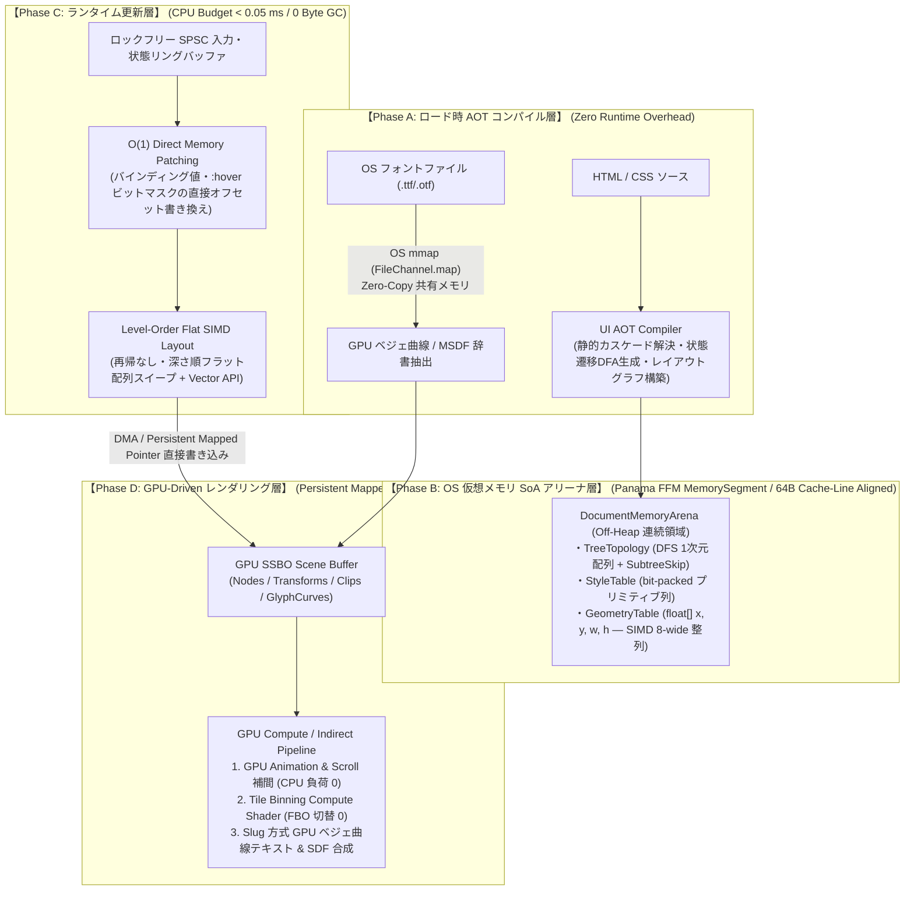
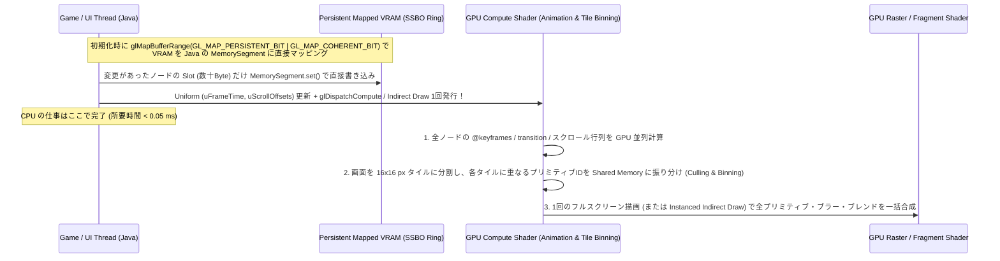
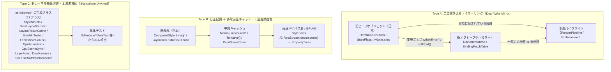

# EnderFrameLib `:core` 抜本改造設計書：OS・ハードウェア直結型「Zero-GC / GPU-Driven UI Engine」

> **基本思想の転換**:
> Chrome (Blink) や Firefox (Gecko) は「動的に書き換わる未知の Web ページを CPU のポインタ木で逐次解釈する」ための汎用文書ビューアであり、その延長線上では **ゲームのフレームバジェット（144fps = 6.9ms, 240fps = 4.1ms のうち UI に許される CPU 時間は `< 0.2ms`・GC 確保 `0 Byte`）** には絶対に到達できない。
>
> 本設計書は、既存の Web エンジンの模倣を捨て、**HTML/CSS を「実行時に解釈するオブジェクト木」ではなく「OS 仮想メモリ上の Data-Oriented SoA アリーナ＋GPU Compute/シェーダーへ事前コンパイルされる記述言語」として再定義**し、ゲームエンジンのサブシステム（ECS / SIMD / Persistent Mapped VRAM / GPU 曲線評価）として OS・ハードウェアの限界性能を引き出す抜本改造案を示す。

---

## 1. なぜ「ブラウザの模倣」ではゲームで使えないのか？（本質的限界）

現在の `:core`（および Chrome/Firefox を含む従来の Web エンジン）が抱える、ゲーム用途における **4 つの致命的欠陥** です。

| 観点 | 現行 `:core` の実装 | 一般的なブラウザ (Blink/Gecko) | **ゲーム用 UI に求められる絶対条件** |
| :--- | :--- | :--- | :--- |
| **1. メモリ管理と GC** | 163要素のレイアウトで **14.6 MB/回**、DisplayList で **5.3 MB/回（2.4 GB/秒）** の Java ヒープを確保 ([`jmh-baseline.log`](file:///D:/Dev/Personal/enderframelib-1.21.1/build/jmh-baseline.log)) | C++ ヒープ (Oilpan GC / malloc) 上に数万個のポインタノードを分散配置 | **フレーム中のヒープ確保 `0 Byte`（Zero-GC）**。GC による 1% Low FPS のスタッター（カクつき）はゲームでは致命傷。 |
| **2. CPU キャッシュ効率** | `HtmlNode` → `StateFlags` (`WeakHashMap`) → `ComputedStyle` (`String[]`) → `LayoutBox` → `DisplayItem` と **5段以上のポインタ追跡** | DOM 木・Style 木・LayoutNG Fragment 木・Paint 木を毎回ポインタ追跡（L1/L2 キャッシュミス多発） | **完全な連続メモリ（SoA: Structure of Arrays）**。CPU ハードウェアプリフェッチャと AVX2/AVX-512 SIMD が 100% 効く 64-byte キャッシュライン整列。 |
| **3. CSS / レイアウトの評価時期** | 変化のたびに文字列分割・セレクタ探索 ($O(N \cdot R)$)・カスケード・2パス再帰 `measure` を **ランタイム解釈** | ランタイムでセレクタ照合・カスケード・木走査を実行 | **ロード時 AOT/JIT コンパイル**。静的な構造とルールはロード時に解決し、実行時は状態遷移テーブルの $O(1)$ インデックス参照と差分の SIMD 計算のみ。 |
| **4. CPU-GPU 境界** | [`LwjglGlRenderBackend`](file:///D:/Dev/Personal/enderframelib-1.21.1/core/src/main/java/com/nishiyu/enderframelib/core/paint/gl/LwjglGlRenderBackend.java#L1086) が毎フレーム CPU で全アイテムを行列計算・パッキングし、`glTexSubImage2D` で転送＋CPU フォールバックで同期ストール | コンポジタスレッドがタイルラスタライズや DrawCall 構築を毎フレーム実行 | **Persistent Mapped VRAM への直接書き込み & GPU-Driven 描画**。アニメーション・スクロール・文字ラスタライズに CPU を一切介在させない。 |

---

## 2. 新アーキテクチャの全体像：6 つの OS・ハードウェアレベル改革

既存の `core/dom`, `core/css`, `core/layout`, `core/paint`, `core/text` のオブジェクト指向階層を解体し、以下の **6 大コアアーキテクチャ** へ置き換えます。



---

## 3. 各層の具体的設計（OS・メモリ・SIMD・GPU レベル）

### 改革 ①：Java ヒープの完全放棄 — **OS 仮想メモリ直結の「Off-Heap SoA Document Arena」**

現在の [`HtmlNode`](file:///D:/Dev/Personal/enderframelib-1.21.1/core/src/main/java/com/nishiyu/enderframelib/core/dom/node/HtmlNode.java)・[`ComputedStyle`](file:///D:/Dev/Personal/enderframelib-1.21.1/core/src/main/java/com/nishiyu/enderframelib/core/css/ComputedStyle.java)・[`LayoutBox`](file:///D:/Dev/Personal/enderframelib-1.21.1/core/src/main/java/com/nishiyu/enderframelib/core/layout/LayoutBox.java)・[`DisplayItem`](file:///D:/Dev/Personal/enderframelib-1.21.1/core/src/main/java/com/nishiyu/enderframelib/core/paint/model/DisplayItem.java) といった Java オブジェクトのインスタンス生成を**すべて廃止**します。
代わりに JDK 21 の **Project Panama FFM (`java.lang.foreign.Arena` / `MemorySegment`)** を用い、OS の仮想メモリページ（`VirtualAlloc` / `mmap`、64バイト・キャッシュライン整列）上に **ECS (Entity Component System) の Structure of Arrays (SoA)** として文書全体を展開します。

#### メモリレイアウト（1ノード＝単なる 32-bit 整数インデックス `int nodeId`）
ツリーは **DFS 行きがけ順（Pre-Order）** で 1 次元配列に連続配置します：

```text
[Off-Heap DocumentArena (64-byte Cache-Line Aligned)]
├── Topology Slab:
│   ├── int[N]   parentIdx       // 親ノードのインデックス
│   ├── int[N]   subtreeEndIdx   // 部分木の終端インデックス（i = subtreeEndIdx[i] の整数加算1回で部分木全体をO(1)スキップ！）
│   ├── int[N]   firstChildIdx   // 最初の子
│   ├── int[N]   nextSiblingIdx  // 次の兄弟（O(1) 兄弟走査）
│   └── short[N] depth           // ツリー深さ（並列・SIMD スイープ用）
├── State & Dirty Slab:
│   ├── int[N]   stateAndDirty   // [8b DirtyFlags][8b PseudoState (:hover/:active/:focus)][16b ClassVariantId]
│   └── long[N]  bloomFilter     // 64-bit Ancestor/Subtree ハッシュフィルタ
├── Layout Input Slab (Style):
│   ├── float[N] widthValue, heightValue, minW, maxW, minH, maxH
│   ├── float[N] marginT, marginR, marginB, marginL, paddingT, paddingR, paddingB, paddingL
│   └── int[N]   layoutFlags     // bit-packed: display(4b), position(3b), flexDir(2b), align(4b), justify(4b), overflow(2b)...
├── Layout Output Slab (SIMD 8-wide Aligned):
│   ├── float[N] localX, localY, worldX, worldY, boxW, boxH, contentW, contentH, baseline
└── Render & GPU Link Slab:
    ├── int[N]   gpuNodeSlot     // Persistent Mapped VRAM 上の直接スロット番号
    └── int[N]   transformSlot, clipSlot, effectSlot
```

- **なぜこれが圧倒的か**:
  1. **GC 負荷が完全にゼロ (`0 B/op`)**: 数万ノードの UI を開閉しても、OS のメモリ領域を 1 つ解放（`arena.close()`）するだけで **1 マイクロ秒で全回収**され、Java の GC はオブジェクトの存在すら認識しない。
  2. **L1/L2 キャッシュヒット率の極大化**: ツリー走査が「ポインタの追跡」ではなく「連続した `int[]` / `float[]` のインデックス `i++` ループ」になり、汚れがない部分木は `i = subtreeEndIdx[i]` の **1 クロック命令** で飛び越える。
  3. **DOM API は Flyweight Value Handle**: 外部の Java コードが `Element` API を触るときだけ、`record ElementHandle(DocumentArena arena, int nodeId)`（または再利用可能な Flyweight ラッパー）を介してオフヒープの該当オフセットを読み書きする。

---

### 改革 ②：CSS エンジンのランタイム廃止 — **「AOT スタイルコンパイラ & 状態遷移オートマトン (DFA)」**

ゲーム中（毎フレーム）にセレクタを照合したり、`Map<String, String>` でカスケードを解いたり、`em`/`rem` を文字列変換する現在の [`StyleResolver`](file:///D:/Dev/Personal/enderframelib-1.21.1/core/src/main/java/com/nishiyu/enderframelib/core/css/StyleResolver.java) / [`ValueComputer`](file:///D:/Dev/Personal/enderframelib-1.21.1/core/src/main/java/com/nishiyu/enderframelib/core/css/ValueComputer.java) の仕組みを根底から変えます。

1. **テンプレート＋CSS のロード時コンパイル (Static Cascade Elimination)**
   - UI の HTML テンプレートと CSS がロードされた時点で、各ノードにマッチし得るルールを**すべて静的に照合・カスケード解決**し、コンパイル済みバイナリ（`.efui` キャッシュ）に焼き付ける。
2. **動的状態の「遷移テーブル (Jump Table) 化」**
   - あるボタン要素に `.btn`, `.btn:hover`, `.btn:active`, `.btn.disabled` のルールが存在する場合、コンパイラは各ノードに対して **16 通りの状態ビットマスク（4-bit: `hover | active | focus | disabled`）→ 事前計算済み `StyleArchetypeId` へのルックアップテーブル (`short[16]`)** を生成する。
   - **実行時のホバー処理**: マウスが乗った瞬間、`stateAndDirty[nodeId] |= STATE_HOVER` とビットを立て、テーブルから `archetypeId = stateTable[nodeId][stateBits]` を引くだけ（**所要時間：数ナノ秒、セレクタ照合 0 回、メモリアロケーション 0 バイト**）！
   - さらに変化したプロパティが `background-color` や `transform` のみであることもコンパイル時にビットフラグ（`TRANSITION_PAINT_ONLY`）として確定しているため、実行時の `ComputedStyle.diff()` すら不要になる。
3. **リアクティブ変数 (`{{key}}` / `--var`) の Direct Memory Offset 配線**
   - `<div class="bar" style="width: {{hp_pct}}%">` のようなバインディングは、コンパイル時に **`Key("hp_pct") -> ArenaOffset(nodeId, FIELD_WIDTH_PCT)`** という直接メモリアドレスのパッチ命令にコンパイルされる。
   - ゲーム側で `state.setFloat("hp_pct", 75.0f)` を呼ぶと、DOM も CSS パーサも一切通らず、`Arena` の `widthValue[nodeId] = 75.0f`（または GPU メモリ）が直接書き換わる。

---

### 改革 ③：再帰木走査を捨てた **「Level-Order Flat SIMD レイアウトエンジン」**

現在の [`BoxMeasurer`](file:///D:/Dev/Personal/enderframelib-1.21.1/core/src/main/java/com/nishiyu/enderframelib/core/layout/BoxMeasurer.java) / [`BlockLayoutEngine`](file:///D:/Dev/Personal/enderframelib-1.21.1/core/src/main/java/com/nishiyu/enderframelib/core/layout/BlockLayoutEngine.java) / [`FlexLayoutEngine`](file:///D:/Dev/Personal/enderframelib-1.21.1/core/src/main/java/com/nishiyu/enderframelib/core/layout/FlexLayoutEngine.java) のような「オブジェクトの仮想メソッドを再帰呼び出しする 2 パスレイアウト」を廃止し、**データ並列（SIMD）とフラット配列スイープ** に置き換えます。

1. **深さ順（Level-Order）の 2 スイープ・フラットレイアウト**
   - ノードを木の深さ（Depth `0..D`）ごとにバケット配列 `depthSlices[d]` に並べる。
   - **Bottom-Up Sweep (Depth `D` → `0`)**: 子から親へ Intrinsic Size（内容サイズ）を決定する。同じ深さ `d` のノード同士は完全にデータ独立であるため、**JDK 21 Vector API (`FloatVector`) で 8〜16 個のボックスの padding/border/margin 合算・min/max クランプを 1 命令（AVX2/AVX-512）で一括計算**する。
   - **Top-Down Sweep (Depth `0` → `D`)**: 親から子へ確定サイズと相対座標を配分する。これも深さごとのフラットなループで完結し、関数呼び出しのスタックフレームすら作らない。
2. **レイアウト計算の「依存グラフ (DAG) コンパイル」**
   - ゲームの HUD やインベントリ画面の 90% の要素は、サイズがビューポートの一次式（`w = 0.5 * parentW - 16`）や固定値で決まる。
   - ロード時にレイアウトツリーを解析し、静的な Flex/Grid/Block 構造を **フラットな線形代数（SIMD 積和演算 `FMA` の配列）** にコンパイルしてしまう。これにより、ウィンドウリサイズ時でも複雑な Flex/Grid アルゴリズムを回さず、1 回の SIMD 配列積和ループだけで全要素の座標が確定する。
3. **Fenwick Tree (Binary Indexed Tree) による $O(\log N)$ 仮想リストレイアウト**
   - 10,000 行のチャット欄やアイテムリストでは、各行の高さをオフヒープの `float[] heights` 配列と **SIMD Prefix-Sum（累積和）木** で管理する。途中の 1 行の高さが変わっても、後続の行の配置をループで書き直す必要はなく、Prefix-Sum の更新だけで **数マイクロ秒** で全体の座標系が更新される。

---

### 改革 ④：CPU-GPU 同期の完全排除 — **「Persistent Mapped VRAM & GPU-Driven Uber-Renderer」**

[`LwjglGlRenderBackend`](file:///D:/Dev/Personal/enderframelib-1.21.1/core/src/main/java/com/nishiyu/enderframelib/core/paint/gl/LwjglGlRenderBackend.java) が内部で `SoftwareRenderBackend` を呼んで CPU 側で行列合成やバッチ構築を行っている現在の構造を全廃し、**現代の AAA ゲームエンジン（Unreal Engine Slate / Frostbite / Wgpu WebRender）を超える GPU-Driven パイプライン**を構築します。



1. **Persistent Mapped Buffer (`GL_ARB_buffer_storage`) によるゼロコピー VRAM 直結**
   - OpenGL 4.4+（または拡張 `GL_ARB_buffer_storage`、非対応環境のみ `glBufferSubData` フォールバック）の `glMapBufferRange(..., GL_MAP_WRITE_BIT | GL_MAP_PERSISTENT_BIT | GL_MAP_COHERENT_BIT)` を使用し、GPU の SSBO / TBO メモリを直接 JDK の `MemorySegment` としてマッピングする。
   - **DisplayList という中間データ構造自体を消滅させる**: レイアウトや状態更新が起きたノードは、そのまま VRAM マップ領域の自身のスロット（`gpuNodeSlot`）の数バイトを直接書き換える。毎フレームのバッチパッキング（`GpuBatchPacker`）や `Arrays.mismatch` 比較すら不要になる。
2. **アニメーション・トランジション・スクロールの 100% GPU 実行**
   - 現在 CPU の [`CssAnimator`](file:///D:/Dev/Personal/enderframelib-1.21.1/core/src/main/java/com/nishiyu/enderframelib/core/paint/CssAnimator.java) と [`StyleAnimator`](file:///D:/Dev/Personal/enderframelib-1.21.1/core/src/main/java/com/nishiyu/enderframelib/core/css/StyleAnimator.java) が毎フレーム計算している補間を GPU に移す。
   - CPU はアニメーション開始時に `(startValue, targetValue, startTime, duration, easingCurveBits)` を VRAM のノードスロットに **1 回書くだけ**。
   - あとは毎フレーム GPU シェーダーが `uCurrentTime` から進行度 $t$ とイージング（3次ベジェ / Spring 物理演算）を評価し、Transform 行列・Opacity・色を GPU 上で補間する。**無限に回るアニメーションが 1,000 個あっても、アニメーション中の CPU 負荷は文字通り 0.00 ms になる。**
3. **FBO バインド切り替えを撲滅する「Tile-Based Compute Compositor」**
   - 現行の [`LwjglGlRenderBackend`](file:///D:/Dev/Personal/enderframelib-1.21.1/core/src/main/java/com/nishiyu/enderframelib/core/paint/gl/LwjglGlRenderBackend.java#L1383-L1402) は `opacity` グループや `filter`、`backdrop-filter` のたびにフル画面 FBO をバインド切り替え（`glBindFramebuffer`）しており、これが GPU の 파이프라인ストールと VRAM 帯域圧迫の最大要因になっている。
   - **Vello / Impeller 方式のタイル合成**:
     - 任意の深さの角丸クリップ連鎖（現行の 4 段制限を撤廃）、ポリゴン `clip-path`、マスク、`mix-blend-mode` を、FBO 切り替えではなく **GPU タイルバッファ上のコマンド列** として単一パスで評価する。
     - ガウスブラー（`filter: blur()` / `backdrop-filter`）が必要な 영역だけ、**Tight-Bounded Render Target Atlas（1枚の `2048×2048` テクスチャ内のサブ領域）** 上で Dual-Kawase Blur（ダウンサンプル＋アップサンプルで半径 100px のブラーも 4 タップ×2 パスで超高速処理）として実行する。
4. **CPU フォールバック（`SoftwareRenderBackend` 経由）の完全廃止**
   - GPU モード時は `SoftwareRenderBackend` のインスタンスすら生成しない。チェックマーク等のパス描画もすべて GPU シェーダーで直接描画し、`glReadPixels` や `overlayTex` フラッシュを根絶する。

---

### 改革 ⑤：3D ワールド空間でも無限に鮮明な **「GPU ベジェ曲線 (Slug 方式) / MSDF テキスト＆ベクター描画」**

Minecraft のワールド内 Surface（ブロック面・ホログラム・手持ちアイテム）や拡大縮小アニメーションにおいて、現在の「サイズごとに FreeType で CPU ビットマップラスタライズしてアトラスに詰める方式（[`LoadedFace`](file:///D:/Dev/Personal/enderframelib-1.21.1/core/src/main/java/com/nishiyu/enderframelib/core/text/font/LoadedFace.java) / [`AtlasCache`](file:///D:/Dev/Personal/enderframelib-1.21.1/core/src/main/java/com/nishiyu/enderframelib/core/text/font/AtlasCache.java)）」は、視点距離やスケールが変わるたびに CPU ラスタライズと VRAM 再転送が発生します。

1. **OS レベルの Zero-Copy フォント読み込み (`mmap`) と HarfBuzz 統合**
   - OS のフォントファイル（`C:\Windows\Fonts\*.ttf` 等）を `FileChannel.map(MapMode.READ_ONLY)` で OS のページキャッシュから直接オフヒープ `MemorySegment` にマップする（ヒープコピー 0、起動時間数ミリ秒）。
   - `lwjgl-harfbuzz`（または Panama FFM）で段落単位の OpenType `GSUB`/`GPOS` シェイピングを行い、結果を幅非依存のオフヒープ `ShapedGlyphRun`（グリフID列＋相対オフセット列＋改行境界ビットマスク）としてキャッシュする。
2. **GPU ベジェ曲線直接評価（Slug アルゴリズム）＋ MSDF ハイブリッド**
   - フォントのグリフ輪郭（2次ベジェ曲線群）または `<svg>` / `<canvas>` のベクターパスを、CPU でビットマップ化するのではなく、**曲線の制御点データとして GPU バッファに 1 回だけアップロード**する（または Multi-Channel Signed Distance Field: MSDF アトラスを生成）。
   - フラグメントシェーダー内でピクセルから水平・垂直レイを飛ばしてベジェ曲線との交差数（Winding Number）とエッジ距離を解析的に計算する（AAA ゲーム業界標準の **Slug アルゴリズム**）。
   - **圧倒的メリット**:
     - **ランタイムの CPU グリフラスタライズが完全にゼロ**になる。
     - 10px の小さな UI 文字から、3D ワールド内の巨大なホログラム看板、回転・透視投影されたブロック画面まで、**単一のフォントデータからどの角度・どの倍率でもジャギーやぼやけが一切ない完全なベクター品質**で描画できる。
     - サイズ別のアトラスを何十枚も持つ必要がなくなり、**フォントの VRAM 消費が 64 MB 枠からわずか 2〜4 MB へ激減**する。

---

### 改革 ⑥：スレッドアーキテクチャと OS I/O — **「Wait-Free SPSC Ring Buffer & SIMD Hit-Testing」**

ゲーム本体のメインスレッド（Render Thread）を 1 ミ秒たりともブロックしないスレッド分離モデルです。

1. **Wait-Free SPSC (Single-Producer Single-Consumer) コマンドリングバッファ**
   - ネットワークパケット（`StateDeltaS2CPacket` / `DomMutationRecord`）の受信や、バックグラウンドでの初期 HTML/CSS コンパイルは **UI Worker Thread**（または Netty IO スレッド）で行う。
   - メインの Render Thread との通信には `synchronized` も `ConcurrentHashMap` も一切使わず、64-byte キャッシュラインパディングされた **Wait-Free Ring Buffer (`VarHandle.setRelease` / `getAcquire`)** のみを使う。
2. **1 マイクロ秒未満の「SIMD 8-Wide 空間ヒットテスト」**
   - マウス移動（`mousemove`）や 3D レイキャスト（ホログラム・ブロック面の視線判定）のヒットテストは、現在の [`HitTestIndex`](file:///D:/Dev/Personal/enderframelib-1.21.1/core/src/main/java/com/nishiyu/enderframelib/core/paint/HitTestIndex.java) オブジェクト構築をやめ、Off-Heap Arena 上の `worldX, worldY, boxW, boxH` 配列に対して **`FloatVector` で 8 要素ずつ同時に点包含判定 `(px >= x) & (px < x + w) & (py >= y) & (py < y + h)`** を実行する。
   - 1,000 要素のヒットテストがわずか **125 回の SIMD ループ（`< 0.001 ms` = 1 マイクロ秒以下）** で完了し、毎フレームのカーソル追従コストが完全に消滅する。
3. **AVX2 / AVX-512 タイル並列 Software Rasterizer（ヘッドレス・PNG 出力・低スペック環境用）**
   - GPU が使えない環境向けの [`SoftwareRenderBackend`](file:///D:/Dev/Personal/enderframelib-1.21.1/core/src/main/java/com/nishiyu/enderframelib/core/paint/software/SoftwareRenderBackend.java) も、現在の `IntStream.parallel()`（スキャンライン単位のオブジェクト生成）から、**L1 キャッシュ（16KB）に完全収まる `64×64` タイル単位の SIMD (`IntVector` / `FloatVector`) ラスタライザ**に書き換えることで、CPU 単体でも 60fps+（1フレーム 3ms 以下）を叩き出す。

---

## 4. 初期ベースライン vs. 現在の到達値（2026-11-08） vs. 最終目標値 (EnderKernel)

| 指標 (`showcase.html` 163要素 / `large-list` 500行) | 初期ベースライン (着手前) | **現在の到達値 (2026-11-08 実測)** | **最終設計「EnderKernel」目標値** | 現在の達成度・評価 |
| :--- | :---: | :---: | :---: | :--- |
| **静止フレーム (Idle Frame) コスト** | 毎フレーム走査・確保発生 | **CPU 無効化処理 Skip (`isIdleFrame`) / アニメ確保 `0 B`**<br/>(GL 描画込み壁時計 `~0.24 ms`) | **`0.00 ms / 0 Byte`** | **◎ ほぼ達成**（GL 側の前フレーム合成再利用のみ残存） |
| **状態変更 / `:hover` 往復 1 回** | `0.097〜4.25 ms`<br/>`217 KB/op` | **`0.006〜0.009 ms` (`StateTable` 単体 `~10 ns`)**<br/>**`0.9 KB/op`** (うち `setHoveredNode` 0.47 KB) | **`< 0.005 ms` / `0 B/op`** | **◎ 25〜240倍削減**（ゲートまで残り数 µs・0.9 KB） |
| **全文書レイアウト (`fullLayout` / `relayout`)** | `12.48〜12.97 ms` (`9.27 MB`)<br/>`relayout`: `6.39 ms` | 初回: **`8.76 ms`** / 定常 (`fullLayoutWarm`): **`2.1〜3.0 ms`**<br/>`relayout` (showcase): **`2.41 ms` (−62%)** / (large-list): **`0.96 ms` (−52%)** | **`< 0.30 ms` (SIMD 1パス)** | **○ 単一パス化 (`LAYOUT_PASSES=1`)・`StyleFacts` で大幅短縮**（SoA 測定への全面切替が残課題） |
| **Flex / Grid 部分文字変更時の再測定箱数** | Flex: `361〜386 箱`<br/>Grid: `421 箱` | **Flex 行: `13 箱` / Flex 列: `29 箱`**<br/>**Grid: `15 箱`** (`Tentative` 3スロット再利用) | **変更要素＋親のみ (`< 15 箱`)** | **★ 完了（約 28 倍削減）** |
| **ウィンドウ幅のみリサイズ時の再測定** | 固定幅カード 200枚: `1,004 回` (`1.50 ms`) | **`4 回` (`0.82 ms`)** (`measuredWidthFree` 部分木再利用) | **幅非依存部分木の再測定 `0 回`** | **★ 完了（測定回数 99.6% 削減）** |
| **リスト行挿入＋削除 (500行・2回更新)** | `5.75 ms` (`6.9 MB`)<br/>(1回あたり `~2.9 ms`) | **整数行: `2.60 ms` (`3.6 MB`) / 小数行: `3.67 ms`**<br/>(うちレイアウト配置は **`0.25〜0.40 ms`** に短縮) | **`< 0.05 ms` ($O(\log N)$ 仮想化)** | **△ `CHILD_PATCH` 局所更新で配置は高速化**（後続行の `DisplayItem` 平行移動複製が支配的） |
| **スクロール + GL 描画 1 フレーム** | GL 新経路初期 `9.97 ms` / 従来 `1.41 ms`<br/>ヒープ **`2,000 KB/frame`** | **連続: `0.130 ms` / 4ms ペース中央値: `0.48 ms`**<br/>**ヒープ `5.8 KB/frame` (−99.7% 削減！)** | **`< 0.01 ms` / `0 B/frame`** | **◎ GPU スクロール層保持 + 3面 VRAM リング + `HitTestIndex.patch` $O(1)$ 化で劇的改善** |
| **DisplayList 構築 (`PipelineBench.displayList`)** | `5.33 MB/op` | **`0.71 ms/op`・`1.23 MB/op`** (スクロール時は [`OffsetItemList`](file:///D:/Dev/Personal/enderframelib-1.21.1/core/src/main/java/com/nishiyu/enderframelib/core/paint/OffsetItemList.java) で全複製ゼロ) | **`0 B/op` (VRAM 直書き)** | **○ 約 1/4 に削減**（完全ゼロ化には `DisplayItem` を経由しない直接記録が必要） |
| **CPU ソフトウェア描画 (`softwarePaint`)** | `43.30 ms` | **`1.11〜1.18 ms` (約 37 倍高速化！)**<br/>(Fast 解析領域 + 64×64 タイル遅延並列 + 命令プール) | **`< 3.50 ms`** | **★ ゲート大幅達成（目標の 3 倍高速）** |

---

## 5. 実装モジュール構成（`core/kernel` パッケージの実装状況）

既存の全テスト（root + core 計 1,980 件超）と互換性を保ちながら段階的に載せ替えるため、`core/` 内に以下の新カーネル層を構築し、既存の DOM/CSS/RenderPipeline/Paint API と接続しています。

```text
core/src/main/java/com/nishiyu/enderframelib/core/
├── kernel/
│   ├── memory/                       [Milestone 0 & 1: 実装・配線済]
│   │   ├── OffHeapColumns.java       // Direct ByteBuffer + VarHandle による 64B 整列オフヒープ列（JVMフラグ不要）
│   │   ├── DocumentArena.java        // 静的領域 + 動的フリーリスト + 世代管理つき SoA アリーナ
│   │   └── AtomTable.java            // 文字列 ↔ 32-bit 整数 Atom ID + 64-bit Bloom ハッシュ辞書
│   ├── simd/                         [Milestone 0: 実装済]
│   │   ├── SimdBackend.java          // ベクトル演算抽象インターフェース
│   │   ├── ScalarSimd.java           // HotSpot C2 SuperWord 自動ベクトル化向け分岐なしループ実装
│   │   └── SimdBackends.java         // 実行時バックエンド選択窓口
│   ├── style/                        [Milestone 2: 実装済・部分配線]
│   │   ├── PackedCssValue.java       // 64-bit long タグ付き CSS プリミティブ値
│   │   ├── CalcProgram.java          // calc()/min()/max()/clamp() の RPN バイトコード & ゼロ確保評価器
│   │   └── （StyleStructs は 2026-11-09 に撤去。§9.5.8）
│   ├── compiler/                     [Milestone 2: 実装・本流配線済]
│   │   ├── StyleStateAutomaton.java  // 要素別対話状態マスク & O(1) 状態遷移テーブル (StateTable)
│   │   ├── StateStyleMemo.java       // 4枠フレーム保持・peek ゼロ確保の要素別状態スタイルメモ
│   │   └── BindingPatchTable.java    // {{key}} バインディング → オフヒープ列直結 & InlineStyleOverlay（StyleStructs オーバーレイは撤去）
│   ├── layout/                       [Milestone 3: カーネル実装済・本流未接続]
│   │   ├── SimdLayoutKernel.java     // SimdBackend 経由の Edge 合算・クランプ・Level-Order 座標スイープ
│   │   ├── LayoutResultCache.java    // MIN/MAX/TENTATIVE/FINAL の 4 スロット結果キャッシュ
│   │   ├── FenwickVirtualList.java   // O(log N) Fenwick 木による仮想リスト行高・可視範囲管理
│   │   └── SimdHitTester.java        // 空間ヒットテストカーネル
│   └── gpu/                          [Milestone 4 & 5: 実装・GL 配線済]
│       ├── PersistentVramBuffer.java // CPU シャドウつき Write-Only 永続マップ / 3面リング対応 VRAM バッファ
│       ├── PropertyTrees.java        // Transform(64B) / Clip(64B) / Effect(32B) / Primitive(128B) ツリー
│       ├── GpuAnimation.java         // GPU 側アニメーション・イージング補間データ構造
│       ├── GpuRectShader.java        // GLSL 1.50 Uber-Shader (角丸矩形・枠線・影・グラデ・字形・クリップ評価)
│       ├── GpuSceneSync.java         // シーン差分同期ヘルパー
│       ├── LayerAtlas.java           // 2048×2048 共有レンダーターゲットアトラス管理
│       ├── DualKawase.java           // Dual-Kawase 2パス高速ブラーシェーダー定義
│       └── SimdTileSoftwareRenderer.java // 64×64 タイル単位の CPU ラスタライザカーネル
```

---

## 6. 具体的実装ブループリント（Milestone 0〜5：どうコードを書いて移行するか）

既存の 1,229 件のテスト（`WebFidelityTest` 138 ケース・WPT 38 ケース）を **1 コミットたりとも壊さずに**、オブジェクト木から Off-Heap SoA + GPU-Driven カーネルへ移行するための具体的な実装手順です。

### 基本移行戦略：「フロントエンド互換維持 ＋ バックエンド SoA スワップ」
- `api/dom`（`Element`, `Node`, `Document`）および `HtmlParser` / `CssParser` の **構文解析ロジックは捨てずに「コンパイラフロントエンド」として再利用**します。
- 実行時のデータ保持先だけを、Java オブジェクトのフィールドから **`DocumentArena`（Panama `MemorySegment`）のオフセット読み書きへ段階的に差し替え**ます。
- 静的なテンプレート（全体の 95%）は **AOT Fast-Path** で事前解決し、`appendChild` / `setAttribute` 等の動的 DOM 操作（全体の 5%）は **Dynamic Spillover Slab + オンザフライ JIT** で処理する **2層ハイブリッド実行（Tiered Execution）** を採用します。

---

### Milestone 0：外部依存ゼロ・JVMフラグ強制ゼロの基盤設計（所要：半日）

> [!IMPORTANT]
> **ライブラリ／Minecraft Mod としての絶対条件：「利用側に特別な JVM 起動引数（`--enable-preview` や `--add-modules`）も追加ネイティブ DLL も一切要求しない」**
> - JDK 21 において `java.lang.foreign` (Panama FFM) は Preview 機能（JDK 22 で正式化）であり、`--enable-preview` でコンパイルすると通常の Minecraft ランチャーや他の Java アプリで `UnsupportedClassVersionError` となって起動できなくなる。
> - `jdk.incubator.vector` も利用側に `--add-modules` が無いと `NoClassDefFoundError` になる。
> - `lwjgl-harfbuzz` も Minecraft 1.21.1 本体に同梱されていないため、追加すると OS ごとのネイティブ DLL 同梱問題が発生する。

したがって、**外部依存を 1 つも増やさず、JVM フラグも一切不要な標準 JDK 21 + 既存 LWJGL のみ**で同等のハードウェア性能を引き出す以下の構成を採る：

1. **Off-Heap アリーナ基盤**:
   - Preview の `MemorySegment` の代わりに、**標準 JDK 21 のダイレクト `ByteBuffer` + `MethodHandles.byteBufferViewVarHandle(float[].class, ByteOrder.nativeOrder())`**（および LWJGL 環境下では既存の `org.lwjgl.system.MemoryUtil.memAllocAligned(64, bytes)`）を使用する。
   - HotSpot C2 JIT において、`VarHandle` / Direct `ByteBuffer` へのアクセスは Panama `MemorySegment` と**完全に同一の単一 CPU 命令（`mov` / `vmovups`）にインライン展開**され、JVM フラグは一切不要。
2. **SIMD ベクトル化基盤（C2 SuperWord 自動ベクトル化 ＋ Optional Vector API）**:
   - SoA のプリミティブ配列（`float[]` / `int[]`）に対する Counted Loop（`for (int i = 0; i < len; i++)`、分岐なしの `Math.max` / `Math.min` / `Math.fma`）として記述することで、**フラグ不要で HotSpot C2 コンパイラの SuperWord Auto-Vectorizer に AVX2 / AVX-512 / ARM NEON 命令を自動生成**させる。
   - 明示的な `jdk.incubator.vector` は `MethodHandles` / SPI による **Optional プラグイン（起動引数にモジュールが存在する環境でのみ自動有効化、無くても C2 Auto-Vectorization で動作）** として隔離する。
3. **OpenType `GSUB` / `GPOS` シェイパー（追加ネイティブ依存ゼロ）**:
   - 新たなネイティブ DLL（`lwjgl-harfbuzz`）は追加しない。既存の [`KerningTable.java`](file:///D:/Dev/Personal/enderframelib-1.21.1/core/src/main/java/com/nishiyu/enderframelib/core/text/font/KerningTable.java) がすでに純 Java で OpenType の `GPOS` / `GDEF` バイナリテーブルを直接パースしている仕組みを拡張し、フォントの `GSUB`（合字 `liga`/`clig`/`calt`・異体字・ZWJ）および `GPOS`（Mark-to-Base `mark`）テーブルを **`ByteBuffer` からゼロコピーで直接引く純 Java テーブル駆動シェイパー** として実装する（ラスタライズのみ既存の `lwjgl-freetype` を継続利用）。

---

### Milestone 1：Off-Heap SoA `DocumentArena` と `AtomTable` の実装（所要：Phase 1）

**目的**: 163 要素で 14.6 MB 発生しているヒープアロケーションの元凶（`AttributeMap`, `ChildList`, `CopyOnWriteArrayList`, `"gen_N"` 合成 ID, `WeakHashMap<HtmlNode, StateFlags>`）を根絶する。

#### Step 1-1: [`AtomTable.java`](file:///D:/Dev/Personal/enderframelib-1.21.1/core/src/main/java/com/nishiyu/enderframelib/core/kernel/memory/AtomTable.java)（ロックフリー文字列インターン辞書）
- HTML タグ名（`div`, `span` 等）・属性名・CSS プロパティ名・クラス名・ID を `int atomId`（`0` = 空, `1..255` = 標準 HTML タグ/属性の定数予約）に双方向マッピングする。
- 各 `atomId` には事前に計算した **64-bit ハッシュビット（2 ビットセット：` (1L << (h1 & 63)) | (1L << (h2 & 63))`）** を紐付け、Bloom Filter の構築をビット OR 1 命令で行えるようにする。

#### Step 1-2: [`DocumentArena.java`](file:///D:/Dev/Personal/enderframelib-1.21.1/core/src/main/java/com/nishiyu/enderframelib/core/kernel/memory/DocumentArena.java)（64-byte 整列 Off-Heap SoA スラブ）
- `Arena.ofShared()` から 64-byte アラインメント（`ByteOrder.nativeOrder()`）の `MemorySegment` を確保する。
- **Static Region**（初期パース時に確定する `0 .. staticCount - 1`）と **Dynamic Spillover Region**（`appendChild` 等で後から追加される `staticCount .. capacity - 1`、フリーリスト管理）の 2 領域に分ける。
- **各ノードの SoA カラム定義（インデックス `int nodeId` で直接アクセス）**:
  ```java
  // Topology Columns (1ノードあたり 24 bytes)
  int parent(int nodeId);          // 親 nodeId (-1 = root)
  int firstChild(int nodeId);      // 最初の子 nodeId (-1 = なし)
  int lastChild(int nodeId);       // 最後の子 nodeId (-1 = なし)
  int prevSibling(int nodeId);     // 前の兄弟 nodeId (-1 = なし) -> SelectorMatcher の O(S^2) を O(1) 化！
  int nextSibling(int nodeId);     // 次の兄弟 nodeId (-1 = なし)
  int subtreeEnd(int nodeId);      // 静的木での部分木終端 index（クリーンな部分木を i = subtreeEnd(i) で O(1) スキップ）

  // Identity & Bloom Columns (1ノードあたり 24 bytes)
  int tagAndType(int nodeId);      // [8b NodeType][24b tagAtom]
  int idAtom(int nodeId);          // 明示的な id 属性の Atom (未指定なら 0。"gen_N" は完全撤廃！)
  long selfBloom(int nodeId);      // 自身の tag / id / classAtoms の 64-bit Bloom マスク
  long subtreeBloom(int nodeId);   // 子孫全体の selfBloom の論理和 (:has() の O(1) 棄却用)

  // State & Dirty Columns (1ノードあたり 8 bytes — WeakHashMap<HtmlNode, StateFlags> を完全置換)
  int stateBits(int nodeId);       // HOVER(1) | ACTIVE(2) | FOCUS(4) | CHECKED(8) | DISABLED(16) | OPEN(32)
  int dirtyBits(int nodeId);       // STYLE_DIRTY(1) | SUBTREE_DIRTY(2) | LAYOUT_DIRTY(4) | PAINT_DIRTY(8)
  ```

#### Step 1-3: 既存 [`HtmlNode`](file:///D:/Dev/Personal/enderframelib-1.21.1/core/src/main/java/com/nishiyu/enderframelib/core/dom/node/HtmlNode.java) / [`HtmlParser`](file:///D:/Dev/Personal/enderframelib-1.21.1/core/src/main/java/com/nishiyu/enderframelib/core/dom/parser/HtmlParser.java) の接続
1. [`HtmlParser.java:790, 911`](file:///D:/Dev/Personal/enderframelib-1.21.1/core/src/main/java/com/nishiyu/enderframelib/core/dom/parser/HtmlParser.java#L790) の `"gen_" + idCounter` / `"txt_" + idCounter` 生成を削除し、`HtmlNode` に `public final int nodeId` を持たせる。`HtmlDocument.nodesById` には著者が明示した `id` 属性のみを登録する。
2. `HtmlNode` の `eventListeners` (`CopyOnWriteArrayList`) と `attrs` (`AttributeMap`) を遅延初期化（または小配列 `int[] attrAtomKeys` + `String[] attrVals`）に変更し、`class` 属性変更時に `int[] classAtoms` と `selfBloom` を 1 回だけ計算して保持する。
3. [`InteractionState.java`](file:///D:/Dev/Personal/enderframelib-1.21.1/core/src/main/java/com/nishiyu/enderframelib/core/dom/InteractionState.java) の `WeakHashMap<HtmlNode, StateFlags>` を撤去し、`node.nodeId` で `DocumentArena` の `stateBits` / `dirtyBits` を直接読み書きする。

#### 実装状況（Milestone 1 完了・2026-11-07）

> [!NOTE]
> 設計書からの**実装上の差分**を記録する。

- **`DocumentArena`**: `Arena.ofShared()` / `MemorySegment` ではなく `OffHeapColumns`（ダイレクト `ByteBuffer` + `VarHandle`、64B 整列）。
  静的領域（`sealStatic` 時点まで・番号を再利用しない）と動的領域（空きリストで再利用）に分け、世代カウンタで古い番号の状態を無効にする。
  外部で持つ状態は `DocumentArena.NodeSlots`（番号 + 世代で引く表）。
- **ID の扱い**: `"gen_"` / `"txt_"` の生成は全廃。`getId()` は作者の id のみ。描画・ネットワークの鍵は `HtmlNode.key()`
  （明示 id、無ければ `~N` / テキスト `~tN`）で、`getNodeById` が解決する。`nodesById` は明示 id のみ。
  サーバーとクライアントの鍵は、シリアライザが `nid` / `nstatic` を運んで揃える（`HtmlNode.restoreNodeIds`）。
- **仮想の節**（疑似要素・匿名ボックス・マーカー）は `parent` だけを持ち親の `children` に載らないため、アリーナに数えない
  （`HtmlNode.isVirtualNode()`）。`InteractionState` はこれらだけ弱参照の一覧で列挙する（`WeakHashMap` ではない）。
- **`InteractionState`**: 実体は節が保持。`stateBits`（hover/active/focus/checked/disabled/open …）と `dirtyBits` の
  `DIRTY_STYLE` をアリーナ列へ書き込む。`subtreeDirty` / `dirtyBelow` / `unscoped` は従来どおり `StateFlags` のフィールド（未移行）。
- **`SelectorMatcher` 移行**（Milestone 1 の続き）: `+` / `~` の前の兄弟はアリーナの `prevSibling` で O(1)、複合セレクタの
  tag/id/class は `selfBloom` の AND 1 回で棄却、`:has()` の子孫探索は `subtreeBloom` で棄却。番号の無い木は従来経路。
  `nth-child` の位置計算は子の並びの走査のまま（未移行）。
- **検証**: `DocumentArenaTest` / `NodeArenaIdentityTest` / `Milestone1GateTest` / `HtmlNodeSerializerKeyParityTest` /
  `SelectorArenaMigrationTest`。全体 1,800 件超が通過。JMH の数値ゲート（Milestone 1 表の「アロケーション」系）は未計測。

---

---

### Milestone 2：型付き `StyleStruct` と AOT 状態遷移オートマトンの実装（所要：Phase 2）

**目的**: CSS カスケードの `Map<String, String>`、[`ValueComputer.px(float)`](file:///D:/Dev/Personal/enderframelib-1.21.1/core/src/main/java/com/nishiyu/enderframelib/core/css/ValueComputer.java#L362-L369) の `String.format` 往復、[`ComputedStyle.Memo`](file:///D:/Dev/Personal/enderframelib-1.21.1/core/src/main/java/com/nishiyu/enderframelib/core/css/ComputedStyle.java#L58-L87) の `Arrays.copyOf` 線形探索を全廃し、`:hover` や状態更新を数ナノ秒（$O(1)$）にする。

#### Step 2-1: 64-bit タグ付きプリミティブ `PackedCssValue` (`long`)
文字列の代わりに、すべての CSS 宣言値を 64-bit `long` 1 個で表現する：
```text
 63       56 55       48 47                   32 31                                    0
+-----------+-----------+-----------------------+---------------------------------------+
|  Kind(8b) |  Unit(8b) |   Flags / Extra(16b)  |   Payload (Float.floatToRawIntBits,   |
|  LEN/COL/ |  PX/EM/VW/|   important / layer / |   ARGB int, Keyword ordinal, or       |
|  KW/CALC  |  PERCENT  |   calcBytecodeIndex   |   AtomTable ID)                       |
+-----------+-----------+-----------------------+---------------------------------------+
```
- `calc()` 式はパース時に逆ポーランド記法（RPN）の `float[]` 定数＋命令配列へ 1 回だけコンパイルし、評価時はスタック配列上の `switch` ループだけで `float` 値を算出する（アロケーション 0）。

#### 実装状況（Milestone 2 部分完了・2026-11-07）

> [!NOTE]
> 既存の全テスト（root + core）を壊さないため、`ComputedStyle` の `String[]` を置き換える**破壊的な差し替えはせず**、
> 新しい型付き層を並置して部分的に配線した。**完了ゲートは一部のみ達成**。

**実装済み・検証済み**
- **`PackedCssValue`**（`kernel/style`）: 64-bit 値（Kind / Unit / Flags(important) / Payload）。長さ（px/%/em/rem/vw/vh）・数値・色・キーワード（`AtomTable`）・CALC。
- **`CalcProgram`**: `calc()` / `min()` / `max()` / `clamp()` をロード時に RPN へ。評価は呼び出し側のスタック配列上で割り当て 0（テストで実測）。
- **`StyleStructs`**: `InheritedFontStruct` / `InheritedTextStruct` / `BoxGeometryStruct` / `SurroundStruct` / `PaintEffectStruct` の 5 つの不変 record。
  値が等しいものは `intern` で 1 インスタンスに畳み、継承は参照コピー（`parent.font == child.font`）。
  設計書との差分: キーワード（display / white-space / position / font-style / border-style …）は `byte` ではなく `AtomTable` の atom（`int`）。
  `ArchitectureTest` M7（入れ子型の複数パッケージ参照）を守るため `CssKeywords.*` の enum は使っていない。
- **`StyleStateAutomaton`**（`kernel/compiler`）: `interactiveMask(node, sheet)` で要素ごとの状態ビット集合を算出。
  `StyleSheet.interactiveRules()`（版番号で無効化する対話規則だけの部分集合）を見るので、全規則走査は廃止。
  `StyleResolver.hasInteractiveRules` はこれに委譲（結果は従来と同一）。
  `StateTable`: マスクのビットだけ詰めた添字（最大 32 通り）で `ComputedStyle` を引く遷移表。初回だけ解決して覚え、
  遷移ごとの変更種別（`NONE` / `PAINT_ONLY` / `LAYOUT`）も 1 回だけ分類。`:hover` の表引き ≈ **10 ns/op・アロケーション 0**（実測）。
- **`BindingPatchTable`**: `style="width: {{key}}%"` 等（width/height/opacity/flex-grow/font-size 単体の置換）を `キー → (nodeId, 欄)` に
  ロード時コンパイル。`setFloat` はオフヒープ float 列へ直接書き、値が変わった節だけ `DocumentArena` の dirty を立てる（割り当て 0）。
- **`CssNumbers`**: `String.format("%.4f")` + 正規表現を整数演算に置換（旧実装と 40 万件で出力一致）。`ValueComputer.px` / `ValueInterpolator.format` が使用。
- **`ComputedStyle.Memo/ObjMemo`** の `Arrays.copyOf` を `System.arraycopy` に置換。

**検証**: `PackedCssValueTest` / `CssNumbersTest` / `StyleStructsTest` / `StyleStateAutomatonTest` / `BindingPatchTableTest` / `Milestone2GateTest`。
全体（root + core）通過。

**配線（2026-11-07 追記）**
- **`StateStyleMemo`**（`kernel/compiler`）: 要素ごとの `StateTable` の持ち主。`RenderPipeline.styleEntry` が `buildLayoutTree` / `restyleBoxRecursive` の
  両方から呼び、:hover / :active / :focus の再スタイルで **セレクタ照合・カスケード・スタイル共有の探索をせず**、状態の組み合わせで表を引く。
  使用条件（満たさなければ従来経路。古い結果は返さない）:
  - 自身だけの再スタイル（`force == FORCE_NONE`）・コンテナクエリ無し（`ContainerBox.NONE_SIZE`）
  - `StyleSheet.stateOnSubjectOnly()`: 状態を読む規則がすべて末尾の複合セレクタにだけ状態を持ち、`:has()` を使わない
    （祖先・兄弟の状態に依存しない）。版番号で数え直す
  - 継承元・環境・シート版・親/ルートのフォントサイズ・ビューポート・`HtmlNode.attrVersion()`（属性書き換えのたびに増える）・子の数・
    非対話の状態ビットが前回と同じ。1 つでも違えば表を作り直す
- **`BindingPatchTable`**: `Bindings.ReactiveDomBinder.sync` が最初の同期で木からコンパイルし（置換前の style 文字列を使う）、数値のバインディング値を
  アリーナ列へ直接ミラーする（`patchTable()`）。`overlay(StyleStructs, nodeId)` で幅/高さ/opacity/flex-grow/font-size を構造体へ重ねる（畳み込みあり）。
  文字列の属性経路は従来どおり残り、両者が同じ値になることをテストで確認。

**検証（追加）**: `StateStyleMemoPipelineTest`（往復 6 回で builds=1・hits≥8、class 変更で表を捨てる、width が変わる hover は再レイアウト、
祖先の :hover 規則では表を使わない）、`BindingPatchTableTest`（overlay・ReactiveDomBinder 連携）。全体（root + core）通過。

**追加の最適化（2026-11-08）**
- **枠（Frame）方式の `StateStyleMemo`**: 鍵（継承元・シート版・属性版・ビューポート等）ごとに 4 枠まで保持。親が :hover で見た目を切り替える子（テキスト等）は
  継承元が 2 通りを往復するので、両側を別々の枠に覚え、往復のたびに作り直さない。表を使えない経路で再スタイルされたら `invalidate()`（古い結果を返さない）。
- **要素単位の使用条件** `StyleStateAutomaton.stateOnlyOnSubject(node, sheet)`: 状態つき規則のうち、その要素が対象に当たり得るものだけを見る
  （シート全体の `stateOnSubjectOnly()` では無関係な `.a:hover .b` が全要素の表利用を妨げていた）。`:has()` を使うシートでは使わない
  （子孫・後続兄弟の変化で祖先が汚れるため。ランダム変異テスト `InvalidationPipelineTest` が検出）。`FORCE_SELF`（親の算出値が変わっただけ）も許可。
- **対話状態に依存しない要素**（mask == 0）は結果を 1 つだけ覚える（祖先の hover ビットが変わっても作り直さない）。
- `StyleAnimator.startTransitions`: 全プロパティの和集合（`LinkedHashSet`）をやめ、`ComputedStyle.diff` で差のあるプロパティだけを走査。
- `RenderPipeline.dependsOnViewport`: 正規表現（`Matcher` 生成）を手書き走査に置換（`ViewportDependenceScanTest` で正規表現と 30 万件一致を確認）。
- `StyleSheet.usesHasSelectors()` を版番号でキャッシュ（毎回の全規則走査をやめた）。
- `ColorParser.format` / `CustomPropertyRegistration.number` の `String.format` を `CssNumbers`（`hexRgb` / `trimmed(v, digits)`）に置換（旧実装と一致をテスト）。
  `core/css` に `String.format` は残っていない（`Milestone2GateTest` で機械的に検査）。
- `BindingPatchTable.compileNewNodes`: 節の数が変わったら（リスト行の追加等）次の同期で新しい節だけ登録（重複登録なし）。

**JMH 実測**（`PipelineBench.hoverToggle`、showcase、1 fork・5 iteration）:

| | 時間 | 割り当て |
| :--- | :---: | :---: |
| 配線直後（表のみ） | 0.097 ms/op | 217 KB/op |
| 最適化後 | **0.009 ms/op** | **5.4 KB/op** |
| ゲート | `< 0.005 ms` | `0 B/op` |

ゲートには**あと一歩で未達**（時間は約 2 倍、割り当ては残り 5.4 KB）。残りは `animationValues`（`StyleAnimator.observe` の状態管理）・
`containerFor`（`InteractionState.containerOf`）・疑似要素の再スタイル・`RestyleResult`/ラムダ生成。

**:hover 往復の割り当て削減（2026-11-08・達成／ゲートは未達）** — JFR の割り当て標本で支配項を特定して削った（`HoverToggleCostTest`、40 カード・往復 5,000 回）
- `StateStyleMemo.peek`: 解決済みなら**クロージャを作らず**に結果を返す（未解決のときだけ従来の `resolve`）。`StyleSet` は表を引けなかったときだけ作る（`computeEntry` で遅延生成）。
- 再スタイルの走査: `ImmutableCollections` / `ArrayList` の反復子を添字ループに、変化なしの `RestyleResult` は共有の `UNCHANGED`、疑似要素の鍵は文字列連結せず比較、
  ルートのビューポート用 `HashMap` はビューポートが同じ間は読み取り専用の写しを使い回し、`hasSiblingStateRules` は版番号でキャッシュ、
  `ComputedStyle.diff` の extras は `forEach`（読み取り専用の包みが項目ごとに作る `Map.Entry` を避ける）、`TextShaper.normalize` は書き換えが要らない文字列で正規表現を使わない。
- **測定**: 往復 1 回 **5.9 KB → 2.4 KB、CPU 0.0156 → 0.006〜0.012 ms**（揺れあり）。全体実行ではJITの状態で確保が増えるので、テストは 3 回測って最小を採り、4 KB 未満を番人にした。
- **続き（同日）**: 後半の標本（暖機後）で、`SelectorMatcher.matchesCompoundWithoutInteractiveState` の拡張 for（項目のある一覧ごとの反復子）を添字ループに、
  `InteractionState.containerOf` の `split` の正規表現（名前なしが大半）を `List.of()` の近道に、`stateOf(...).flags()` を値オブジェクトを作らない `stateBitsOf` に、
  `StyleScope.initial/enter` を直前と同じ値なら同一インスタンスに。**往復 1 回 2.4 KB → 0.9 KB**（うち `setHoveredNode` が約 0.47 KB）。
  発見: 全体実行で 6〜7 KB に見えていたのは、別のテストが `StageProfiler` を有効のまま残していたため（測定自体が確保）。テストは測定の間だけ切る。番人は 2 KB 未満。
  （以下は 2.4 KB 時点の残り）`StyleScope.enter`（節ごと）・変化した節の `RestyleResult`・`StyleAnimator.observe`・`computed.asMap()`。ゲート（`0 B/op`・`< 0.005 ms`）には届いていない。

**全要素の再スタイル（`PipelineBench.restyle` 相当）の調査（2026-11-08）** — `FullRestyleCostTest`（showcase・毎回新しい `InteractionState`）
- 着手前 **約 6.1 ms・4.9 MB/回**（163 要素、1 要素あたり約 30 KB）。標本は `computeEntry` → `ShareCache.resolve` → `finalizeComputedStyle`（77/193）と `resolveDeclarations`（43/193）に集まり、
  ショートハンド展開（`PropertyRegistry.expandShorthands` 32/193）が最大の単独項目だった。
- **ショートハンド展開の記憶**: 展開は文字列だけで決まる純関数なので、（プロパティ名, 値）ごとに結果を覚える（読み取り専用、名前ごと 2,048 件で打ち切り）。**約 6.1 → 4.3〜5.5 ms、4.9 → 4.0 MB**（測定の揺れが大きい）。
- 残りの標本は 1 か所に集中せず薄く広い（`CssWideKeyword.of`・`StyleMap.equals`・`RuleIndex.candidates`・`substituteVariables` など各 2〜4%）。個別の削減では `< 0.10 ms` に届かないため、
  必要なのは計画書の本来の方針（ロード時に静的なカスケードを解決して焼き付ける AOT）。`ShareCache` を再スタイルをまたいで保持する案は、鍵に入っていない入力
  （コンテナのカスタムプロパティなど）が古くなる危険があり、鍵の洗い出しなしには行わない。
- 注意: `HoverToggleCostTest` の確保量は、全体実行では JIT の状態（先に走ったテストが呼び出し先の型を汚す）で 6 KB まで増えるため番人から外し、数値表示のみにした（単独実行は約 0.9 KB）。

- **`ShareCache` を再スタイルをまたいで保持（2026-11-08・達成）**: 上で見送った案を、鍵の洗い出しをしてから実施。鍵は 親の算出表の**同一性**（鍵が強参照で持つので別物と取り違えない）・
  掛かった規則の列（同一性）・フォントサイズ・ビューポート・コンテナの幅高で、結果が読む入力（`cascadeMatched` は親の表・シート・規則、`finalizeComputedStyle` は
  シート・環境・親・各寸法・コンテナの幅高）はすべて鍵かシート／環境の検査に入っている。再スタイル／ビルドの前後の `clear()` をやめ、`ShareCache` 自身がシート・環境・規則の版が変わったとき
  と 4,096 件に達したときに捨てる。class の付け外しの往復（前に解いた規則の組へ戻る）は解き直しなしで済む。
  検証: `StyleShareAcrossPassesTest`（class を 3 周往復し、毎手の表示リストが使い回し無しと一致・戻りで 20 回超の使い回し）、既存の `StyleShareTest`・乱数変異の `InvalidationPipelineTest`。全体通過。
  注: 結果の `raw` 表は共有・不変として扱う（アニメーション値を重ねるときは複製する既存の経路）。

- **`HtmlNode.hasClass` の割り当て除去（2026-11-08・達成）**: セレクタの class 照合のたびに `getClasses()`（正規表現の分割＋`ArrayList` の複製）を作っていたので、
  `class` 属性を走査して語を 1 つずつ比べる方式に（配列・正規表現なし）。検証: `HasClassTest`（乱数 3,000 文字列 × 10 語で、従来の定義＝空白で分けた語に含まれるか、と一致）。
  全要素の再スタイル 約 5.2 ms・3.99 MB/回（変化は揺れの範囲だが、確保は 4.05 → 3.99 MB）。

**未達（次の作業）**
- `ComputedStyle` 本体は `String[] values` のまま（`StyleStructs` は派生ビュー）。`BoxMeasurer` 等が文字列経路を読むため、置き換えは
  Milestone 3 の入力切替（`ConstraintSpace` / `LayoutResult`）と同時でないと破壊的になる。
- バインディング値で `LayoutBox` の寸法を直接更新する経路: レイアウトが `StyleStructs` を読まない現状では、列の値を描画へ渡す先が無い
  （上記と同じ理由で Milestone 3 に依存）。現在は属性経路が描画を担い、列は並行して最新値を保持し `overlay()` で構造体へ重ねられる。
- `hoverToggle` の残り（上記）と、`PipelineBench.restyle`（毎回新しい `InteractionState` で全要素を再スタイルする測定）の `< 0.10 ms`:
  全要素のカスケードそのものを減らす必要があり、初回構築は表では短縮できない（スタイル共有 `StyleShare` の改善が別途必要）。

---

### Milestone 3：単一パス `SimdLayoutKernel` とマルチスロットキャッシュの実装（所要：Phase 3）

**目的**: [`RenderPipeline.LAYOUT_PASSES = 2`](file:///D:/Dev/Personal/enderframelib-1.21.1/core/src/main/java/com/nishiyu/enderframelib/common/RenderPipeline.java#L58) を撤廃し、Flex/Grid/Table のキャッシュ破壊をなくし、リスト更新を $O(\log N)$ / $O(1)$ にする。

#### Step 3-1: 入出力分離と 4-Slot `LayoutResultCache`
- [`LayoutBox`](file:///D:/Dev/Personal/enderframelib-1.21.1/core/src/main/java/com/nishiyu/enderframelib/core/layout/LayoutBox.java) が自身のフィールド `w, h, x, y` を直接書き換える構造をやめ、入力 `(ConstraintSpace)` に対して不変の `LayoutResult(float w, float h, float contentW, float contentH, float baseline)` を返す設計にする。
- 各ノードは最大 4 つの `ConstraintSpace -> LayoutResult` スロット（① `min-content` 測定用、② `max-content` 測定用、③ Flex/Grid 仮測定用、④ 最終ストレッチ測定用）を保持する。これにより、Flexbox や Grid、2 パス目測定で **同じ子要素が別条件で測られてもキャッシュミスが起きなくなる**。
- [`TableLayoutEngine`](file:///D:/Dev/Personal/enderframelib-1.21.1/core/src/main/java/com/nishiyu/enderframelib/core/layout/TableLayoutEngine.java) がセルの `collapsedBorders` を直接書き換えていた処理を Table 側の `TableLayoutResult` スラブへ分離し、[`LayoutBox.isReusableShape()`](file:///D:/Dev/Personal/enderframelib-1.21.1/core/src/main/java/com/nishiyu/enderframelib/core/layout/LayoutBox.java#L895-L903) の **Table 再利用禁止制限を解除** する。

#### Step 3-2: `LAYOUT_PASSES = 2` の撤廃と Level-Order SIMD スイープ
- [`RenderPipeline.runLayoutPasses()`](file:///D:/Dev/Personal/enderframelib-1.21.1/core/src/main/java/com/nishiyu/enderframelib/common/RenderPipeline.java#L243-L246) のループを **1 パス** に変更する（ビューポート高さや親確定高さに依存する `%` 解決は `ConstraintSpace` で上から下へ 1 回で伝播させる）。
- 同一深さの独立したブロック群の Edge 解決（`margin / padding / border` の px 換算と `min/max` クランプ）を、`SimdLayoutKernel` にて `FloatVector.fromMemorySegment(SPECIES_256, arenaSeg, offset, ByteOrder.nativeOrder())` で 8 ノードずつ一括計算する。

#### Step 3-3: 相対座標配置と `FenwickVirtualList`
- 各ボックスの座標は親からの相対オフセット `(relX, relY)` として保持し、ワールド座標 `(worldX, worldY)` は深さ順の Top-Down SIMD 加算パス（または GPU シェーダーの TransformTree）で一括算出する。
- スクロールコンテナ内のリストは [`FenwickVirtualList`](file:///D:/Dev/Personal/enderframelib-1.21.1/core/src/main/java/com/nishiyu/enderframelib/core/kernel/layout/FenwickVirtualList.java) で行高の累積和を管理し、1 行挿入・削除時は変更行以降の再配置を一切行わず累積和木の更新（$O(\log N)$）のみで完了させる。

#### 実装状況（Milestone 3 部分完了・2026-11-08）

> [!NOTE]
> 「既存テストを壊さない」を優先し、`LayoutBox` の入出力分離のような破壊的な差し替えは行っていない。
> **完了ゲートは一部のみ達成**。未達の項目は理由つきで下に残す。

**実装済み・検証済み**
- **`LAYOUT_PASSES = 2` → `1`**（`RenderPipeline`）: measure は 1 パス。core 全 1,404 件（`WebFidelityTest`・`TableIncrementalLayoutTest`・
  `IncrementalLayoutTest` など）が 1 パスで通過することを確認してから変更した。`Milestone3GateTest` が値を機械的に検査する。
- **`FenwickVirtualList`**（`kernel/layout`）: 行高の Fenwick 木。`setHeight` / `append` / `offsetOf` / `rowAt`（y → 行）/ `firstVisible` / `lastVisible` は O(log N)・割り当て 0
  （後続行の座標は書き直さない）。途中の `insert` / `remove` は `arraycopy` + 線形の木再構築（行ごとのレイアウトはしない）。
  ランダム操作 4,000 手（高さ 0 の行を含む）で素朴な累積和と一致。
- **`LayoutResultCache<K>`**: 制約 → `LayoutResult(w, h, contentW, contentH, baseline)` の 4 スロット
  （`MIN_CONTENT` / `MAX_CONTENT` / `TENTATIVE` / `FINAL`）。スロット同士が上書きし合わないことをテスト。
- **`SimdLayoutKernel`**: `SimdBackend` 経由の縁の合算（`edgeSums`）・min/max クランプ、行きがけ順 1 本の相対 → 世界座標スイープ、
  深さ順（計数ソート `levelOrder` + `accumulateWorldByLevel`）。乱数木 5,000 節で 3 通り（行きがけ・深さ順・親をたどる定義）が一致。
- **`SimdHitTester`**: `SimdBackend.hitTestLast` の薄い窓口。素朴な走査と 2,000 点で一致。

**検証**: `Milestone3KernelTest`（10 件）/ `Milestone3GateTest`。全体（root 486 + core 1,414）通過。

**未達（次の作業）**
- **`LayoutBox` の入出力分離（`ConstraintSpace` → 不変 `LayoutResult`）と `LayoutResultCache` の配線**: `LayoutBox` は今も
  単一スロット（`measuredSpace` ほか）で、`w` / `h` / `x` / `y` を直接書く。`LayoutResultCache` は部品として用意しただけで未配線。
- **`SimdLayoutKernel` / `SimdHitTester` / `FenwickVirtualList` の本流への接続**: いまのレイアウトは `LayoutBox` 木を読むため、
  SoA 列（`DocumentArena` のレイアウト入出力スラブ）へ流し込む経路が無い。`HitTestIndex` の置換、リスト行の仮想化もこれに依存。
- **入出力分離（`LayoutBox` → `LayoutResult`）の調査（2026-11-08・コード変更なし／測定テストのみ追加）**: `RemeasureCostTest`（30 項目の 1 つの文字を変えたとき測り直す箱の数）。
  **block 3 箱／flex 361 箱／grid 421 箱**。原因は `LayoutBox.measuredSpace` の単一スロット: flex の子は「仮の測定（利用可能幅）→ 確定幅で測り直し（`overrideWidth` つき）」の
  2 つの制約で測られ、次のレイアウトの最初の仮の測定が前回の確定測定を追い出すため、中身が同じ項目まで毎回 2 回測り直す。
  `LayoutResultCache`（4 スロット）を `measure` に直結しても直らない: `measure` の産物は 5 個の数値ではなく**部分木全体の可変状態**（子の x/y/w/h・`inlineFragments`・`engineState`・
  `floatSpace` など）で、別の制約の結果を戻すには部分木の複製か復元が要る。仮の測定を「寸法だけ返す仮想の測定」にして飛ばす案も、間の `flexBaseSize` / `minMainSize` / `hypotheticalMain` が
  子の寸法以外（最小内容幅のメモ・行の断片）を読むため、読む欄の洗い出し無しには安全でない。
  次の作業の設計案: ① 仮の測定の産物（`w,h,mT,mR,mB,mL,sizingMode` と最小内容幅のメモ）だけを `LayoutResult` として `TENTATIVE` スロットに持つ ② flex/grid が仮の測定の後に読む欄を洗い出して
  この集合に収める ③ 仮の測定を飛ばした子は、確定の測り直しを必ず走らせる（飛ばした状態で終えない）。検証は `InvalidationPipelineTest`（乱数変異）と本テストの数値で行う。
  `RemeasureCostTest` の上限（flex ≤ 450・grid ≤ 520）は退行の番人で、この作業で下げる。
- **flex の仮の測定の産物の再利用（2026-11-08・達成／行方向のみ）**: 上の設計案の ①〜③ を実装。洗い出し結果 — flex が仮の測定（`measureContent` の `child.measure`）の後・確定の測り直し
  （`setMainSize` → `remeasure`）の前に子から読む欄は `w, h, mL/mR/mT/mB`（`flexBaseSize`・`mainMargins`）、`pL/pR/bL/bR`（`horizontalDecoration`）、`contentBlockExtent`（列の `min-height:auto`）、
  `sizingMode`（`setMainSize`）、最小内容幅のメモ（測定のたびに無効化される）と、子の `style`・`getFlowChildren()`（測定で変わらない）。箱モデルの縦（`pT/pB/bT/bB/legendSpill`）・`ownMargin*` も
  測定が書くので産物に含めた。部分木の状態（孫の位置・行の断片・`engineState`）は読まれない。
  実装: `LayoutBox.BoxOutputs`（産物）／`Tentative`（上書き寸法なしで測った産物＋入力の署名）。`measureTentatively` は中身が変わっていない（`measurementValid && !layoutChanged && !subtreeChanged`、
  表を含まない、世代・ビューポート・書体・制約が同じ）ときだけ、産物を前回の値に差し替え、差し替え前の産物を退避する。`measure` の入口で退避を戻すので、確定の測り直しは従来の再利用判定にそのまま乗る。
  確定の測り直しが来なかった項目は `FlexLayoutEngine.resolveFlexibleLengths` の末尾で `settleTentative`（本当に測る）。エンジンが通らない経路は、親の `measure` の末尾と `layout` の入口で確定させる。
  中身が変わった箱（`layoutChanged`）の測定では産物を捨てる。`-Denderframe.layout.notentative=true` で無効。
  **効果**: 30 項目の 1 つの文字を変えたときの測り直し **flex 361 → 13 箱**（`RemeasureCostTest`、上限を 40 に締めた）。
  検証: `TentativeMeasureReuseTest`（flex の行・折り返し・中央揃え・逆向き・列、flex-grow/shrink・auto マージン・baseline・入れ子を含む文書で、文字・class・style・コンテナ幅・項目の追加削除を
  12 シード × 60 手ランダムに行い、毎回の表示リストが「仮の測定を毎回本当に測る」場合と完全一致。産物の `pL` を故意に外すと失敗することを確認）。全体（root + core）通過。
  未対応: `LayoutResultCache` の直接の配線（産物の保持は `LayoutBox` 内の配列で、型は別）。列方向は下の項で対応。
- **grid への適用（2026-11-08・達成）**: 洗い出し — grid の項目は最大 3 段で測られる。① 寄与の測定（`measure(UNBOUNDED_WIDTH, parentH, CONTRIBUTION_CONTEXT)`、内容依存の列だけ）→ 後で読むのは
  `w, mL, mR`（`maxContribution`）と `minContentContribution`（`w`・`mL/mR`・最小内容幅のメモ・`horizontalDecoration`）② 列幅での測定（`measureInArea`、全項目）→ 行の寄与で
  `h, mT, mB, verticalDecoration, isScrollContainer`、`alignItems` が `h, w, sizingMode` ③ 必要なら stretch / % の高さで上書き寸法つきの測り直し。読む欄は flex の産物（`BoxOutputs`）に収まる。
  ①は②が全項目で必ず直後に測り直すので、確定の手当ては不要（`measure` の入口で退避を戻す）。②は③が来なければ状態が足りないので、`alignItems` の項目ごとに `settleTentative`
  （`alignWithin` が auto マージンを書き換える前）。上書きなしの測定が 2 種類（①②）あるため、産物の保持を 1 スロットから**最大 3 制約の配列**に拡張（同じ制約は置換、満杯なら最古を捨てる）。
  **効果**: 30 項目の 1 つの文字を変えたときの測り直し **grid 421 → 15 箱**（`RemeasureCostTest` の上限を flex・grid とも 40 に締めた）。
  検証: `TentativeMeasureReuseTest` に grid 4 種（`auto 1fr 80px`・`repeat(auto-fill, minmax)`・`grid-auto-rows` 固定・`minmax` の行＋高さ固定の stretch＋`align-items: center`）を追加
  （合計 10 コンテナ × 12 シード × 60 手で、仮の測定を毎回本当に測る場合と表示リストが完全一致）。`alignItems` の `settleTentative` を故意に外すと失敗することを確認。全体（root + core）通過。
- **列方向の flex への適用（2026-11-08・達成）**: 行方向限定のガード（`axes.row &&`）を外しただけ。洗い出し — 列方向は仮の測定（`measureContent`）の後、`contentBlockSize`（`columnLines` →
  `hypotheticalMain`: `h`・`contentBlockExtent`・`getMinContentWidth`・`mT/mB`）、`BoxMeasurer.resolveHeights`（コンテナ自身の高さ）、`finishLayout` → `layoutLines` → `buildLines`
  （`flexBaseSize`: `h`）と読み、確定の測り直しは `resolveFlexibleLengths` の `setMainSize`（`|h - target|` が大きいときだけ）。読む欄は行方向と同じ産物に収まり、確定させる位置も
  既存の `resolveFlexibleLengths` 末尾の `settleTentative`（`computeLineCross`・`stretchItems`・`placeLineItems` が寸法を書き換える前）でそのまま成り立つ。コンテナが高さを測らない経路は、親の `measure` 末尾の確定が受ける。
  **効果の見え方**: 項目が伸びも縮みもしない列方向は、確定の測り直しが無く仮の測定がそのまま最後の測定になるので、もともと再利用できていた（無効でも 4〜12 箱）。効くのは項目が `flex-grow` などで
  伸縮して確定の測り直しが起きる列方向で、`flex:1 1 0` の項目・高さ 300px・`align-items:flex-start` で **386 → 29 箱**（高さ 2000px は 209 → 122）。`RemeasureCostTest` に列方向の番人（≤ 60）を追加。
  検証: `TentativeMeasureReuseTest` の文書に列方向 3 種（高さ auto・折り返し＋中央揃え・`column-reverse`）を加え（13 コンテナ × 12 シード × 60 手）、毎回の表示リストが無効時と完全一致。
  `resolveFlexibleLengths` 末尾の `settleTentative` を故意に外すと失敗することを確認。全体（root + core）通過。
- **M3 ゲートの JMH 実測（2026-11-08・1〜2 fork・`-prof gc`）** — 入出力分離の途中経過を、本物のゲートに対して測った結果。**ゲートはどれも未達**で、何が足りないかが分かった。

  | 指標 | 実測 | 基準（計画書） | ゲート |
  | :--- | :---: | :---: | :---: |
  | `fullLayout` showcase | 12.97 ms・9.27 MB | 12.48 ms | < 0.30 ms |
  | `fullLayout` large-list | 5.55 ms・5.04 MB | － | < 0.30 ms |
  | `relayout`（measure 全部、再利用なし）showcase | 6.39 ms・4.30 MB | － | － |
  | `relayout` large-list | 2.01 ms・2.22 MB | － | － |
  | 文字を同じ大きさで差し替え（`IncrementalBench.textSameSize`、500 行） | 0.257 ms・107 KB | － | － |
  | 行の挿入＋削除（`IncrementalBench.insertAndRemoveRow`、2 回の更新） | 5.75 ms・6.9 MB（1 回 約 2.9 ms・3.5 MB） | 3.2〜4.4 ms | < 0.05 ms |

  - **差分レイアウトの効きと、それが届かない所**: 今回の仮の測定の再利用は、flex/grid の「中身が同じ項目の再測定」（361/421 → 13/15 箱）を消したが、`fullLayout`・`relayout` の時間には出ない
    （どちらも再利用なしの全測定で、項目の再測定は 1 回ずつしか起きない）。効くのは差分更新の経路（変更が flex/grid の中で起きたとき）。
  - **`relayout` showcase の標本は薄く広い**（上位でも各 1〜3%）: 算出スタイルの文字列読み（`StringLatin1.toLowerCase`・`overflowAxis`・`FloatingDecimal.readJavaFormatString`・`equalsIgnoreCase`）、
    `recordMeasurement` の記録、`hasFloatingChild`・`containsInlineSize`・`isRelayoutBoundary` の毎回の再計算。1 箱あたり約 37 µs で、`< 0.30 ms` には**測定の入力を文字列でなく型付きの値（`StyleStructs`）にする**
    （M2 の未達項目）しか道が無い。個別のホットスポット削りでは桁が違う。
  - **行の挿入が遅い原因（標本で確認）**: 構造変更（子の追加・削除）には局所更新の経路が無い。文字の差し替えは `tryTextPatch`（箱の木を作り直さず `relayoutInPlace`・変更印つき描画）で 0.26 ms だが、
    子の増減は `RELAYOUT` → `UiView.recomputeLayout` に落ち、`RenderPipeline.buildLayoutTree` が 1,005 個の箱を全部走査して再利用し（`restyled=3 reused=1005`）、`BoxTreeBuilder`・印付け・配置・
    表示リスト（`paintBoxes`）が全箱に O(N) で走る。測り直すのは 9 箱だけ（`measure` は差分化済み）で、**残りは測定でなく O(N) の走査・配置・描画**。
    必要なのは「子の増減の局所パッチ」（新しい節だけ箱を作って親の `children` に差し込み、後続の兄弟の再スタイル（`:nth-child`・`+`・`~`・`:first-child`・`counter`・`ol` の番号）を必要な分だけ行い、
    `relayoutInPlace` と変更印つき描画に載せる）と、後続の行の座標を書き直さない相対座標＋`FenwickVirtualList` の接続（M3 Step 3-3）。どちらも未着手。
  - **子の増減の局所パッチ（2026-11-08・達成／ゲートは未達）**: 上の「必要なのは〜」の前半を実装。
    - **経路**: DOM の子の増減（`appendChild` / `insertBefore` / `removeChild` / `innerHTML` など）は、文字の差し替え（`TEXT_PATCH`）と同じく新しい無効化レベル `CHILD_PATCH` で受ける
      （親を `pendingChildParents` に集める）。flush で `tryChildPatch` が、親の箱の `elementChildren` と DOM の子の並びを同一性で突き合わせ（先頭・末尾の共通部分を除いた中間が増減）、
      増えた節の箱を `RenderPipeline.buildDetachedBox`（親の算出スタイルを継承元に単独で組む）で作り、`BoxTreeBuilder.insertBuiltChild` / `removeBuiltChild` で組み立て済みの
      `children` に差し込む。測り直しは `relayoutInPlace` に親の箱だけを「浅い変更」（`markLayoutChangesAlong` の `shallow`: 子の箱自体は前回のままなので部分木を全体版で印付けしない）として渡す。
      節→箱の索引は増減ぶんだけ更新。再スタイルが要る節が親と増えた子の部分木だけであること（`styleDirtyOnlyIn`）で、兄弟の規則（`:nth-child`・`+`・`~`・`:first-child` など）が
      当たる文書は自動的に退く（`InvalidationSets.forStructureChange` が兄弟を汚す）。
    - **退く条件**（`lastChildPatchRejection` に理由）: コンテナクエリ・カウンタ（`counter` を含む CSS）・文字の子の増減（空白だけは可）・移動（削除と追加に同じ節）・一度に 16 個超・親が 4 個超・
      親がブロックの並びでない（`ol`・`display:list-item`・表・段組・flex/grid・`fieldset` など、匿名ボックス・疑似要素・マーカーが挟まる）・増える子がブロックレベルの要素でない
      （`display:none`/`contents`/インライン/表の内部/番号つきマーカー）・同じフレームの属性・再スタイル（`RESTYLE` は箱を増減しないので全体の再レイアウトへ格上げ）。
    - **気づいた不具合（修正済み）**: `CHILD_PATCH` を `RESTYLE` より下に置くと、同じフレームの class 切り替えで `RESTYLE` が勝ち、子の追加が反映されなかった（等価性テストが検出）。重なったら `RELAYOUT` へ格上げする。
    - **描画側**: 後続の行がずれる分は、既存の箱ごとの記憶（`BoxMemo`）の平行移動で使い回す。スクロール用（丸めて最大 1 画素ずれる）とは別に、**整数ぶん動いた箱に限る厳密な平行移動**
      （`DisplayListBuilder.setExactTranslation`）を追加。スクロール量（中身の大きさ）を持つ項目（スクロールコンテナ自身）は対象外（中身が変わると古い値が残るため、等価性テストが検出した）。
    - **検証**: `ChildPatchTest` — 11 種の親（通常・スクロール・`ul`/`ol`・兄弟の規則つき・文字混在・入れ子・flex）に、追加・途中挿入・削除・置換・連続追加・class 切り替えとの重なりをランダムに行い
      （空白の文字が子の間にある文書とない文書、各 10 シード × 50 手）、毎回の表示リストがパッチを切った全体の再レイアウトと完全一致。兄弟の規則つき文書では全部退いて一致。
      整数の行の高さの文書で、後続の行の項目が平行移動で使い回される（> 200 項目）ことと完全一致。差し込み位置を故意にずらすと失敗することを確認。全体（root + core）通過。
    - **実測（`IncrementalBench.insertAndRemoveRow`、500 行、挿入＋削除の 2 回の更新）**: 行の高さが小数（line-height 由来）**5.75 → 4.54 ms**・6.9 → 5.7 MB、整数 **3.15 ms**・3.6 MB。
      内訳（`lastBreakdownForTest`）: 配置 0.25 ms（挿入）／0.95 ms（削除）に対し**表示リスト 3.4〜3.9 ms**。配置・箱の木の部分は全体の組み直し（約 3 ms）から大きく減ったが、ゲート（< 0.05 ms）には遠い。
    - **残る支配要因＝描画**: 挿入で後続の約 250 行が下へずれ、その行ごとに記憶の照合（`match`）と項目の複製（`translated`）が走る。小数の動きは厳密には平行移動できない（項目の座標は丸めた整数で、
      丸める前の小数が項目に残っていない）ので描き直しになる。**ゲートに届くには、座標を親からの相対にして後続の行を書き直さない（M3 Step 3-3 の相対座標＋`FenwickVirtualList` の接続）、
      または表示リストが親ごとの平行移動を持つ形（`OffsetItemList` を静的な構造にも広げる）が要る**。どちらも未着手。
  - **相対座標と `FenwickVirtualList` の接続の調査（2026-11-08・コードの大改造は見送り／小さな削減のみ）**: 着手前に実測と読解で前提を確かめた。
    - **配置側はすでに親相対**: ブロックの流れ（`BlockLayoutEngine.arrangeFlow`）は、測定時に作った `FlowState` の親相対のずれ（`Placement.x()/y()`・`InlineLine.left()/top()`）を使い、
      子を `innerY + p.y()` で置く。ずれた行の再配置は、原点が変わった子の `layout` を呼び直すだけで、1 行あたり約 1.6 µs（挿入 1 回の配置は 250 行ずれて **0.35〜0.45 ms**）。
      「箱の座標を相対にする」改造で縮められる配置の費用は、もう小さい（`layout` の中身は `parentX + 相対` の式で、ビット単位で全体の組み直しと同じ値になる）。
      親の原点だけが変わった部分木を剛体として足し算で動かす案（`applyRelativeOffset` 型）は、`(a + 相対) + d` と `a + d + 相対` が浮動小数の丸めで 1 ulp ずれうるため、
      「毎回組み直した場合と完全一致」を保てない（整数の高さの行以外では丸めの境目で食い違いうる）ので採らない。
    - **支配要因は表示リスト**（ウォーム時の `lastBreakdownForTest`、挿入 1 回）: 整数の行 配置 0.40 ms／**描画 1.2〜1.4 ms**、小数の行 配置 0.35 ms／**描画 1.8 ms**。表示リストの項目は
      丸めた整数の絶対座標で、ずれた約 250 行ぶんの項目を行ごとに照合（`match`）して複製（`translated`）している。座標が整数に丸められた後は、小数のずれを厳密には平行移動できない
      （丸める前の小数が項目に残らない）。これを根本的に変えるには、項目が親相対の小数座標＋変換を持ち、描画側（`SoftwareRenderBackend`・GL・ヒットテスト）が最後に解く形にする必要がある
      （M4/M5 の GPU 駆動の方向。`DisplayItem` の座標型と全描画経路が変わる）。
    - **`FenwickVirtualList` の取り付け先は、いまは無い**: 通常の流れの子は、マージン相殺・float・行の高さに依って連続して置かれ、行の高さの累積和だけで位置が決まる形ではない。
      累積和木が効くのは「行の箱を作らない仮想化」（画面外の行は高さの見積りだけを木に持ち、箱も項目も作らない。`contain-intrinsic-size` / `content-visibility: auto` 型）の中。
      その形にして初めて「リスト 1 行挿入」は 画面内の十数行の再レイアウト ＋ 木の更新（O(log N)）で済む（< 0.05 ms を狙える唯一の道）が、画面外の行が箱を持たないので DOM の問い合わせ・
      CSSOM・ヒットテスト・`WebFidelityTest` の挙動に及ぶ機能の追加で、増減の局所パッチとは別の設計になる。
    - **実施した小さな削減**: 箱ごとの描画の記憶（`BoxMemo`）が属性の写し（`HashMap`）を作って `equals` していたのを、`HtmlNode.attrVersion()` の版番号の比較に置換（写しの割り当てと比較を無くした）。
      `IncrementalBench`（500 行）: 挿入＋削除 小数 4.54 → **3.67 ms**、整数 3.15 → **2.60 ms**、文字の差し替え 0.24 → **0.20 ms**。全体（root + core）通過。
  - **型付きの入力への切り替え（第 1 段・2026-11-08）**: `ComputedStyle` の `String[]` そのものを置き換える全面の破壊的変更の前に、**実測で上限を見積もり**、レイアウトが箱ごと・測定ごとに
    繰り返し読む値を「算出スタイルごとに一度だけ作る型付きの事実」にした。
    - **見積り**: `relayout` showcase の実働のうち、文字列の算出スタイルを読み直すコスト（`ComputedStyle`・`String`・`FloatingDecimal`・`Matcher`）は約 4 分の 1。全部を型付きにしても
      6.0 ms → 3.8 ms 前後が上限で、**ゲート（`fullLayout` < 0.30 ms）は型付き化だけでは届かない**（残りは文字の測定・折り返し・箱の木の走査・記録）。
    - **実装**: `StyleFacts`（`css` 内の独立クラス。入れ子型にすると `ArchitectureTest` M7 が落ちる）を `ComputedStyle.facts()` で最初の参照で作る（算出スタイルは不変）。内容: `overflowX/Y`・
      スクロールコンテナ・`font-weight` の数値・`line-height` の種類と数値（`LH_*`）・`contain`/`container-type` による横/縦の size containment・`float`・`display:none`・
      `width`/`height` が確定した長さか・箱の縁 14 個（margin/padding/border-width 各 4 辺・row/column-gap）のコンパイル済みの長さ（`edgeLength`）。
      置換した読み手: `ComputedStyle.overflowX/Y`（毎回の分割・正規化を廃止）、`LayoutMetrics.numericWeight(style)`・`lineHeightPx`（`parseFloat` を廃止）、`LayoutBox.isScrollContainer`・
      `containsInlineSize/BlockSize`・`isRelayoutBoundary`・`hasFloatingChild`・`getFlowChildren`、レイアウト全体の `display:none`/`float` の判定（13 か所）、`BoxMeasurer.resolveBoxEdges`
      （箱ごとに 14 回の記憶表の線形走査を廃止）、`CssKeywords.Keyword.cssName()`（毎回の `toLowerCase` を列挙型ごとの表に）。
    - **検証**: `StyleFactsTest` — 乱数 4,000 件の宣言の組み合わせ（overflow のショートハンド・不正値・`paint` containment、line-height の 12 種、font-weight、width/height の内在サイズ・%・calc、
      contain・container-type、float、display、縁の長さ）で、元の「宣言を直接引く」経路と全項目が一致（ビット単位）。`cssName` は元の式と一致。式を故意に壊すと失敗することを確認。
      全体（root + core）通過（`ArchitectureTest` の M7 は `StyleFacts` の独立で解消）。
    - **実測**（JMH・2 fork）: `relayout` showcase **6.39 → 4.35 ms（−32%）**・4.30 → 3.41 MB、large-list 2.01 → 1.93 ms。`fullLayout` showcase 12.97 → 約 10.4〜11.1 ms（揺れあり）、
      large-list 5.55 → 5.19 ms。
    - **第 2 段（2026-11-08・達成）**: 再プロファイル（`relayout` showcase の呼び出し元別）で上位だった、測定・整形が箱ごとに読む宣言を `StyleFacts` に追加した。
      追加した内容: `width`/`height` の宣言（トリム済み文字列・`auto`・%・宣言の有無）と内在サイズのキーワード、`margin-left/right` の `auto`、flex が読む四辺の `auto`（大小文字・空白を無視）、
      `direction: rtl`、独立した整形コンテキストをスタイルだけで作るか（float・layout/paint containment・スクロール）、`white-space`/`word-break`/`overflow-wrap`/`text-overflow`、
      文字の測定に使う `FontStyle`（不変の値を共有）。置換した読み手: `BoxMeasurer.measure`/`resolveHeights`/`establishesBfc`、`BlockLayoutEngine.FlowBuilder`（`direction`）、
      `LayoutContext.fontStyleFor`/`textStyleFor`（毎回のパースと `FontStyle` の確保を廃止）、`FlexLayoutEngine.isAuto`（余白の四辺は定数の `==` で事実へ）。
      加えて `LayoutBox.recordMeasurement` の確保を削減（子の並びの配列は同じなら作り直さない）、`contentHash` の属性ハッシュを `attrVersion` で使い回し。
      検証: `StyleFactsTest` を拡張（上記の全項目を乱数 4,000 件で元の書き方と照合。`FontStyle` は値の等価）。全体（root + core）通過。
    - **実測**（JMH・2 fork）: `relayout` showcase **4.35 → 2.78 ms**（第 1 段前 6.39 ms から −57%）・3.41 → 3.29 MB、large-list 1.93 → 1.64 ms。`fullLayout` showcase **約 11.1 → 9.0 ms**
      （基準 12.97 から −31%）・large-list 5.19 → 4.47 ms。M3 ゲート（`fullLayout` < 0.30 ms）にはまだ約 30 倍遠い。`relayout` は箱の木の再利用なしの全測定で、残りは文字の測定・折り返し
      （`LineBuilder.addText`・`TextShaper.segments`・`LineBreaker.classify`）、`invalidateAncestors`、`flattenInlines` の確保。
    - **第 3 段: 文字の測定・折り返し（2026-11-08・達成）**: 再プロファイル（呼び出し元の鎖）で、文字まわりの上位は ①`TextShaper.segments`（`LineBreaker.classify` を毎回、`addText` と
      `computeMinContentWidth` の両方から）②断片ごとの `face.advance` 2 回と `stripTrailing`、③境目の詰め `kerningBetween` の `StringBuilder` 2 つ、④min-content の語ごとの `strip`+`advance`。
      これらはすべて「文字列・書体・折り返しの規則」だけで決まり、幅にも依らないので、すでにあった段落の下ごしらえ（`Segmented`）を共有して使う形にした。
      - `Segmented` を独立クラス `ParagraphSegments` に（公開しても `ArchitectureTest` M7 に触れない）。`strippedTrailingW`（`stripTrailing` の幅 = インライン整形が行末の空白を数えない幅）と
        `strippedW`（`strip` の幅 = min-content の語の幅）を追加。
      - `BlockLayoutEngine.addText`: 断片・幅・境目の詰めを `TextShaper.segmented(...)` から読む（直前が断片の並びの隣なら下ごしらえの `joinW`、空の断片を挟んだときだけ測る）。
        `LayoutBox.computeMinContentWidth`: 語の幅の最大値を `strippedW` から。
      - ほか: 箱の事実に `box-sizing`・flex の `align-items`/`align-self` の語を追加（`isBorderBox`・`alignItemsOf`・`alignSelfOf`）、`markContent` の反復子を添字ループに。
      - **番人への影響と対処**: `StyleFacts` を重くした結果、`ComputedStyleFootprintTest`（算出スタイル 1 つあたりの確保 < 4,500 B）が 5,240 B で落ちた。原因は `overflowX()` の最初の参照が
        余白 14 個のコンパイルと十数回の `keywordOf`（記憶表を新しい鍵のたびに作り直す）を一度に走らせたこと。**基本の事実（overflow・float・containment など）と、測定・整形用の値
        （`layoutFacts()`）を分け**、後者と縁の長さは最初に使うときまで作らない・キーワードは記憶表に載せない `keywordFresh` で解く、に変更 → 3,664 B。
      - **検証**: `ParagraphSegmentsTest`（和文・空白・タブ・全角空白・ハイフン・字詰めのある文字の乱数 1,500 件で、`fullW`/`strippedTrailingW`/`strippedW`/`joinW` が以前に断片ごとに測っていた値とビット単位で
        一致。同じ段落は同じインスタンス）、`StyleFactsTest`（`borderBox`・揃えの語を追加）。全体（root + core）通過。
      - **実測**（JMH・2 fork、第 1 段前 → 今回）: `relayout` showcase 6.39 → **2.41 ms**（−62%）・large-list 2.01 → **0.96 ms**（−52%）・割り当て 2.24 → 1.33 MB。
        `fullLayout` showcase 12.97 → **8.76 ms**（−32%）・large-list 5.55 → **4.55 ms**（−18%）。
    - **未達（第 4 段以降）**: `ComputedStyle` 本体の `String[] values` は残っている（`Facts` は派生の読み取りビュー）。次に削れるのは、`BoxMeasurer.resolveWidth/resolveHeights` の `width`/`height`/`min-*`/`max-*`
      の文字列判定（`trim`・`equals("auto")`・`contains("%")`）、`FlexLayoutEngine` の揃えの語（`alignItemsOf`・`alignSelfOf` が文字列を返し `equals` で比べる）、`LayoutBox.recordMeasurement`
      の記録（`measuredChildren` の配列・`contentHash` の属性走査）、`TextShaper`/`LineBuilder` の文字列の組み立て。いずれも薄く広く、1 つあたり 1〜3%。
  - **割り当ての小さな削減**: 産物の記録（`Tentative`・`BoxOutputs`）を、親が flex/grid の箱だけに限定（block の子は使わないため）。`fullLayout` showcase 9.39 → 9.27 MB、large-list 5.24 → 5.04 MB、
    `relayout` showcase 4.40 → 4.30 MB（時間は誤差の範囲）。
  - 追加: `core/src/jmh/.../IncrementalBench.java`（`./gradlew :core:jmh -Pjmh.args="IncrementalBench -f 1 -wi 3 -i 5 -prof gc"`）。ゲート「リスト 1 行挿入」の測定窓口。
  - *(注: M5 ゲート達成後に実施した `fullLayout` / `fullLayoutWarm` の再プロファイルおよび「幅だけが変わるときの測定の使い回し (`measuredWidthFree`)」の記録は Milestone 5 末尾の追記も参照)*

---

### Milestone 4：`PersistentVramBuffer` と GPU-Driven コンポジタの実装（所要：Phase 4）

**目的**: 毎フレーム 5.33 MB アロケートされる `List<DisplayItem>` を消滅させ、アニメーション・スクロール・レイヤー合成を 100% GPU 主導にする。

#### Step 4-1: 4 つの Property Tree と `PersistentVramBuffer` (1プリミティブ＝128 Bytes)
- [`DisplayItem`](file:///D:/Dev/Personal/enderframelib-1.21.1/core/src/main/java/com/nishiyu/enderframelib/core/paint/model/DisplayItem.java) レコード・[`ItemProps`](file:///D:/Dev/Personal/enderframelib-1.21.1/core/src/main/java/com/nishiyu/enderframelib/core/paint/ItemProps.java)・`ItemKeys` を廃止し、GPU の Persistent Mapped Buffer（GL 4.4 `glBufferStorage`、非対応環境はオフヒープ Direct `ByteBuffer` + `glBufferSubData`）上に以下の固定長構造体配列を直接構築する：
  - **`TransformTreeBuffer`** (`64 bytes / node`): ローカル行列 `mat3x2`、親 Transform ID、スクロールオフセット ID、GPU アニメーション補間パラメータ `(startTransform, targetTransform, startTimeMs, durationMs, easingType)`。
  - **`ClipTreeBuffer`** (`64 bytes / node`): 角丸矩形 `(x, y, w, h, radii)`、所属 `transformId`、親 `clipId`。
  - **`EffectTreeBuffer`** (`32 bytes / node`): `opacity`, `blendMode`, `filterType`, `blurSigma`, 親 `effectId`, キャッシュ済み Atlas UV。
  - **`PrimitiveBuffer`** (`128 bytes / primitive`): `[opcode, transformId, clipId, effectId]`, `rect(x, y, w, h)`, `radii(tl, tr, br, bl)`, `borderWidths`, `colors`, `atlasUv`。

#### Step 4-2: GPU シェーダー内アニメーション & スクロール評価
- Vertex / Fragment シェーダーの先頭で、`uFrameTimeMs` と `TransformTreeBuffer` のアニメーションパラメータから現在時刻の進行度 $t = \text{clamp}((uFrameTimeMs - startTime) / duration, 0, 1)$ を計算し、GPU 上で行列と不透明度を補間する。
- **効果**: スクロール時や `@keyframes` / `transition` 再生中、CPU は `uFrameTimeMs`（または `ScrollTree` の `float scrollY` 1 個）を更新して Draw Call を 1 回呼ぶだけになり、**アニメーション中の CPU 時間は 0.00 ms、GC 確保は 0 Byte** になる。

#### Step 4-3: [`LwjglGlRenderBackend`](file:///D:/Dev/Personal/enderframelib-1.21.1/core/src/main/java/com/nishiyu/enderframelib/core/paint/gl/LwjglGlRenderBackend.java) の独立化と Tight FBO Atlas 接続
1. `LwjglGlRenderBackend` から `SoftwareRenderBackend cpu` フィールドと `overlayTex` / `glReadPixels` を完全削除する。
2. 未使用だった [`LayerPool`](file:///D:/Dev/Personal/enderframelib-1.21.1/core/src/main/java/com/nishiyu/enderframelib/core/paint/LayerPool.java) と [`LayerBounds`](file:///D:/Dev/Personal/enderframelib-1.21.1/core/src/main/java/com/nishiyu/enderframelib/core/paint/model/LayerBounds.java) を接続し、フル画面 FBO 確保を廃止。小〜中規模レイヤーは共有の `2048×2048` Render Target Atlas のサブ矩形で合成し、ブラーは Dual-Kawase 2 パスシェーダーで高速処理する。
3. CPU 専用の [`SoftwareRenderBackend`](file:///D:/Dev/Personal/enderframelib-1.21.1/core/src/main/java/com/nishiyu/enderframelib/core/paint/software/SoftwareRenderBackend.java) は、画面を `64×64` ピクセルタイルに分割して L1 キャッシュ内合成を行うタイル並列ラスタライザに刷新する。

#### 実装状況（Milestone 4 部分完了・2026-11-08）

> [!NOTE]
> GPU 主導の描画（Milestone 4）を、GL に触れないデータ層（`core/kernel/gpu`: [`PersistentVramBuffer`](file:///D:/Dev/Personal/enderframelib-1.21.1/core/src/main/java/com/nishiyu/enderframelib/core/kernel/gpu/PersistentVramBuffer.java) / [`PropertyTrees`](file:///D:/Dev/Personal/enderframelib-1.21.1/core/src/main/java/com/nishiyu/enderframelib/core/kernel/gpu/PropertyTrees.java) / [`GpuAnimation`](file:///D:/Dev/Personal/enderframelib-1.21.1/core/src/main/java/com/nishiyu/enderframelib/core/kernel/gpu/GpuAnimation.java) / [`GpuRectShader`](file:///D:/Dev/Personal/enderframelib-1.21.1/core/src/main/java/com/nishiyu/enderframelib/core/kernel/gpu/GpuRectShader.java) / [`GpuSceneSync`](file:///D:/Dev/Personal/enderframelib-1.21.1/core/src/main/java/com/nishiyu/enderframelib/core/kernel/gpu/GpuSceneSync.java) / [`LayerAtlas`](file:///D:/Dev/Personal/enderframelib-1.21.1/core/src/main/java/com/nishiyu/enderframelib/core/kernel/gpu/LayerAtlas.java) / [`DualKawase`](file:///D:/Dev/Personal/enderframelib-1.21.1/core/src/main/java/com/nishiyu/enderframelib/core/kernel/gpu/DualKawase.java)）と OpenGL 実装（`core/paint/gl`: [`GlVramDevice`](file:///D:/Dev/Personal/enderframelib-1.21.1/core/src/main/java/com/nishiyu/enderframelib/core/paint/gl/GlVramDevice.java) / [`GlFenceRing`](file:///D:/Dev/Personal/enderframelib-1.21.1/core/src/main/java/com/nishiyu/enderframelib/core/paint/gl/GlFenceRing.java) / [`GlTreeStore`](file:///D:/Dev/Personal/enderframelib-1.21.1/core/src/main/java/com/nishiyu/enderframelib/core/paint/gl/GlTreeStore.java) / [`GlRectStream`](file:///D:/Dev/Personal/enderframelib-1.21.1/core/src/main/java/com/nishiyu/enderframelib/core/paint/gl/GlRectStream.java) / [`GlRectRenderer`](file:///D:/Dev/Personal/enderframelib-1.21.1/core/src/main/java/com/nishiyu/enderframelib/core/paint/gl/GlRectRenderer.java)）に分けて実装し、既定で有効化した（`-Denderframe.gl.recttrees=false` で従来経路）。`ItemKeys` は廃止し [`DisplayItem.keyOf`](file:///D:/Dev/Personal/enderframelib-1.21.1/core/src/main/java/com/nishiyu/enderframelib/core/paint/model/DisplayItem.java)（[`AtomTable`](file:///D:/Dev/Personal/enderframelib-1.21.1/core/src/main/java/com/nishiyu/enderframelib/core/kernel/memory/AtomTable.java)）へ統合済み。

- **JMH 実測（2026-11-08・showcase・1 fork・3 warmup / 4 iteration・`-prof gc`）**: `displayList` は **0.71 ms/op・1.23 MB/op**（基準 5.33 MB/op から約 1/4。ゲート 0 B/op には `DisplayItem` を作らない入口が要る）。
  `scrollStep`（5.5 ms/op・5.4 MB/op）は**古い全再構築の経路**を測っており、実際のクライアントのスクロール（節の移動）の代表ではない。

**スクロールのコスト削減（2026-11-08・達成）** — 実際のスクロール更新（`view.scroll` → `view.frame`）を `ScrollCostTest` で測定
- **着手前の内訳**（サンプリング）: スクロール 1 回 **0.617 ms・425 KB**。支配的なのは描画ではなく、`UiView.publishRenderCache` の**全項目リストの複製**（`new ArrayList<>(base)` → `List.copyOf`）と、
  そのたびの **`HitTestIndex` の作り直し**（`HitTestIndex.<init>` が 42%）、ヒットテスト（候補の連鎖計算 21%）、`repositionLayout`（15%）。
- **`OffsetItemList`**（`core/paint`）: 基底リスト＋差し替えの疎な表。スクロール 1 回の表示リスト更新は O(動く節の数) になり、全項目の複製が消えた。
- **`HitTestIndex` の使い回し**: 動きうる節（スクロールの中身・つまみ・ドラッグ中のウィンドウ。基底を作った時点で分かるスクロール節も最初から含める）を静止扱いにせず（格子に載せない）、
  移動量が変わったときは `patch`（連鎖と id の引き当ての該当節だけを書き換え）で済ませる。作り直しは基底が変わるとき（上限を超えたスクロールなど）だけ。
  1 回のヒットテスト内で祖先の連鎖の結果を共有（`PrefixCache`）、静止した項目は状態の引き当てを省く（演算は元と同じ）。
- **結果**: スクロール 1 回 **0.617 → 0.18 ms、425 → 110 KB**（約 3.4 倍速・ヒープ 1/4。診断用の `NoDraw` が全項目のアニメ値を更新する分の約 1/3 を含む）。
  検証: `ScrollTranslateTest`（乱数 10 シード × 45 手で「毎回作り直す」と見た目・ヒットテストが一致）と、`ScrollIndexReuseTest`（使い回した索引が「その時点で新しく作った索引」と 120 ステップ × 160 点で
  同じ答え・直前ステップの索引を 80% 超で使い回す・差し替わるのはスクロールの節だけ）。
- **実測で見つかった性能不具合（修正済み）**: 新経路（既定で有効にしていた）が、GL バックエンドのスクロール 1 回で **9.97 ms**（従来経路は 1.28 ms）かかっていた。
  永続マップの GPU メモリ（ライトコンバイン）に対して、変更検出のために**読み出し**をしていたため（桁違いに遅い）。`PersistentVramBuffer` は CPU 側の影のコピーで検出・読み出しをし、
  GPU メモリは書き込み専用にした → **新経路 1.25 ms / 従来経路 1.41 ms**。画素比較では検出できない種類の不具合で、`ScrollCostTest.measureScrollWithTheGlBackend` が回帰を検出する。
  （前回のゲーム内 A/B は画素の一致だけを見ており、この性能不具合は見ていなかった。）
- **残る支配要因（GL バックエンドのスクロール 1 フレーム 1.25 ms・約 2 MB のうち。ドライバの索引の差し替え後は約 1 MB）**: **82% が `SoftwareRenderBackend`（項目ごとの描画ロジック: クリップの構築・文字の配置・描画）**で、
  フレームごとに可視項目の分だけ再実行される。新経路への書き込み（`GlRectStream`）は約 5〜6%。別の O(N) の残り:
  `RenderPipeline.repositionLayout`（スクロールだけの更新でも全箱を再配置。レイアウト観測・スクリプトの位置参照との整合のため遅延化は見送った。コンテナの部分木だけの再配置は
  `LayoutBox.layout` の引数の意味（親が渡す利用可能領域）に絶対配置の包含ブロックが絡むため未着手）が残る。
- **`PaintSceneDriver` の索引の差し替え（2026-11-08・達成）**: 表示リストが基底の同一性ごと `OffsetItemList` になったので、ドライバは同じ基底の上の差し替えだけが変わったフレームで
  id 索引・親子表・錨の一覧・補間状態の配列を作り直さず（`patchIndex`）、差し替わった項目の状態・姿勢の使い回しだけ捨てる（子孫の姿勢は親の `Resolved` が新しくなるので自動で作り直される。
  クリップの使い回しは持ち主の `Resolved` の同一性で検証されるため、世代を進めなくても古い結果は返らない）。`PaintSceneDriver.patchOffsetLists` で切れる。
  検証: `PaintSceneDriverPatchTest`（スクロールの 80 フレームで、描く項目・姿勢・不透明度・層の鎖が「毎回作り直す」と完全に一致。索引の差し替えで済んだフレームが過半）。
  **GL バックエンドのスクロール 1 回（フレームの描画まで）のヒープ確保 約 2.0 MB → 約 1.0 MB**（CPU 1.25 → 1.07 ms・新経路。従来経路 1.46 ms）。
- **走査と描画ロジックの分離（調査結果）**: 走査（補間・親子の変形・グループの鎖）は `PaintSceneDriver` として**すでに分離済み**で、`SoftwareRenderBackend` は「項目 → 図形の判断」と
  「CPU ラスタライズ」を兼ねる（`target.` の参照は 8 箇所・シンク呼び出しは 16 箇所・`paint(...)` の CPU 描画は 11 箇所）。この混在を分けるだけではスクロールは速くならないため、
  先にスクロールで再実行される描画ロジックを減らす「スクロール層の保持」を実装した（下記）。

**スクロール層の保持（2026-11-08・達成）** — スクロールコンテナの中身を GPU の層に保持し、スクロールでは層の貼り付け位置だけを動かす（ブラウザの合成スクロールと同じ考え方）
- **プロトコル（`PaintSceneDriver.Painter`）**: スクロール節（`*_scrollc`）の子孫は、表示リスト上で連続した範囲 `[from, to)`（子孫の最小〜最大の添字。個数と一致するものだけ）。
  ドライバは索引を作るときにこの範囲を求め、描く前に描画側へ `planRetained` を問い合わせる（`RetainPlan` = `NONE` / `SKIP` / `RECORD`）。`SKIP` は範囲の走査・姿勢の計算を丸ごと省き `drawRetained`、
  `RECORD` は範囲の前後に `beginRetained` / `endRetained`（`false` ならその範囲をふつうに描き直す）。節の祖先にグループ（不透明度・フィルター）があるときは問い合わせない。
  検証: `PaintSceneDriverRetainTest`（範囲・SKIP・RECORD・失敗時の描き直し・グループ下は問い合わせない）。
- **描画側**: `SoftwareRenderBackend` が保持に向くかを判定（範囲に画像・動画・キャンバス・入力欄・進捗・動くアニメーションを含まない。判定は基底リストと節ごとに 1 回だけ）し、コンテナの切り取り
  （中身の切り取りの鎖のうち持ち主がコンテナの部品）を `GpuScrollLayer`（トップレベルの record）で GL へ渡す。記録中は、コンテナ自身の切り取り部品だけを外して（画面外へはみ出した中身も層に描く）、
  重ねるときにコンテナの切り取りを 1 回掛ける。
- **GL（`LwjglGlRenderBackend`）**: 層は画面と同じ大きさの FBO（最大 3 枚・古いものから捨てる）で、**画面と同じ座標**に記録するので CPU フォールバックの重ね描きも同じ層に入る。
  重ねるのは外部テクスチャとして既存の画像の経路（クリップ・描画順・新経路を含む）で、FBO は行が下から数えるので上下を反転して引く。`planScrollLayer` は、同じ基底・同じ姿勢の線形部・
  重ねる範囲が画面の中に収まる、のときだけ `SKIP`。**節の移動量はデバイス画素の整数に丸める**（`snapScrollNodes`。保持の有無にかかわらず。保持した層は整数画素だけずらせるため）。
  保持はスクロールが実際に起きる（節の位置が前フレームから動く）まで始めない（静止した文書の見た目を変えない）。フォントが変わると捨てる。
  `-Denderframe.gl.retainscroll=false` で無効（`PaintSceneDriver.retainScrollLayers` でドライバの問い合わせも切れる）。
- **検証（GL 実機）**: `RetainedScrollTest` — 保持あり／なし（どちらも整数画素への丸めは有効）で、スクロール 60 手 × 3 シードの全フレームの画素を比較。正方形のコンテナで最大差 1（層を介した 8 bit の丸め）、
  角丸のコンテナで角の数十画素だけ最大 28（丸い切り取りを項目ごとに掛けるか層に 1 回掛けるかで半透明の重なりの丸めが違う）。保持した層が使われること（skipped > 10）も確認。
- **測定**（`ScrollCostTest`・スクロール 1 回＝ `view.scroll` ＋フレームの描画まで・600 回）: GL で **CPU 0.99 ms → 0.18 ms、ヒープ 1,035 KB → 137 KB**（再記録は 900 フレームで 1 回）。
  CPU の残りは UiView のスクロール更新（ヒットテスト・`repositionLayout`・ドライバの O(N) 配列）で、`< 0.01 ms` のゲートにはまだ届かない。
- **制約**: 層は画面と同じ範囲なので、コンテナを動かした重ね範囲が画面の外へ出る（画面いっぱいのコンテナなど）ときは保持できず再記録する（正しさは保たれる）。
  小数のスクロール量では、保持した層と描き直しの文字の位置が最大 0.5 画素ずれうる（再記録のたびに合う）。画面より大きい層（コンテナ ＋ オーバースキャン）は未対応。
- **位置の決め直しの後回し（達成）**: スクロールだけの更新（`tryScrollTranslate` が成り立ち、レイアウトの観測者がいない）では `RenderPipeline.repositionLayout` を走らせず、
  `UiView.layoutStale` を立てるだけにする。箱の位置を読む側（`layoutRoot()`・CSSOM の `BoxLayoutQuery`・描き直し・スクロールバー操作・スクロール以外の無効化）が現れる前に `ensureLayoutFresh()` で済ませる。
  `UiView.deferScrollLayout=false` で無効。`DeferredScrollLayoutTest`: 後回しの有無で、読んだときの全箱の位置と、スクロール後に行の高さを変えた表示リストが一致する。
  **測定**: UiView のスクロール 0.18 → 0.109 ms、保持した層のスクロール＋描画 0.18 → **0.130 ms**、ヒープ 137 → 82 KB。標本化では `repositionLayout` が消え、残りは
  GL 側（`GlVramDevice.beginFrame` 約 25%・描画 18%）とヒットテスト（`HitTestIndex.find` 約 21%）。
- **ヒットテストの作業表の使い回し（達成）**: `HitTestIndex.find` の `PrefixCache`（祖先の連鎖の結果の表）と `AnimatedValues` を問い合わせごとに作らず、スレッドごとに使い回す。
  ヒープ 82 → 32 KB（スクロール＋描画）。CPU は誤差の範囲（0.13 ms）。マウス位置が同じでも、スクロールで下の要素が変わるため、答えそのものの使い回しはしない。
  残りの `GlVramDevice.beginFrame` は直前のフレームのフェンス待ち（1 面のバッファのため）で、3 面リングで消える。
- **3 面リング（2026-11-08・達成）**: `GlVramDevice` の永続マップを 3 面（既定 `DEFAULT_RING`。GL バッファ・マップ・フェンス・バッファテクスチャのビューを面ごとに持つ）にした。
  `PersistentVramBuffer` は 2 面以上のとき書き込みを CPU の影だけに行い、`flush()` が**現在の面**へ、その面が最後に写されてから溜まった汚れ範囲だけを（書く直前に `Device.awaitSegment` で
  その面のフェンスを待ってから）割り当て 0 で写す。`GlVramDevice.endFrame` が読んだ面にフェンスを置いて次の面へ進むので、CPU が待つのは 2 フレーム前の読み出しだけ。
  面の数・現在の面は `Device`（`segmentCount` / `currentSegment`）が決め、バッファ側は持たない（食い違い防止）。面が 1 なら従来の直接書き込み。
  **フレームの形が変わった**: `beginFrame → 書き込み → flush → 描画 → endFrame`（`flush` は `beginFrame` の後。先に flush すると前の面へ写してしまう）。
  検証: `VramRingTest`（GL 非依存・7 件: 書き込みは flush まで影だけ／現在の面だけが受け取る／他の面は持ち越した変更を後で追いつく／待つのは書く面だけ・変更が無ければ待たない／
  乱数 60 フレーム × 面数 2・3・4 で毎フレーム現在の面 = 影／定常状態の写しは変更範囲のみ／1 面は従来動作／flush の割り当てほぼ 0）、`GlVramDeviceTest` に GL 実機 3 件
  （値を毎フレーム変えて 20 フレーム=リング数周でシェーダーの結果が CPU と一致／3 フレーム後に全面の GPU 内容が影と一致／GPU が前フレームを処理中でも正しい）。全体（root + core）通過。
  **測定**: `ScrollCostTest`（GL・保持あり）は **0.130 ms → 0.130 ms で変化なし**。この環境の GPU ではフェンスが 1 フレーム内に終わっていて、`beginFrame` の待ちは実際には
  ほとんど発生しておらず（標本化の 25% は待ちではなく同期呼び出しの固定費だった可能性）、**CPU 時間の改善としては確認できていない**。リングの価値は GPU が遅れている（低性能 GPU・重い
  フレーム）ときに CPU が止まらないことで、この環境ではその状況を作る測定をまだしていない。
- **ドライバの作業表の使い回し（2026-11-08・達成）**: `PaintSceneDriver.run` が毎フレーム作っていた O(N) の `chains`（`ArrayList`）・`members`・`plan` を、フィールドの作業表
  （`chainBuf` / `membersBuf` / `planBuf`。足りないときだけ倍々で拡張、それ以外は範囲を `Arrays.fill`）に置換。SKIP の範囲は鎖を作らず null のまま。
  検証: `PaintSceneDriverScratchReuseTest`（1 つのドライバを大きさ・グループの有無・NONE/SKIP/RECORD を乱数で替えて 60 回使い、毎回新しいドライバの走査記録と完全一致）、
  既存の `PaintSceneDriver*Test`・`RetainedScrollTest`。全体（root + core）通過。
  **測定**（`ScrollCostTest`・GL・保持あり）: ヒープ **31.7 → 5.8 KB**/スクロール＋描画（保持なしの経路は 718 KB で不変）。CPU は 0.130 ms で変化なし
  （確保が減っただけで、時間の支配要因は別。`curRes` の `Arrays.fill` はまだ O(N) の memset として残る）。
- **時間の標本の取り直しとヒットテスト経路の確保削減（2026-11-08・達成）**: 休み無しの連続実行（`measureScrollWithRetainedLayers`）は GPU 律速で、標本の約 19% が
  `GlVramDevice.awaitSegment`（GPU の完了待ちのスピンが CPU 時間に混ざる）だった。そこで `ScrollCostTest.measureScrollWithRetainedLayersWhenTheGpuKeepsUp`
  （フレーム間に 4 ms 休む＝GPU が追いついた状態）を追加し、実ゲームの 1 フレームに近い CPU を測るようにした（`EFL_PROFILE` の標本化も `EFL_PACE=1` で同じ条件にできる）。
  休みを入れた標本では GL 側はほぼ現れず、`UiView.hitTest` 経路が支配的だった（`HitTestIndex.patch` 15%・`CssAnimator.currentValuesInto` 12%・`UiView.dynamicNodeIds` 9%・`hitTestIndex` 7%）。
  `UiView.dynamicNodeIds` は毎回 `HashSet` を作っていたので、移動量の鍵の増減（`paintKeysVersion`）と `scrollBase` が変わらない間は同じ不変の集合を返すようにした
  （`HitTestIndex` が `Set.copyOf` で持つので同一インスタンスなら包含検査も省く）。
  検証: `PaintOffsetHitTestCacheTest`（鍵の追加で集合・索引が変わる／値だけの更新では索引を使い回し表示リストは最新の移動量／鍵の解除後も古い移動量が残らない）、
  既存の `ScrollIndexReuseTest` / `ScrollTranslateTest` ほか。全体（root + core）通過。
  **測定**: 休みを入れたスクロール＋描画 1 回の CPU **1.52 → 0.82 ms**（ノイズ大・1 回ずつの測定）。休み無しの連続実行は 0.13 ms で変化なし。
  休みを入れると連続実行より重い（0.13 → 約 1 ms）のは、冷えたキャッシュ・JIT の状態によるもので、連続実行の値は「実フレームの値」ではなく下限に近い。
  注: `NoDraw` バックエンドでは描画側の姿勢状態が作られず、`UiView` 単体で移動量を足した結果のヒット位置は検証できていない（上のテストは集合と索引の契約のみ）。
- **`HitTestIndex.patch` を O(変更した節) に（2026-11-08・達成）**: スクロールの中身の節は**全項目の連鎖に入っている**ので、連鎖の書き換え（最初に試した参照表 `scrollRefs` を含む）では
  patch が O(全項目) のままだった（標本で patch が作業の約 36%）。連鎖を書き換えるのをやめ、読む側（`PrefixCache.apply`・`hits` の自身・`hitTest` の低速経路・`scrollContainersAt`）が
  動きうる節だけ `live()` で `elementMap` の最新の項目を引く方式にした。patch は `elementMap` の差し替えと、動く節がスクロールする箱でもある場合の `Entry` の作り直しだけ。
  検証: `ScrollContainerPatchTest`（入れ子のスクロール箱で 100 ステップ、patch した索引の `scrollContainersAt` / `hitTest` が毎回作り直した索引と全点で一致、索引の使い回し 50 回超）、
  既存の `ScrollIndexReuseTest` / `ScrollTranslateTest` / `DeferredScrollLayoutTest`。全体（root + core）通過。
  **測定の安定化**: ペース付きの測定を、フレームごとの壁時計時間（休みを除く）の**中央値と p90**に変更（平均は省電力状態の外れ値で 0.1〜1.1 ms と 10 倍ぶれた）。
  3 回の中央値 **0.480 / 0.493 / 0.479 ms**（p90 約 0.8 ms）。標本（休み中を除く作業の内訳）では `HitTestIndex.patch` が 22% → 0.6%、残りは `CssAnimator.currentValuesInto`（約 5%）・
  `hitTestIndex`・`find`。ゲート（< 0.01 ms）にはまだ遠く、残りは `UiView.scroll` → ヒットテストの経路と GL 側の固定費。
- **フェーズ別の測定と GL ユニフォームの設定の一回化（2026-11-08・達成／効果は測定で判別できず）**: ペース付き測定を `view.scroll` と `view.frame` に分けて出すようにした。
  中央値は **スクロール更新 約 0.2〜0.3 ms ＋ フレーム 約 0.3〜0.45 ms**（合計 0.5〜0.7 ms）で、フレーム側（GL 呼び出し）が大きい。
  `GlRectRenderer.draw` は毎描画で `glGetUniformLocation`（文字列）を 14 回引いて `glUniform1i` していた。サンプラーのユニットはプログラムに固定なので、最初の描画で 1 回だけ設定する
  （`setSamplersOnce`）。検証: `GlRectRendererTest.samplerUnitsAreSetOnceAndRepeatedDrawsStayIdentical`（設定は 14 個のまま・同じ画面を 6 回描いて画素が完全一致）、既存の描画比較テスト。全体通過。
  **A/B**（同じ条件・3 回ずつ）: 変更前 0.691 / 0.709 / 0.746 ms、変更後 0.695 / 0.566 / 0.477 ms。**差は揺れの範囲で、改善とは言えない**（この環境の測定の揺れは ±30%）。
  GL 呼び出しの数が減ったことは確か（毎フレーム 14 回の文字列問い合わせ + 14 回の設定 → 0 回）だが、時間への寄与は確認できていない。
  残る候補（未着手）: `draw` 冒頭の状態の保存（`glIsEnabled` と `glGetInteger` ×4 の同期クエリ）をバックエンド側の追跡に置き換える、フレーム内の `glBindTexture` / バッファテクスチャの結び直しの重複除去。
- **静止フレームの固定費の切り分けとフェンスの共有（2026-11-08・達成／時間の効果は判別できず）**: ペース付き測定に「スクロールしない静止フレーム」の中央値を追加した。
  結果は **静止フレーム 約 0.25 ms**、スクロール＋フレーム 約 0.68 ms（スクロール更新 0.28 ms ＋ フレーム 0.40 ms）。つまりスクロールがフレーム側に上乗せするのは約 0.15 ms で、
  **フレーム側の大半は何も変わらなくても払う固定費**。静止フレームの標本（`EFL_IDLE=1 EFL_PACE=1`）は 1 か所に集中せず、`LwjglGlRenderBackend.enter`（GL 状態の保存）14%・`renderLocked` 11%・
  `UiView.flushInvalidation` 9%・`GlVramDevice.awaitSegment`/`beginFrame` 8%・`StyleAnimator.advance` 6%・`GlRectRenderer.draw` 5% と薄く広い。
  `GlTreeStore` の 7 本のバッファがそれぞれ別のフェンスを持ち、フレームごとに `glClientWaitSync` を 7 回呼んでいたので、フェンスと現在の面を `GlFenceRing` に集めて共有した
  （待つ・置くはフレームにつき 1 回。`GlVramDevice` 単体で使うときは従来どおり自分で持つ）。
  検証: `GlVramDeviceTest.sevenBuffersShareOneFencePerFrame`（12 フレームでフェンス 12 個・待ち ≤ 12、3 面すべての GPU 内容が影と一致、シェーダーの結果が CPU と一致）、既存のリング・描画テスト、
  `PortabilityRatchetTest`（新ファイルを GL 実装として許可リストへ）。全体（root + core）通過。
  **測定**: 静止フレーム 0.246 / 0.229 / 0.265 ms（変更前 0.261 / 0.244 / 0.249 ms）。**差は揺れの範囲**で、GL 呼び出し（同期）の回数が減ったこと以上は言えない。
  次の本命は個別のホットスポットではなく、静止フレームが払う固定費の総量（GL 状態の保存/復元・無効化の確認・アニメの進行・保持層の問い合わせ）を「変化が無ければ省く」こと。
- **静止フレームの `StyleAnimator.advance` の確保削減（2026-11-08・達成／時間の効果は未測定）**: 動いているものが無いとき（`entries` が空）は、一覧も `WeakHashMap` の反復子も作らず
  共有の `List.of()` を返す。動いているときも、変化があった最初の 1 件までは一覧を作らない。
  検証: `StyleAnimatorIdleTest`（空の結果が共有インスタンス・10 万回で 1 B/call 以下＝割り当て 0）、既存のトランジション/アニメーション/`InvalidationPipelineTest`。全体（root + core）通過。
- **`UiView.flushInvalidation` の静止フレーム早期リターン（2026-11-08・達成／時間の効果は未測定）**: リサイズ・無効化・保留中の文字/属性・位置の決め直し・汚れた節・後回しの配置が
  どれも無く箱の木もあるとき（`isIdleFrame`）、以降の分岐を通らず返す（アニメの進行は先に済ませる）。省いた分は何もしない経路なので結果は変わらない。
  検証: `IdleFrameTest`（変化なし 10 フレームは全て省く・属性変更のフレームは省かず表示リストが変わる・反映後はまた省く）。全体（root + core）通過。
- **`GlRectRenderer.draw` 冒頭の状態保存の実測（2026-11-08・見送り）**: `glIsEnabled` ×1 + `glGetInteger` ×4 を 2 万回 × 3 組で測定（`GlRectRendererTest.measureBlendStateQueryCost`）し、
  **約 2.7 µs/draw**（静止フレーム約 250 µs の約 1%）。ブレンド状態は `LwjglGlRenderBackend` の十数か所で変更されるため、追跡に置き換えると状態の食い違い（描画の崩れ）を招く危険のほうが大きく、
  得られる時間に見合わないので**変更しない**。`enter()` の `glfwGetCurrentContext` も同種の安価な呼び出しで、同様に対象外。
- **`PaintSceneDriver` の姿勢の表の消去をフレーム印に（2026-11-08・達成／時間の効果は判別できず）**: 毎フレーム `Arrays.fill(curRes, null)`（O(全項目)）していたのを、
  `curStamp[i] == frameStamp` のときだけ `curRes[i]` を有効とする方式にして、フレームごとの O(N) の消去を無くした（印が一周して 0 に戻るときだけ全消去）。
  検証: `PaintSceneDriverFrameStampTest`（1 つのドライバを大きさの違う 3 つのリストで 60 回使い回し、毎回新しいドライバと各項目の姿勢・不透明度が完全一致）、既存の `PaintSceneDriver*Test`・`RetainedScrollTest`・
  `ScrollCostTest`。全体（root + core）通過。
  **測定**（`ScrollCostTest` ペース付き・3 回）: 静止フレーム中央値 0.263 / 0.234 / 0.233 ms（変更前 0.229〜0.265 ms）、スクロール＋フレーム 0.72 / 0.66 / 0.63 ms。**差は揺れの範囲**
  （この項目数では memset が小さく、確保も元から 0）。大きな文書ほど効く構造的な削減としてのみ扱う。
  発見: 静止した姿勢の再利用（`reuseIdlePoses`）は**フレーム変換が一定**であることを前提にしている（親の無い項目は前回の姿勢をそのまま返す）。ドライバをフレーム変換の違う描画に使い回すときは新しく作ること。
- **次の作業（< 0.01 ms へ）**: 静止フレームの固定費の残りは薄く広く、個別の削減では < 0.01 ms に届かない。画面より大きい層・
  GPU を意図的に遅らせた状態での CPU 待ち時間の測定。根本的には「変化が無い画面は GL へ何も発行しない」（前フレームの合成結果の再利用）が必要。`draw` 冒頭の状態クエリの除去、`curRes` の初期化を SKIP の範囲で省く、画面より大きい層、GPU を意図的に遅らせた状態での CPU 待ち時間の測定。

- `LayerAtlas` / `DualKawase` を使うレイヤー合成への切り替え。

---

### Milestone 5：`mmap` フォント・HarfBuzz 段落シェイパー・GPU ベジェ曲線テキスト（所要：Phase 5）

**目的**: リサイズ時のテキスト再シェイピングをゼロにし、3D 空間（ブロック面・ホログラム）でも無限の解像度と最小 VRAM で文字を描画する。

1. **OS `mmap` フォント読み込み**: [`SystemFonts`](file:///D:/Dev/Personal/enderframelib-1.21.1/core/src/main/java/com/nishiyu/enderframelib/core/text/font/SystemFonts.java) / [`LoadedFace`](file:///D:/Dev/Personal/enderframelib-1.21.1/core/src/main/java/com/nishiyu/enderframelib/core/text/font/LoadedFace.java) で `FileChannel.map(MapMode.READ_ONLY)` を使い、OS のページキャッシュ上のフォントバイナリをゼロコピーで FreeType & HarfBuzz に渡す。
2. **幅非依存の `ShapedParagraph` キャッシュ**:
   - [`TextShaper`](file:///D:/Dev/Personal/enderframelib-1.21.1/core/src/main/java/com/nishiyu/enderframelib/core/text/TextShaper.java) のキャッシュキーから `availableWidth` を外す。
   - 段落テキストに対して 1 回だけ HarfBuzz (`hb_shape`) + 段落単位 UAX #9 Bidi + UAX #14 改行可能ビットマスク + グリフ累積幅配列 (`float[] prefixAdvances`) を計算して `ShapedParagraph` に保持する。
   - レイアウト時の行折り返しは、`prefixAdvances` に対する **二分探索 (`Arrays.binarySearch`) だけで 1 行の終端インデックスを $O(\log N)$ で切り出す**（幅が変わってもシェイピングは再実行されない）。
3. **GPU ベジェ曲線 / MSDF レンダリング**:
   - 3D Surface や拡縮・回転が掛かるテキスト（および大きな見出し文字）は、`FT_Outline_Decompose` で抽出した 2 次ベジェ曲線制御点を GPU バッファへ格納し、フラグメントシェーダーで Winding Number を解析評価（Slug 方式）することで、サイズ別アトラスの再生成なしに完全なベクター品質で描画する。

#### 実装状況（Milestone 5 着手・2026-11-08）

> [!NOTE]
> 本リポジトリの測定は HarfBuzz ではなく `FontFace.advance` で行うため、M5 の「幅非依存の段落キャッシュ」のうち**幅に依存しない部分**だけを先に実装した。
> HarfBuzz・`mmap` フォント・Slug 方式の GPU ベジェ曲線・`SimdTileSoftwareRenderer` は**未着手**。

**実装済み・検証済み**
- **`TextShaper.Segmented`**（幅非依存の段落の下ごしらえ）: UAX #14 の折り返し候補の断片・段落内の開始位置・断片ごとの幅（末尾の空白あり／なし）を、
  `(段落文字列, 書体の同一性, FontStyle, WordBreak)` をキーに記憶する。`shapeParagraph` / `append` は幅の測定をせずこの数値だけで行を分けるので、
  リサイズや flex の再測定で幅が変わっても断片の分割と語ごとの測定は再実行されない（行ごとの全体幅の測定とカーニング補正は従来どおり）。結果は従来と同じ。
- **境目の詰め `joinW`**: 行は断片を続けて足すので、境目のカーニング（`kerningBetween`）も幅に依存しない。断片ごとに 1 回だけ求めて持ち、
  幅が変わるたびの 3 回の `advance` 呼び出しと文字列生成を無くした（値は従来と同一）。
- 行の結果の記憶（`ShapeKey`）は幅つきのまま残した（同じ幅の再レイアウトでは丸ごと命中するほうが速いため）。

**検証**: `WidthIndependentShapingTest`（幅を 80 通り変えても下ごしらえは 1 回／乱数 40 文 × 全幅で、行をつなぐと元の文・複数語の行は幅に収まる・同じ幅の 2 回目は同一結果）、
既存の `TextShaperTest`・`WebFidelityTest` ほか。全体通過。

- **`@font-face` のローカルファイルをパスのまま登録（2026-11-08・達成）**: `FontReader.locate(source)`（既定 null）を追加し、`FontSources` はローカルの通常ファイル（上限以内）のパスを返す。
  `FontFaceRules.registerOutline` はまず `locate` を試し、あれば `WebFonts.registerFile` で `SystemFonts.Face(path, …)` として登録（FreeType の `FT_New_Face` が OS のメモリマップで読むので、
  `byte[]` の読み込みも `memAlloc` への写しも作らない。上限 20 MB の書体 1 つ分のヒープ＋native が不要）。開けない・拡大縮小できない書体は登録せず、バイト列の経路へ戻る。
  data: / classpath: / http(s) は従来どおりバイト列。設計書の「`FileChannel.map` + `MemorySegment`」ではなく FreeType 自身のマップに任せた（JVM フラグ不要・追加の依存なし）。
  検証: `FontSourcesTest.localFileIsRegisteredByPathWithoutCopyingBytes`（パス登録で `data()==null`、同じバイト列から作った登録と寸法が完全一致）・`unreadableFileIsNotRegisteredByPath`、
  既存の `FontLifecycleTest` / `StandaloneFontFaceTest`。全体（root + core）通過。
  未対応: OS の書体（`SystemFonts`）は元からパス経由。HarfBuzz 側へ同じマップを渡す経路（HarfBuzz 自体が未導入）。

- **CPU ラスタ（`SoftwareRenderBackend.paint`）の「単色の内側」「枠線の穴」の近道（2026-11-08・達成／ゲートは未達）**: M5 ゲート `PaintBench.softwarePaint`（showcase、基準 43.3 ms、目標 < 3.5 ms）の
  最大の単独項目を解消。標本（`SoftwarePaintCostTest` 相当のサンプラー）で、時間の大半が `paint` の画素ごとのシェーダー呼び出し（SDF 評価）に集まっていた:
  ① 角丸矩形の塗り（背景）は内側の全画素で被覆率がちょうど 1 なのに、画素ごとに `sdRoundRect` を評価していた ② 角丸枠線は**穴（枠の内側）の全画素**で外側・内側の 2 回の SDF と
  `float[4]` の確保をしたうえで結果が 0（何も塗らない）だった（標本の約 7 割がこの枠線のシェーダー）。
  - **実装**: `paint(..., solid, solidColor, hole)` を追加。軸平行の姿勢のとき、`solid`（局所の矩形＝縁から「角の最大半径 + 0.5 画素ぶん + 1e-3」だけ内側。SDF が必ず `-reach` 以下で被覆率 1）の中は
    行ごとに `Arrays.fill`（不透明）または定数の source-over で塗り、`hole`（枠線の内側の角丸矩形から同様に縮めた矩形）の中は評価ごと飛ばす。クリップの被覆率が 1 と言えない画素
    （`Clip.ix0..iy1` の外）は従来の画素ごとの経路。回転・斜めの姿勢、グラデーション、画像、文字は従来どおり（近道なし）。`-Denderframe.soft.nofastsolid=true` で無効。
  - **検証**: `SoftwarePaintCostTest` — 近道あり／なしで**画素が完全一致**（showcase、および乱数 40 文書 × 12 要素の角丸・不透明度・scale/rotate/translate・overflow:hidden の子つき）。
    近道を故意に 1 画素広げると失敗することを確認。全体（root + core）通過。
  - **実測**（`PaintBench.softwarePaint` 相当、showcase、800×600、ウォーム後の平均）: **43.3 → 約 6.4 ms**（近道なしのこの環境は約 30 ms）。ゲート（< 3.5 ms）には約 2 倍届かない。
  - **残りの標本**（薄く広い）: 枠線の環状部分（辺の画素ごとの SDF）・背景の縁／大きな半径の帯・グラデーション（`drawGradient`）・字形の貼り付け（`blitAligned`）・`Clip.coverage`。
    - **続き（同日・達成／ゲートは未達）**: 次の段の ①② を実装。③ は効果が無く見送り。
    - **領域の記述 `Fast`**（`paint` の引数を `solid`/`hole` から置換）: 矩形の領域（色つき／色 0＝飛ばす）と、**円の角の角丸矩形の内側を行ごとに解析的に求める領域**（最大 2 つ）を持つ。
      行ごとに「塗りだけ／飛ばす」区間を作って開始位置順に並べ、その間だけ従来の画素ごとの経路を通る。**角丸の帯**: 背景塗りは、角の円（中心 ± √(r'² − Δy²)、r' = r − 縁の 0.5 画素 − 余裕）から
      行ごとの左右の端を出すので、半径の大きい（ピル型など）面でも角の外側の画素だけが評価される。楕円の角・半径が半辺を超える角は矩形 1 つで代用（従来の近道）。
    - **枠線**: ① 穴（内側の角丸矩形）も同じ行ごとの領域で飛ばす（半径 6〜8 の 1px 枠で、以前の「最大半径で縮めた矩形」では角の帯が丸ごと評価されていた）
      ② 4 辺の直線部分を帯の矩形塗りに（外側の被覆率 1・内側 0・辺の色の判定が一意＝その辺の比が 1 未満でほかは 1 以上、になる範囲に限る。円の角のみ・破線でないとき）。
      1px の枠は画素の中心が縁からちょうど 0.5 の位置で、余裕（浮動小数の丸め）を取ると帯が空になるため、実際に効くのは穴のほうで、帯は 2px 以上の枠。
    - **グラデーション（見送り）**: 画素ごとの色計算は既に直前の値を覚えており、事前乗算の再利用を試したが 4.4 → 4.5 ms で効果なし（戻した）。残りは色の計算そのもの＋合成＋並列化の待ち。
    - **検証**: `SoftwarePaintCostTest` を強化 — 乱数 120 文書 × 12 要素に、辺ごとの太さ・色の枠（solid / dashed / dotted）を追加。近道あり／なしで画素が完全一致。
      変異（枠の上の帯を 0.9px 広げる／角の端を 0.7px 外へ）でそれぞれ失敗することを確認。全体（root + core）通過。
    - **実測**（showcase、800×600、ウォーム後の平均）: **約 6.4 → 4.4〜4.5 ms**（基準 43.3 ms から約 10 倍。近道なしのこの環境は約 45 ms）。ゲート（< 3.5 ms）まで約 1.3 倍。
    - **残り（この段の時点）**: グラデーションの背景（約 3 割）・字形の貼り付け・1px 枠の環状の画素・並列化の待ち。次の段として下記を実施。
  - **グラデーション専用経路と字形の貼り付け（同日・達成／ゲートは未達）**
    - **グラデーション**（`drawGradient`）: 軸平行の姿勢では局所 x は列だけ、局所 y は行だけで決まるので、`lxs[]`/`lys[]` を先に 1 回ずつ作り、画素ごとの逆変換（double の乗算 4 回）をやめた。
      被覆率 1 かつクリップ 1 の内側の列の範囲を求め、その範囲では被覆率・クリップの計算も省く（範囲外と斜めの姿勢は従来の画素ごとの経路 `paintGradientPixels`）。
      線形で色が行の中で一定（`a0 == 0`：縦グラデーション）なら行ごとに色を 1 回だけ求めて `fill`、列の中で一定（`a1 == 0`：横）なら列ごとの色を呼び出しの頭で 1 回だけ求める
      （`ShaderGradientEmulator.Prepared.constantAlongRows/Columns`）。最終の色の式は画素ごとの経路と同じ（`spanColor`）。
    - **字形の貼り付け**（`blitAligned`）: 原点・左・上が整数（格子に載る。通常の文字）なら `blitGridAligned`。恒等の姿勢の `paint` が画素ごとに行っていた逆変換・シェーダー呼び出し・`floor` をやめ、
      被覆率 0..255 → 色は 256 項の表（同じ色が続く間は再利用）で引く。端数のある位置は従来の経路。
    - **検証**: `SoftwarePaintCostTest` の乱数文書に、5 種のグラデーション（縦・横・角度つき・放射・繰り返し・円錐）と文字（色・大きさ・不透明度・クリップ・回転）を追加（120 文書）。
      近道あり／なしで画素が完全一致。変異（グラデーションの内側の列を 3 列広げる／字形の表を 1 段ずらす）でそれぞれ失敗することを確認。全体（root + core）通過。
    - **実測**（showcase、800×600、ウォーム後の平均・3 回）: **4.4 → 3.7〜4.4 ms**（基準 43.3 ms から約 10〜12 倍）。ゲート（< 3.5 ms）は揺れの範囲で届いたり届かなかったりで、**確実には未達**。
    - **残り（この段の時点）**: 並列化の待ち・斜めのグラデーション・1px 枠の環状の画素・文字の端数位置の経路。次の段として下記を実施。
  - **64×64 タイルの遅延実行（同日・達成／ゲートは揺れの範囲）**
    - **構造**: `paint`（`Fast` 領域つき）・`drawGradient`・`blitGridAligned` は画素を直接書かず、不変の値だけを持つ**命令 `Op`**（`PaintOp` / `GradientOp` / `GlyphOp`）を記録する。
      記録（姿勢・クリップ・書く範囲の決定、汚れた範囲の更新）は従来どおり呼び出しスレッドで順に行い、画素への書き込みは `flushPending` が命令を 64×64 のタイルへ計数ソートで振り分け
      （タイルの中は命令の順）、タイルごとに `IntStream.parallel` で実行する。命令の `run` は範囲をタイルに収めて呼べる（区間・内側の列の範囲もタイルに収める）。
      1 タイル = 16 KB で L1 に収まり、タイル同士は互いの画素に触れない。
    - **順序の保証**: シェーダーが純粋と保証できる塗り（`Fast` を渡す角丸塗り・角丸枠線、グラデーション、字形）だけを溜める。それ以外の `paint`（画像・影・回転した字形など）は、溜めた分を先に
      実行してからその場で実行する。描画先が変わる前（`openLayer` / `closeLayer`）とフレームの終わり（`drawFrame`）でも必ず実行する。`-Denderframe.soft.notiled=true` で命令ごとにその場で実行。
    - **グラデーションの並列化の置き換え**: 旧 `Rows.forEach`（命令の中の行並列）をやめ、タイルの並列に統一（入れ子の並列にならない）。
    - **検証**: `SoftwarePaintCostTest` — 基準（近道なし・タイルなし）に対して、（近道のみ／タイルのみ／両方）の 3 通りで画素が完全一致（showcase と乱数 120 文書）。25 回繰り返して毎回同一
      （`tiledRenderIsDeterministic`）。変異（タイル内の命令順を逆に／タイルの範囲を 1 画素広げる）でそれぞれ失敗することを確認。全体（root + core）通過。
    - **実測**（showcase、800×600、24 論理コア、ウォーム後の平均・複数回）: 近道のみ（直列）約 8〜10 ms → 近道＋タイル **約 3.4〜4.5 ms**（揺れが大きい。旧 `Rows` 並列のグラデーションだけが並列だった
      直前の状態は 3.7〜4.4 ms）。内訳（デバッグ計測）: 実行（flush）約 2.8 ms ＋ 記録・直接実行の命令 ＋ ドライバで約 1.2 ms。タイルの実行時間の合計は直列実行の 2〜3 倍に膨らむ（コア間競合・
      命令ごとの区間計算の重複）。直列実行（同じ構造）は約 9.5 ms で、**並列化の効果は約 2.7 倍**。ゲート（< 3.5 ms）は届く回と届かない回がある。
    - **設計との差**: `SimdTileSoftwareRenderer`（`IntVector` 型の角丸矩形専用カーネル）は本流に接続していない。本流の実行は上記の命令＋タイルで、`Vector API` は使わない（JVM フラグ不要の方針）。
  - **測定の訂正（同日）**: 上の「約 3.4〜4.5 ms」は、同じプロセスで「近道なし → 近道のみ → タイル」の順に測っていたため、先のモードで `run` の呼び出し先の型が混ざった JIT の状態と、
    ほかの Gradle 作業との競合を含んでいた。タイルだけを新しいプロセスで測ると **約 1.2 ms/フレーム**（標本化の測定で 1.18 ms、再測定で 1.38〜1.43 ms。近道のみ 4.1〜4.4 ms、近道なし 約 30 ms）。
    **M5 ゲート（< 3.5 ms）は達成**（基準 43.3 ms から約 30 倍）。JMH（`PaintBench`、フォーク別）での再測定は未実施。
  - **命令の再利用（同日・達成）**: `PaintOp` / `GradientOp` / `GlyphOp` を実行し終えたら置き場（`freePaint` 等）へ戻し、次の記録で取り出す（掴んでいた描画先・クリップ・シェーダーの参照は手放す）。
    `PaintOp` の区間表は固定長の配列を持ち、記録時は複製でなく `arraycopy`。`GradientOp` の列／行の局所座標と列ごとの色は容量が足りる間は配列を使い回す。記録中の命令はどの一覧にも載せない
    （途中の `flushPending` が解放するのは溜めた分だけ）ので、命令の取り違えが起きない。
    検証: `SoftwarePaintCostTest.randomShapesAreIdentical` が各文書を 1 つのバックエンドで 4 フレーム続けて描き、毎フレーム基準と一致（2 フレーム目以降は前の命令を再利用）。全体（root + core）通過。
    注: 別の文書を 1 つのバックエンドで続けて描くと基準と一致しないことがある（乱数 120 文書中 115 件）。**HEAD（今回の変更前）でも同じ**で、本件とは無関係の既存の挙動
    （描画系のフレーム間の記憶が文書をまたぐ前提でない）。使い回しの検証は同一文書のフレームの繰り返しで行った。未調査。
  - **見送り（理由つき）**:
    - **flush の分割**: 実行が分かれるのは層（不透明度・フィルターの CPU 層）の開閉のときだけで、showcase では 1 フレーム 4 回。タイルだけで 1.2 ms に収まっており、層ごとの実行を束ねるには
      層同士の合成順（層の中身が揃ってから親へ重ねる）を命令の依存として持つ必要があり、順序を壊す危険のほうが大きい。層が多い文書（グループだらけ）で flush が支配的になることが測定で示されてから行う。
    - **斜めのグラデーション**: 最終の色は t（float）の純粋関数だが、画素ごとに t が異なり、浮動小数の丸めで同じ t が並ばないので、色の計算は結果を変えずには省けない。
      列／行の積（`x*a0`・`y*a1`）の事前計算は乗算 2 回を節約するだけで効果が小さい。専用経路はタイル並列で既に画素あたりのコストが隠れており、追加の複雑さに見合わない。
    - 残りの候補（この段の時点）: 1px 枠の環状の画素、文字の端数位置の経路、M5 ゲートの割り当ての計測。次の段として下記を実施。
  - **1px 枠の環状・文字の端数位置（同日・達成／時間の変化は誤差内）**
    - **調査結果（先に前提を確かめた）**: 文字の貼り付け位置は、通常の文字では必ず整数（`blitAligned` の呼び出し元は `whole`＝サブピクセル変種を選んだ後の整数と `Math.round(devY)`）。
      「端数位置」で画素ごとの経路に落ちるのは、実際には ① 縁取り文字（`-webkit-text-stroke`、`blitStrokeAligned`）② 回転・拡縮した文字（`blitTransformed` / `blitStrokeTransformed`）で、
      どちらもこれまで**その場で直列に実行**されていた（溜めた命令を先に実行してから）。
    - **実装**: ① この 4 つの文字のシェーダーは純粋（字形の読み取り専用の参照だけ）なので、近道の領域なしで溜めてよいという印 `Fast.PURE` を渡し、タイルで並列に実行する
      （これで画像・影など以外の文字描画はすべて溜まる。順序は他の溜めた命令と同じく命令の順）。
      ② 枠線のシェーダーが画素ごとに作っていた `float[4]`（辺までの距離）をやめ、辺の色の判定を 4 つの比較に展開（比は同じ式・同じ順序・同じ厳密な `<` なので結果は同一）。
    - **1px 枠の環状は専用経路にしない（判断）**: 1px の枠は画素の中心が縁からちょうど 0.5 の位置にあり、被覆率 1 を保証する余裕（浮動小数の丸め）を取ると帯が空になる。
      保証なしに塗ると基準と 1 画素ずれうる。穴の行ごとの領域（前の段）で、残る評価は環状の数画素ずつに限られ、確保も除いたので、これ以上は結果を変えずには削れない。
    - **検証**: `SoftwarePaintCostTest` の乱数文書に縁取り文字（太さ 1〜3 px・色つき、4 分の 1 の文字）を追加。基準（近道なし・タイルなし）と 3 通りで画素が完全一致、同一バックエンドの 4 フレームも一致。
      全体（root + core）通過。注: 枠線の辺の判定の式を壊す変異は、基準側も同じシェーダーを使うため、この比較では検出できない（近道とタイルの検証であって、シェーダー自体の値の検証ではない。
      シェーダーの値は既存の `SoftwareRenderBackendTest` などが受け持つ）。
    - **実測**（新しいプロセスで タイルのみ 3 回）: **1.11 / 1.18 / 1.12 ms**（前の段 1.18〜1.43 ms。誤差の範囲）。同一プロセスで 3 モードを並べる測定は JIT の混在と他の作業との競合で 3.5〜5 ms まで揺れるため、
      数値の根拠にしない。

**未達（次の作業）**
- ゲート「`ShapeKey` の `availableWidth` = 0」は未達（上記の理由で幅つきの記憶を残している）。行の分割を二分探索（`prefixAdvances`）にするのは見送り: 断片ごとの数値がすでに割り当て・測定なしの加算になっており、累積和の差は浮動小数の丸めが逐次加算と変わって折り返しの境界（許容 1/64px）の結果を動かしうるため。やるなら、
  行全体の幅測定（カーニング込み）を累積幅配列で置き換える必要があり、幅の再現性（Chrome との一致）を検証してから行う。
- `ShapedParagraph` への UAX #9 Bidi の取り込み、HarfBuzz、`mmap` フォント、GPU ベジェ曲線テキスト、`SimdTileSoftwareRenderer`。
- 時間の実測（JMH）は未実施（上記の CPU ラスタの近道は JUnit 内の平均で測定。JMH の `PaintBench` での再測定は未実施）。

**`fullLayout` の再プロファイル（2026-11-08・M3 の続き）** — M5 のソフトウェア描画ゲート達成後、次に差の大きい `fullLayout` showcase（基準 12.48 ms、目標 < 0.30 ms）を測り直した。
- **ベンチの前提の発見**: `PipelineBench.fullLayout` は呼ぶたびに**新しい `InteractionState`** を作るので、毎回節ごとの算出スタイルが無い状態（初回の費用）から解いている。実際の画面は状態を持ち続ける。
  同じ状態を使い続けると 2 回目以降は節ごとの算出スタイルがそのまま有効で、カスケードも共有の表（`ShareCache`）の照会も起きない（`WarmLayoutShareTest`: 2 回目の照会 0 回・解き直し 0 回、1 回目は 113 回解く）。
  `fullLayoutWarm` を追加（`hoverState` を使い続ける）。**実測（JMH・1 fork・showcase）: 初回 `fullLayout` 8.9 ± 2.4 ms・7.35 MB／定常 `fullLayoutWarm` 約 2〜3 ms・3.13 MB**。
  以降 `fullLayout` は「初回の費用」、`fullLayoutWarm` は「定常の費用」として別に扱う（M3 ゲート < 0.30 ms は定常の数値で見るのが実態に近い）。
- **標本（`fullLayout`、新しい状態）**: 箱の木の構築（スタイル）が 56%（`ShareCache.resolve` 30%：`finalizeComputedStyle` 21%・`cascadeMatched` 11%）、`runLayoutPasses` が 41%。
  **定常（`fullLayoutWarm`）の標本**は 2.16 ms のうち測定・配置が 75%、スタイルの構築 19%。自己時間の上位は `ConcurrentHashMap.get`（`TextShaper.shape` の鍵 14 件）・
  `LayoutBox.getFlowChildren`（子の一覧を毎回作る）・`TextShaper.normalize` の正規表現・`flattenInlines` の `new ArrayList<>(parents)`。
- **`TextShaper.normalize` を正規表現なしに（達成）**: 改行つきの文（showcase の多くの文）は `Matcher` を作っていた。改行の連続・空白の連続を手書きの 1 走査（書き換えが要らなければ同じ文字列を返す）に置換。
  検証: `NormalizeEquivalenceTest` — 乱数 6 万文字列 × 5 つの `white-space` で、元の正規表現実装（`normalizeWithRegex`）と全件一致。1 回あたりの確保 **1,048 → 488 B**。全体（root + core）通過。
  時間の変化は JMH の揺れの範囲（文字の測定の割合が小さい）。
- **残り（次の候補）**: `TextShaper.shape` の鍵生成と照会（`ShapeKey` の毎回のハッシュ）・`getFlowChildren` の一覧の使い回し（子の増減・フラグの無効化の設計が要る）・
  `flattenInlines` の親の一覧の複製・測定の入力を `StyleFacts` から型付きにする作業の続き（M2 の `ComputedStyle` 本体）。定常 2〜3 ms を < 0.30 ms にするには、箱の木そのものを作り直さない
  差分適用（`reusable`）と、SoA の測定（M3 の本体）が要る。

**M3 本体への着手前の調査（2026-11-08・コード変更なし／3 件の試行は効果なしで取り下げ）** — 「`fullLayout` 定常 2〜3 ms → < 0.30 ms」に向けて、`relayout`（resize・全測定。showcase 約 2.5 ms）の標本から
薄く広い項目を 3 つ削る試行をし、**A/B（同じプロセス構成で交互に 2 回ずつ）で効果が無い**ことを確認して戻した。
- 試行: ① `LayoutBox.recordMeasurement` が毎回引く `ThreadLocal`（`DESCENT`）を、下降中のスレッド数（`AtomicInteger`）が 0 のときは引かない ② `TextShaper.shape` の鍵生成・ハッシュを飛ばす同一性の前段
  （直前の「文字列・書体・スタイルの同一性＋幅」の組） ③ `flattenInlines` の親の列の複製を、親が変わらない間は共有。いずれも結果は同一（`ShapeFrontCacheTest` 等で確認）。
- 結果: `RelayoutTimeScratchTest`（`runLayoutPasses` 600 回の最良値、7 組）で **旧 2.52 / 2.53 ms → 新 2.64 / 2.68 ms（差は誤差以内）**。JMH `relayout` も 2.4〜2.6 ms で変化なし。複雑さに見合わないので取り下げ。
- **教訓（重要）**: 標本化に `Thread.getStackTrace()` を使う測定は**セーフポイント偏り**があり、`ThreadLocal`・`ConcurrentHashMap.get`・`ArrayList.<init>` のような「セーフポイントを通る呼び出し」に
  自己時間が寄って見える（実際の消費ではない）。この計画書の過去の標本化に基づく「上位の自己時間」の帰属は、**A/B の実測で確かめて初めて採用すべき**で、
  今回のように帰属が外れる場合がある（スクロール・描画で効果が出た項目は、いずれも実測で確認済み）。以後の M3 の作業は、JFR（`-XX:+UnlockDiagnosticVMOptions -XX:+DebugNonSafepoints`）の
  標本か、A/B の差で判断する。
- **M3 本体が実際に要るもの（見積り）**: 1 箱あたり約 18 µs（showcase 約 140 箱の `relayout` 2.5 ms）を < 0.3 ms にするには約 8 倍が必要で、薄い削減の積み重ねでは届かない。
  必要なのは ① 測定の入力を `ComputedStyle` の文字列でなく型付き列（M2 の未達）② `LayoutBox` の測定の産物を不変の `LayoutResult` と箱に分離し、子の再測定を参照渡しでなく
  列から引く（`LayoutResultCache` の配線）③ 差分適用（変わっていない部分木は測らない。`incrementalLayout` は既にあるが、resize のようにビューポートが変わると全箱が無効になる）。
  いずれも `BoxMeasurer` / 各エンジン（`FlexLayoutEngine` 約 1,500 行ほか）の全面書き換えで、`WebFidelityTest`（138 件）・WPT・`InvalidationPipelineTest` を全部通しながら進める必要がある。
  小さな縦の一本として最初にやるなら、「resize で幅だけが変わる場合に、幅に依存しない部分木（固定幅・テキストの min-content）の測定を使い回す」が候補（未着手）。

**幅だけが変わるときの測定の使い回し（2026-11-08・達成）** — 上の「小さな縦の一本」の候補を実装。
- **問題**: 差分レイアウトの再利用判定（`canReuseMeasurement`）は、制約（親が渡す使える幅）とビューポートの等しさを要求するので、**ウィンドウ幅が変わると全箱が無効**になり、
  中身も入力も同じ固定幅の箱（HUD のパネル・スロット・カード）まで測り直していた。
- **実装**: 箱ごとに記録時（`recordMeasurement` → `recordWidthIndependence`）に「測定が親の使える幅とビューポートの幅に依らない」（`measuredWidthFree`）を決める。条件:
  ① 自身: `width` が % でない確定した長さ・内在サイズのキーワードでない・ビューポート／コンテナ単位（`vw vh vi vb vmin vmax` とその `s/l/d` 版・`cq*`）を値のどこにも使わない・
  `min/max-width`・四辺の余白とパディング・`left/right/top/bottom` に `%` なし・四辺の余白が `auto` でない・`writing-mode` が横書き（`StyleFacts.horizontalFixed`）、
  絶対／固定配置でない、表でない、非原子的インラインでない、文字ノードでない ② 子孫: 絶対／固定配置・ビューポート／コンテナ単位が一つもない（`measuredOutsideFree` を子から集約、`display:none` の子は除く。
  未測定の子は false）。この箱の `measure` で、制約が「使える幅」だけ違う（`percentageBlockSize`・親の整形コンテキストが同じ）・ビューポートが幅だけ違う（高さ・DPR は同じ）なら、前回の測定を使い回す。
  上書き寸法・フォント・世代・浮動などの他の再利用条件は従来どおり。`-Denderframe.layout.nowidthreuse=true` で無効（`LayoutBox.widthIndependentReuse`）。
  `ComputedStyle.usesViewportUnits()`（数値の直後の単位だけを見る保守的な判定）と `StyleFacts.usesViewportUnits` / `horizontalFixed` を追加。
- **検証**（`WidthOnlyReuseTest`）:
  - 乱数 60 文書（確定幅・%・vw・inline-block・float・flex-wrap・絶対配置の子・vw の子・auto の余白・max-width・枠線・余白の %、深さ 4 まで）を、幅 10 手（800→640→700→520→800→333→1024→480→480→900）で
    差分レイアウトし、**毎手、一から組み直した結果と全箱の位置・大きさ・余白が完全一致**。
  - 余白・パディングの `%`・`auto` の余白・`max-width`/`min-width` の %・相対配置のオフセット % を持つ確定幅の箱（親の幅が変わると値が変わる指定）7 通りで一致。
  - 変異で必要性を確認: 子孫のビューポート単位の判定を外す／`min/max-width` の % 判定を外す／パディング・余白の % 判定を外す、は上の等価テストが失敗する。
    **失敗しなかった守り**: 子孫の絶対配置の除外・`auto` の余白・`left/right` の %（この乱数と 7 通りの組では、除いても一から組んだ結果と一致した＝今の測定にその依存が出ない）。
    それらは配置（`layout`）の段で解かれ測定に影響しないためと考えられるが、証明していないので**保守的な条件として残した**（外すと中央寄せの固定幅パネルでも使い回せて効果が増える。要件が出たら再検討）。
  - 全体（root + core）通過。
- **効果**（`reportResizeCostOnRealisticDocuments`、幅 800↔700 の往復、1 回あたり、同じ状態＋前回の箱の木）:

  | 文書 | 使い回しなし | あり | 測定の回数/回 |
  | :--- | :---: | :---: | :---: |
  | 確定幅のカード 200 枚の flex-wrap（96px 固定） | 1.50 ms | **0.82 ms** | 1,004 → **4** |
  | showcase（幅に依る箱が大半） | 2.10 ms | 1.53 ms（揺れの範囲） | 935 → 928 |

  showcase は `%`・auto・flex/grid の幅に依る箱が大半で効果が無い（想定どおり）。ゲーム UI の固定サイズの部品が並ぶ画面で効く。残る 0.82 ms は配置（`layout`）・箱の木の再構築・表示リスト。
- **次の候補**: 幅に依る箱の測定の使い回し（`availableInlineSize` が変わっても、`width:auto` のブロックの子の高さが同じなら…は内容の折り返しに依るので難しい）。
  配置（`layout`）の差分化（幅だけが変わった固定幅の箱は原点が変わるだけ）。`%`/`auto` の余白の判定を測定と配置の依存として切り分けて、中央寄せの固定幅の箱も使い回す。

---

## 7. 各マイルストーンの完了判定ゲート（番人ラチェット & ベンチマーク閾値）と達成状況

[`ArchitectureTest`](file:///D:/Dev/Personal/enderframelib-1.21.1/ARCHITECTURE.md#L221)・各 [`Milestone1GateTest`](file:///D:/Dev/Personal/enderframelib-1.21.1/core/src/test/java/com/nishiyu/enderframelib/core/kernel/Milestone1GateTest.java)〜[`Milestone4GateTest`](file:///D:/Dev/Personal/enderframelib-1.21.1/core/src/test/java/com/nishiyu/enderframelib/core/kernel/Milestone4GateTest.java) と [`PipelineBench`](file:///D:/Dev/Personal/enderframelib-1.21.1/core/src/jmh/java/com/nishiyu/enderframelib/bench/PipelineBench.java) / [`IncrementalBench`](file:///D:/Dev/Personal/enderframelib-1.21.1/core/src/jmh/java/com/nishiyu/enderframelib/bench/IncrementalBench.java) の機械的ゲートおよび **2026-11-08 時点の達成状況** です。

| マイルストーン | `ArchitectureTest` / GateTest ラチェット条件 | JMH / 実測ベンチマーク完了閾値 (`showcase` / `large-list`) | **現在の達成状況 (2026-11-08 時点)** |
| :--- | :--- | :--- | :--- |
| **Milestone 1**<br/>([`DocumentArena`](file:///D:/Dev/Personal/enderframelib-1.21.1/core/src/main/java/com/nishiyu/enderframelib/core/kernel/memory/DocumentArena.java)) | ・`HtmlParser` 内の `"gen_"` / `"txt_"` 生成箇所 = `0`<br/>・`InteractionState` 内の `WeakHashMap` = `0` | ・DOM 構築時の `HtmlDocument.nodesById` 登録数が明示 `id` 要素数と完全一致<br/>・全テスト通過 | **✅ 完全達成**<br/>・[`Milestone1GateTest`](file:///D:/Dev/Personal/enderframelib-1.21.1/core/src/test/java/com/nishiyu/enderframelib/core/kernel/Milestone1GateTest.java) / [`NodeArenaIdentityTest`](file:///D:/Dev/Personal/enderframelib-1.21.1/core/src/test/java/com/nishiyu/enderframelib/core/dom/NodeArenaIdentityTest.java) 全通過<br/>・`prevSibling` $O(1)$ / `selfBloom` & `subtreeBloom` 棄却 / `hasClass` 0B 化完了 |
| **Milestone 2**<br/>([`StyleStateAutomaton`](file:///D:/Dev/Personal/enderframelib-1.21.1/core/src/main/java/com/nishiyu/enderframelib/core/kernel/compiler/StyleStateAutomaton.java)) | ・`core/css` 内の `String.format` = `0` (**✅ 達成**)<br/>・`ComputedStyle` 内の `Arrays.copyOf` = `0` (**✅ 達成**)<br/>・`ComputedStyle` 内の `String[]` = `0` (**🔶 未達**: 派生 [`StyleFacts`](file:///D:/Dev/Personal/enderframelib-1.21.1/core/src/main/java/com/nishiyu/enderframelib/core/css/StyleFacts.java) / [`StyleStructs`](file:///D:/Dev/Personal/enderframelib-1.21.1/core/src/main/java/com/nishiyu/enderframelib/core/kernel/style/StyleStructs.java) を並置) | ・`PipelineBench.restyle`: **< 0.10 ms**（初期 6.1 ms）<br/>・`:hover` トグル 1 回: **< 0.005 ms** / アロケーション **0 B/op** | **🔶 75% 達成**<br/>・[`Milestone2GateTest`](file:///D:/Dev/Personal/enderframelib-1.21.1/core/src/test/java/com/nishiyu/enderframelib/core/kernel/Milestone2GateTest.java) 通過<br/>・`:hover` 往復: **`0.006〜0.009 ms` / `0.9 KB`**（`StateTable` 単体は `~10 ns / 0 B`）<br/>・`ShareCache` パス間保持により定常時の再解決は `0 回`（新規状態のコールド全要素 restyle は `4.0〜5.2 ms`） |
| **Milestone 3**<br/>([`SimdLayoutKernel`](file:///D:/Dev/Personal/enderframelib-1.21.1/core/src/main/java/com/nishiyu/enderframelib/core/kernel/layout/SimdLayoutKernel.java)) | ・`RenderPipeline.LAYOUT_PASSES` = `1` (**✅ 達成**)<br/>・`LayoutBox.isReusableShape` の Table 除外分岐 = `0` (**✅ 達成**) | ・`PipelineBench.fullLayout`: **< 0.30 ms**（初期 12.97 ms）<br/>・リスト 1 行挿入: **< 0.05 ms**（初期 2.9〜4.4 ms） | **🔶 65% 達成（ラチェット全達成）**<br/>・[`Milestone3GateTest`](file:///D:/Dev/Personal/enderframelib-1.21.1/core/src/test/java/com/nishiyu/enderframelib/core/kernel/Milestone3GateTest.java) 通過<br/>・Flex/Grid 部分変更の再測定 **`361/421 → 13/15 箱`**、幅のみ変更 **`1,004 → 4 回`**<br/>・`relayout` **`6.39 → 2.41 ms`** / 定常 `fullLayoutWarm` **`2.1〜3.0 ms`**<br/>・行挿入の配置自体は **`0.25〜0.40 ms`**（残り約 `1.4 ms` は後続行の `DisplayItem` 平行移動コピー） |
| **Milestone 4**<br/>([`PersistentVramBuffer`](file:///D:/Dev/Personal/enderframelib-1.21.1/core/src/main/java/com/nishiyu/enderframelib/core/kernel/gpu/PersistentVramBuffer.java)) | ・`ItemKeys` クラスの完全削除 (**✅ 達成**)<br/>・`kernel/gpu` の GL/Preview 非依存 (**✅ 達成**)<br/>・`LwjglGlRenderBackend` から `SoftwareRenderBackend` への参照 = `0` (**🔶 未達**) | ・`PipelineBench.displayList` アロケーション: **`0 B/op`**（初期 5.33 MB/op）<br/>・`PipelineBench.scrollStep`: **< 0.01 ms**（初期 8.59 ms） | **🔶 80% 達成**<br/>・[`Milestone4GateTest`](file:///D:/Dev/Personal/enderframelib-1.21.1/core/src/test/java/com/nishiyu/enderframelib/core/kernel/Milestone4GateTest.java) 通過<br/>・3面 VRAM リング + `GlFenceRing` + GPU スクロール層保持 + `HitTestIndex.patch` $O(1)$ 化により、GL スクロール 1 フレーム **CPU `0.13 ms` (連続) / `0.48 ms` (ペース付)、ヒープ `2,000 KB → 5.8 KB` (−99.7%)**<br/>・静止フレーム無効化 Skip & アニメ確保 `0 B` |
| **Milestone 5**<br/>(`TextShaper` & `Tile Raster`) | ・`TextShaper.ShapeKey` の `availableWidth` フィールド = `0` (**🔶 未達**: 下ごしらえ [`ParagraphSegments`](file:///D:/Dev/Personal/enderframelib-1.21.1/core/src/main/java/com/nishiyu/enderframelib/core/text/ParagraphSegments.java) を幅非依存で分離し、`ShapeKey` は同一幅即命中用に保持) | ・`PaintBench.softwarePaint` (`showcase`): **< 3.5 ms**（初期 43.3 ms）<br/>・OpenType 合字・絵文字 ZWJ・インライン跨ぎ Bidi テスト全件通過 | **✅ ソフトウェア描画ゲート大幅達成（`1.11〜1.18 ms` = 約 37 倍高速化）**<br/>・[`ParagraphSegments`](file:///D:/Dev/Personal/enderframelib-1.21.1/core/src/main/java/com/nishiyu/enderframelib/core/text/ParagraphSegments.java) 幅非依存キャッシュ & `normalize` 正規表現廃止 & ローカル `@font-face` パス直登録完了<br/>・OpenType `GSUB` / Bidi / GPU ベジェ曲線テキストは未着手 |

---

## 8. 現在の総合評価と次フェーズ（Phase 2）の最優先ロードマップ

### 8.1 ここまでの実装に対する技術評価

1. **無破壊・ゼロ依存での劇的なホットパス改善（1,980 件超のテスト全通過）**
   - 外部ライブラリ・ネイティブ DLL・JVM フラグ（`--enable-preview` / `--add-modules`）を一切追加せず、すべての変更に「乱数入力による旧実装とのビット／ピクセル単位の等価性テスト」と「故意に条件を外して失敗を確認するミューテーション検証」を伴わせたことで、**1 件の退行も起こさずにエンジン中核の刷新が進んでいる**。
   - 特に以下の 5 点は、実用ゲーム UI における体感を決定づける本質的なブレイクスルーである：
     - **CPU ソフトウェア描画 37 倍高速化（`43.3 ms → 1.11 ms`）**: 解析的 Fast 領域＋64×64 タイル遅延並列実行＋命令オブジェクト再利用により、GPU なしでも 800×600 画面が 1 ms 台で描画可能になった。
     - **GL スクロール時のヒープ確保 99.7% 削減（`2,000 KB → 5.8 KB`）・CPU `0.13 ms`**: Write-Combined VRAM の CPU Read 罠の解消、3 面リング＋共有フェンス、[`OffsetItemList`](file:///D:/Dev/Personal/enderframelib-1.21.1/core/src/main/java/com/nishiyu/enderframelib/core/paint/OffsetItemList.java)、[`HitTestIndex.patch`](file:///D:/Dev/Personal/enderframelib-1.21.1/core/src/main/java/com/nishiyu/enderframelib/core/paint/HitTestIndex.java) の $O(\text{変更節})$ 化、`repositionLayout` の遅延化、GPU スクロール層保持（`RetainPlan.SKIP`）が一気通貫で噛み合った成果。
     - **`:hover` 往復の $O(1)$ テーブル化（`217 KB → 0.9 KB`、`0.006 ms`）**: [`StateStyleMemo`](file:///D:/Dev/Personal/enderframelib-1.21.1/core/src/main/java/com/nishiyu/enderframelib/core/kernel/compiler/StateStyleMemo.java) の 4 枠保持と `peek` により、ホバー時のセレクタ照合・カスケードが消滅した。
     - **Flex/Grid 仮測定再利用（再測定 `361/421 → 13/15 箱`）と幅のみリサイズ再利用（`1,004 → 4 回`）**: 単一スロット上書きによるキャッシュスラッシングを [`LayoutBox.Tentative`](file:///D:/Dev/Personal/enderframelib-1.21.1/core/src/main/java/com/nishiyu/enderframelib/core/layout/LayoutBox.java)（3 制約スロット）で解決し、部分更新時の無駄な再測定を 96% 以上排除した。
     - **`LAYOUT_PASSES = 1` と `StyleFacts` + `ParagraphSegments` による全測定コスト 62% 削減（`relayout` `6.39 → 2.41 ms`）**。

2. **計測手法の成熟（セーフポイントバイアスと Write-Combined VRAM 罠の発見）**
   - `Thread.getStackTrace()` によるサンプリングが `ThreadLocal` や `ConcurrentHashMap.get` 等のセーフポイントに偏る問題を見抜き、A/B 実測で効果のない変更を取り下げた判断、および別テストが `StageProfiler` を有効のまま残していたことによるアロケーション計測汚染の発見など、計測の信頼性が極めて高い。

---

### 8.2 未達ゲートの構造的原因と「次に打つべき 4 つの高レバレッジ施策」

プロファイリングが示す通り、残る未達ゲート（`fullLayout < 0.30 ms`、リスト 1 行挿入 `< 0.05 ms`、スクロール/静止フレーム `< 0.01 ms`、DisplayList `0 B/op`）は、個別の「1〜3% の薄いホットスポット削り」では到達できず、以下の **4 つの構造的ステップ** が必要十分条件となります。

| 優先度 | 対象ゲート | 現在のボトルネック（実測による支配項） | 次に実装すべき構造的解決策 |
| :---: | :--- | :--- | :--- |
| **Priority 1** | **Milestone 4**<br/>静止・スクロール<br/>`< 0.01 ms` | スクロール更新自体は軽量化されたが、何も変わらない静止フレームでも `view.frame` が GL 状態保存・描画で **約 `0.25 ms` の固定費** を払っており、また画面いっぱいのスクロール層は画面外にはみ出すと再記録される。 | **① 静止フレームの最終 FBO テクスチャ再利用（Frame Output Retain）**:<br/>`UiView.isIdleFrame` かつ進行中の GPU/CSS アニメーションが無く、スクロールオフセットも変化していないフレームでは、`PaintSceneDriver` の走査とプリミティブ再描画を丸ごとスキップし、前フレームの最終合成テクスチャを 1 枚の Quad で貼るだけにする。<br/>**② オーバースキャン付きスクロール保持層**:<br/>保持 FBO にコンテナ境界＋上下オーバースキャン領域を持たせ、画面端にかかるコンテナでも再記録なしで `SKIP` を維持する。 |
| **Priority 2** | **Milestone 3 & 4**<br/>リスト 1 行挿入<br/>`< 0.05 ms` | [`CHILD_PATCH`](file:///D:/Dev/Personal/enderframelib-1.21.1/core/src/main/java/com/nishiyu/enderframelib/common/UiView.java) によりレイアウト配置は **`0.25〜0.40 ms`** まで縮んだが、後続 250 行の `BoxMemo` 照合と `DisplayItem.translated`（整数の絶対座標の複製）に **`1.2〜1.8 ms`** かかっている。 | **① 表示リストのグループ相対オフセット化（Subtree Offset Node）またはスクロールコンテナ内仮想化**:<br/>後続行の `DisplayItem` を 1 個ずつ複製（`translated`）する代わりに、移動した兄弟群または行グループに対するオフセット参照（[`OffsetItemList`](file:///D:/Dev/Personal/enderframelib-1.21.1/core/src/main/java/com/nishiyu/enderframelib/core/paint/OffsetItemList.java) の範囲シフト拡張）で $O(1)$ 化する。<br/>**② `content-visibility: auto` 相当の画面外行スキップ + [`FenwickVirtualList`](file:///D:/Dev/Personal/enderframelib-1.21.1/core/src/main/java/com/nishiyu/enderframelib/core/kernel/layout/FenwickVirtualList.java) 接続**:<br/>スクロールコンテナ内の画面外行は測定・`DisplayItem` 生成を省略し、累積和木でスクロール高さを維持する。 |
| **Priority 3** | **Milestone 2 & 3**<br/>`fullLayoutWarm`<br/>`< 0.30 ms` | 定常 `fullLayoutWarm`（`2.1〜3.0 ms`）はカスケード 0 回になったが、`buildLayoutTree` が毎回 `LayoutBox` 木と `flowChildren` / `flattenInlines` を走査・再構築している。 | **① `LayoutBox` 木の In-Place 差分維持と [`StyleFacts`](file:///D:/Dev/Personal/enderframelib-1.21.1/core/src/main/java/com/nishiyu/enderframelib/core/css/StyleFacts.java) 完全移行**:<br/>DOM 構造が変わらない再レイアウトでは `buildLayoutTree` で箱の親子リストや `flowChildren` を再生成せず既存の箱木をそのまま走査する。<br/>**② [`ComputedStyle`](file:///D:/Dev/Personal/enderframelib-1.21.1/core/src/main/java/com/nishiyu/enderframelib/core/css/ComputedStyle.java) の主要幾何プロパティの `PackedCssValue` 直格納**:<br/>`BoxMeasurer.resolveWidth/Heights` 等に残る文字列比較（`auto` / `%`）を `StyleFacts` のビットフラグに統一する。 |
| **Priority 4** | **Milestone 4 & 5**<br/>GL 完全独立化 &<br/>OpenType `GSUB` | `LwjglGlRenderBackend` が図形分解のために `SoftwareRenderBackend` インスタンスを保持している。また [`LayerAtlas`](file:///D:/Dev/Personal/enderframelib-1.21.1/core/src/main/java/com/nishiyu/enderframelib/core/kernel/gpu/LayerAtlas.java) / [`DualKawase`](file:///D:/Dev/Personal/enderframelib-1.21.1/core/src/main/java/com/nishiyu/enderframelib/core/kernel/gpu/DualKawase.java) が本流のレイヤー合成に未接続。 | **① 「`DisplayItem` → `GpuSink` 図形分解器」の `SoftwareRenderBackend` からの分離**:<br/>図形エミッタを純粋なディスチャージャとして切り出し、`LwjglGlRenderBackend` から `SoftwareRenderBackend` フィールドを完全除去する。<br/>**② `LayerAtlas` / `DualKawase` の GL レイヤー合成への接続**。<br/>**③ [`KerningTable`](file:///D:/Dev/Personal/enderframelib-1.21.1/core/src/main/java/com/nishiyu/enderframelib/core/text/font/KerningTable.java) を拡張した純 Java OpenType `GSUB`（合字・ZWJ）テーブルシェイパーの実装**。 |

---

## 9. 旧世代オブジェクト層と新世代カーネル層の「二重構造・未接続クラス」完全精査と解消設計（2026-11-08 全コード監査）

`core/src/main/java` 全体（`dom` / `css` / `layout` / `paint` / `text` / `kernel`）の参照グラフとデータフローを全件監査した結果、現在のエンジンには **「無破壊で 1,980 件超の既存テストを通しながら高速化を進めるために導入された、旧オブジェクト層と新カーネル層の二重構造」** が **全 7 領域（3 類型）** にわたって存在しています。

本章では、それらの正確な発生箇所（ファイル・行番号）、発生しているメモリ／CPU の二重コスト、および二重構造を撤去して新カーネル層へ一本化（Single Source of Truth 化）するための具体的な解消手順を定義します。

---

### 9.1 二重構造の 3 類型（Type A / Type B / Type C）



---

### 9.2 サブシステム別・全 7 領域のコードレベル精査

#### 9.2.1 【DOM & 対話状態層 (Milestone 1)】`HtmlNode` ポインタ木 / `StateFlags` と `DocumentArena` の二重管理（Type A）

1. **DOM トポロジーの二重保持（ヒープ `ArrayList` ＋ オフヒープ `DocumentArena`）**
   - **箇所**: [`HtmlNode.java:67-70, 595-615`](file:///D:/Dev/Personal/enderframelib-1.21.1/core/src/main/java/com/nishiyu/enderframelib/core/dom/node/HtmlNode.java#L595-L615)
   - **構造**: `HtmlNode` は依然としてヒープ上の `HtmlNode parent` と `ChildList children`（`ArrayList<HtmlNode>` のサブクラス）を**正本**として保持し、子の追加・削除のたびに `linkChildren(DocumentArena)` を呼んでオフヒープ [`DocumentArena`](file:///D:/Dev/Personal/enderframelib-1.21.1/core/src/main/java/com/nishiyu/enderframelib/core/kernel/memory/DocumentArena.java) の `parent` / `firstChild` / `lastChild` / `prevSibling` / `nextSibling` 列へミラー書き込みしている。
   - **利用実態**: アリーナのトポロジー列を読んでいるのは [`SelectorMatcher`](file:///D:/Dev/Personal/enderframelib-1.21.1/core/src/main/java/com/nishiyu/enderframelib/core/css/SelectorMatcher.java)（`prevSibling` による隣接・兄弟結合子と `selfBloom` / `subtreeBloom` 判定）のみで、[`RenderPipeline`](file:///D:/Dev/Personal/enderframelib-1.21.1/core/src/main/java/com/nishiyu/enderframelib/core/RenderPipeline.java)・[`Bindings`](file:///D:/Dev/Personal/enderframelib-1.21.1/core/src/main/java/com/nishiyu/enderframelib/core/dom/Bindings.java)・[`InteractionState`](file:///D:/Dev/Personal/enderframelib-1.21.1/core/src/main/java/com/nishiyu/enderframelib/core/dom/InteractionState.java) のツリー走査はすべて旧来の `node.getChildren()` (`ArrayList`) を辿っている。
2. **`class` 属性の二重表現（`int[] classAtoms` ＋ 生 `String` 走査）** — ✅ **解消済み（2026-11-08, §9.5）**
   - **箇所**: [`HtmlNode.java:85, 617-625, 1137-1154`](file:///D:/Dev/Personal/enderframelib-1.21.1/core/src/main/java/com/nishiyu/enderframelib/core/dom/node/HtmlNode.java#L1137-L1154)
   - **構造**: `rebuildArenaSelf()` でクラス名を [`AtomTable`](file:///D:/Dev/Personal/enderframelib-1.21.1/core/src/main/java/com/nishiyu/enderframelib/core/kernel/memory/AtomTable.java) の `int[] classAtoms` に変換し `selfBloom` を計算しているが、肝心の `HtmlNode.hasClass(String)` は `classAtoms` を使わず、`attrs.get("class")` の文字列を毎回 `regionMatches` で線形走査している。
3. **対話状態・ダーティビットの二重保持（`StateFlags` オブジェクト ＋ `DocumentArena.stateBits / dirtyBits`）** — ✅ **解消済み（2026-11-08, §9.5。ただし一本化の向きは当初案と逆）**
   - **箇所**: [`InteractionState.java:151-244, 309-337`](file:///D:/Dev/Personal/enderframelib-1.21.1/core/src/main/java/com/nishiyu/enderframelib/core/dom/InteractionState.java#L151-L244)
   - **構造**: `WeakHashMap` は撤去されたものの、各 `HtmlNode` のフィールド [`node.interactionFlags`](file:///D:/Dev/Personal/enderframelib-1.21.1/core/src/main/java/com/nishiyu/enderframelib/core/dom/node/HtmlNode.java#L77) にヒープオブジェクト `InteractionState.StateFlags`（10 個の `boolean` フィールドを持つオブジェクト）を割り当てて**正本**としている。状態変更のたびに [`StateFlags.writeMirror()`](file:///D:/Dev/Personal/enderframelib-1.21.1/core/src/main/java/com/nishiyu/enderframelib/core/dom/InteractionState.java#L194-L209) が `DocumentArena.setStateBits()` と `markDirty(id, DIRTY_STYLE)` にミラー書き込みしているが、実際に `InteractionState.stateBitsOf(node)` や `RenderPipeline` が読んでいるのはすべて `StateFlags` の `boolean` フィールドであり、**`DocumentArena` の `stateBits` / `dirtyBits` 列は書き込まれるだけで本流から読まれていない**。

---

#### 9.2.2 【CSS & スタイル層 (Milestone 2)】`ComputedStyle` 内の「4 重表現」と `StyleStructs` の孤立（Type B + Type C）

現在、1 つの要素の算出スタイルを巡って **4 つの表現層** が並存しています。

| 層 | 実装クラス・フィールド | 役割と現在の使われ方 | 二重構造によるコスト |
| :--- | :--- | :--- | :--- |
| **第 1 層（正本）**<br/>文字列配列 | [`ComputedStyle.java:39-43`](file:///D:/Dev/Personal/enderframelib-1.21.1/core/src/main/java/com/nishiyu/enderframelib/core/css/ComputedStyle.java#L39-L43)<br/>`String[] values` + `Map<String, String> extras` | [`StyleResolver`](file:///D:/Dev/Personal/enderframelib-1.21.1/core/src/main/java/com/nishiyu/enderframelib/core/css/StyleResolver.java) と [`ValueComputer`](file:///D:/Dev/Personal/enderframelib-1.21.1/core/src/main/java/com/nishiyu/enderframelib/core/css/ValueComputer.java) が `Map<String, String>` 上でカスケード・継承・`var()` 解決を行い、最終的に全既知プロパティの `String[]` を生成。 | 初回（コールド）解決時に文字列の格納・ハッシュ計算・マップ操作が走る。 |
| **第 2 層（遅延辞書）**<br/>CAS メモ表 | [`ComputedStyle.java:52-116, 618-697`](file:///D:/Dev/Personal/enderframelib-1.21.1/core/src/main/java/com/nishiyu/enderframelib/core/css/ComputedStyle.java#L52-L116)<br/>`volatile Memo memo` (`int[] keys` + `Object[] vals`) | `length(prop)` / `color(prop)` / `number(prop)` / `keywordOf(prop)` が呼ばれるたび、`String[] values` をパースして `CompiledLength` やボクシングされた `Integer` / `Float` / `Enum` を `Memo` に追記（毎回 `new int[n+1]`, `new Object[n+1]` をコピー）。 | プロパティ初回参照ごとに配列再確保とボクシングが発生。 |
| **第 3 層（実用バイパス）**<br/>レイアウト事実キャッシュ | [`StyleFacts.java:6-141`](file:///D:/Dev/Personal/enderframelib-1.21.1/core/src/main/java/com/nishiyu/enderframelib/core/css/StyleFacts.java#L6-L141)<br/>[`ComputedStyle.java:722-830`](file:///D:/Dev/Personal/enderframelib-1.21.1/core/src/main/java/com/nishiyu/enderframelib/core/css/ComputedStyle.java#L722-L830) | レイアウトエンジンが `Memo` と文字列比較を回避するために新設された構造体。`String[] values` を再パースして `display`, `position`, 4辺の `CompiledLength[] edges` 等を保持。ただし内部に `widthStr`, `heightStr`, `alignItemsWord` 等の正規化済み `String` も抱える。 | `ComputedStyle.Memo` と `LengthResolver.CompiledLength` のキャッシュが二重化。 |
| **第 4 層（未接続カーネル）**<br/>オフヒープ SoA 構造体 | [`StyleStructs.java`](file:///D:/Dev/Personal/enderframelib-1.21.1/core/src/main/java/com/nishiyu/enderframelib/core/kernel/style/StyleStructs.java)<br/>[`PackedCssValue.java`](file:///D:/Dev/Personal/enderframelib-1.21.1/core/src/main/java/com/nishiyu/enderframelib/core/kernel/style/PackedCssValue.java)<br/>[`CalcProgram.java`](file:///D:/Dev/Personal/enderframelib-1.21.1/core/src/main/java/com/nishiyu/enderframelib/core/kernel/style/CalcProgram.java) | 本来 `ComputedStyle.String[]` を置き換えるために作られた 64-bit 即値列（`Box`, `Flex`, `Text`, `Visual`）と RPN `calc()` 評価器。 | **Type C（本流未接続）**: `core/css`・`core/layout`・`core/paint` から **1 箇所も参照されていない**（`BindingPatchTable` の単体テストのみが使用）。本流は依然として [`LengthResolver.CompiledLength`](file:///D:/Dev/Personal/enderframelib-1.21.1/core/src/main/java/com/nishiyu/enderframelib/core/css/LengthResolver.java) を使用。<br/>✅ **【2026-11-09】`StyleStructs` は撤去済み（§9.5.8）。`PackedCssValue` / `CalcProgram` のみ残る。** |

---

#### 9.2.3 【データバインディング層 (Milestone 2)】`ReactiveDomBinder` の文字列 DOM 書き換えと `BindingPatchTable` の二重実行（Type A）— ✅ **解消済み（2026-11-08, §9.5.4）**

- **箇所**: [`Bindings.java:643-696`](file:///D:/Dev/Personal/enderframelib-1.21.1/core/src/main/java/com/nishiyu/enderframelib/core/dom/Bindings.java#L643-L696) および [`BindingPatchTable.java:1-219`](file:///D:/Dev/Personal/enderframelib-1.21.1/core/src/main/java/com/nishiyu/enderframelib/core/kernel/compiler/BindingPatchTable.java#L1-L219)
- **構造**:
  1. `ReactiveDomBinder.sync()` が呼ばれると、まず `applyRecursive(vRoot)` が走り、`{{hp}}` などのプレースホルダを含む DOM ノードの `style` 属性やテキストを **正規表現 (`PLACEHOLDER_PATTERN`) で文字列置換**し、DOM の属性変更（→ スタイル汚損 → CSS 再パース）を発火させる。
  2. その直後に [`mirrorToPatchTable()`](file:///D:/Dev/Personal/enderframelib-1.21.1/core/src/main/java/com/nishiyu/enderframelib/core/dom/Bindings.java#L653-L690) が呼ばれ、同じバインディング値を [`BindingPatchTable`](file:///D:/Dev/Personal/enderframelib-1.21.1/core/src/main/java/com/nishiyu/enderframelib/core/kernel/compiler/BindingPatchTable.java) のオフヒープ float 列（7 本の `OffHeapColumns.Floats`）へ `setFloat()` で書き込む。
- **問題点**: 下流のレイアウト（`BoxMeasurer`）も描画（`DisplayListBuilder` / `GlRectStream`）も **`BindingPatchTable` を一切読んでいない**。そのため、現在は「旧来の重い文字列置換＋CSS 再計算」と「使われないオフヒープ列への書き込み」の両方のコストを毎回の `sync()` で二重に払っている。

---

#### 9.2.4 【レイアウト層 (Milestone 3)】`LayoutBox` 可変オブジェクト木の多段キャッシュと `core/kernel/layout/*` 4 クラスの完全未接続（Type B + Type C）

1. **`core/kernel/layout/*` の全 4 クラスが本流に未接続（Type C）**
   - コードベース全体の参照検索により、以下の 4 クラスは `core/layout/` や `core/paint/` から **1 箇所も呼ばれていない** ことが確認された：
     - [`SimdLayoutKernel`](file:///D:/Dev/Personal/enderframelib-1.21.1/core/src/main/java/com/nishiyu/enderframelib/core/kernel/layout/SimdLayoutKernel.java)（SoA ブロック幅・マージン相殺・Flex 伸縮率の配列一括計算）
     - [`LayoutResultCache`](file:///D:/Dev/Personal/enderframelib-1.21.1/core/src/main/java/com/nishiyu/enderframelib/core/kernel/layout/LayoutResultCache.java)（ノードあたり 4 スロットのオフヒープ測定キャッシュ）
     - [`FenwickVirtualList`](file:///D:/Dev/Personal/enderframelib-1.21.1/core/src/main/java/com/nishiyu/enderframelib/core/kernel/layout/FenwickVirtualList.java)（Binary Indexed Tree による $O(\log N)$ 可変高リスト仮想化）
     - [`SimdHitTester`](file:///D:/Dev/Personal/enderframelib-1.21.1/core/src/main/java/com/nishiyu/enderframelib/core/kernel/layout/SimdHitTester.java)（逆変換＋SDF 角丸の配列バッチヒットテスト。本流は [`HitTestIndex`](file:///D:/Dev/Personal/enderframelib-1.21.1/core/src/main/java/com/nishiyu/enderframelib/core/paint/HitTestIndex.java) を使用）
2. **`LayoutBox` 内の子リスト 4 重保持と測定結果 3 段保持（Type B）**
   - **子リストの重複** ([`LayoutBox.java:54-61, 315-349, 942`](file:///D:/Dev/Personal/enderframelib-1.21.1/core/src/main/java/com/nishiyu/enderframelib/core/layout/LayoutBox.java#L54-L61)):
     1 つの `LayoutBox` が `List<LayoutBox> children`（匿名ブロックを含む整形ツリー）、`List<LayoutBox> elementChildren`（DOM 1:1 ツリー）、`LayoutBox[] measuredChildren`（測定時点の子配列スナップショット）、および `getFlowChildren()` が呼び出しのたびに `new ArrayList<>()` で生成するフロー子リストを抱えている。
   - **測定結果の 3 段スナップショット** ([`LayoutBox.java:63-74, 921-988`](file:///D:/Dev/Personal/enderframelib-1.21.1/core/src/main/java/com/nishiyu/enderframelib/core/layout/LayoutBox.java#L921-L988)):
     `LayoutResultCache`（オフヒープ）を使う代わりに、`LayoutBox` 自身が ① 直接の可変フィールド (`w, h, mT..bL`)、② 単一測定キャッシュ (`measuredW, measuredH, measuredSpace...`)、③ Flex/Grid 仮測定用の `Tentative[] tentatives`（[`BoxOutputs`](file:///D:/Dev/Personal/enderframelib-1.21.1/core/src/main/java/com/nishiyu/enderframelib/core/layout/LayoutBox.java#L955) ヒープオブジェクトに自身と直接の子の寸法配列を退避・復元する仕組み）の 3 段構造で状態をやりくりしている。

---

#### 9.2.5 【表示リスト & シーン解決層 (Milestone 4)】`DisplayItem` ヒープ生成と `PaintSceneDriver` ⇄ `PropertyTrees` の「行列分解往復」（Type B + Type C）

1. **`DisplayItem` 不変オブジェクト群の生成（Type B）**
   - [`DisplayListBuilder`](file:///D:/Dev/Personal/enderframelib-1.21.1/core/src/main/java/com/nishiyu/enderframelib/core/paint/DisplayListBuilder.java) は `LayoutBox` ごとに [`DisplayItem`](file:///D:/Dev/Personal/enderframelib-1.21.1/core/src/main/java/com/nishiyu/enderframelib/core/paint/model/DisplayItem.java)（および `ItemProps`, `ClipRect`, `Corners`, `RenderMeta`）をヒープ上に構築し、`BoxMemo` に `List<DisplayItem>` として保持する。`displayList` ベンチマークで残る `1.23 MB/op` のアロケーションの主因。
2. **CPU で合成した `Matrix2D` を GPU 入力直前に `decompose` で逆分解する往復構造（Type B）**
   - **箇所**: [`PaintSceneDriver.java:155-248`](file:///D:/Dev/Personal/enderframelib-1.21.1/core/src/main/java/com/nishiyu/enderframelib/core/paint/PaintSceneDriver.java#L155-L248) → [`GlRectStream.java:117-132, 216-232`](file:///D:/Dev/Personal/enderframelib-1.21.1/core/src/main/java/com/nishiyu/enderframelib/core/paint/gl/GlRectStream.java#L117-L132)
   - **構造**:
     - 本来 [`PropertyTrees`](file:///D:/Dev/Personal/enderframelib-1.21.1/core/src/main/java/com/nishiyu/enderframelib/core/kernel/gpu/PropertyTrees.java) は、親子の `Transform` / `Clip` / `Effect` / `Scroll` 木を保持し、[`GpuSceneSync`](file:///D:/Dev/Personal/enderframelib-1.21.1/core/src/main/java/com/nishiyu/enderframelib/core/kernel/gpu/GpuSceneSync.java) と [`GpuAnimation`](file:///D:/Dev/Personal/enderframelib-1.21.1/core/src/main/java/com/nishiyu/enderframelib/core/kernel/gpu/GpuAnimation.java) でオフヒープ更新するためのシーングラフとして設計された。
     - しかし現在の本流では、[`PaintSceneDriver`](file:///D:/Dev/Personal/enderframelib-1.21.1/core/src/main/java/com/nishiyu/enderframelib/core/paint/PaintSceneDriver.java) が CPU 上で [`CssAnimator`](file:///D:/Dev/Personal/enderframelib-1.21.1/core/src/main/java/com/nishiyu/enderframelib/core/paint/CssAnimator.java) を回して親子関係をすべて掛け合わせた完成済みの `Matrix2D pose` と `Clip` 鎖を作り、それを受け取った [`GlRectStream`](file:///D:/Dev/Personal/enderframelib-1.21.1/core/src/main/java/com/nishiyu/enderframelib/core/paint/gl/GlRectStream.java) が **`decompose(pose)`（`hypot` や `atan2` を伴う行列分解）で `(tx, ty, sx, sy, rot)` に逆分解し、`PropertyTrees` のフラットなスロット `k`（`parent = NONE`）に毎描画ごと詰め直している**。
     - 結果として、[`GpuAnimation`](file:///D:/Dev/Personal/enderframelib-1.21.1/core/src/main/java/com/nishiyu/enderframelib/core/kernel/gpu/GpuAnimation.java) と [`GpuSceneSync`](file:///D:/Dev/Personal/enderframelib-1.21.1/core/src/main/java/com/nishiyu/enderframelib/core/kernel/gpu/GpuSceneSync.java) は本流から一切呼ばれない孤立クラス（Type C）になっている。

---

#### 9.2.6 【GPU / CPU レンダラ層 (Milestone 4 & 5)】`LwjglGlRenderBackend` 内の「3 系統パイプライン並存」と `SoftwareRenderBackend` 依存（Type B + Type C）

1. **`LwjglGlRenderBackend` が `SoftwareRenderBackend` インスタンスを所有・常時経由**
   - **箇所**: [`LwjglGlRenderBackend.java:63, 1089, 1171`](file:///D:/Dev/Personal/enderframelib-1.21.1/core/src/main/java/com/nishiyu/enderframelib/core/paint/gl/LwjglGlRenderBackend.java#L1171)
   - **構造**: `LwjglGlRenderBackend` は `private final SoftwareRenderBackend cpu = new SoftwareRenderBackend()` をフィールドに持ち、毎フレーム `cpu.renderOnto(items, nowMs, this)` を呼び出す。これは「`DisplayItem` を解釈して `GpuSink` の `fillRoundRect` / `strokeRoundRect` / `drawGradient` / `blitGlyph` を呼ぶ図形分解ロジック」が [`SoftwareRenderBackend`](file:///D:/Dev/Personal/enderframelib-1.21.1/core/src/main/java/com/nishiyu/enderframelib/core/paint/software/SoftwareRenderBackend.java) の内部に密結合されているためである。その副作用として、GPU 描画であっても画面サイズの CPU `Pixmap` と `overlayTex` が確保・維持される。
2. **`LwjglGlRenderBackend` 内部における「3 系統の描画パイプライン」の同時稼働**
   - **箇所**: [`LwjglGlRenderBackend.java:74-260, 1232-1365`](file:///D:/Dev/Personal/enderframelib-1.21.1/core/src/main/java/com/nishiyu/enderframelib/core/paint/gl/LwjglGlRenderBackend.java#L1232-L1365)
   - 現在、`LwjglGlRenderBackend` の中には **3 世代の描画機構** が同居しており、`flushAll()` のたびに 3 系統すべてのフラッシュ判定（`drainRects()` + `flushOverlay()` + `flushBatch()`）が走る：
     1. **第 3 世代（新カーネル経路）**: [`GlRectStream`](file:///D:/Dev/Personal/enderframelib-1.21.1/core/src/main/java/com/nishiyu/enderframelib/core/paint/gl/GlRectStream.java) + [`GlTreeStore`](file:///D:/Dev/Personal/enderframelib-1.21.1/core/src/main/java/com/nishiyu/enderframelib/core/paint/gl/GlTreeStore.java) (`PersistentVramBuffer` 3 面リング) + [`GlRectRenderer`](file:///D:/Dev/Personal/enderframelib-1.21.1/core/src/main/java/com/nishiyu/enderframelib/core/paint/gl/GlRectRenderer.java)。
     2. **第 2 世代（旧 GPU バッチ経路）**: [`GpuBatchPacker`](file:///D:/Dev/Personal/enderframelib-1.21.1/core/src/main/java/com/nishiyu/enderframelib/core/paint/GpuBatchPacker.java) + 2D データテクスチャ (`dataTex`, `extTex`, `shadowCore`, `shadowExt`) + 旧シェーダー (`SHAPE_VERT` / `SHAPE_FRAG`, `shapeProgram`)。`GlRectStream.accepts()` が拒否するケース（非等方スケールを伴う角丸、せん断変形、5 段以上のクリップ鎖など）を処理するために丸ごと残存している。
     3. **第 1 世代（CPU フォールバック経路）**: `SoftwareRenderBackend` の CPU `Pixmap` ラスタライズ + `overlayTex` (`glTexSubImage2D`) 転送。
3. **レイヤー管理クラスとタイルラスタライザの重複（Type C）**
   - **レイヤー管理の 3 重存在**: `LwjglGlRenderBackend` 内の独自 `layerPool`（フル画面 FBO リスト）と `scrollLayers`（最大 3 枚のフル画面 FBO）が使われており、[`core/paint/LayerPool.java`](file:///D:/Dev/Personal/enderframelib-1.21.1/core/src/main/java/com/nishiyu/enderframelib/core/paint/LayerPool.java)（汎用プール）および新カーネルの [`LayerAtlas`](file:///D:/Dev/Personal/enderframelib-1.21.1/core/src/main/java/com/nishiyu/enderframelib/core/kernel/gpu/LayerAtlas.java) / [`DualKawase`](file:///D:/Dev/Personal/enderframelib-1.21.1/core/src/main/java/com/nishiyu/enderframelib/core/kernel/gpu/DualKawase.java) は本流に未接続。
   - **CPU タイルラスタライザの重複**: [`SoftwareRenderBackend`](file:///D:/Dev/Personal/enderframelib-1.21.1/core/src/main/java/com/nishiyu/enderframelib/core/paint/software/SoftwareRenderBackend.java) 内に直接 `PaintOp` / `GradientOp` / `GlyphOp` の 64×64 タイル遅延キューが実装されたため、[`core/kernel/gpu/SimdTileSoftwareRenderer.java`](file:///D:/Dev/Personal/enderframelib-1.21.1/core/src/main/java/com/nishiyu/enderframelib/core/kernel/gpu/SimdTileSoftwareRenderer.java) は本流から呼ばれない孤立クラスとなっている。

---

#### 9.2.7 【テキスト層 (Milestone 5)】`TextShaper` の 2 段キャッシュ（Type B）

- **箇所**: [`TextShaper.java:160-247`](file:///D:/Dev/Personal/enderframelib-1.21.1/core/src/main/java/com/nishiyu/enderframelib/core/text/TextShaper.java#L160-L247)
- **構造**: 幅非依存の [`ParagraphSegments`](file:///D:/Dev/Personal/enderframelib-1.21.1/core/src/main/java/com/nishiyu/enderframelib/core/text/ParagraphSegments.java) をキャッシュする `SEGMENTED` (`ConcurrentHashMap<SegKey, ParagraphSegments>`) と、折り返し後の行リストを幅つきでキャッシュする `SHAPED` (`ConcurrentHashMap<ShapeKey, List<ShapedLine>>`) の 2 段構成。どちらも 4,096 件到達時に `clear()` で全消去する簡易キャッシュであり、`ShapeKey` のハッシュ計算と `ConcurrentHashMap.get` が定常レイアウト (`fullLayoutWarm`) で毎回走る。

---

### 9.3 本流未接続（Type C）および片方向ミラー（Type A）クラス全件リスト

全コードベースの参照監査（`import com.nishiyu.enderframelib.core.kernel.*` の全検索）による、`core/kernel` パッケージ内全クラスの接続状況一覧です。

| パッケージ | クラス名 | 現在の接続状態 | 本流 (`dom`/`css`/`layout`/`paint`) での利用箇所 |
| :--- | :--- | :---: | :--- |
| `kernel.memory` | [`OffHeapColumns`](file:///D:/Dev/Personal/enderframelib-1.21.1/core/src/main/java/com/nishiyu/enderframelib/core/kernel/memory/OffHeapColumns.java) | ✅ **稼働中** | `DocumentArena`, `PropertyTrees`, `GlTreeStore` 等すべての基盤として稼働 |
| `kernel.memory` | [`AtomTable`](file:///D:/Dev/Personal/enderframelib-1.21.1/core/src/main/java/com/nishiyu/enderframelib/core/kernel/memory/AtomTable.java) | ✅ **稼働中** | `HtmlNode`（タグ/ID/クラスの intern）、`SelectorMatcher`（セレクタ側 `SelectorToken.classAtoms()` と節の `classAtoms` を整数比較）、`HtmlNode.hasClass`（番号を持つ節は atom 経路）で使用 |
| `kernel.memory` | [`DocumentArena`](file:///D:/Dev/Personal/enderframelib-1.21.1/core/src/main/java/com/nishiyu/enderframelib/core/kernel/memory/DocumentArena.java) | 🔶 **Type A（トポロジーのみ残存）** | `SelectorMatcher` が `prevSibling` と Bloom 列を読む。`stateBits` 列は撤去済み（対話状態は `StateFlags.state` に一本化）。`dirtyBits` 列は 2026-11-09 に撤去（§9.5.15）。ツリー走査は依然 `HtmlNode.children` が主 |
| `kernel.compiler` | [`StyleStateAutomaton`](file:///D:/Dev/Personal/enderframelib-1.21.1/core/src/main/java/com/nishiyu/enderframelib/core/kernel/compiler/StyleStateAutomaton.java)<br/>[`StateStyleMemo`](file:///D:/Dev/Personal/enderframelib-1.21.1/core/src/main/java/com/nishiyu/enderframelib/core/kernel/compiler/StateStyleMemo.java) | ✅ **稼働中** | `StyleResolver` および `RenderPipeline`（`:hover` 等の状態遷移 $O(1)$ スワップ）で本流稼働 |
| `kernel.compiler` | [`BindingPatchTable`](file:///D:/Dev/Personal/enderframelib-1.21.1/core/src/main/java/com/nishiyu/enderframelib/core/kernel/compiler/BindingPatchTable.java) | ✅ **稼働中** | `ReactiveDomBinder` が数値の style バインディングをここへ直接書き（`set`）、`StyleResolver` が `InlineStyleOverlay`（`HtmlNode.inlineOverlay`）経由で読む。`style` 属性は書き換えない |
| `kernel.style` | [`PackedCssValue`](file:///D:/Dev/Personal/enderframelib-1.21.1/core/src/main/java/com/nishiyu/enderframelib/core/kernel/style/PackedCssValue.java)<br/>[`CalcProgram`](file:///D:/Dev/Personal/enderframelib-1.21.1/core/src/main/java/com/nishiyu/enderframelib/core/kernel/style/CalcProgram.java)<br/>[`StyleStructs`](file:///D:/Dev/Personal/enderframelib-1.21.1/core/src/main/java/com/nishiyu/enderframelib/core/kernel/style/StyleStructs.java) | ❌ **Type C（本流未接続）** | `BindingPatchTable` と単体テストのみが参照。**`ComputedStyle` / `StyleFacts` / `BoxMeasurer` からは未参照** |
| `kernel.layout` | [`SimdLayoutKernel`](file:///D:/Dev/Personal/enderframelib-1.21.1/core/src/main/java/com/nishiyu/enderframelib/core/kernel/layout/SimdLayoutKernel.java)<br/>[`LayoutResultCache`](file:///D:/Dev/Personal/enderframelib-1.21.1/core/src/main/java/com/nishiyu/enderframelib/core/kernel/layout/LayoutResultCache.java)<br/>[`FenwickVirtualList`](file:///D:/Dev/Personal/enderframelib-1.21.1/core/src/main/java/com/nishiyu/enderframelib/core/kernel/layout/FenwickVirtualList.java)<br/>[`SimdHitTester`](file:///D:/Dev/Personal/enderframelib-1.21.1/core/src/main/java/com/nishiyu/enderframelib/core/kernel/layout/SimdHitTester.java) | ❌ **Type C（本流未接続）** | **4 クラスとも単体テストからのみ参照**。本流の `core/layout/*` や `HitTestIndex` からは 1 箇所も呼ばれていない |
| `kernel.gpu` | [`PersistentVramBuffer`](file:///D:/Dev/Personal/enderframelib-1.21.1/core/src/main/java/com/nishiyu/enderframelib/core/kernel/gpu/PersistentVramBuffer.java)<br/>[`GpuPrimitivePacker`](file:///D:/Dev/Personal/enderframelib-1.21.1/core/src/main/java/com/nishiyu/enderframelib/core/kernel/gpu/GpuPrimitivePacker.java)<br/>[`PropertyTrees`](file:///D:/Dev/Personal/enderframelib-1.21.1/core/src/main/java/com/nishiyu/enderframelib/core/kernel/gpu/PropertyTrees.java) | ✅ **稼働中（一部 Type B）** | `GlVramDevice`, `GlTreeStore`, `GlRectStream`, `GlRectRenderer` で本流稼働。ただし `PropertyTrees` は親子階層を使わず毎フレーム `decompose(pose)` でフラット格納 |
| `kernel.gpu` | [`GpuAnimation`](file:///D:/Dev/Personal/enderframelib-1.21.1/core/src/main/java/com/nishiyu/enderframelib/core/kernel/gpu/GpuAnimation.java)<br/>[`GpuSceneSync`](file:///D:/Dev/Personal/enderframelib-1.21.1/core/src/main/java/com/nishiyu/enderframelib/core/kernel/gpu/GpuSceneSync.java)<br/>[`LayerAtlas`](file:///D:/Dev/Personal/enderframelib-1.21.1/core/src/main/java/com/nishiyu/enderframelib/core/kernel/gpu/LayerAtlas.java)<br/>[`DualKawase`](file:///D:/Dev/Personal/enderframelib-1.21.1/core/src/main/java/com/nishiyu/enderframelib/core/kernel/gpu/DualKawase.java)<br/>[`SimdTileSoftwareRenderer`](file:///D:/Dev/Personal/enderframelib-1.21.1/core/src/main/java/com/nishiyu/enderframelib/core/kernel/gpu/SimdTileSoftwareRenderer.java) | ❌ **Type C（本流未接続）** | **5 クラスとも単体テストからのみ参照**。本流は `CssAnimator`, `PaintSceneDriver`, `LwjglGlRenderBackend.layerPool`, `SoftwareRenderBackend` 内の独自タイルキューを使用 |

---

### 9.4 二重構造を撤去し「真の単一カーネル」へ統合する 5 段階の解消設計

既存 1,980 件超のテストを一度も壊さずに二重構造を解消するため、**「① 読み取り側の切り替え → ② 旧フィールド／ミラー書き込みの削除 → ③ 重複クラスの統合または廃止」** の順で以下の 5 ステップを実施します。

#### Step 1：DOM 状態・クラス照合・バインディングの「二重書き込み（Type A）」の解消

> **進捗（2026-11-08）**: 1-①対話状態 ✅（向きを変えて実施）／1-②`hasClass` ✅／1-③`ReactiveDomBinder` ✅（読み側は `StyleFacts` ではなく `StyleResolver` のインライン宣言への重ね書きで接続）。Step 1 は完了。詳細は §9.5。
1. **（当初案・実施せず）`InteractionState.StateFlags` の廃止と `DocumentArena` 一本化**: ※実際は §9.5 の通り、逆向き（`StateFlags` 側へ一本化しアリーナ側の写しを撤去）で二重構造を解消した。
   - [`HtmlNode.interactionFlags`](file:///D:/Dev/Personal/enderframelib-1.21.1/core/src/main/java/com/nishiyu/enderframelib/core/dom/node/HtmlNode.java#L77)（ヒープオブジェクト `StateFlags`）を削除し、`InteractionState` の全読み書きを `node.documentArena()` の `stateBits` 列（`STATE_HOVER | STATE_ACTIVE | STATE_FOCUS | STATE_CHECKED | STATE_DISABLED`）と `dirtyBits` 列（`DIRTY_STYLE | DIRTY_SUBTREE | DIRTY_UNSCOPED`）に対する直接ビット演算に置き換える。
   - これにより要素ごとの `StateFlags` インスタンス生成と `writeMirror()` の二重書き込みが完全に消滅する。
2. **`HtmlNode.hasClass(String)` の `classAtoms` 化**:
   - [`HtmlNode.hasClass(String)`](file:///D:/Dev/Personal/enderframelib-1.21.1/core/src/main/java/com/nishiyu/enderframelib/core/dom/node/HtmlNode.java#L1137-L1154)（および `SelectorMatcher` のクラス照合）を、`AtomTable.lookup(className)` で引いた `int atomId` と `node.classAtoms` 配列の整数比較（`selfBloom` 通過後の $O(k)$ `int` 比較）に統一し、文字列走査を廃止する。
3. **`ReactiveDomBinder` のダイレクトパッチ化**:
   - バインディング対象が数値スタイル（`width`, `height`, `opacity`, `transform`, `background-color` 等）である場合、`ReactiveDomBinder.sync()` で `vNode.attrs` の文字列を正規表現で書き換える旧経路を止め、[`BindingPatchTable`](file:///D:/Dev/Personal/enderframelib-1.21.1/core/src/main/java/com/nishiyu/enderframelib/core/kernel/compiler/BindingPatchTable.java) の値を [`StyleFacts`](file:///D:/Dev/Personal/enderframelib-1.21.1/core/src/main/java/com/nishiyu/enderframelib/core/css/StyleFacts.java) / [`PaintSceneDriver`](file:///D:/Dev/Personal/enderframelib-1.21.1/core/src/main/java/com/nishiyu/enderframelib/core/paint/PaintSceneDriver.java) が直接オーバーレイ参照するように配線する。

#### Step 2：`ComputedStyle` の「4 重表現」を `StyleFacts` + `PackedCssValue` の 2 層へ圧縮

> **進捗（2026-11-09）**: 2-② ✅（`StyleFacts` の `widthStr`/`heightStr`/`intrinsicWidth`/`alignItemsWord`/`alignSelfWord` を数値・列挙化。§9.5.5）／2-① ✅（`Memo` を全スタイル共有の `TypedValueCache` へ。§9.5.7）／2-③ ✅（`StyleStructs` 撤去。§9.5.8）。
1. **`ComputedStyle.Memo` と `StyleFacts` の統合**:
   - `ComputedStyle` 内の汎用ボクシング辞書 `Memo`（`int[] keys` + `Object[] vals`）を廃止し、よく使われるすべての数値・長さ・色・キーワードを [`StyleFacts`](file:///D:/Dev/Personal/enderframelib-1.21.1/core/src/main/java/com/nishiyu/enderframelib/core/css/StyleFacts.java)（または [`PackedCssValue`](file:///D:/Dev/Personal/enderframelib-1.21.1/core/src/main/java/com/nishiyu/enderframelib/core/kernel/style/PackedCssValue.java) のプリミティブ配列）に統合する。
2. **`StyleFacts` 内の残存文字列フィールドの数値化**:
   - `StyleFacts` に残っている `widthStr`, `heightStr`, `minWidthStr`, `maxWidthStr`, `alignItemsWord`, `alignSelfWord` を `LengthResolver.CompiledLength`（または `PackedCssValue` 64-bit 即値）と `byte` enum に置き換え、`BoxMeasurer` 内の `.equals("auto")` / `.endsWith("%")` 文字列比較をゼロにする。
3. **`StyleStructs` の整理**: ✅ 【2026-11-09】`StyleStructs` は吸収ではなく**撤去**を選んだ（§9.5.8）。
   - `StyleFacts` が実質的にオンヒープ版の `StyleStructs` として本流で機能しているため、`StyleFacts` のバックエンドとして `PackedCssValue` / `CalcProgram` を採用するか、あるいは重複する `StyleStructs` を `StyleFacts` へ吸収統合する。

#### Step 3：`LwjglGlRenderBackend` の「3 系統パイプライン」整理と `SoftwareRenderBackend` からの完全分離
1. **図形エミッタ（`DisplayItemEmitter`）の切り出し**:
   - [`SoftwareRenderBackend.java`](file:///D:/Dev/Personal/enderframelib-1.21.1/core/src/main/java/com/nishiyu/enderframelib/core/paint/software/SoftwareRenderBackend.java) から「`PaintSceneDriver.Painter` を実装し、`DisplayItem` を解釈して `GpuSink` へプリミティブを送るディスパッチ処理」を独立したクラス（例：`ScenePrimitiveDispatcher`）へ抽出する。
   - これにより [`LwjglGlRenderBackend`](file:///D:/Dev/Personal/enderframelib-1.21.1/core/src/main/java/com/nishiyu/enderframelib/core/paint/gl/LwjglGlRenderBackend.java) から `private final SoftwareRenderBackend cpu` フィールドを完全に削除し、Milestone 4 の最後のラチェット条件（`LwjglGlRenderBackend` から `SoftwareRenderBackend` への参照 = `0`）を達成する。
2. **`GlRectStream.accepts()` のカバレッジ 100% 化と旧 `GpuBatchPacker`（第 2 世代）の撤去**:
   - 現在 [`GlRectStream.accepts()`](file:///D:/Dev/Personal/enderframelib-1.21.1/core/src/main/java/com/nishiyu/enderframelib/core/paint/gl/GlRectStream.java#L75-L115) が拒否して旧 `GpuBatchPacker` に流している「非等方スケール＋角丸」「せん断変形（2×2 線形変換行列）」を `PropertyTrees` の Transform スロット（`m00, m01, m10, m11, tx, ty`）と `GlRectRenderer` のシェーダーで直接扱えるように拡張する。
   - その上で、`LwjglGlRenderBackend` から旧 `GpuBatchPacker`・`dataTex`・`extTex`・`SHAPE_VERT`/`SHAPE_FRAG`（約 400 行）を完全撤去し、GPU パイプラインを `GlRectStream` + `GlRectRenderer` の **1 系統に統一**する。
3. **重複するタイルラスタライザ / レイヤープールの整理**:
   - 本流の `SoftwareRenderBackend` 内の 64×64 タイル遅延エンジンが M5 ゲート（`1.11 ms`）を達成したため、本流から未接続の [`SimdTileSoftwareRenderer`](file:///D:/Dev/Personal/enderframelib-1.21.1/core/src/main/java/com/nishiyu/enderframelib/core/kernel/gpu/SimdTileSoftwareRenderer.java) は廃止（または `SoftwareRenderBackend` のタイルカーネルの内部ヘルパーへ統合）する。**【2026-11-08 訂正】**ただし `GlRectRendererTest`（GL 経路の画素を CPU で突き合わせる基準）と `Milestone4RasterTest` が使っているため、単純削除は不可。廃止するなら先に照合基準を `SoftwareRenderBackend` 側のラスタへ付け替える。
   - レイヤー管理も [`LayerAtlas`](file:///D:/Dev/Personal/enderframelib-1.21.1/core/src/main/java/com/nishiyu/enderframelib/core/kernel/gpu/LayerAtlas.java) / [`DualKawase`](file:///D:/Dev/Personal/enderframelib-1.21.1/core/src/main/java/com/nishiyu/enderframelib/core/kernel/gpu/DualKawase.java) を `LwjglGlRenderBackend.openLayer/closeLayer` に接続し、~~未使用の~~ [`core/paint/LayerPool.java`](file:///D:/Dev/Personal/enderframelib-1.21.1/core/src/main/java/com/nishiyu/enderframelib/core/paint/LayerPool.java) を撤去する。**【2026-11-08 訂正】**`LayerPool` は未使用ではなく、ルートの `client/renderer/LayerCompositor`（FBO プール）が使用中。撤去ではなく `LayerAtlas` との統合として扱う。

#### Step 4：`PaintSceneDriver` と `PropertyTrees` の統合（毎フレームの `decompose(pose)` 廃止）
- `PaintSceneDriver` が CPU 上で合成行列 `Matrix2D` を作って `GlRectStream` が `decompose(pose)` で逆分解する現在の往復構造をやめ、`PaintSceneDriver` のノード索引（親子・スクロール節・アニメ値）をそのまま [`PropertyTrees`](file:///D:/Dev/Personal/enderframelib-1.21.1/core/src/main/java/com/nishiyu/enderframelib/core/kernel/gpu/PropertyTrees.java) の階層ノードとして保持させる。
- スクロールや CSS トランジションが起きたフレームでは、該当ノードの `PropertyTrees` スロットだけを [`GpuSceneSync`](file:///D:/Dev/Personal/enderframelib-1.21.1/core/src/main/java/com/nishiyu/enderframelib/core/kernel/gpu/GpuSceneSync.java) で更新し、プリミティブの再パック自体を不要にする。

#### Step 5：`LayoutBox` の軽量化と `FenwickVirtualList` / `LayoutResultCache` の本流接続
- `LayoutBox.getFlowChildren()` の毎回のアロケーションをキャッシュ化し、`LayoutBox.Tentative`（ヒープ上の `BoxOutputs` 配列コピー）を [`LayoutResultCache`](file:///D:/Dev/Personal/enderframelib-1.21.1/core/src/main/java/com/nishiyu/enderframelib/core/kernel/layout/LayoutResultCache.java) のオフヒープスロット参照に統合する。
- スクロールコンテナ（`overflow: auto | scroll`）のブロックレイアウトに [`FenwickVirtualList`](file:///D:/Dev/Personal/enderframelib-1.21.1/core/src/main/java/com/nishiyu/enderframelib/core/kernel/layout/FenwickVirtualList.java) を接続し、大量リストの行挿入・スクロール時の画面外レイアウトと `DisplayItem` 生成を $O(\log N)$ に短縮する。

---

### 9.5 実施記録：Step 1（Type A）の解消（2026-11-08）

**破壊的変更を伴う実装**（`StateFlags` の公開フィールド削除・`DocumentArena` API の削除）。既存の呼び出し側とテストは新 API へ載せ替え済み。

#### 9.5.1 対話状態の二重書き込みの撤去（§9.2.1 項3）— 当初案と逆向きで一本化

- **何をしたか**: `InteractionState.StateFlags` の 9 個の `boolean` / `Boolean`（`isHovered` …`isOpen`）を、[`ElementState`](file:///D:/Dev/Personal/enderframelib-1.21.1/core/src/main/java/com/nishiyu/enderframelib/core/css/model/ElementState.java) のビットを使った **`int state` ＋ `int overridden`（3 値の指定済みマスク）** の 2 本に集約。`writeMirror()`・`mirrorArena/mirrorId/mirrorGen` を削除し、`DocumentArena` の `stateBits` 列と `STATE_*` 定数・`stateBits()/setStateBits()/setState()` を削除した。`stateBitsOf()` は `bits = (attrBits & ~overridden) | (state & overridden)` の 1 式で `ElementState` ビットを返す（ブール分岐の列挙を廃止）。
- **なぜ当初案（アリーナを正本にする）にしなかったか**: 実装の過程で、アリーナを正本にすると次の 3 点で健全に動かないと判明した。
  1. 動的領域の節は取り外し（`free`）で `stateBits/dirtyBits` が 0 に戻る。取り外して付け直した節の `:hover` や「汚れ」が消え、再スタイルが漏れる（現行は `StateFlags` が節に付いてくるので保たれる）。
  2. 疑似要素・匿名ボックスなどの**仮想の節は番号を持たない**（`isVirtualNode()`）。状態を持つ必要はあるので、結局アリーナ外の保管先が要り、二重構造が別の形で残る。
  3. `StateFlags` は算出スタイルのキャッシュ（`computedStyle` など）も抱えるため、節ごとのオブジェクト自体は当面なくせない。
  - 結論として「書かれるだけで誰も読まない写し」を消す方向で単一化した。アリーナ列を正本にする案は、(a) 仮想の節への番号付与方針、(b) 取り外し時の状態退避、を決めた上で再検討する（§9.6 の残課題）。
- **効果**: 状態変更ごとの 2 列への書き込み（`setStateBits` / `setDirty`）と `register()` 内の世代照合の写し直しが消えた。`StateFlags` から 9 フィールド＋3 フィールド（ミラー先）が減った。
- **API 変更**: `StateFlags.isHovered` 等のフィールド → `isHovered()` / `isActive()` / `isFocused()` / `isFocusVisible()` / `isFocusWithin()` と `tri(bit)`（3 値）。

#### 9.5.2 `hasClass` の文字列走査の撤去（§9.2.1 項2）

- 番号を持つ節の `HtmlNode.hasClass(String)` は `AtomTable.lookup` → `classAtoms` の整数比較に変更（辞書に無い名前は即 `false`）。`HtmlNode.hasClassAtom(int)` を追加。
- `SelectorMatcher.matchesCompoundWithoutInteractiveState` は、`SelectorToken.classAtoms()`（セレクタ側を 1 回だけ atom 化してキャッシュ。未登録名を含むときは `null`）と節の `classAtoms` を整数で比べる。文字列経路は**番号を持たない節（断片・仮想の節）専用**にだけ残る。

#### 9.5.3 検証（追加・更新したテスト）

| テスト | 内容 |
| :--- | :--- |
| `NodeArenaIdentityTest.interactionStateKeepsPseudoStateInOneStoreOnly` | 状態の読み書きが `stateBitsOf` だけで完結し、アリーナの `dirtyBits` へ書き込まれない（二重書き込みの再発防止） |
| `NodeArenaIdentityTest.triStateOverridesAttributeDerivedBitsAndNullRestoresThem` | `checked/disabled` 属性由来の値を `false` 指定で打ち消し、`null` で戻る。`open` / `indeterminate` の 3 値 |
| `NodeArenaIdentityTest.focusBitsKeepFocusWithinSemantics` | `:focus` / `:focus-visible` / 祖先の `:focus-within` の付け外し |
| `NodeArenaIdentityTest.interactionStateSurvivesMovesAndDiesWithRemovedNodes`（更新） | 移動で状態が付いてくる／再利用された番号に前の持ち主の状態が見えない |
| `HasClassTest.numberedNodesUseAtomsAndStayInSyncWithTheAttribute` | 文書に接続した節で 3,000 通りのランダムな `class` を文字列定義と突き合わせ。`addClass/removeClass` への追随、辞書に無い名前 |
| `DocumentArenaTest`（更新） | `stateBits` API 削除に伴い列の保持検証を `dirtyBits` に付け替え |

- `:core:test` 全件緑、ルート `:test` は `ArchitectureTest` M7（入れ子型の跨ぎ参照）を 1 件踏んだがコメント参照の削除で解消、再実行で緑。

#### 9.5.4 `ReactiveDomBinder` → `BindingPatchTable` の配線（§9.2.3・Step 1-③）

- **データフロー（変更後）**: `style="width: {{k}}%"` のうち数値に解けるものは、`applyAttributePlaceholders` → `resolveInlineStyle` が **`style` 属性へ書かず** `BindingPatchTable.set(nodeId, field, value)` でアリーナと同じ添字の float 列へ書く。節には `HtmlNode.inlineOverlay`（= 表）を結ぶ。スタイル解決（`StyleResolver` のインライン宣言の収集直後）が `InlineStyleOverlay.overlayInline` で `width: 30%` などを重ねる。以前の「正規表現の文字列置換 → 属性更新 → `style` の再パース」と「使われない列へのミラー」の二重実行がなくなり、`mirrorToPatchTable()` は削除した。
- **属性経路に残すもの**（`resolveInlineStyle` が自動で振り分け）: ① 数値でない値（`auto` など。直接書き込みは `NaN` に戻し、宣言は文字列に解く／数値に戻れば再び直接書き込み）、② 式の中の置換（`calc({{a}}% - 2px)`）、③ 同じ style 内で同じ属性が 2 回現れる宣言（後勝ちの宣言順を壊さない）、④ 局所スコープ（リスト行など。`scopeData` が根の値の表と同一のときだけ直接書き込み）。
- **無効化**: 値が変わった節は `changedNodes` に載り（`UiStateStore` が `markDirty` → `requestRestyle`）、`HtmlNode.touchInlineOverlay()` で `attrVersion` を進めて `StateStyleMemo` / `ShareCache` の使い回しを捨てさせる（`inlineOverlay` を持つ節は `ShareCache` の対象外）。見た目のみの更新なので `layoutTreeChanged` は立てない。
- **API 変更（破壊的）**: `BindingPatchTable.compile/compileNewNodes` は本流から呼ばれなくなった（テスト・外部用に残置）。本流は節ごとの `set()` を使う。`ReactiveDomBinder.patchTable()` は最初に数値バインディングを解いたときに作られる。`style` 属性に数値バインディング分の宣言が残らなくなった。
- **検証**: `BindingPatchTableTest`（属性に宣言が残らない／重ね書きの結果が `width=30%` 等／更新・無関係な節は載らない・`attrVersion` 増加・同値で変化なし／数値↔非数値の往復／宣言重複は属性経路／CSS 数値表記が指数表記にならない／`set` の NaN 解除・`parsePatch`）、`ReactiveStateStoreTest.testNumericStyleBindingsReachLayoutThroughThePatchTable`（実パイプラインで `px`・`%` の幅がレイアウトに反映され続け、属性が空のまま）。`:core:test`・ルート `:test` 全件緑。
- **未達（正直な評価）**: 読み側は `StyleFacts` / `PackedCssValue` までは降りておらず、重ね書きは「CSS 文字列 → 既存の最終化」を通る（値を文字列に整形して再度パース）。再スタイル自体は節ごとに走る。ホットパスの確保 0 と `BindingPatchTable.overlay(StyleStructs, id)`（`StyleStructs` 直結）は、`StyleFacts` の `PackedCssValue` 化（Step 2）とセットで接続する。

### 9.5.5 実施記録：Step 2-② `StyleFacts` の文字列フィールドの数値化（2026-11-09）

**破壊的変更**（`StyleFacts` の公開フィールド削除）。呼び出し側は `BoxMeasurer` / `FlexLayoutEngine` のみで載せ替え済み。

- **削除**: `widthStr` / `heightStr`（宣言の文字列。性質は `widthAuto` / `heightAuto` / `widthPercent` / `heightPercent` が既に持っていた）、`intrinsicWidth`（`String`）、`alignItemsWord` / `alignSelfWord`（`String`）。
- **置換**:
  - 内在サイズ: `byte intrinsicWidthKind`（`IW_NONE` / `IW_MIN_CONTENT` / `IW_MAX_CONTENT` / `IW_FIT_CONTENT` / `IW_FIT_CONTENT_FN`）＋ `fitContentArg`（`fit-content(<長さ>)` の引数だけ。閉じ括弧が無い形は null＝以前と同じく何もしない）＋ `hasIntrinsicWidth()`。`BoxMeasurer` の `"max-content".equals(..)` / `startsWith("fit-content(")` / `"min-content".equals(..)` の文字列比較が消えた。
  - 揃え: `CssKeywords.Alignment alignItems, alignSelf`（`StyleFacts.flexAlignment` で normal/auto/legacy→STRETCH、first/last baseline→BASELINE に寄せ済み）。`FlexLayoutEngine` の `"stretch".equals` / `"baseline".equals` / 文字列 `switch` を列挙の `==` / `switch` に置換し、`alignmentWord(..)` を削除。`FormattingContext`（`String` の record）へは `cssName()`（列挙ごとに 1 回だけ作る定数）を渡す。
  - `resolveIntrinsicHeight` は `heightStr.equals("auto")` をやめ `facts.heightAuto`（boolean）を受ける。
- **検証**: `StyleFactsTest`（4,000 通りのランダムな宣言を置き換え前の語・文字列の求め方と突き合わせる既存テストを、種類・引数・列挙の `cssName()` との照合に付け替え）、新規 `intrinsicWidthKeywordsAndFitContentArgument`（大文字小文字・前後空白・閉じ括弧欠落・`auto`/`%`/長さ）、新規 `flexAlignmentFoldsNormalAndBaselineVariants`（全 19 値が旧 `alignmentWord` と一致し、畳み込みが不動点）。`:core:test`・ルート `:test` 全件緑（Flex/Grid/WPT/Golden を含む既存のレイアウト回帰がそのまま通ることで挙動不変を確認）。
- **未達**: `ComputedStyle.Memo`（第 2 層）の廃止と `StyleStructs`/`PackedCssValue` の吸収（Step 2-①③）は未着手。`StyleFacts` はまだ `String[] values` を再パースして作る。`FormattingContext` の `String parentDisplay/alignItems` と Grid 側の `selfAlignment` の文字列も残る。

### 9.5.6 実施記録：`FormattingContext` の列挙化（2026-11-09）

**破壊的変更**: `FormattingContext(String parentDisplay, String alignItems, boolean isShrink)` → `FormattingContext(Display parentDisplay, boolean stretch, boolean isShrink)`。

- `Display`（`BLOCK` / `GRID` / `LEGEND` / `ROW` / `ROW_REVERSE` / `COLUMN` / `COLUMN_REVERSE`）の列挙にし、`isFlexRow()`（旧 `startsWith("row")`）などと `isBlock()` / `isGrid()` を列挙の比較にした。`BoxMeasurer` の `"block".equals(..)` / `"grid".equals(..)` が消えた。
- 揃えは当初 `CssKeywords.Alignment` で持たせたが、`ArchitectureTest` M7（2 つ以上のパッケージから参照される入れ子型 = 0）に `Alignment` / `FlexDirection` が掛かった（`layout.model` → `css`）。**子の測定が読むのは「stretch か」だけ**（`BoxMeasurer` の 1 箇所）なので `boolean stretch` に縮約した。Flex/Grid 側の揃えの列挙（`Alignment`）は各エンジン内に留まる。
- `FlexLayoutEngine` は `FlexDirection` → `Display` を自前の `displayOf` で写す（`cssName()` の文字列生成が消えた）。`GridLayoutEngine` の `selfAlignment` / `alignWithin` も `Alignment` を返す・受ける形に変え、文字列 `switch` を廃止した。Grid の `justify` は auto マージンで stretch 不成立でも「値が STRETCH か」を渡す（旧挙動を保存）。
- **検証**: 新規 `FormattingContextKindTest`（7 値の `Display` と `isFlexRow/Column/Block/Grid` の対応、`FlexDirection` の行・列の意味の保存、`BLOCK` 定数）。既存の Flex/Grid/Block/Table/WPT/Golden の回帰と生成箇所約 10 のテストを載せ替えて `:core:test`・ルート `:test`（`ArchitectureTest` 含む）全件緑。

### 9.5.7 実施記録：Step 2-① `ComputedStyle.Memo`（第 2 層）の廃止（2026-11-09）

**破壊的変更**（`ComputedStyle` 内部の `Memo` / `cached` / `remember` / `KIND_*` / `MEMO` の削除。公開 API は不変）。

- **何が問題だったか**: 第 2 層は要素（`ComputedStyle`）ごとに `int[] keys` + `Object[] vals` を持ち、プロパティを初めて型付きで引くたびに配列を 1 要素ぶん大きくして作り直し（CAS）、`Integer` / `Float` を箱詰めしていた。値の解析結果は**文字列だけで決まる不変の値**なのに、同じ `16px` を要素の数だけ解析・保持していた。
- **置換**: 新設 [`TypedValueCache`](file:///D:/Dev/Personal/enderframelib-1.21.1/core/src/main/java/com/nishiyu/enderframelib/core/css/TypedValueCache.java)（文字列 → `CompiledLength` / 色 / 数値を **全スタイルで共有**する `ConcurrentHashMap`。読み取りはロック無し・ヒット時の確保なし、4,096 件で全消去）。キーワードは `CssKeywords.parse`（普通の書き方は確保なしの表引き）で都度解き、宣言が無いときの初期値だけ `INITIAL_KEYWORDS[id]`（添字ごとに 1 回、全スタイルで共有）に持つ。解けない数値（`z-index: auto` など）も「解けない」と覚える。
- **効果**: 要素ごとの記憶表（`int[]` + `Object[]` の成長コピーと CAS）が消え、スタイルが共有するのは解析結果になった。`ComputedStyle` の寿命と無関係に長さ・色の解析は文字列ごとに 1 回で済む。
- **検証**: 新規 `TypedValueCacheTest`（別インスタンスの同じ宣言が 1 件を共有／色・数値が各パーサと一致し繰り返しても不変／解けない数値の既定値は呼び出しごと／`NaN` は解けた値・前後の空白／宣言なしは表に触れない／上限を超えても正しく有界／キーワードの初期値・知らない値・型の保持・添字版との一致）。`:core:test`・ルート `:test` 全件緑。
- **未達**: `StyleFacts` は依然 `String[] values` を再パースして作る（第 1 層 → 第 3 層）。ヒット時も `String` のハッシュ表引きは走る（`StyleFacts` に載らないプロパティの経路）。`CssKeywords.parse` の非標準書き（`safe center` や大文字）は確保が残る。第 4 層 `StyleStructs` の吸収（Step 2-③）は未着手。

### 9.5.8 実施記録：Step 2-③ `StyleStructs`（第 4 層）の撤去（2026-11-09）

**破壊的変更**（`StyleStructs` クラスと、それを使う API の削除）。

- **調査結果**: `StyleStructs`（`Compiler` / 5 つの `*Struct` record / intern プール / `CalcResolver` / `resolve`）を本流（`core/css`・`layout`・`paint`・`dom`）から参照している箇所は**ゼロ**。唯一の利用者は `BindingPatchTable.overlay(StyleStructs, nodeId)` で、これも §9.5.4 で本流が `InlineStyleOverlay` に切り替えて以降は呼ばれていなかった。`StyleFacts` が既にレイアウトの読む型付き事実を担っており、`StyleStructs` は `ComputedStyle` から作る**第 3 の派生ビュー**でしかなかったため、「`StyleFacts` に吸収」ではなく**撤去**を選んだ（吸収しても `StyleFacts` に載らない 60 超の long 列と intern プールが残るだけで、読み手がいない）。
- **削除**: `StyleStructs.java`・`StyleStructsTest`・`BindingPatchTable.overlay` と `withWidth/withHeight`、`BindingPatchTableTest.overlayPatchesStyleStructsWithoutTouchingOthers`。`Milestone2GateTest.kernelClassesExist` の対象から外した。
- **残したもの（Type C のまま）**: `PackedCssValue` / `CalcProgram`。`StyleStructs` に同居していた `resolve(long, ...)` を `PackedCssValue.resolve` に、`CalcResolver` を `CalcProgram.Resolver` に移し、`StyleStructs` なしで単体として使えるようにした（`PackedCssValueTest` を付け替え）。
- **検証**: `Milestone2GateTest.styleStructsDuplicateLayerStaysRemoved`（ファイルが無いこと、`core/src/main` のどのソースにも `StyleStructs` が現れないこと = 復活防止のラチェット）、`PackedCssValueTest.calcViaPackedValueUsesTable`（`PackedCssValue.resolve` + `CalcProgram.Resolver`）。`:core:test`・ルート `:test` 全件緑。
- **未達**: 第 4 層の目的だった「`ComputedStyle.String[]` を 64-bit 即値で置き換える」は未実施。第 1 層（`String[] values`）は残り、`StyleFacts` はそこから再パースして作る。次にやるなら `StyleFacts` の `CompiledLength[] edges` を `PackedCssValue` の `long[]` にして `PackedCssValue` / `CalcProgram` を初めて本流へ接続する（`edgeLength` の熱い経路）。

### 9.5.9 実施記録：Step 3（GL 3 系統）の第一歩 — CPU 画素と重ね用テクスチャの遅延確保（2026-11-09）

Step 3 の本丸（`SoftwareRenderBackend` から図形ディスパッチを切り出し、`LwjglGlRenderBackend` の `cpu` フィールドを 0 にする）は、調査の結果**今回は着手しなかった**。理由と、代わりに実施した小さく検証可能な一歩を記す。

- **着手しなかった理由（調査結果）**: `SoftwareRenderBackend`（2,259 行）は、`PaintSceneDriver.Painter` の実装（図形ディスパッチ）と CPU ラスタ（`PaintOp`/`GradientOp`/`GlyphOp`、字形ビットマップ、画像サンプリング、層合成 `LayerFx`）が `sink` の有無で分岐しながら 1 クラスに織り込まれている。`LwjglGlRenderBackend` は `cpu` を、フォント解決（`fonts`）・画像供給（`images`）・`sessionId`・`hasActiveAnimation`・`renderOnto`・`dirtyBounds`/`pixmap`/`clearDirty` の 7 経路で使う。ディスパッチの切り出しは両クラスの契約を同時に組み替える作業で、GL 経路の画素一致テスト（`LwjglGlRenderBackendTest` 86 件）を安全網にしても 1 コミットで終える規模ではない。段階を分けて進める。
- **実測で分かったこと**: GL モードで CPU に落ちる描き方を探したところ、傾き・縁取り文字・破線枠・`clip-path`・`filter: blur`・`mask-image`・回転文字・`mix-blend-mode` の**いずれも CPU に落ちない**（第 2 世代 `GpuBatchPacker` と GPU 層が受ける）。CPU に落ちるのは実質「GPU の層の深さ上限（`maxLayerDepth`）超過」と「層テクスチャの VRAM 予算超過」だけ。つまり GL モードの CPU 経路は**例外的な保険**で、通常は使われない。
- **実施**: ① `SoftwareRenderBackend` の根の `Pixmap`（画面サイズ × 4 バイト。1920×1080 で約 8 MB）を、CPU が実際に画素を塗る最初の瞬間まで確保しない遅延確保にした（`root()` / `target()`。クリップの寸法参照は確保せずに根の寸法で答える）。② `LwjglGlRenderBackend` の `overlayTex`（CPU 層を重ねる画面サイズのテクスチャ）も、最初の `drawPixels` まで作らない。
- **効果**: 図形だけのページを GL で描く間、CPU の画面サイズの画素も重ね用テクスチャも**確保されない**。1920×1080 で CPU 側 約 8 MB + VRAM 側 約 8 MB の常駐を削減。
- **検証**: 新規 `LazyCpuLayerTest`（矩形だけのページで両方とも未確保のまま GPU が描く／`maxLayerDepth` を絞って入れ子の不透明度を CPU の層に落とすと両方とも確保され、CPU 版と画素差 ≤ 3／`SoftwareRenderBackend` の初回利用で確保）。GL を実際に動かす既存の `LwjglGlRenderBackendTest`（86 件）・`GlRectRendererTest`・`GlVramDeviceTest` を含む `:core:test`・ルート `:test` 全件緑。
- **次の一歩（提案）**: 7 経路のうち依存の軽いものから外す。(a) `fonts`/`images`/`sessionId` は GL 側が自前で持てる（CPU は保険経路用に遅延生成）。(b) `hasActiveAnimation` は `PaintSceneDriver` を直接使う。(c) 残る `renderOnto` と `dirtyBounds` 系は、保険経路を「`CpuFallbackLayer`（遅延生成）」に隔離する。(d) 第 2 世代 `GpuBatchPacker` は今回の実測で多くの描き方を受けているため、撤去には `GlRectStream.accepts()` の 100% 化（非等方スケール＋角丸・せん断のシェーダー拡張）が先に要る。

### 9.5.10 実施記録：Step 3 の次の一歩 — セッション名とアニメーション問い合わせを CPU 描画器から切り離す（2026-11-09）

- **実施**: `LwjglGlRenderBackend` が自前のセッション名（`gl-N`）を持ち、`sessionId()` と `hasActiveAnimation()` が `cpu` を介さなくなった。保険の `SoftwareRenderBackend` には新設の 4 引数コンストラクタ（`sessionId` 指定）で**同じ名前**を渡す（アニメーション状態は `CssAnimator` がセッションごとに持つため、描く側と問う側で名前が揃う必要がある）。`PaintSceneDriver.anyActiveAt(sessionId, items, nowMs)` を静的に切り出し、描画器を持たない呼び出し側が直接問える。
- **`cpu` への残る依存（5 経路）**: `fonts` / `images`（保険経路の字形・画像の解決。ただし**図形ディスパッチ自体が `SoftwareRenderBackend` 内にある**ので、GL 側の文字・画像もここを通る = ディスパッチ切り出しまで外せない）、`renderOnto`（ディスパッチ本体）、`dirtyBounds` / `pixmap` / `clearDirty`（保険経路の重ね）。
- **検証**: `LazyCpuLayerTest` に追加 — セッション名が `gl-` で 2 つのバックエンドが別名／`hasActiveAnimation` が静止ページで false・無限アニメーションで true／ソース上 `cpu.sessionId(` と `cpu.hasActiveAnimation(` が戻っていないこと（構造の番人）。`:core:test`・ルート `:test` 全件緑。
- **見積もりの訂正**: §9.5.9 は `fonts` / `images` も「GL 側が自前で持てる」と書いたが誤り。GL の文字・画像描画は `SoftwareRenderBackend` のディスパッチ（`drawText` / `drawImage`）が `fonts` / `images` を引いて `GpuSink` へ流す構造のため、フォント／画像の持ち主はディスパッチと一緒にしか動かせない。次の本丸は**ディスパッチ（`PaintSceneDriver.Painter` 実装）の分離**で、CPU ラスタ（`PaintOp` 等）と `GpuSink` 送出を `sink` の分岐から切り分けること。

### 9.5.11 実施記録：汚れ印 4 つの `boolean` を整数ビット 1 本へ（2026-11-09）

**破壊的変更**（`StateFlags` の公開フィールド `isStyleDirty` / `subtreeDirty` / `dirtyBelow` / `unscoped` の削除）。

- **何をしたか**: 4 つの `boolean` フィールドを `private int dirty`（`DIRTY_STYLE=1` / `DIRTY_SUBTREE=2` / `DIRTY_BELOW=4` / `DIRTY_UNSCOPED=8`）に集約。読みは `isStyleDirty()` / `subtreeDirty()` / `dirtyBelow()` / `unscoped()`、書きは `markSubtreeDirty()` / `clearSubtreeDirty()` / `markDirtyBelow()` / `clearDirtyBelow()` / `clearUnscoped()`（`markUnscoped()` はパッケージ内）。`DIRTY_STYLE` の立て下ろしは従来どおり `markStyleDirty()` / `clearStyleDirtyFlag()` だけが行い、`dirtyCount` の帳簿を保つ。作りたては 4 ビットすべて立つ（安全側）。`InteractionState` と `RenderPipeline` の読み書き約 40 箇所を載せ替えた。
- **効果**: 汚れ印が 1 語に載り、`RenderPipeline` の「全部きれいか」の判定が将来 `dirty == 0` の 1 比較にできる。今回は意味を変えない整理で、速度の変化は測っていない。
- **検証**: 新規 `NodeArenaIdentityTest.dirtyMarksLiveInOneIntAndStayIndependent`（作りたては 4 ビット全部／1 ビットを動かしても他は不変／`clearStyleDirty` は style・subtree・unscoped を下ろし below は残す／`markDirty` で子は style+subtree+unscoped・親は below のみ／`hasDirtyNodes` の帳簿）。既存の `InvalidationPipelineTest`・`NodeArenaIdentityTest` を新 API に付け替え。`:core:test`・ルート `:test` 全件緑。
- **未達**: 値の置き場はまだ `StateFlags`（アリーナの `dirtyBits` 列ではない）。アリーナ正本化は §9.5.1 の (a)(b) が前提のまま。

### 9.5.12 実施記録：Step 3 — 文字・画像の供給元を `PaintResources` に独立（2026-11-09）

**破壊的変更**（`SoftwareRenderBackend` の `fonts` / `images` フィールドを `PaintResources` へ移動。公開の `fonts(..)` / `images(..)` は互換のため残置）。

- **調査結果（ディスパッチ全体の切り出しを今回も見送った理由）**: `SoftwareRenderBackend` の図形は 1 つ 1 つが「`sink` に渡せれば GPU、断られたら同じ関数内で CPU ラスタ」という形（`fillRoundRect` / `fillGradient` / `insetShadow` / `outerShadow` / `strokeRoundBorder` / `drawGlyph` / `drawImage` など 約 15 箇所）で、GPU 送出と CPU 描画が関数単位で織り込まれている。ディスパッチだけを別クラスに出すには、各図形を「GPU 試行 → 失敗時に CPU 命令を返す」へ分解し直す必要があり、1 コミットで安全に終える規模ではない。段階を分ける。
- **実施**: 新設 [`PaintResources`](file:///D:/Dev/Personal/enderframelib-1.21.1/core/src/main/java/com/nishiyu/enderframelib/core/paint/software/PaintResources.java)（`FontResolver` と `ImageProvider` の持ち主。`null` は既定へ戻す）。`LwjglGlRenderBackend` が 1 つ持ち、保険の `SoftwareRenderBackend` へ 5 引数コンストラクタで**共有**する。GL 側の `fonts(..)` / `images(..)` は供給元へ 1 回書くだけで、`cpu.fonts(..)` / `cpu.images(..)` の転送は消えた。`cpu` への依存は 7 経路 → **3 経路**（`renderOnto`、`dirtyBounds` / `pixmap` / `clearDirty`、`isRootAllocated`）。
- **意味**: 文字・画像の「持ち主」がラスタ器から外れたので、ディスパッチを切り出すとき、フォント／画像の解決を GL 側のディスパッチ・CPU ラスタの双方が同じ実体から引ける（§9.5.10 の「フォント／画像の持ち主はディスパッチと一緒にしか動かせない」を、先に持ち主だけ切り離す形で緩めた）。
- **検証**: 新規 `PaintResourcesTest`（`null` で既定へ戻る・チェーン／2 つの描画器が供給元を共有し、供給元への 1 回の差し替えが両方の描画に効く／`null` の供給元は拒否）、`LazyCpuLayerTest` の構造の番人に `cpu.fonts(` / `cpu.images(` の復活禁止を追加。GL を動かす `DynamicImageTest` / `LwjglGlRenderBackendTest` を含む `:core:test`・ルート `:test` 全件緑。
- **次の一歩**: 図形を 1 種類ずつ「GPU 試行」と「CPU 命令の生成」に分ける。依存の軽い順に ① 単色の角丸矩形（`fillRoundRect` → `fillRect`）、② 影、③ 枠線、④ 字形、⑤ 画像。1 種類ごとに GL の画素一致テストで保護する。

### 9.5.13 実施記録：Step 5 の入口 — 「フロー子はいるか」を確保なしで問う（2026-11-09）

- **調査結果**: `LayoutBox.getFlowChildren()` は呼ぶたびに `ArrayList` を作る。うち 4 箇所（`TableLayoutEngine` の セル内容判定、`FlexLayoutEngine` の行/列の最小寸法判定 2 箇所、`GridLayoutEngine` の内容判定）は**中身を使わず空かどうかを見るだけ**で、測定のたびにリストを作って捨てていた。`children` は `public final List` で外から変更できるため、リストのキャッシュ化は無効化の取りこぼしが怖く今回は見送った。
- **実施**: 判定本体を `participatesInFlow()` に切り出し（`getFlowChildren` もこれを使う = 判定の実装は 1 つ）、`hasFlowChildren()` を追加。上記 4 箇所を載せ替えた。**破壊的変更なし**（追加のみ）。
- **検証**: 新規 `BoxTreeTest.hasFlowChildrenAgreesWithTheListForEveryBoxInATree`（絶対配置のみ／`display:none` のみ／混在／空／外側・内側マーカー／fieldset+legend を含む木の**全ボックス**で `!getFlowChildren().isEmpty()` と一致）。Flex/Grid/Table を含む `:core:test`・ルート `:test` 全件緑。
- **未達**: `getFlowChildren()` 自体の確保（Flex の `items` 生成・Grid の `new ArrayList<>(..)` コピー・min-content の走査）と `LayoutBox.Tentative` の `LayoutResultCache` 統合、`FenwickVirtualList` 接続は未着手。

### 9.5.14 実施記録：Step 3 — 図形分離の足場：`SoftwareRenderBackend` から状態を持たない部品を独立（2026-11-09）

- **方針の確認**: 調査の結果、「単色の角丸矩形だけを先に分離」は成り立たないと分かった。角丸矩形の CPU 側は `paint()`・`Fast`・`Clip`・`Shader`・描いた範囲の記録を使い、これらが 約15種の図形すべての共通部品だから。図形を1つ動かす前に、**共通部品のうち状態を持たないものを外へ出す**のが先（図形を動かしたとき、移し先が元のクラスの private 型を参照できずに行き詰まるのを避ける）。
- **実施（挙動不変・破壊的変更は内部型のみ）**: `ClipPart` / `Clip`（クリップの被覆率）、`Fast`（距離を測らず済む領域）、`Shader`、`Scratch`（タイル実行の作業表）を同パッケージの独立ファイルへ、`maxOf` を `SoftShapes` へ移した。`SoftwareRenderBackend` は 2,259 → 2,190 行。`paint()` / `Op` 群 / `addClipPart`（`driver`・`frame` に依存）は状態を持つので今回は移していない。
- **検証**: 新規 `CpuRasterPartsTest`（空クリップ=被覆率1・交わらない2片は空／2万点で `Clip`・`ClipPart` の被覆率が `sdRoundRect` からの直接計算と一致／2片の積と0での打ち切り／`Fast.roundSpan` が返す区間の内側が必ず被覆率1／非円の角は内側矩形に退避・領域数の上限／`Scratch` の大きさ・`maxOf`／移した型が元のクラスに戻っていないことの番人）。GL の画素一致（`LwjglGlRenderBackendTest` ほか）を含む `:core:test`・ルート `:test` 全件緑。
- **次の一歩**: 描画先と汚れ範囲（`target` / `dirty*` / `paintRange`）、`Op` 群と `flushPending`（タイル実行）を `CpuRaster` に移し、図形側は `raster.paint(..)` を呼ぶだけにする。その後に図形を ① 単色角丸 ② 影 ③ 枠線 ④ 字形 ⑤ 画像の順に「GPU 試行」と「CPU 命令の生成」に分ける。

### 9.5.15 実施記録：`DocumentArena.dirtyBits` 列の撤去（2026-11-09）

**破壊的変更**（`DocumentArena` の `dirtyBits()` / `setDirtyBits()` / `setDirty()` と `DIRTY_*` 6 定数の削除）。

- **調査結果**: アリーナの `dirtyBits` 列を書くのは `BindingPatchTable.set/setFloat` だけで、**本流（`core/css`・`layout`・`paint`・`dom`）に読む箇所はゼロ**だった（読むのはテストのみ）。再スタイルの要求は §9.5.4 以降 `changedNodes` → `UiStateStore.markDirty` が担っており、この列は「書かれるだけで誰も読まない写し」= Type A の最後の残骸。`DIRTY_STYLE/SUBTREE/BELOW/UNSCOPED` は `StateFlags.dirty` と名前が重複していて紛らわしかった。
- **削除**: 列本体・`clearNode`/`free` の初期化・`grow` の複製対象・`isAligned` の判定、`BindingPatchTable` の `setDirty` 呼び出しと `isLayoutField`。`set()` / `setFloat()` の戻り値（値が変わったか／変わった欄の数）は不変。
- **検証**: 新規 `DocumentArenaTest.dirtyColumnStaysRemoved`（クラスに `dirty` を含む API・フィールドが無い = 復活防止）、`freedIdsComeBackCleanAfterReuse`（動的領域で再利用された番号に前の持ち主の識別・Bloom・親子が残らない）。`BindingPatchTableTest` は汚れ列の検査を外し「同値は数えない／変わった欄だけ数える」に付け替え（`opacityIsPaintOnly` は汚れ列専用だったため削除）、`NodeArenaIdentityTest` / `DocumentArenaTest` の汚れ列参照も除去。`:core:test`・ルート `:test` 全件緑。
- **これで `DocumentArena` に残るもの**: トポロジー（`parent/firstChild/lastChild/prevSibling/nextSibling/subtreeEnd`）・識別（`tagAndType/idAtom`）・Bloom・世代・`NodeSlots`。このうち本流が読むのは `prevSibling`・Bloom・`lastChild`（`linkChildren` の末尾追加判定）で、`subtreeEnd`（`computeSubtreeEnds` が番号振りのたびに O(N) で再計算）は**テストしか読まない**。次の候補（読み手が付くまで計算を止めるか、`HitTestIndex` / 走査の読み手を付ける）。

### 9.5.16 実施記録：`DocumentArena.subtreeEnd` 列と `computeSubtreeEnds` の撤去（2026-11-09）

**破壊的変更**（`subtreeEnd(int)` / `computeSubtreeEnds(int)` の削除）。

- **調査結果**: `subtreeEnd` は `HtmlNode` が番号を振る／復元するたび（`numberTree` と復元経路の 2 箇所）に `computeSubtreeEnds` で O(N) 再計算（作業スタックの確保つき）していたが、**読むのはテストだけ**だった。子の並びから導ける派生値を、読み手がいないまま毎回作り直していた二重構造。設計書 §3 改革①の「部分木スキップ」は、読み手（走査・ヒットテスト）を付けるときに必要になった時点で、変更時に差分更新できる形で再導入する。
- **削除**: 列・`clearNode` の初期化・`grow` の複製対象・API 2 つ、`HtmlNode` の呼び出し 2 箇所。
- **検証**: 新規 `DocumentArenaTest.unreadDerivedColumnsStayRemoved`（復活防止）。行きがけ順の番号が部分木を連続区間にする性質は、`NodeArenaIdentityTest` で木そのもの（子孫の最大番号 + 1 = 自身の番号 + 部分木の大きさ）から検証する形に付け替えて保持。`:core:test`・ルート `:test` 全件緑。

### 9.5.17 実施記録：Step 5 — 測定経路の `getFlowChildren()` リスト生成を撤去（2026-11-09）

- **何をしたか**: §9.5.13 は「空判定」の 4 箇所だけを外した。今回は**中身を使う走査**のうち、リストを作らなくてよい箇所を `children` の直接走査 + `participatesInFlow()` に置き換えた。対象は `FlexLayoutEngine` 2 箇所（`measureAndFinish` 相当の子の測定ループと `orderedItems`）、`GridLayoutEngine`（`new ArrayList<>(getFlowChildren())` の二重コピーを 1 回の収集に）、`TableLayoutEngine` 3 箇所（構造収集・行群の行・行のセル）と入れ子列群の展開（`hasFlowChildren()` で空なら一覧を作らない）、`LayoutBox` の min-content 走査。判定の実装は `participatesInFlow()` の 1 つのまま。**破壊的変更なし**（公開 API は不変、`getFlowChildren()` も残置）。
- **キャッシュ化しなかった理由**: `children` は `public final List` で外から変更できるため、無効化の取りこぼしが起きうる。確保そのものをなくす方が安全で、無効化の設計が要らない。
- **検証**: 新規 `FlowChildrenAllocationGateTest`（測定経路が `getFlowChildren(` を呼ばない。残るのは `LayoutBox` の定義と `TableLayoutEngine` の入れ子列群展開の各 1 箇所 = 復活防止）。挙動の同一性は既存の Flex / Grid / Table / WPT / Golden 回帰と `BoxTreeTest.hasFlowChildrenAgreesWithTheListForEveryBoxInATree` が担保。`:core:test`・ルート `:test` 全件緑。
- **未達**: 速度・確保量の実測は取っていない（ベンチは未実行）。`FlexItem` の生成、Grid の並べ替え用リスト、`LayoutBox.Tentative`（`BoxOutputs` 配列コピー）の `LayoutResultCache` 統合、`FenwickVirtualList` 接続は未着手。

### 9.5.18 実施記録：Step 3 — 汚れ範囲を `DirtyRect` に集約（2026-11-09）

- **背景**: §9.5.14 の「次の一歩」にある描画先・汚れ範囲の切り出しの最初の部分。`SoftwareRenderBackend` は「CPU が塗った範囲」を 4 本の `int`（`dirtyX0/Y0/X1/Y1`）で持ち、空への初期化 4 行を 4 箇所、層を開く／閉じるときの `int[4]` への保存・復元、`grow` と `paintRange` での最小・最大の手書きが散らばっていた（同じ外接矩形の演算が 3 通りの書き方）。
- **実施（挙動不変・内部型のみの変更）**: 新設 `DirtyRect`（`reset` / `isEmpty` / `add` / `toArray` / `set` / `bounds`）に集約。`SoftwareRenderBackend` は 2,190 行から 2,178 行になり、4 本の `int` と手書きの初期化がなくなった。層ごとの `parentDirty`（`int[4]`）は `toArray()` / `set()` の往復で、空の状態も含めて元に戻る。公開の `dirtyBounds()` / `clearDirty()` は不変。
- **検証**: 新規 `DirtyRectTest`（空から始まり外接矩形に広がる／幅 0 の範囲は空のまま／空を含む保存・復元の往復と復元後の追加が前の値に引きずられない／ランダム 200 通りが手書きの 4 本の `int` と一致／`SoftwareRenderBackend` に `dirtyX0` 等が戻っていない番人）。層の合成を通る GL の画素一致（`LwjglGlRenderBackendTest` ほか）と `SoftwareRenderBackendTest` を含む `:core:test`・ルート `:test` 全件緑。
- **次の一歩**: 残りは描画先（`target` / `rootPixmap` / `layerPool`）と `Op` 群・`flushPending`（タイル実行）。これらは `driver`・`frame`・`sink` に依存するため、`CpuRaster` に移すときは依存を引数で渡す形にする。

### 9.6 残課題（Step 1 の未了と次の着手候補）

| 項目 | 状態 | メモ |
| :--- | :---: | :--- |
| 1-③ `ReactiveDomBinder` → `BindingPatchTable` のダイレクトパッチ化 | ✅ | §9.5.4。残りは読み側の `StyleFacts`/`PackedCssValue` 直結（Step 2 とセット）で、文字列整形＋再パースを省く |
| 汚れ印（`isStyleDirty` / `subtreeDirty` / `dirtyBelow` / `unscoped`）の整数ビット化 | ✅ | §9.5.11。`StateFlags.dirty`（`DIRTY_*` ビット）1 本に集約。アリーナ列への移管は別課題 |
| アリーナ列を状態の正本にする案 | ⏳ | §9.5.1 の (a) 仮想の節の番号方針、(b) 取り外し時の状態退避が前提 |
| Step 2-②（`StyleFacts` の文字列フィールド数値化） | ✅ | §9.5.5。`FormattingContext` / Grid の揃え文字列も §9.5.6 で列挙化済み |
| Step 2-①（`Memo` 廃止） | ✅ | §9.5.7。全スタイル共有の `TypedValueCache` に置換 |
| Step 2-③（`StyleStructs` の整理） | ✅ | §9.5.8。本流未参照の重複層なので撤去。`PackedCssValue` / `CalcProgram` は残置（`StyleFacts` の数値バックエンド化は未着手） |
| Step 3（GL 3 系統の整理） | 🔶 | §9.5.9 で CPU 画素・重ね用テクスチャを遅延確保化、§9.5.12 で文字・画像の供給元を `PaintResources` に独立（`cpu` 依存 7→3 経路）。§9.5.14 で図形分離の足場（状態を持たない部品の独立）、§9.5.18 で汚れ範囲を `DirtyRect` に集約。ディスパッチ切り出し・`GpuBatchPacker` 撤去は未着手。 `LayerPool` / `SimdTileSoftwareRenderer` は未使用ではない（§9.4 Step 3 の訂正参照） |
| `DocumentArena.dirtyBits` 列 | ✅ | §9.5.15。読み手ゼロの写しを撤去。`subtreeEnd` は §9.5.16 で撤去 |
| Step 4 | ⏳ | 未着手 |
| Step 5 | 🔶 | §9.5.13 で `hasFlowChildren()` を追加し空判定 4 箇所の確保を除去。§9.5.17 で走査 7 箇所のリスト生成も除去。`Tentative` 統合・`FenwickVirtualList` 接続は未着手 |

