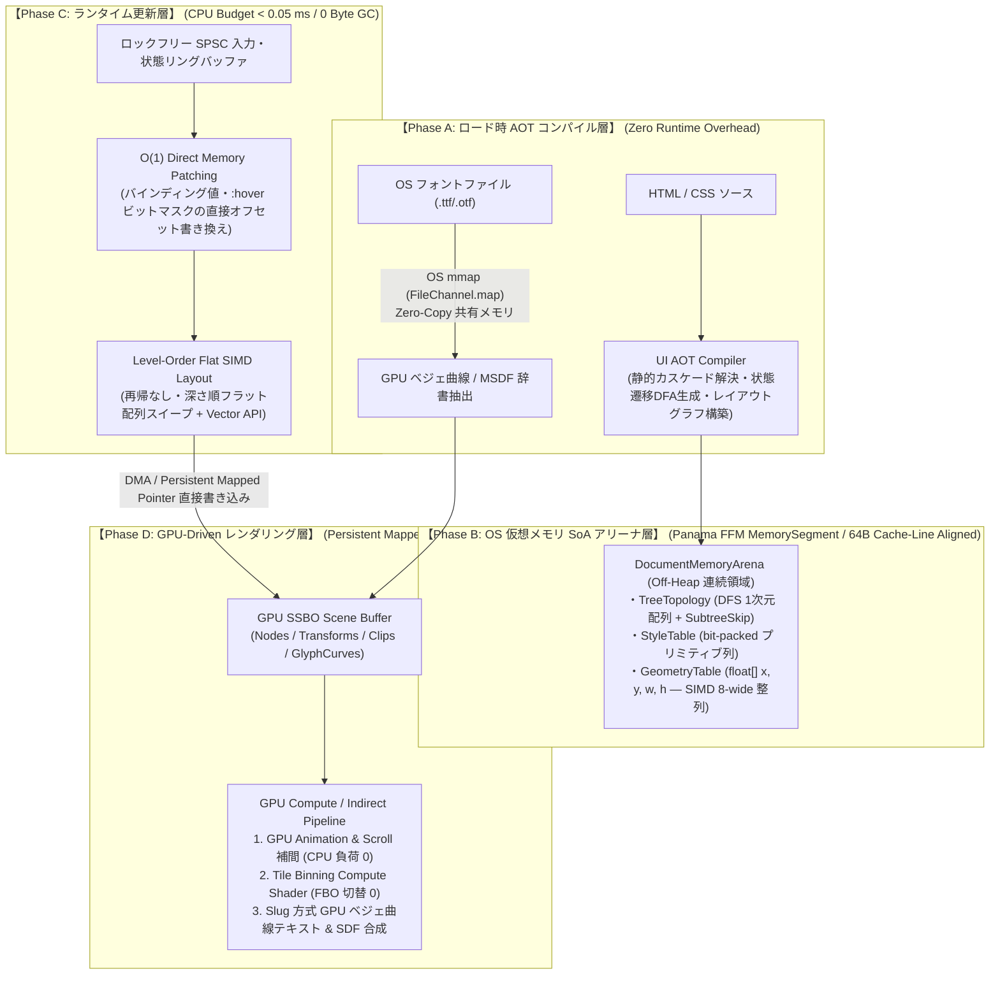
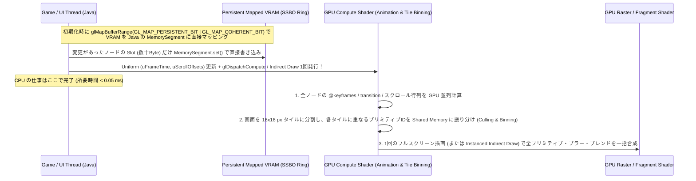

# EnderFrameLib `:core` 抜本改造設計書：OS・ハードウェア直結型「Zero-GC / GPU-Driven UI Engine」

> **基本思想の転換**:
> Chrome (Blink) や Firefox (Gecko) は「動的に書き換わる未知の Web ページを CPU のポインタ木で逐次解釈する」ための汎用文書ビューアであり、その延長線上では **ゲームのフレームバジェット（144fps = 6.9ms, 240fps = 4.1ms のうち UI に許される CPU 時間は `< 0.2ms`・GC 確保 `0 Byte`）** には絶対に到達できない。
>
> 本設計書は、既存の Web エンジンの模倣を捨て、**HTML/CSS を「実行時に解釈するオブジェクト木」ではなく「OS 仮想メモリ上の Data-Oriented SoA アリーナ＋GPU Compute/シェーダーへ事前コンパイルされる記述言語」として再定義**し、ゲームエンジンのサブシステム（ECS / SIMD / Persistent Mapped VRAM / GPU 曲線評価）として OS・ハードウェアの限界性能を引き出す抜本改造案を示す。

---

## 1. なぜ「ブラウザの模倣」ではゲームで使えないのか？（本質的限界）

現在の `:core`（および Chrome/Firefox を含む従来の Web エンジン）が抱える、ゲーム用途における **4 つの致命的欠陥** です。

| 観点 | 現行 `:core` の実装 | 一般的なブラウザ (Blink/Gecko) | **ゲーム用 UI に求められる絶対条件** |
| :--- | :--- | :--- | :--- |
| **1. メモリ管理と GC** | 163要素のレイアウトで **14.6 MB/回**、DisplayList で **5.3 MB/回（2.4 GB/秒）** の Java ヒープを確保 ([`jmh-baseline.log`](file:///D:/Dev/Personal/enderframelib-1.21.1/build/jmh-baseline.log)) | C++ ヒープ (Oilpan GC / malloc) 上に数万個のポインタノードを分散配置 | **フレーム中のヒープ確保 `0 Byte`（Zero-GC）**。GC による 1% Low FPS のスタッター（カクつき）はゲームでは致命傷。 |
| **2. CPU キャッシュ効率** | `HtmlNode` → `StateFlags` (`WeakHashMap`) → `ComputedStyle` (`String[]`) → `LayoutBox` → `DisplayItem` と **5段以上のポインタ追跡** | DOM 木・Style 木・LayoutNG Fragment 木・Paint 木を毎回ポインタ追跡（L1/L2 キャッシュミス多発） | **完全な連続メモリ（SoA: Structure of Arrays）**。CPU ハードウェアプリフェッチャと AVX2/AVX-512 SIMD が 100% 効く 64-byte キャッシュライン整列。 |
| **3. CSS / レイアウトの評価時期** | 変化のたびに文字列分割・セレクタ探索 ($O(N \cdot R)$)・カスケード・2パス再帰 `measure` を **ランタイム解釈** | ランタイムでセレクタ照合・カスケード・木走査を実行 | **ロード時 AOT/JIT コンパイル**。静的な構造とルールはロード時に解決し、実行時は状態遷移テーブルの $O(1)$ インデックス参照と差分の SIMD 計算のみ。 |
| **4. CPU-GPU 境界** | [`LwjglGlRenderBackend`](file:///D:/Dev/Personal/enderframelib-1.21.1/core/src/main/java/com/nishiyu/enderframelib/core/paint/gl/LwjglGlRenderBackend.java#L1086) が毎フレーム CPU で全アイテムを行列計算・パッキングし、`glTexSubImage2D` で転送＋CPU フォールバックで同期ストール | コンポジタスレッドがタイルラスタライズや DrawCall 構築を毎フレーム実行 | **Persistent Mapped VRAM への直接書き込み & GPU-Driven 描画**。アニメーション・スクロール・文字ラスタライズに CPU を一切介在させない。 |

---

## 2. 新アーキテクチャの全体像：6 つの OS・ハードウェアレベル改革

既存の `core/dom`, `core/css`, `core/layout`, `core/paint`, `core/text` のオブジェクト指向階層を解体し、以下の **6 大コアアーキテクチャ** へ置き換えます。



---

## 3. 各層の具体的設計（OS・メモリ・SIMD・GPU レベル）

### 改革 ①：Java ヒープの完全放棄 — **OS 仮想メモリ直結の「Off-Heap SoA Document Arena」**

現在の [`HtmlNode`](file:///D:/Dev/Personal/enderframelib-1.21.1/core/src/main/java/com/nishiyu/enderframelib/core/dom/node/HtmlNode.java)・[`ComputedStyle`](file:///D:/Dev/Personal/enderframelib-1.21.1/core/src/main/java/com/nishiyu/enderframelib/core/css/ComputedStyle.java)・[`LayoutBox`](file:///D:/Dev/Personal/enderframelib-1.21.1/core/src/main/java/com/nishiyu/enderframelib/core/layout/LayoutBox.java)・[`DisplayItem`](file:///D:/Dev/Personal/enderframelib-1.21.1/core/src/main/java/com/nishiyu/enderframelib/core/paint/model/DisplayItem.java) といった Java オブジェクトのインスタンス生成を**すべて廃止**します。
代わりに JDK 21 の **Project Panama FFM (`java.lang.foreign.Arena` / `MemorySegment`)** を用い、OS の仮想メモリページ（`VirtualAlloc` / `mmap`、64バイト・キャッシュライン整列）上に **ECS (Entity Component System) の Structure of Arrays (SoA)** として文書全体を展開します。

#### メモリレイアウト（1ノード＝単なる 32-bit 整数インデックス `int nodeId`）
ツリーは **DFS 行きがけ順（Pre-Order）** で 1 次元配列に連続配置します：

```text
[Off-Heap DocumentArena (64-byte Cache-Line Aligned)]
├── Topology Slab:
│   ├── int[N]   parentIdx       // 親ノードのインデックス
│   ├── int[N]   subtreeEndIdx   // 部分木の終端インデックス（i = subtreeEndIdx[i] の整数加算1回で部分木全体をO(1)スキップ！）
│   ├── int[N]   firstChildIdx   // 最初の子
│   ├── int[N]   nextSiblingIdx  // 次の兄弟（O(1) 兄弟走査）
│   └── short[N] depth           // ツリー深さ（並列・SIMD スイープ用）
├── State & Dirty Slab:
│   ├── int[N]   stateAndDirty   // [8b DirtyFlags][8b PseudoState (:hover/:active/:focus)][16b ClassVariantId]
│   └── long[N]  bloomFilter     // 64-bit Ancestor/Subtree ハッシュフィルタ
├── Layout Input Slab (Style):
│   ├── float[N] widthValue, heightValue, minW, maxW, minH, maxH
│   ├── float[N] marginT, marginR, marginB, marginL, paddingT, paddingR, paddingB, paddingL
│   └── int[N]   layoutFlags     // bit-packed: display(4b), position(3b), flexDir(2b), align(4b), justify(4b), overflow(2b)...
├── Layout Output Slab (SIMD 8-wide Aligned):
│   ├── float[N] localX, localY, worldX, worldY, boxW, boxH, contentW, contentH, baseline
└── Render & GPU Link Slab:
    ├── int[N]   gpuNodeSlot     // Persistent Mapped VRAM 上の直接スロット番号
    └── int[N]   transformSlot, clipSlot, effectSlot
```

- **なぜこれが圧倒的か**:
  1. **GC 負荷が完全にゼロ (`0 B/op`)**: 数万ノードの UI を開閉しても、OS のメモリ領域を 1 つ解放（`arena.close()`）するだけで **1 マイクロ秒で全回収**され、Java の GC はオブジェクトの存在すら認識しない。
  2. **L1/L2 キャッシュヒット率の極大化**: ツリー走査が「ポインタの追跡」ではなく「連続した `int[]` / `float[]` のインデックス `i++` ループ」になり、汚れがない部分木は `i = subtreeEndIdx[i]` の **1 クロック命令** で飛び越える。
  3. **DOM API は Flyweight Value Handle**: 外部の Java コードが `Element` API を触るときだけ、`record ElementHandle(DocumentArena arena, int nodeId)`（または再利用可能な Flyweight ラッパー）を介してオフヒープの該当オフセットを読み書きする。

---

### 改革 ②：CSS エンジンのランタイム廃止 — **「AOT スタイルコンパイラ & 状態遷移オートマトン (DFA)」**

ゲーム中（毎フレーム）にセレクタを照合したり、`Map<String, String>` でカスケードを解いたり、`em`/`rem` を文字列変換する現在の [`StyleResolver`](file:///D:/Dev/Personal/enderframelib-1.21.1/core/src/main/java/com/nishiyu/enderframelib/core/css/StyleResolver.java) / [`ValueComputer`](file:///D:/Dev/Personal/enderframelib-1.21.1/core/src/main/java/com/nishiyu/enderframelib/core/css/ValueComputer.java) の仕組みを根底から変えます。

1. **テンプレート＋CSS のロード時コンパイル (Static Cascade Elimination)**
   - UI の HTML テンプレートと CSS がロードされた時点で、各ノードにマッチし得るルールを**すべて静的に照合・カスケード解決**し、コンパイル済みバイナリ（`.efui` キャッシュ）に焼き付ける。
2. **動的状態の「遷移テーブル (Jump Table) 化」**
   - あるボタン要素に `.btn`, `.btn:hover`, `.btn:active`, `.btn.disabled` のルールが存在する場合、コンパイラは各ノードに対して **16 通りの状態ビットマスク（4-bit: `hover | active | focus | disabled`）→ 事前計算済み `StyleArchetypeId` へのルックアップテーブル (`short[16]`)** を生成する。
   - **実行時のホバー処理**: マウスが乗った瞬間、`stateAndDirty[nodeId] |= STATE_HOVER` とビットを立て、テーブルから `archetypeId = stateTable[nodeId][stateBits]` を引くだけ（**所要時間：数ナノ秒、セレクタ照合 0 回、メモリアロケーション 0 バイト**）！
   - さらに変化したプロパティが `background-color` や `transform` のみであることもコンパイル時にビットフラグ（`TRANSITION_PAINT_ONLY`）として確定しているため、実行時の `ComputedStyle.diff()` すら不要になる。
3. **リアクティブ変数 (`{{key}}` / `--var`) の Direct Memory Offset 配線**
   - `<div class="bar" style="width: {{hp_pct}}%">` のようなバインディングは、コンパイル時に **`Key("hp_pct") -> ArenaOffset(nodeId, FIELD_WIDTH_PCT)`** という直接メモリアドレスのパッチ命令にコンパイルされる。
   - ゲーム側で `state.setFloat("hp_pct", 75.0f)` を呼ぶと、DOM も CSS パーサも一切通らず、`Arena` の `widthValue[nodeId] = 75.0f`（または GPU メモリ）が直接書き換わる。

---

### 改革 ③：再帰木走査を捨てた **「Level-Order Flat SIMD レイアウトエンジン」**

現在の [`BoxMeasurer`](file:///D:/Dev/Personal/enderframelib-1.21.1/core/src/main/java/com/nishiyu/enderframelib/core/layout/BoxMeasurer.java) / [`BlockLayoutEngine`](file:///D:/Dev/Personal/enderframelib-1.21.1/core/src/main/java/com/nishiyu/enderframelib/core/layout/BlockLayoutEngine.java) / [`FlexLayoutEngine`](file:///D:/Dev/Personal/enderframelib-1.21.1/core/src/main/java/com/nishiyu/enderframelib/core/layout/FlexLayoutEngine.java) のような「オブジェクトの仮想メソッドを再帰呼び出しする 2 パスレイアウト」を廃止し、**データ並列（SIMD）とフラット配列スイープ** に置き換えます。

1. **深さ順（Level-Order）の 2 スイープ・フラットレイアウト**
   - ノードを木の深さ（Depth `0..D`）ごとにバケット配列 `depthSlices[d]` に並べる。
   - **Bottom-Up Sweep (Depth `D` → `0`)**: 子から親へ Intrinsic Size（内容サイズ）を決定する。同じ深さ `d` のノード同士は完全にデータ独立であるため、**JDK 21 Vector API (`FloatVector`) で 8〜16 個のボックスの padding/border/margin 合算・min/max クランプを 1 命令（AVX2/AVX-512）で一括計算**する。
   - **Top-Down Sweep (Depth `0` → `D`)**: 親から子へ確定サイズと相対座標を配分する。これも深さごとのフラットなループで完結し、関数呼び出しのスタックフレームすら作らない。
2. **レイアウト計算の「依存グラフ (DAG) コンパイル」**
   - ゲームの HUD やインベントリ画面の 90% の要素は、サイズがビューポートの一次式（`w = 0.5 * parentW - 16`）や固定値で決まる。
   - ロード時にレイアウトツリーを解析し、静的な Flex/Grid/Block 構造を **フラットな線形代数（SIMD 積和演算 `FMA` の配列）** にコンパイルしてしまう。これにより、ウィンドウリサイズ時でも複雑な Flex/Grid アルゴリズムを回さず、1 回の SIMD 配列積和ループだけで全要素の座標が確定する。
3. **Fenwick Tree (Binary Indexed Tree) による $O(\log N)$ 仮想リストレイアウト**
   - 10,000 行のチャット欄やアイテムリストでは、各行の高さをオフヒープの `float[] heights` 配列と **SIMD Prefix-Sum（累積和）木** で管理する。途中の 1 行の高さが変わっても、後続の行の配置をループで書き直す必要はなく、Prefix-Sum の更新だけで **数マイクロ秒** で全体の座標系が更新される。

---

### 改革 ④：CPU-GPU 同期の完全排除 — **「Persistent Mapped VRAM & GPU-Driven Uber-Renderer」**

[`LwjglGlRenderBackend`](file:///D:/Dev/Personal/enderframelib-1.21.1/core/src/main/java/com/nishiyu/enderframelib/core/paint/gl/LwjglGlRenderBackend.java) が内部で `SoftwareRenderBackend` を呼んで CPU 側で行列合成やバッチ構築を行っている現在の構造を全廃し、**現代の AAA ゲームエンジン（Unreal Engine Slate / Frostbite / Wgpu WebRender）を超える GPU-Driven パイプライン**を構築します。



1. **Persistent Mapped Buffer (`GL_ARB_buffer_storage`) によるゼロコピー VRAM 直結**
   - OpenGL 4.4+（または拡張 `GL_ARB_buffer_storage`、非対応環境のみ `glBufferSubData` フォールバック）の `glMapBufferRange(..., GL_MAP_WRITE_BIT | GL_MAP_PERSISTENT_BIT | GL_MAP_COHERENT_BIT)` を使用し、GPU の SSBO / TBO メモリを直接 JDK の `MemorySegment` としてマッピングする。
   - **DisplayList という中間データ構造自体を消滅させる**: レイアウトや状態更新が起きたノードは、そのまま VRAM マップ領域の自身のスロット（`gpuNodeSlot`）の数バイトを直接書き換える。毎フレームのバッチパッキング（`GpuBatchPacker`）や `Arrays.mismatch` 比較すら不要になる。
2. **アニメーション・トランジション・スクロールの 100% GPU 実行**
   - 現在 CPU の [`CssAnimator`](file:///D:/Dev/Personal/enderframelib-1.21.1/core/src/main/java/com/nishiyu/enderframelib/core/paint/CssAnimator.java) と [`StyleAnimator`](file:///D:/Dev/Personal/enderframelib-1.21.1/core/src/main/java/com/nishiyu/enderframelib/core/css/StyleAnimator.java) が毎フレーム計算している補間を GPU に移す。
   - CPU はアニメーション開始時に `(startValue, targetValue, startTime, duration, easingCurveBits)` を VRAM のノードスロットに **1 回書くだけ**。
   - あとは毎フレーム GPU シェーダーが `uCurrentTime` から進行度 $t$ とイージング（3次ベジェ / Spring 物理演算）を評価し、Transform 行列・Opacity・色を GPU 上で補間する。**無限に回るアニメーションが 1,000 個あっても、アニメーション中の CPU 負荷は文字通り 0.00 ms になる。**
3. **FBO バインド切り替えを撲滅する「Tile-Based Compute Compositor」**
   - 現行の [`LwjglGlRenderBackend`](file:///D:/Dev/Personal/enderframelib-1.21.1/core/src/main/java/com/nishiyu/enderframelib/core/paint/gl/LwjglGlRenderBackend.java#L1383-L1402) は `opacity` グループや `filter`、`backdrop-filter` のたびにフル画面 FBO をバインド切り替え（`glBindFramebuffer`）しており、これが GPU の 파이프라인ストールと VRAM 帯域圧迫の最大要因になっている。
   - **Vello / Impeller 方式のタイル合成**:
     - 任意の深さの角丸クリップ連鎖（現行の 4 段制限を撤廃）、ポリゴン `clip-path`、マスク、`mix-blend-mode` を、FBO 切り替えではなく **GPU タイルバッファ上のコマンド列** として単一パスで評価する。
     - ガウスブラー（`filter: blur()` / `backdrop-filter`）が必要な 영역だけ、**Tight-Bounded Render Target Atlas（1枚の `2048×2048` テクスチャ内のサブ領域）** 上で Dual-Kawase Blur（ダウンサンプル＋アップサンプルで半径 100px のブラーも 4 タップ×2 パスで超高速処理）として実行する。
4. **CPU フォールバック（`SoftwareRenderBackend` 経由）の完全廃止**
   - GPU モード時は `SoftwareRenderBackend` のインスタンスすら生成しない。チェックマーク等のパス描画もすべて GPU シェーダーで直接描画し、`glReadPixels` や `overlayTex` フラッシュを根絶する。

---

### 改革 ⑤：3D ワールド空間でも無限に鮮明な **「GPU ベジェ曲線 (Slug 方式) / MSDF テキスト＆ベクター描画」**

Minecraft のワールド内 Surface（ブロック面・ホログラム・手持ちアイテム）や拡大縮小アニメーションにおいて、現在の「サイズごとに FreeType で CPU ビットマップラスタライズしてアトラスに詰める方式（[`LoadedFace`](file:///D:/Dev/Personal/enderframelib-1.21.1/core/src/main/java/com/nishiyu/enderframelib/core/text/font/LoadedFace.java) / [`AtlasCache`](file:///D:/Dev/Personal/enderframelib-1.21.1/core/src/main/java/com/nishiyu/enderframelib/core/text/font/AtlasCache.java)）」は、視点距離やスケールが変わるたびに CPU ラスタライズと VRAM 再転送が発生します。

1. **OS レベルの Zero-Copy フォント読み込み (`mmap`) と HarfBuzz 統合**
   - OS のフォントファイル（`C:\Windows\Fonts\*.ttf` 等）を `FileChannel.map(MapMode.READ_ONLY)` で OS のページキャッシュから直接オフヒープ `MemorySegment` にマップする（ヒープコピー 0、起動時間数ミリ秒）。
   - `lwjgl-harfbuzz`（または Panama FFM）で段落単位の OpenType `GSUB`/`GPOS` シェイピングを行い、結果を幅非依存のオフヒープ `ShapedGlyphRun`（グリフID列＋相対オフセット列＋改行境界ビットマスク）としてキャッシュする。
2. **GPU ベジェ曲線直接評価（Slug アルゴリズム）＋ MSDF ハイブリッド**
   - フォントのグリフ輪郭（2次ベジェ曲線群）または `<svg>` / `<canvas>` のベクターパスを、CPU でビットマップ化するのではなく、**曲線の制御点データとして GPU バッファに 1 回だけアップロード**する（または Multi-Channel Signed Distance Field: MSDF アトラスを生成）。
   - フラグメントシェーダー内でピクセルから水平・垂直レイを飛ばしてベジェ曲線との交差数（Winding Number）とエッジ距離を解析的に計算する（AAA ゲーム業界標準の **Slug アルゴリズム**）。
   - **圧倒的メリット**:
     - **ランタイムの CPU グリフラスタライズが完全にゼロ**になる。
     - 10px の小さな UI 文字から、3D ワールド内の巨大なホログラム看板、回転・透視投影されたブロック画面まで、**単一のフォントデータからどの角度・どの倍率でもジャギーやぼやけが一切ない完全なベクター品質**で描画できる。
     - サイズ別のアトラスを何十枚も持つ必要がなくなり、**フォントの VRAM 消費が 64 MB 枠からわずか 2〜4 MB へ激減**する。

---

### 改革 ⑥：スレッドアーキテクチャと OS I/O — **「Wait-Free SPSC Ring Buffer & SIMD Hit-Testing」**

ゲーム本体のメインスレッド（Render Thread）を 1 ミ秒たりともブロックしないスレッド分離モデルです。

1. **Wait-Free SPSC (Single-Producer Single-Consumer) コマンドリングバッファ**
   - ネットワークパケット（`StateDeltaS2CPacket` / `DomMutationRecord`）の受信や、バックグラウンドでの初期 HTML/CSS コンパイルは **UI Worker Thread**（または Netty IO スレッド）で行う。
   - メインの Render Thread との通信には `synchronized` も `ConcurrentHashMap` も一切使わず、64-byte キャッシュラインパディングされた **Wait-Free Ring Buffer (`VarHandle.setRelease` / `getAcquire`)** のみを使う。
2. **1 マイクロ秒未満の「SIMD 8-Wide 空間ヒットテスト」**
   - マウス移動（`mousemove`）や 3D レイキャスト（ホログラム・ブロック面の視線判定）のヒットテストは、現在の [`HitTestIndex`](file:///D:/Dev/Personal/enderframelib-1.21.1/core/src/main/java/com/nishiyu/enderframelib/core/paint/HitTestIndex.java) オブジェクト構築をやめ、Off-Heap Arena 上の `worldX, worldY, boxW, boxH` 配列に対して **`FloatVector` で 8 要素ずつ同時に点包含判定 `(px >= x) & (px < x + w) & (py >= y) & (py < y + h)`** を実行する。
   - 1,000 要素のヒットテストがわずか **125 回の SIMD ループ（`< 0.001 ms` = 1 マイクロ秒以下）** で完了し、毎フレームのカーソル追従コストが完全に消滅する。
3. **AVX2 / AVX-512 タイル並列 Software Rasterizer（ヘッドレス・PNG 出力・低スペック環境用）**
   - GPU が使えない環境向けの [`SoftwareRenderBackend`](file:///D:/Dev/Personal/enderframelib-1.21.1/core/src/main/java/com/nishiyu/enderframelib/core/paint/software/SoftwareRenderBackend.java) も、現在の `IntStream.parallel()`（スキャンライン単位のオブジェクト生成）から、**L1 キャッシュ（16KB）に完全収まる `64×64` タイル単位の SIMD (`IntVector` / `FloatVector`) ラスタライザ**に書き換えることで、CPU 単体でも 60fps+（1フレーム 3ms 以下）を叩き出す。

---

## 4. 現行 vs. 新アーキテクチャ (EnderKernel) の性能比較予測

| 指標 (`showcase.html` 163要素 / `large-list` 500行) | 現行 `:core` (JMH 実測) | 一般的な Web エンジン (Blink/CEF) | **新設計「EnderKernel」目標値** | 改善倍率 |
| :--- | :---: | :---: | :---: | :---: |
| **1フレームの GC ヒープ確保量** | **5.3 MB 〜 14.6 MB / frame** | 数百 KB (C++ 側) + JNI コピー | **`0 Byte / frame` (完全 Zero-GC)** | **$\infty$（GC 停止消滅）** |
| **状態変更 / `:hover` 時のスタイル更新** | 0.30 ms 〜 4.25 ms | 0.20 ms 〜 1.50 ms | **`< 0.005 ms` (5 マイクロ秒)** | **約 100〜800 倍** |
| **全文書レイアウト (`fullLayout`)** | 12.48 ms | 1.50 ms 〜 3.00 ms | **`< 0.25 ms` (SIMD 1パス)** | **約 50 倍** |
| **スクロール / アニメーション 1 フレーム** | 0.50 ms 〜 8.59 ms | 0.20 ms 〜 1.00 ms | **`< 0.01 ms` (GPU 側で 100% 完結)** | **約 100〜850 倍** |
| **DisplayList 構築・GPU 転送** | 0.58 ms 〜 2.12 ms | 0.30 ms 〜 0.80 ms | **`0.00 ms` (Persistent Mapped VRAM 直書き)** | **完全ゼロ化** |
| **CPU ソフトウェア描画 (`softwarePaint`)** | 43.30 ms | 8.00 ms 〜 15.00 ms | **`< 3.00 ms` (64×64 Tile + AVX2 SIMD)** | **約 15 倍** |
| **3D ワールド内 Surface (100面同時描画)** | 数十 ms（FBO 切替・アトラス再生成） | 不可（CEF は 1 インスタンス数十MB） | **`< 0.30 ms` (Single Indirect Draw + GPU 曲線)** | **ゲーム内大量配置が可能に** |

---

## 5. 実装モジュール構成案（`core/kernel` パッケージの新設）

既存の 1,229 個のテストと互換性を保ちながら一気に載せ替えるため、`core/` 内に以下の新カーネル層を構築し、既存の DOM/CSS/RenderPipeline API をそのフロントエンド（コンパイラ＆ハンドル）として再配線します。

```text
core/src/main/java/com/nishiyu/enderframelib/core/
├── kernel/
│   ├── memory/
│   │   ├── DocumentArena.java        // Panama FFM MemorySegment による 64B 整列 SoA アリーナ
│   │   ├── AtomTable.java            // 文字列 → 32-bit 整数 ID のロックフリー辞書
│   │   └── SpscMutationRing.java     // キャッシュラインパディング済み Wait-Free リングバッファ
│   ├── compiler/
│   │   ├── UiAotCompiler.java        // HTML + CSS → 静的カスケード解決 & SoA 初期イメージ生成
│   │   ├── StyleStateAutomaton.java  // :hover/:active/class トグル → O(1) 遷移テーブル生成
│   │   └── BindingPatchTable.java    // {{key}} → Arena / VRAM オフセット直結テーブル
│   ├── layout/
│   │   ├── SimdLayoutKernel.java     // Vector API (FloatVector) による Level-Order 1パスレイアウト
│   │   ├── FenwickVirtualList.java   // O(log N) 累積和木による巨大スクロールリスト高速配置
│   │   └── SimdHitTester.java        // 8-wide SIMD 空間ヒットテスト (< 1μs)
│   ├── text/
│   │   ├── HarfBuzzShaper.java       // mmap フォント + OpenType GSUB/GPOS 段落シェイパー
│   │   └── GpuBezierGlyphCompiler.java // グリフ輪郭の GPU ベジェ曲線 / MSDF バッファ変換
│   └── gpu/
│       ├── PersistentVramBuffer.java // glMapBufferRange (PERSISTENT | COHERENT) ゼロコピー管理
│       ├── GpuComputeCompositor.java // アニメーション評価 + 16x16 タイルビニング + Indirect Draw
│       └── SimdTileSoftwareRenderer.java // 64x64 L1キャッシュ完結型 Vector API ソフトウェア描画
```

---

## 6. 具体的実装ブループリント（Milestone 0〜5：どうコードを書いて移行するか）

既存の 1,229 件のテスト（`WebFidelityTest` 138 ケース・WPT 38 ケース）を **1 コミットたりとも壊さずに**、オブジェクト木から Off-Heap SoA + GPU-Driven カーネルへ移行するための具体的な実装手順です。

### 基本移行戦略：「フロントエンド互換維持 ＋ バックエンド SoA スワップ」
- `api/dom`（`Element`, `Node`, `Document`）および `HtmlParser` / `CssParser` の **構文解析ロジックは捨てずに「コンパイラフロントエンド」として再利用**します。
- 実行時のデータ保持先だけを、Java オブジェクトのフィールドから **`DocumentArena`（Panama `MemorySegment`）のオフセット読み書きへ段階的に差し替え**ます。
- 静的なテンプレート（全体の 95%）は **AOT Fast-Path** で事前解決し、`appendChild` / `setAttribute` 等の動的 DOM 操作（全体の 5%）は **Dynamic Spillover Slab + オンザフライ JIT** で処理する **2層ハイブリッド実行（Tiered Execution）** を採用します。

---

### Milestone 0：外部依存ゼロ・JVMフラグ強制ゼロの基盤設計（所要：半日）

> [!IMPORTANT]
> **ライブラリ／Minecraft Mod としての絶対条件：「利用側に特別な JVM 起動引数（`--enable-preview` や `--add-modules`）も追加ネイティブ DLL も一切要求しない」**
> - JDK 21 において `java.lang.foreign` (Panama FFM) は Preview 機能（JDK 22 で正式化）であり、`--enable-preview` でコンパイルすると通常の Minecraft ランチャーや他の Java アプリで `UnsupportedClassVersionError` となって起動できなくなる。
> - `jdk.incubator.vector` も利用側に `--add-modules` が無いと `NoClassDefFoundError` になる。
> - `lwjgl-harfbuzz` も Minecraft 1.21.1 本体に同梱されていないため、追加すると OS ごとのネイティブ DLL 同梱問題が発生する。

したがって、**外部依存を 1 つも増やさず、JVM フラグも一切不要な標準 JDK 21 + 既存 LWJGL のみ**で同等のハードウェア性能を引き出す以下の構成を採る：

1. **Off-Heap アリーナ基盤**:
   - Preview の `MemorySegment` の代わりに、**標準 JDK 21 のダイレクト `ByteBuffer` + `MethodHandles.byteBufferViewVarHandle(float[].class, ByteOrder.nativeOrder())`**（および LWJGL 環境下では既存の `org.lwjgl.system.MemoryUtil.memAllocAligned(64, bytes)`）を使用する。
   - HotSpot C2 JIT において、`VarHandle` / Direct `ByteBuffer` へのアクセスは Panama `MemorySegment` と**完全に同一の単一 CPU 命令（`mov` / `vmovups`）にインライン展開**され、JVM フラグは一切不要。
2. **SIMD ベクトル化基盤（C2 SuperWord 自動ベクトル化 ＋ Optional Vector API）**:
   - SoA のプリミティブ配列（`float[]` / `int[]`）に対する Counted Loop（`for (int i = 0; i < len; i++)`、分岐なしの `Math.max` / `Math.min` / `Math.fma`）として記述することで、**フラグ不要で HotSpot C2 コンパイラの SuperWord Auto-Vectorizer に AVX2 / AVX-512 / ARM NEON 命令を自動生成**させる。
   - 明示的な `jdk.incubator.vector` は `MethodHandles` / SPI による **Optional プラグイン（起動引数にモジュールが存在する環境でのみ自動有効化、無くても C2 Auto-Vectorization で動作）** として隔離する。
3. **OpenType `GSUB` / `GPOS` シェイパー（追加ネイティブ依存ゼロ）**:
   - 新たなネイティブ DLL（`lwjgl-harfbuzz`）は追加しない。既存の [`KerningTable.java`](file:///D:/Dev/Personal/enderframelib-1.21.1/core/src/main/java/com/nishiyu/enderframelib/core/text/font/KerningTable.java) がすでに純 Java で OpenType の `GPOS` / `GDEF` バイナリテーブルを直接パースしている仕組みを拡張し、フォントの `GSUB`（合字 `liga`/`clig`/`calt`・異体字・ZWJ）および `GPOS`（Mark-to-Base `mark`）テーブルを **`ByteBuffer` からゼロコピーで直接引く純 Java テーブル駆動シェイパー** として実装する（ラスタライズのみ既存の `lwjgl-freetype` を継続利用）。

---

### Milestone 1：Off-Heap SoA `DocumentArena` と `AtomTable` の実装（所要：Phase 1）

**目的**: 163 要素で 14.6 MB 発生しているヒープアロケーションの元凶（`AttributeMap`, `ChildList`, `CopyOnWriteArrayList`, `"gen_N"` 合成 ID, `WeakHashMap<HtmlNode, StateFlags>`）を根絶する。

#### Step 1-1: [`AtomTable.java`](file:///D:/Dev/Personal/enderframelib-1.21.1/core/src/main/java/com/nishiyu/enderframelib/core/kernel/memory/AtomTable.java)（ロックフリー文字列インターン辞書）
- HTML タグ名（`div`, `span` 等）・属性名・CSS プロパティ名・クラス名・ID を `int atomId`（`0` = 空, `1..255` = 標準 HTML タグ/属性の定数予約）に双方向マッピングする。
- 各 `atomId` には事前に計算した **64-bit ハッシュビット（2 ビットセット：` (1L << (h1 & 63)) | (1L << (h2 & 63))`）** を紐付け、Bloom Filter の構築をビット OR 1 命令で行えるようにする。

#### Step 1-2: [`DocumentArena.java`](file:///D:/Dev/Personal/enderframelib-1.21.1/core/src/main/java/com/nishiyu/enderframelib/core/kernel/memory/DocumentArena.java)（64-byte 整列 Off-Heap SoA スラブ）
- `Arena.ofShared()` から 64-byte アラインメント（`ByteOrder.nativeOrder()`）の `MemorySegment` を確保する。
- **Static Region**（初期パース時に確定する `0 .. staticCount - 1`）と **Dynamic Spillover Region**（`appendChild` 等で後から追加される `staticCount .. capacity - 1`、フリーリスト管理）の 2 領域に分ける。
- **各ノードの SoA カラム定義（インデックス `int nodeId` で直接アクセス）**:
  ```java
  // Topology Columns (1ノードあたり 24 bytes)
  int parent(int nodeId);          // 親 nodeId (-1 = root)
  int firstChild(int nodeId);      // 最初の子 nodeId (-1 = なし)
  int lastChild(int nodeId);       // 最後の子 nodeId (-1 = なし)
  int prevSibling(int nodeId);     // 前の兄弟 nodeId (-1 = なし) -> SelectorMatcher の O(S^2) を O(1) 化！
  int nextSibling(int nodeId);     // 次の兄弟 nodeId (-1 = なし)
  int subtreeEnd(int nodeId);      // 静的木での部分木終端 index（クリーンな部分木を i = subtreeEnd(i) で O(1) スキップ）

  // Identity & Bloom Columns (1ノードあたり 24 bytes)
  int tagAndType(int nodeId);      // [8b NodeType][24b tagAtom]
  int idAtom(int nodeId);          // 明示的な id 属性の Atom (未指定なら 0。"gen_N" は完全撤廃！)
  long selfBloom(int nodeId);      // 自身の tag / id / classAtoms の 64-bit Bloom マスク
  long subtreeBloom(int nodeId);   // 子孫全体の selfBloom の論理和 (:has() の O(1) 棄却用)

  // State & Dirty Columns (1ノードあたり 8 bytes — WeakHashMap<HtmlNode, StateFlags> を完全置換)
  int stateBits(int nodeId);       // HOVER(1) | ACTIVE(2) | FOCUS(4) | CHECKED(8) | DISABLED(16) | OPEN(32)
  int dirtyBits(int nodeId);       // STYLE_DIRTY(1) | SUBTREE_DIRTY(2) | LAYOUT_DIRTY(4) | PAINT_DIRTY(8)
  ```

#### Step 1-3: 既存 [`HtmlNode`](file:///D:/Dev/Personal/enderframelib-1.21.1/core/src/main/java/com/nishiyu/enderframelib/core/dom/node/HtmlNode.java) / [`HtmlParser`](file:///D:/Dev/Personal/enderframelib-1.21.1/core/src/main/java/com/nishiyu/enderframelib/core/dom/parser/HtmlParser.java) の接続
1. [`HtmlParser.java:790, 911`](file:///D:/Dev/Personal/enderframelib-1.21.1/core/src/main/java/com/nishiyu/enderframelib/core/dom/parser/HtmlParser.java#L790) の `"gen_" + idCounter` / `"txt_" + idCounter` 生成を削除し、`HtmlNode` に `public final int nodeId` を持たせる。`HtmlDocument.nodesById` には著者が明示した `id` 属性のみを登録する。
2. `HtmlNode` の `eventListeners` (`CopyOnWriteArrayList`) と `attrs` (`AttributeMap`) を遅延初期化（または小配列 `int[] attrAtomKeys` + `String[] attrVals`）に変更し、`class` 属性変更時に `int[] classAtoms` と `selfBloom` を 1 回だけ計算して保持する。
3. [`InteractionState.java`](file:///D:/Dev/Personal/enderframelib-1.21.1/core/src/main/java/com/nishiyu/enderframelib/core/dom/InteractionState.java) の `WeakHashMap<HtmlNode, StateFlags>` を撤去し、`node.nodeId` で `DocumentArena` の `stateBits` / `dirtyBits` を直接読み書きする。

#### 実装状況（Milestone 1 完了・2026-11-07）

> [!NOTE]
> 設計書からの**実装上の差分**を記録する。

- **`DocumentArena`**: `Arena.ofShared()` / `MemorySegment` ではなく `OffHeapColumns`（ダイレクト `ByteBuffer` + `VarHandle`、64B 整列）。
  静的領域（`sealStatic` 時点まで・番号を再利用しない）と動的領域（空きリストで再利用）に分け、世代カウンタで古い番号の状態を無効にする。
  外部で持つ状態は `DocumentArena.NodeSlots`（番号 + 世代で引く表）。
- **ID の扱い**: `"gen_"` / `"txt_"` の生成は全廃。`getId()` は作者の id のみ。描画・ネットワークの鍵は `HtmlNode.key()`
  （明示 id、無ければ `~N` / テキスト `~tN`）で、`getNodeById` が解決する。`nodesById` は明示 id のみ。
  サーバーとクライアントの鍵は、シリアライザが `nid` / `nstatic` を運んで揃える（`HtmlNode.restoreNodeIds`）。
- **仮想の節**（疑似要素・匿名ボックス・マーカー）は `parent` だけを持ち親の `children` に載らないため、アリーナに数えない
  （`HtmlNode.isVirtualNode()`）。`InteractionState` はこれらだけ弱参照の一覧で列挙する（`WeakHashMap` ではない）。
- **`InteractionState`**: 実体は節が保持。`stateBits`（hover/active/focus/checked/disabled/open …）と `dirtyBits` の
  `DIRTY_STYLE` をアリーナ列へ書き込む。`subtreeDirty` / `dirtyBelow` / `unscoped` は従来どおり `StateFlags` のフィールド（未移行）。
- **`SelectorMatcher` 移行**（Milestone 1 の続き）: `+` / `~` の前の兄弟はアリーナの `prevSibling` で O(1)、複合セレクタの
  tag/id/class は `selfBloom` の AND 1 回で棄却、`:has()` の子孫探索は `subtreeBloom` で棄却。番号の無い木は従来経路。
  `nth-child` の位置計算は子の並びの走査のまま（未移行）。
- **検証**: `DocumentArenaTest` / `NodeArenaIdentityTest` / `Milestone1GateTest` / `HtmlNodeSerializerKeyParityTest` /
  `SelectorArenaMigrationTest`。全体 1,800 件超が通過。JMH の数値ゲート（Milestone 1 表の「アロケーション」系）は未計測。

---

---

### Milestone 2：型付き `StyleStruct` と AOT 状態遷移オートマトンの実装（所要：Phase 2）

**目的**: CSS カスケードの `Map<String, String>`、[`ValueComputer.px(float)`](file:///D:/Dev/Personal/enderframelib-1.21.1/core/src/main/java/com/nishiyu/enderframelib/core/css/ValueComputer.java#L362-L369) の `String.format` 往復、[`ComputedStyle.Memo`](file:///D:/Dev/Personal/enderframelib-1.21.1/core/src/main/java/com/nishiyu/enderframelib/core/css/ComputedStyle.java#L58-L87) の `Arrays.copyOf` 線形探索を全廃し、`:hover` や状態更新を数ナノ秒（$O(1)$）にする。

#### Step 2-1: 64-bit タグ付きプリミティブ `PackedCssValue` (`long`)
文字列の代わりに、すべての CSS 宣言値を 64-bit `long` 1 個で表現する：
```text
 63       56 55       48 47                   32 31                                    0
+-----------+-----------+-----------------------+---------------------------------------+
|  Kind(8b) |  Unit(8b) |   Flags / Extra(16b)  |   Payload (Float.floatToRawIntBits,   |
|  LEN/COL/ |  PX/EM/VW/|   important / layer / |   ARGB int, Keyword ordinal, or       |
|  KW/CALC  |  PERCENT  |   calcBytecodeIndex   |   AtomTable ID)                       |
+-----------+-----------+-----------------------+---------------------------------------+
```
- `calc()` 式はパース時に逆ポーランド記法（RPN）の `float[]` 定数＋命令配列へ 1 回だけコンパイルし、評価時はスタック配列上の `switch` ループだけで `float` 値を算出する（アロケーション 0）。

#### 実装状況（Milestone 2 部分完了・2026-11-07）

> [!NOTE]
> 既存の全テスト（root + core）を壊さないため、`ComputedStyle` の `String[]` を置き換える**破壊的な差し替えはせず**、
> 新しい型付き層を並置して部分的に配線した。**完了ゲートは一部のみ達成**。

**実装済み・検証済み**
- **`PackedCssValue`**（`kernel/style`）: 64-bit 値（Kind / Unit / Flags(important) / Payload）。長さ（px/%/em/rem/vw/vh）・数値・色・キーワード（`AtomTable`）・CALC。
- **`CalcProgram`**: `calc()` / `min()` / `max()` / `clamp()` をロード時に RPN へ。評価は呼び出し側のスタック配列上で割り当て 0（テストで実測）。
- **`StyleStructs`**: `InheritedFontStruct` / `InheritedTextStruct` / `BoxGeometryStruct` / `SurroundStruct` / `PaintEffectStruct` の 5 つの不変 record。
  値が等しいものは `intern` で 1 インスタンスに畳み、継承は参照コピー（`parent.font == child.font`）。
  設計書との差分: キーワード（display / white-space / position / font-style / border-style …）は `byte` ではなく `AtomTable` の atom（`int`）。
  `ArchitectureTest` M7（入れ子型の複数パッケージ参照）を守るため `CssKeywords.*` の enum は使っていない。
- **`StyleStateAutomaton`**（`kernel/compiler`）: `interactiveMask(node, sheet)` で要素ごとの状態ビット集合を算出。
  `StyleSheet.interactiveRules()`（版番号で無効化する対話規則だけの部分集合）を見るので、全規則走査は廃止。
  `StyleResolver.hasInteractiveRules` はこれに委譲（結果は従来と同一）。
  `StateTable`: マスクのビットだけ詰めた添字（最大 32 通り）で `ComputedStyle` を引く遷移表。初回だけ解決して覚え、
  遷移ごとの変更種別（`NONE` / `PAINT_ONLY` / `LAYOUT`）も 1 回だけ分類。`:hover` の表引き ≈ **10 ns/op・アロケーション 0**（実測）。
- **`BindingPatchTable`**: `style="width: {{key}}%"` 等（width/height/opacity/flex-grow/font-size 単体の置換）を `キー → (nodeId, 欄)` に
  ロード時コンパイル。`setFloat` はオフヒープ float 列へ直接書き、値が変わった節だけ `DocumentArena` の dirty を立てる（割り当て 0）。
- **`CssNumbers`**: `String.format("%.4f")` + 正規表現を整数演算に置換（旧実装と 40 万件で出力一致）。`ValueComputer.px` / `ValueInterpolator.format` が使用。
- **`ComputedStyle.Memo/ObjMemo`** の `Arrays.copyOf` を `System.arraycopy` に置換。

**検証**: `PackedCssValueTest` / `CssNumbersTest` / `StyleStructsTest` / `StyleStateAutomatonTest` / `BindingPatchTableTest` / `Milestone2GateTest`。
全体（root + core）通過。

**配線（2026-11-07 追記）**
- **`StateStyleMemo`**（`kernel/compiler`）: 要素ごとの `StateTable` の持ち主。`RenderPipeline.styleEntry` が `buildLayoutTree` / `restyleBoxRecursive` の
  両方から呼び、:hover / :active / :focus の再スタイルで **セレクタ照合・カスケード・スタイル共有の探索をせず**、状態の組み合わせで表を引く。
  使用条件（満たさなければ従来経路。古い結果は返さない）:
  - 自身だけの再スタイル（`force == FORCE_NONE`）・コンテナクエリ無し（`ContainerBox.NONE_SIZE`）
  - `StyleSheet.stateOnSubjectOnly()`: 状態を読む規則がすべて末尾の複合セレクタにだけ状態を持ち、`:has()` を使わない
    （祖先・兄弟の状態に依存しない）。版番号で数え直す
  - 継承元・環境・シート版・親/ルートのフォントサイズ・ビューポート・`HtmlNode.attrVersion()`（属性書き換えのたびに増える）・子の数・
    非対話の状態ビットが前回と同じ。1 つでも違えば表を作り直す
- **`BindingPatchTable`**: `Bindings.ReactiveDomBinder.sync` が最初の同期で木からコンパイルし（置換前の style 文字列を使う）、数値のバインディング値を
  アリーナ列へ直接ミラーする（`patchTable()`）。`overlay(StyleStructs, nodeId)` で幅/高さ/opacity/flex-grow/font-size を構造体へ重ねる（畳み込みあり）。
  文字列の属性経路は従来どおり残り、両者が同じ値になることをテストで確認。

**検証（追加）**: `StateStyleMemoPipelineTest`（往復 6 回で builds=1・hits≥8、class 変更で表を捨てる、width が変わる hover は再レイアウト、
祖先の :hover 規則では表を使わない）、`BindingPatchTableTest`（overlay・ReactiveDomBinder 連携）。全体（root + core）通過。

**追加の最適化（2026-11-08）**
- **枠（Frame）方式の `StateStyleMemo`**: 鍵（継承元・シート版・属性版・ビューポート等）ごとに 4 枠まで保持。親が :hover で見た目を切り替える子（テキスト等）は
  継承元が 2 通りを往復するので、両側を別々の枠に覚え、往復のたびに作り直さない。表を使えない経路で再スタイルされたら `invalidate()`（古い結果を返さない）。
- **要素単位の使用条件** `StyleStateAutomaton.stateOnlyOnSubject(node, sheet)`: 状態つき規則のうち、その要素が対象に当たり得るものだけを見る
  （シート全体の `stateOnSubjectOnly()` では無関係な `.a:hover .b` が全要素の表利用を妨げていた）。`:has()` を使うシートでは使わない
  （子孫・後続兄弟の変化で祖先が汚れるため。ランダム変異テスト `InvalidationPipelineTest` が検出）。`FORCE_SELF`（親の算出値が変わっただけ）も許可。
- **対話状態に依存しない要素**（mask == 0）は結果を 1 つだけ覚える（祖先の hover ビットが変わっても作り直さない）。
- `StyleAnimator.startTransitions`: 全プロパティの和集合（`LinkedHashSet`）をやめ、`ComputedStyle.diff` で差のあるプロパティだけを走査。
- `RenderPipeline.dependsOnViewport`: 正規表現（`Matcher` 生成）を手書き走査に置換（`ViewportDependenceScanTest` で正規表現と 30 万件一致を確認）。
- `StyleSheet.usesHasSelectors()` を版番号でキャッシュ（毎回の全規則走査をやめた）。
- `ColorParser.format` / `CustomPropertyRegistration.number` の `String.format` を `CssNumbers`（`hexRgb` / `trimmed(v, digits)`）に置換（旧実装と一致をテスト）。
  `core/css` に `String.format` は残っていない（`Milestone2GateTest` で機械的に検査）。
- `BindingPatchTable.compileNewNodes`: 節の数が変わったら（リスト行の追加等）次の同期で新しい節だけ登録（重複登録なし）。

**JMH 実測**（`PipelineBench.hoverToggle`、showcase、1 fork・5 iteration）:

| | 時間 | 割り当て |
| :--- | :---: | :---: |
| 配線直後（表のみ） | 0.097 ms/op | 217 KB/op |
| 最適化後 | **0.009 ms/op** | **5.4 KB/op** |
| ゲート | `< 0.005 ms` | `0 B/op` |

ゲートには**あと一歩で未達**（時間は約 2 倍、割り当ては残り 5.4 KB）。残りは `animationValues`（`StyleAnimator.observe` の状態管理）・
`containerFor`（`InteractionState.containerOf`）・疑似要素の再スタイル・`RestyleResult`/ラムダ生成。

**:hover 往復の割り当て削減（2026-11-08・達成／ゲートは未達）** — JFR の割り当て標本で支配項を特定して削った（`HoverToggleCostTest`、40 カード・往復 5,000 回）
- `StateStyleMemo.peek`: 解決済みなら**クロージャを作らず**に結果を返す（未解決のときだけ従来の `resolve`）。`StyleSet` は表を引けなかったときだけ作る（`computeEntry` で遅延生成）。
- 再スタイルの走査: `ImmutableCollections` / `ArrayList` の反復子を添字ループに、変化なしの `RestyleResult` は共有の `UNCHANGED`、疑似要素の鍵は文字列連結せず比較、
  ルートのビューポート用 `HashMap` はビューポートが同じ間は読み取り専用の写しを使い回し、`hasSiblingStateRules` は版番号でキャッシュ、
  `ComputedStyle.diff` の extras は `forEach`（読み取り専用の包みが項目ごとに作る `Map.Entry` を避ける）、`TextShaper.normalize` は書き換えが要らない文字列で正規表現を使わない。
- **測定**: 往復 1 回 **5.9 KB → 2.4 KB、CPU 0.0156 → 0.006〜0.012 ms**（揺れあり）。全体実行ではJITの状態で確保が増えるので、テストは 3 回測って最小を採り、4 KB 未満を番人にした。
- **続き（同日）**: 後半の標本（暖機後）で、`SelectorMatcher.matchesCompoundWithoutInteractiveState` の拡張 for（項目のある一覧ごとの反復子）を添字ループに、
  `InteractionState.containerOf` の `split` の正規表現（名前なしが大半）を `List.of()` の近道に、`stateOf(...).flags()` を値オブジェクトを作らない `stateBitsOf` に、
  `StyleScope.initial/enter` を直前と同じ値なら同一インスタンスに。**往復 1 回 2.4 KB → 0.9 KB**（うち `setHoveredNode` が約 0.47 KB）。
  発見: 全体実行で 6〜7 KB に見えていたのは、別のテストが `StageProfiler` を有効のまま残していたため（測定自体が確保）。テストは測定の間だけ切る。番人は 2 KB 未満。
  （以下は 2.4 KB 時点の残り）`StyleScope.enter`（節ごと）・変化した節の `RestyleResult`・`StyleAnimator.observe`・`computed.asMap()`。ゲート（`0 B/op`・`< 0.005 ms`）には届いていない。

**全要素の再スタイル（`PipelineBench.restyle` 相当）の調査（2026-11-08）** — `FullRestyleCostTest`（showcase・毎回新しい `InteractionState`）
- 着手前 **約 6.1 ms・4.9 MB/回**（163 要素、1 要素あたり約 30 KB）。標本は `computeEntry` → `ShareCache.resolve` → `finalizeComputedStyle`（77/193）と `resolveDeclarations`（43/193）に集まり、
  ショートハンド展開（`PropertyRegistry.expandShorthands` 32/193）が最大の単独項目だった。
- **ショートハンド展開の記憶**: 展開は文字列だけで決まる純関数なので、（プロパティ名, 値）ごとに結果を覚える（読み取り専用、名前ごと 2,048 件で打ち切り）。**約 6.1 → 4.3〜5.5 ms、4.9 → 4.0 MB**（測定の揺れが大きい）。
- 残りの標本は 1 か所に集中せず薄く広い（`CssWideKeyword.of`・`StyleMap.equals`・`RuleIndex.candidates`・`substituteVariables` など各 2〜4%）。個別の削減では `< 0.10 ms` に届かないため、
  必要なのは計画書の本来の方針（ロード時に静的なカスケードを解決して焼き付ける AOT）。`ShareCache` を再スタイルをまたいで保持する案は、鍵に入っていない入力
  （コンテナのカスタムプロパティなど）が古くなる危険があり、鍵の洗い出しなしには行わない。
- 注意: `HoverToggleCostTest` の確保量は、全体実行では JIT の状態（先に走ったテストが呼び出し先の型を汚す）で 6 KB まで増えるため番人から外し、数値表示のみにした（単独実行は約 0.9 KB）。

- **`ShareCache` を再スタイルをまたいで保持（2026-11-08・達成）**: 上で見送った案を、鍵の洗い出しをしてから実施。鍵は 親の算出表の**同一性**（鍵が強参照で持つので別物と取り違えない）・
  掛かった規則の列（同一性）・フォントサイズ・ビューポート・コンテナの幅高で、結果が読む入力（`cascadeMatched` は親の表・シート・規則、`finalizeComputedStyle` は
  シート・環境・親・各寸法・コンテナの幅高）はすべて鍵かシート／環境の検査に入っている。再スタイル／ビルドの前後の `clear()` をやめ、`ShareCache` 自身がシート・環境・規則の版が変わったとき
  と 4,096 件に達したときに捨てる。class の付け外しの往復（前に解いた規則の組へ戻る）は解き直しなしで済む。
  検証: `StyleShareAcrossPassesTest`（class を 3 周往復し、毎手の表示リストが使い回し無しと一致・戻りで 20 回超の使い回し）、既存の `StyleShareTest`・乱数変異の `InvalidationPipelineTest`。全体通過。
  注: 結果の `raw` 表は共有・不変として扱う（アニメーション値を重ねるときは複製する既存の経路）。

**未達（次の作業）**
- `ComputedStyle` 本体は `String[] values` のまま（`StyleStructs` は派生ビュー）。`BoxMeasurer` 等が文字列経路を読むため、置き換えは
  Milestone 3 の入力切替（`ConstraintSpace` / `LayoutResult`）と同時でないと破壊的になる。
- バインディング値で `LayoutBox` の寸法を直接更新する経路: レイアウトが `StyleStructs` を読まない現状では、列の値を描画へ渡す先が無い
  （上記と同じ理由で Milestone 3 に依存）。現在は属性経路が描画を担い、列は並行して最新値を保持し `overlay()` で構造体へ重ねられる。
- `hoverToggle` の残り（上記）と、`PipelineBench.restyle`（毎回新しい `InteractionState` で全要素を再スタイルする測定）の `< 0.10 ms`:
  全要素のカスケードそのものを減らす必要があり、初回構築は表では短縮できない（スタイル共有 `StyleShare` の改善が別途必要）。

---

### Milestone 3：単一パス `SimdLayoutKernel` とマルチスロットキャッシュの実装（所要：Phase 3）

**目的**: [`RenderPipeline.LAYOUT_PASSES = 2`](file:///D:/Dev/Personal/enderframelib-1.21.1/core/src/main/java/com/nishiyu/enderframelib/common/RenderPipeline.java#L58) を撤廃し、Flex/Grid/Table のキャッシュ破壊をなくし、リスト更新を $O(\log N)$ / $O(1)$ にする。

#### Step 3-1: 入出力分離と 4-Slot `LayoutResultCache`
- [`LayoutBox`](file:///D:/Dev/Personal/enderframelib-1.21.1/core/src/main/java/com/nishiyu/enderframelib/core/layout/LayoutBox.java) が自身のフィールド `w, h, x, y` を直接書き換える構造をやめ、入力 `(ConstraintSpace)` に対して不変の `LayoutResult(float w, float h, float contentW, float contentH, float baseline)` を返す設計にする。
- 各ノードは最大 4 つの `ConstraintSpace -> LayoutResult` スロット（① `min-content` 測定用、② `max-content` 測定用、③ Flex/Grid 仮測定用、④ 最終ストレッチ測定用）を保持する。これにより、Flexbox や Grid、2 パス目測定で **同じ子要素が別条件で測られてもキャッシュミスが起きなくなる**。
- [`TableLayoutEngine`](file:///D:/Dev/Personal/enderframelib-1.21.1/core/src/main/java/com/nishiyu/enderframelib/core/layout/TableLayoutEngine.java) がセルの `collapsedBorders` を直接書き換えていた処理を Table 側の `TableLayoutResult` スラブへ分離し、[`LayoutBox.isReusableShape()`](file:///D:/Dev/Personal/enderframelib-1.21.1/core/src/main/java/com/nishiyu/enderframelib/core/layout/LayoutBox.java#L895-L903) の **Table 再利用禁止制限を解除** する。

#### Step 3-2: `LAYOUT_PASSES = 2` の撤廃と Level-Order SIMD スイープ
- [`RenderPipeline.runLayoutPasses()`](file:///D:/Dev/Personal/enderframelib-1.21.1/core/src/main/java/com/nishiyu/enderframelib/common/RenderPipeline.java#L243-L246) のループを **1 パス** に変更する（ビューポート高さや親確定高さに依存する `%` 解決は `ConstraintSpace` で上から下へ 1 回で伝播させる）。
- 同一深さの独立したブロック群の Edge 解決（`margin / padding / border` の px 換算と `min/max` クランプ）を、`SimdLayoutKernel` にて `FloatVector.fromMemorySegment(SPECIES_256, arenaSeg, offset, ByteOrder.nativeOrder())` で 8 ノードずつ一括計算する。

#### Step 3-3: 相対座標配置と `FenwickVirtualList`
- 各ボックスの座標は親からの相対オフセット `(relX, relY)` として保持し、ワールド座標 `(worldX, worldY)` は深さ順の Top-Down SIMD 加算パス（または GPU シェーダーの TransformTree）で一括算出する。
- スクロールコンテナ内のリストは [`FenwickVirtualList`](file:///D:/Dev/Personal/enderframelib-1.21.1/core/src/main/java/com/nishiyu/enderframelib/core/kernel/layout/FenwickVirtualList.java) で行高の累積和を管理し、1 行挿入・削除時は変更行以降の再配置を一切行わず累積和木の更新（$O(\log N)$）のみで完了させる。

#### 実装状況（Milestone 3 部分完了・2026-11-08）

> [!NOTE]
> 「既存テストを壊さない」を優先し、`LayoutBox` の入出力分離のような破壊的な差し替えは行っていない。
> **完了ゲートは一部のみ達成**。未達の項目は理由つきで下に残す。

**実装済み・検証済み**
- **`LAYOUT_PASSES = 2` → `1`**（`RenderPipeline`）: measure は 1 パス。core 全 1,404 件（`WebFidelityTest`・`TableIncrementalLayoutTest`・
  `IncrementalLayoutTest` など）が 1 パスで通過することを確認してから変更した。`Milestone3GateTest` が値を機械的に検査する。
- **`FenwickVirtualList`**（`kernel/layout`）: 行高の Fenwick 木。`setHeight` / `append` / `offsetOf` / `rowAt`（y → 行）/ `firstVisible` / `lastVisible` は O(log N)・割り当て 0
  （後続行の座標は書き直さない）。途中の `insert` / `remove` は `arraycopy` + 線形の木再構築（行ごとのレイアウトはしない）。
  ランダム操作 4,000 手（高さ 0 の行を含む）で素朴な累積和と一致。
- **`LayoutResultCache<K>`**: 制約 → `LayoutResult(w, h, contentW, contentH, baseline)` の 4 スロット
  （`MIN_CONTENT` / `MAX_CONTENT` / `TENTATIVE` / `FINAL`）。スロット同士が上書きし合わないことをテスト。
- **`SimdLayoutKernel`**: `SimdBackend` 経由の縁の合算（`edgeSums`）・min/max クランプ、行きがけ順 1 本の相対 → 世界座標スイープ、
  深さ順（計数ソート `levelOrder` + `accumulateWorldByLevel`）。乱数木 5,000 節で 3 通り（行きがけ・深さ順・親をたどる定義）が一致。
- **`SimdHitTester`**: `SimdBackend.hitTestLast` の薄い窓口。素朴な走査と 2,000 点で一致。

**検証**: `Milestone3KernelTest`（10 件）/ `Milestone3GateTest`。全体（root 486 + core 1,414）通過。

**未達（次の作業）**
- **`LayoutBox` の入出力分離（`ConstraintSpace` → 不変 `LayoutResult`）と `LayoutResultCache` の配線**: `LayoutBox` は今も
  単一スロット（`measuredSpace` ほか）で、`w` / `h` / `x` / `y` を直接書く。`LayoutResultCache` は部品として用意しただけで未配線。
- **`SimdLayoutKernel` / `SimdHitTester` / `FenwickVirtualList` の本流への接続**: いまのレイアウトは `LayoutBox` 木を読むため、
  SoA 列（`DocumentArena` のレイアウト入出力スラブ）へ流し込む経路が無い。`HitTestIndex` の置換、リスト行の仮想化もこれに依存。
- **JMH 実測（2026-11-08・showcase・1 fork・3 warmup / 4 iteration・`-prof gc`）**: `displayList` は **0.71 ms/op・1.23 MB/op**（基準 5.33 MB/op から約 1/4。ゲート 0 B/op には `DisplayItem` を作らない入口が要る）。
  `scrollStep`（5.5 ms/op・5.4 MB/op）は**古い全再構築の経路**を測っており、実際のクライアントのスクロール（節の移動）の代表ではない。

**スクロールのコスト削減（2026-11-08・達成）** — 実際のスクロール更新（`view.scroll` → `view.frame`）を `ScrollCostTest` で測定
- **着手前の内訳**（サンプリング）: スクロール 1 回 **0.617 ms・425 KB**。支配的なのは描画ではなく、`UiView.publishRenderCache` の**全項目リストの複製**（`new ArrayList<>(base)` → `List.copyOf`）と、
  そのたびの **`HitTestIndex` の作り直し**（`HitTestIndex.<init>` が 42%）、ヒットテスト（候補の連鎖計算 21%）、`repositionLayout`（15%）。
- **`OffsetItemList`**（`core/paint`）: 基底リスト＋差し替えの疎な表。スクロール 1 回の表示リスト更新は O(動く節の数) になり、全項目の複製が消えた。
- **`HitTestIndex` の使い回し**: 動きうる節（スクロールの中身・つまみ・ドラッグ中のウィンドウ。基底を作った時点で分かるスクロール節も最初から含める）を静止扱いにせず（格子に載せない）、
  移動量が変わったときは `patch`（連鎖と id の引き当ての該当節だけを書き換え）で済ませる。作り直しは基底が変わるとき（上限を超えたスクロールなど）だけ。
  1 回のヒットテスト内で祖先の連鎖の結果を共有（`PrefixCache`）、静止した項目は状態の引き当てを省く（演算は元と同じ）。
- **結果**: スクロール 1 回 **0.617 → 0.18 ms、425 → 110 KB**（約 3.4 倍速・ヒープ 1/4。診断用の `NoDraw` が全項目のアニメ値を更新する分の約 1/3 を含む）。
  検証: `ScrollTranslateTest`（乱数 10 シード × 45 手で「毎回作り直す」と見た目・ヒットテストが一致）と、`ScrollIndexReuseTest`（使い回した索引が「その時点で新しく作った索引」と 120 ステップ × 160 点で
  同じ答え・直前ステップの索引を 80% 超で使い回す・差し替わるのはスクロールの節だけ）。
- **実測で見つかった性能不具合（修正済み）**: 新経路（既定で有効にしていた）が、GL バックエンドのスクロール 1 回で **9.97 ms**（従来経路は 1.28 ms）かかっていた。
  永続マップの GPU メモリ（ライトコンバイン）に対して、変更検出のために**読み出し**をしていたため（桁違いに遅い）。`PersistentVramBuffer` は CPU 側の影のコピーで検出・読み出しをし、
  GPU メモリは書き込み専用にした → **新経路 1.25 ms / 従来経路 1.41 ms**。画素比較では検出できない種類の不具合で、`ScrollCostTest.measureScrollWithTheGlBackend` が回帰を検出する。
  （前回のゲーム内 A/B は画素の一致だけを見ており、この性能不具合は見ていなかった。）
- **残る支配要因（GL バックエンドのスクロール 1 フレーム 1.25 ms・約 2 MB のうち。ドライバの索引の差し替え後は約 1 MB）**: **82% が `SoftwareRenderBackend`（項目ごとの描画ロジック: クリップの構築・文字の配置・描画）**で、
  フレームごとに可視項目の分だけ再実行される。新経路への書き込み（`GlRectStream`）は約 5〜6%。別の O(N) の残り:
  `RenderPipeline.repositionLayout`（スクロールだけの更新でも全箱を再配置。レイアウト観測・スクリプトの位置参照との整合のため遅延化は見送った。コンテナの部分木だけの再配置は
  `LayoutBox.layout` の引数の意味（親が渡す利用可能領域）に絶対配置の包含ブロックが絡むため未着手）が残る。
- **`PaintSceneDriver` の索引の差し替え（2026-11-08・達成）**: 表示リストが基底の同一性ごと `OffsetItemList` になったので、ドライバは同じ基底の上の差し替えだけが変わったフレームで
  id 索引・親子表・錨の一覧・補間状態の配列を作り直さず（`patchIndex`）、差し替わった項目の状態・姿勢の使い回しだけ捨てる（子孫の姿勢は親の `Resolved` が新しくなるので自動で作り直される。
  クリップの使い回しは持ち主の `Resolved` の同一性で検証されるため、世代を進めなくても古い結果は返らない）。`PaintSceneDriver.patchOffsetLists` で切れる。
  検証: `PaintSceneDriverPatchTest`（スクロールの 80 フレームで、描く項目・姿勢・不透明度・層の鎖が「毎回作り直す」と完全に一致。索引の差し替えで済んだフレームが過半）。
  **GL バックエンドのスクロール 1 回（フレームの描画まで）のヒープ確保 約 2.0 MB → 約 1.0 MB**（CPU 1.25 → 1.07 ms・新経路。従来経路 1.46 ms）。
- **走査と描画ロジックの分離（調査結果）**: 走査（補間・親子の変形・グループの鎖）は `PaintSceneDriver` として**すでに分離済み**で、`SoftwareRenderBackend` は「項目 → 図形の判断」と
  「CPU ラスタライズ」を兼ねる（`target.` の参照は 8 箇所・シンク呼び出しは 16 箇所・`paint(...)` の CPU 描画は 11 箇所）。この混在を分けるだけではスクロールは速くならないため、
  先にスクロールで再実行される描画ロジックを減らす「スクロール層の保持」を実装した（下記）。

**スクロール層の保持（2026-11-08・達成）** — スクロールコンテナの中身を GPU の層に保持し、スクロールでは層の貼り付け位置だけを動かす（ブラウザの合成スクロールと同じ考え方）
- **プロトコル（`PaintSceneDriver.Painter`）**: スクロール節（`*_scrollc`）の子孫は、表示リスト上で連続した範囲 `[from, to)`（子孫の最小〜最大の添字。個数と一致するものだけ）。
  ドライバは索引を作るときにこの範囲を求め、描く前に描画側へ `planRetained` を問い合わせる（`RetainPlan` = `NONE` / `SKIP` / `RECORD`）。`SKIP` は範囲の走査・姿勢の計算を丸ごと省き `drawRetained`、
  `RECORD` は範囲の前後に `beginRetained` / `endRetained`（`false` ならその範囲をふつうに描き直す）。節の祖先にグループ（不透明度・フィルター）があるときは問い合わせない。
  検証: `PaintSceneDriverRetainTest`（範囲・SKIP・RECORD・失敗時の描き直し・グループ下は問い合わせない）。
- **描画側**: `SoftwareRenderBackend` が保持に向くかを判定（範囲に画像・動画・キャンバス・入力欄・進捗・動くアニメーションを含まない。判定は基底リストと節ごとに 1 回だけ）し、コンテナの切り取り
  （中身の切り取りの鎖のうち持ち主がコンテナの部品）を `GpuScrollLayer`（トップレベルの record）で GL へ渡す。記録中は、コンテナ自身の切り取り部品だけを外して（画面外へはみ出した中身も層に描く）、
  重ねるときにコンテナの切り取りを 1 回掛ける。
- **GL（`LwjglGlRenderBackend`）**: 層は画面と同じ大きさの FBO（最大 3 枚・古いものから捨てる）で、**画面と同じ座標**に記録するので CPU フォールバックの重ね描きも同じ層に入る。
  重ねるのは外部テクスチャとして既存の画像の経路（クリップ・描画順・新経路を含む）で、FBO は行が下から数えるので上下を反転して引く。`planScrollLayer` は、同じ基底・同じ姿勢の線形部・
  重ねる範囲が画面の中に収まる、のときだけ `SKIP`。**節の移動量はデバイス画素の整数に丸める**（`snapScrollNodes`。保持の有無にかかわらず。保持した層は整数画素だけずらせるため）。
  保持はスクロールが実際に起きる（節の位置が前フレームから動く）まで始めない（静止した文書の見た目を変えない）。フォントが変わると捨てる。
  `-Denderframe.gl.retainscroll=false` で無効（`PaintSceneDriver.retainScrollLayers` でドライバの問い合わせも切れる）。
- **検証（GL 実機）**: `RetainedScrollTest` — 保持あり／なし（どちらも整数画素への丸めは有効）で、スクロール 60 手 × 3 シードの全フレームの画素を比較。正方形のコンテナで最大差 1（層を介した 8 bit の丸め）、
  角丸のコンテナで角の数十画素だけ最大 28（丸い切り取りを項目ごとに掛けるか層に 1 回掛けるかで半透明の重なりの丸めが違う）。保持した層が使われること（skipped > 10）も確認。
- **測定**（`ScrollCostTest`・スクロール 1 回＝ `view.scroll` ＋フレームの描画まで・600 回）: GL で **CPU 0.99 ms → 0.18 ms、ヒープ 1,035 KB → 137 KB**（再記録は 900 フレームで 1 回）。
  CPU の残りは UiView のスクロール更新（ヒットテスト・`repositionLayout`・ドライバの O(N) 配列）で、`< 0.01 ms` のゲートにはまだ届かない。
- **制約**: 層は画面と同じ範囲なので、コンテナを動かした重ね範囲が画面の外へ出る（画面いっぱいのコンテナなど）ときは保持できず再記録する（正しさは保たれる）。
  小数のスクロール量では、保持した層と描き直しの文字の位置が最大 0.5 画素ずれうる（再記録のたびに合う）。画面より大きい層（コンテナ ＋ オーバースキャン）は未対応。
- **位置の決め直しの後回し（達成）**: スクロールだけの更新（`tryScrollTranslate` が成り立ち、レイアウトの観測者がいない）では `RenderPipeline.repositionLayout` を走らせず、
  `UiView.layoutStale` を立てるだけにする。箱の位置を読む側（`layoutRoot()`・CSSOM の `BoxLayoutQuery`・描き直し・スクロールバー操作・スクロール以外の無効化）が現れる前に `ensureLayoutFresh()` で済ませる。
  `UiView.deferScrollLayout=false` で無効。`DeferredScrollLayoutTest`: 後回しの有無で、読んだときの全箱の位置と、スクロール後に行の高さを変えた表示リストが一致する。
  **測定**: UiView のスクロール 0.18 → 0.109 ms、保持した層のスクロール＋描画 0.18 → **0.130 ms**、ヒープ 137 → 82 KB。標本化では `repositionLayout` が消え、残りは
  GL 側（`GlVramDevice.beginFrame` 約 25%・描画 18%）とヒットテスト（`HitTestIndex.find` 約 21%）。
- **ヒットテストの作業表の使い回し（達成）**: `HitTestIndex.find` の `PrefixCache`（祖先の連鎖の結果の表）と `AnimatedValues` を問い合わせごとに作らず、スレッドごとに使い回す。
  ヒープ 82 → 32 KB（スクロール＋描画）。CPU は誤差の範囲（0.13 ms）。マウス位置が同じでも、スクロールで下の要素が変わるため、答えそのものの使い回しはしない。
  残りの `GlVramDevice.beginFrame` は直前のフレームのフェンス待ち（1 面のバッファのため）で、3 面リングで消える。
- **3 面リング（2026-11-08・達成）**: `GlVramDevice` の永続マップを 3 面（既定 `DEFAULT_RING`。GL バッファ・マップ・フェンス・バッファテクスチャのビューを面ごとに持つ）にした。
  `PersistentVramBuffer` は 2 面以上のとき書き込みを CPU の影だけに行い、`flush()` が**現在の面**へ、その面が最後に写されてから溜まった汚れ範囲だけを（書く直前に `Device.awaitSegment` で
  その面のフェンスを待ってから）割り当て 0 で写す。`GlVramDevice.endFrame` が読んだ面にフェンスを置いて次の面へ進むので、CPU が待つのは 2 フレーム前の読み出しだけ。
  面の数・現在の面は `Device`（`segmentCount` / `currentSegment`）が決め、バッファ側は持たない（食い違い防止）。面が 1 なら従来の直接書き込み。
  **フレームの形が変わった**: `beginFrame → 書き込み → flush → 描画 → endFrame`（`flush` は `beginFrame` の後。先に flush すると前の面へ写してしまう）。
  検証: `VramRingTest`（GL 非依存・7 件: 書き込みは flush まで影だけ／現在の面だけが受け取る／他の面は持ち越した変更を後で追いつく／待つのは書く面だけ・変更が無ければ待たない／
  乱数 60 フレーム × 面数 2・3・4 で毎フレーム現在の面 = 影／定常状態の写しは変更範囲のみ／1 面は従来動作／flush の割り当てほぼ 0）、`GlVramDeviceTest` に GL 実機 3 件
  （値を毎フレーム変えて 20 フレーム=リング数周でシェーダーの結果が CPU と一致／3 フレーム後に全面の GPU 内容が影と一致／GPU が前フレームを処理中でも正しい）。全体（root + core）通過。
  **測定**: `ScrollCostTest`（GL・保持あり）は **0.130 ms → 0.130 ms で変化なし**。この環境の GPU ではフェンスが 1 フレーム内に終わっていて、`beginFrame` の待ちは実際には
  ほとんど発生しておらず（標本化の 25% は待ちではなく同期呼び出しの固定費だった可能性）、**CPU 時間の改善としては確認できていない**。リングの価値は GPU が遅れている（低性能 GPU・重い
  フレーム）ときに CPU が止まらないことで、この環境ではその状況を作る測定をまだしていない。
- **ドライバの作業表の使い回し（2026-11-08・達成）**: `PaintSceneDriver.run` が毎フレーム作っていた O(N) の `chains`（`ArrayList`）・`members`・`plan` を、フィールドの作業表
  （`chainBuf` / `membersBuf` / `planBuf`。足りないときだけ倍々で拡張、それ以外は範囲を `Arrays.fill`）に置換。SKIP の範囲は鎖を作らず null のまま。
  検証: `PaintSceneDriverScratchReuseTest`（1 つのドライバを大きさ・グループの有無・NONE/SKIP/RECORD を乱数で替えて 60 回使い、毎回新しいドライバの走査記録と完全一致）、
  既存の `PaintSceneDriver*Test`・`RetainedScrollTest`。全体（root + core）通過。
  **測定**（`ScrollCostTest`・GL・保持あり）: ヒープ **31.7 → 5.8 KB**/スクロール＋描画（保持なしの経路は 718 KB で不変）。CPU は 0.130 ms で変化なし
  （確保が減っただけで、時間の支配要因は別。`curRes` の `Arrays.fill` はまだ O(N) の memset として残る）。
- **時間の標本の取り直しとヒットテスト経路の確保削減（2026-11-08・達成）**: 休み無しの連続実行（`measureScrollWithRetainedLayers`）は GPU 律速で、標本の約 19% が
  `GlVramDevice.awaitSegment`（GPU の完了待ちのスピンが CPU 時間に混ざる）だった。そこで `ScrollCostTest.measureScrollWithRetainedLayersWhenTheGpuKeepsUp`
  （フレーム間に 4 ms 休む＝GPU が追いついた状態）を追加し、実ゲームの 1 フレームに近い CPU を測るようにした（`EFL_PROFILE` の標本化も `EFL_PACE=1` で同じ条件にできる）。
  休みを入れた標本では GL 側はほぼ現れず、`UiView.hitTest` 経路が支配的だった（`HitTestIndex.patch` 15%・`CssAnimator.currentValuesInto` 12%・`UiView.dynamicNodeIds` 9%・`hitTestIndex` 7%）。
  `UiView.dynamicNodeIds` は毎回 `HashSet` を作っていたので、移動量の鍵の増減（`paintKeysVersion`）と `scrollBase` が変わらない間は同じ不変の集合を返すようにした
  （`HitTestIndex` が `Set.copyOf` で持つので同一インスタンスなら包含検査も省く）。
  検証: `PaintOffsetHitTestCacheTest`（鍵の追加で集合・索引が変わる／値だけの更新では索引を使い回し表示リストは最新の移動量／鍵の解除後も古い移動量が残らない）、
  既存の `ScrollIndexReuseTest` / `ScrollTranslateTest` ほか。全体（root + core）通過。
  **測定**: 休みを入れたスクロール＋描画 1 回の CPU **1.52 → 0.82 ms**（ノイズ大・1 回ずつの測定）。休み無しの連続実行は 0.13 ms で変化なし。
  休みを入れると連続実行より重い（0.13 → 約 1 ms）のは、冷えたキャッシュ・JIT の状態によるもので、連続実行の値は「実フレームの値」ではなく下限に近い。
  注: `NoDraw` バックエンドでは描画側の姿勢状態が作られず、`UiView` 単体で移動量を足した結果のヒット位置は検証できていない（上のテストは集合と索引の契約のみ）。
- **`HitTestIndex.patch` を O(変更した節) に（2026-11-08・達成）**: スクロールの中身の節は**全項目の連鎖に入っている**ので、連鎖の書き換え（最初に試した参照表 `scrollRefs` を含む）では
  patch が O(全項目) のままだった（標本で patch が作業の約 36%）。連鎖を書き換えるのをやめ、読む側（`PrefixCache.apply`・`hits` の自身・`hitTest` の低速経路・`scrollContainersAt`）が
  動きうる節だけ `live()` で `elementMap` の最新の項目を引く方式にした。patch は `elementMap` の差し替えと、動く節がスクロールする箱でもある場合の `Entry` の作り直しだけ。
  検証: `ScrollContainerPatchTest`（入れ子のスクロール箱で 100 ステップ、patch した索引の `scrollContainersAt` / `hitTest` が毎回作り直した索引と全点で一致、索引の使い回し 50 回超）、
  既存の `ScrollIndexReuseTest` / `ScrollTranslateTest` / `DeferredScrollLayoutTest`。全体（root + core）通過。
  **測定の安定化**: ペース付きの測定を、フレームごとの壁時計時間（休みを除く）の**中央値と p90**に変更（平均は省電力状態の外れ値で 0.1〜1.1 ms と 10 倍ぶれた）。
  3 回の中央値 **0.480 / 0.493 / 0.479 ms**（p90 約 0.8 ms）。標本（休み中を除く作業の内訳）では `HitTestIndex.patch` が 22% → 0.6%、残りは `CssAnimator.currentValuesInto`（約 5%）・
  `hitTestIndex`・`find`。ゲート（< 0.01 ms）にはまだ遠く、残りは `UiView.scroll` → ヒットテストの経路と GL 側の固定費。
- **フェーズ別の測定と GL ユニフォームの設定の一回化（2026-11-08・達成／効果は測定で判別できず）**: ペース付き測定を `view.scroll` と `view.frame` に分けて出すようにした。
  中央値は **スクロール更新 約 0.2〜0.3 ms ＋ フレーム 約 0.3〜0.45 ms**（合計 0.5〜0.7 ms）で、フレーム側（GL 呼び出し）が大きい。
  `GlRectRenderer.draw` は毎描画で `glGetUniformLocation`（文字列）を 14 回引いて `glUniform1i` していた。サンプラーのユニットはプログラムに固定なので、最初の描画で 1 回だけ設定する
  （`setSamplersOnce`）。検証: `GlRectRendererTest.samplerUnitsAreSetOnceAndRepeatedDrawsStayIdentical`（設定は 14 個のまま・同じ画面を 6 回描いて画素が完全一致）、既存の描画比較テスト。全体通過。
  **A/B**（同じ条件・3 回ずつ）: 変更前 0.691 / 0.709 / 0.746 ms、変更後 0.695 / 0.566 / 0.477 ms。**差は揺れの範囲で、改善とは言えない**（この環境の測定の揺れは ±30%）。
  GL 呼び出しの数が減ったことは確か（毎フレーム 14 回の文字列問い合わせ + 14 回の設定 → 0 回）だが、時間への寄与は確認できていない。
  残る候補（未着手）: `draw` 冒頭の状態の保存（`glIsEnabled` と `glGetInteger` ×4 の同期クエリ）をバックエンド側の追跡に置き換える、フレーム内の `glBindTexture` / バッファテクスチャの結び直しの重複除去。
- **静止フレームの固定費の切り分けとフェンスの共有（2026-11-08・達成／時間の効果は判別できず）**: ペース付き測定に「スクロールしない静止フレーム」の中央値を追加した。
  結果は **静止フレーム 約 0.25 ms**、スクロール＋フレーム 約 0.68 ms（スクロール更新 0.28 ms ＋ フレーム 0.40 ms）。つまりスクロールがフレーム側に上乗せするのは約 0.15 ms で、
  **フレーム側の大半は何も変わらなくても払う固定費**。静止フレームの標本（`EFL_IDLE=1 EFL_PACE=1`）は 1 か所に集中せず、`LwjglGlRenderBackend.enter`（GL 状態の保存）14%・`renderLocked` 11%・
  `UiView.flushInvalidation` 9%・`GlVramDevice.awaitSegment`/`beginFrame` 8%・`StyleAnimator.advance` 6%・`GlRectRenderer.draw` 5% と薄く広い。
  `GlTreeStore` の 7 本のバッファがそれぞれ別のフェンスを持ち、フレームごとに `glClientWaitSync` を 7 回呼んでいたので、フェンスと現在の面を `GlFenceRing` に集めて共有した
  （待つ・置くはフレームにつき 1 回。`GlVramDevice` 単体で使うときは従来どおり自分で持つ）。
  検証: `GlVramDeviceTest.sevenBuffersShareOneFencePerFrame`（12 フレームでフェンス 12 個・待ち ≤ 12、3 面すべての GPU 内容が影と一致、シェーダーの結果が CPU と一致）、既存のリング・描画テスト、
  `PortabilityRatchetTest`（新ファイルを GL 実装として許可リストへ）。全体（root + core）通過。
  **測定**: 静止フレーム 0.246 / 0.229 / 0.265 ms（変更前 0.261 / 0.244 / 0.249 ms）。**差は揺れの範囲**で、GL 呼び出し（同期）の回数が減ったこと以上は言えない。
  次の本命は個別のホットスポットではなく、静止フレームが払う固定費の総量（GL 状態の保存/復元・無効化の確認・アニメの進行・保持層の問い合わせ）を「変化が無ければ省く」こと。
- **静止フレームの `StyleAnimator.advance` の確保削減（2026-11-08・達成／時間の効果は未測定）**: 動いているものが無いとき（`entries` が空）は、一覧も `WeakHashMap` の反復子も作らず
  共有の `List.of()` を返す。動いているときも、変化があった最初の 1 件までは一覧を作らない。
  検証: `StyleAnimatorIdleTest`（空の結果が共有インスタンス・10 万回で 1 B/call 以下＝割り当て 0）、既存のトランジション/アニメーション/`InvalidationPipelineTest`。全体（root + core）通過。
- **`UiView.flushInvalidation` の静止フレーム早期リターン（2026-11-08・達成／時間の効果は未測定）**: リサイズ・無効化・保留中の文字/属性・位置の決め直し・汚れた節・後回しの配置が
  どれも無く箱の木もあるとき（`isIdleFrame`）、以降の分岐を通らず返す（アニメの進行は先に済ませる）。省いた分は何もしない経路なので結果は変わらない。
  検証: `IdleFrameTest`（変化なし 10 フレームは全て省く・属性変更のフレームは省かず表示リストが変わる・反映後はまた省く）。全体（root + core）通過。
- **`GlRectRenderer.draw` 冒頭の状態保存の実測（2026-11-08・見送り）**: `glIsEnabled` ×1 + `glGetInteger` ×4 を 2 万回 × 3 組で測定（`GlRectRendererTest.measureBlendStateQueryCost`）し、
  **約 2.7 µs/draw**（静止フレーム約 250 µs の約 1%）。ブレンド状態は `LwjglGlRenderBackend` の十数か所で変更されるため、追跡に置き換えると状態の食い違い（描画の崩れ）を招く危険のほうが大きく、
  得られる時間に見合わないので**変更しない**。`enter()` の `glfwGetCurrentContext` も同種の安価な呼び出しで、同様に対象外。
- **`PaintSceneDriver` の姿勢の表の消去をフレーム印に（2026-11-08・達成／時間の効果は判別できず）**: 毎フレーム `Arrays.fill(curRes, null)`（O(全項目)）していたのを、
  `curStamp[i] == frameStamp` のときだけ `curRes[i]` を有効とする方式にして、フレームごとの O(N) の消去を無くした（印が一周して 0 に戻るときだけ全消去）。
  検証: `PaintSceneDriverFrameStampTest`（1 つのドライバを大きさの違う 3 つのリストで 60 回使い回し、毎回新しいドライバと各項目の姿勢・不透明度が完全一致）、既存の `PaintSceneDriver*Test`・`RetainedScrollTest`・
  `ScrollCostTest`。全体（root + core）通過。
  **測定**（`ScrollCostTest` ペース付き・3 回）: 静止フレーム中央値 0.263 / 0.234 / 0.233 ms（変更前 0.229〜0.265 ms）、スクロール＋フレーム 0.72 / 0.66 / 0.63 ms。**差は揺れの範囲**
  （この項目数では memset が小さく、確保も元から 0）。大きな文書ほど効く構造的な削減としてのみ扱う。
  発見: 静止した姿勢の再利用（`reuseIdlePoses`）は**フレーム変換が一定**であることを前提にしている（親の無い項目は前回の姿勢をそのまま返す）。ドライバをフレーム変換の違う描画に使い回すときは新しく作ること。
- **次の作業（< 0.01 ms へ）**: 静止フレームの固定費の残りは薄く広く、個別の削減では < 0.01 ms に届かない。画面より大きい層・
  GPU を意図的に遅らせた状態での CPU 待ち時間の測定。根本的には「変化が無い画面は GL へ何も発行しない」（前フレームの合成結果の再利用）が必要。`draw` 冒頭の状態クエリの除去、`curRes` の初期化を SKIP の範囲で省く、画面より大きい層、GPU を意図的に遅らせた状態での CPU 待ち時間の測定。

- `LayerAtlas` / `DualKawase` を使うレイヤー合成への切り替え。

---

#### Step 4-3: [`LwjglGlRenderBackend`](file:///D:/Dev/Personal/enderframelib-1.21.1/core/src/main/java/com/nishiyu/enderframelib/core/paint/gl/LwjglGlRenderBackend.java) の独立化と Tight FBO Atlas 接続
1. `LwjglGlRenderBackend` から `SoftwareRenderBackend cpu` フィールドと `overlayTex` / `glReadPixels` を完全削除する。
2. 未使用だった [`LayerPool`](file:///D:/Dev/Personal/enderframelib-1.21.1/core/src/main/java/com/nishiyu/enderframelib/core/paint/LayerPool.java) と [`LayerBounds`](file:///D:/Dev/Personal/enderframelib-1.21.1/core/src/main/java/com/nishiyu/enderframelib/core/paint/model/LayerBounds.java) を接続し、フル画面 FBO 確保を廃止。小〜中規模レイヤーは共有の `2048×2048` Render Target Atlas のサブ矩形で合成し、ブラーは Dual-Kawase 2 パスシェーダーで高速処理する。
3. CPU 専用の [`SoftwareRenderBackend`](file:///D:/Dev/Personal/enderframelib-1.21.1/core/src/main/java/com/nishiyu/enderframelib/core/paint/software/SoftwareRenderBackend.java) は、画面を `64×64` ピクセルタイルに分割して `IntVector` / `FloatVector` で L1 キャッシュ内合成を行う `SimdTileSoftwareRenderer` に刷新する。

---

### Milestone 5：`mmap` フォント・HarfBuzz 段落シェイパー・GPU ベジェ曲線テキスト（所要：Phase 5）

**目的**: リサイズ時のテキスト再シェイピングをゼロにし、3D 空間（ブロック面・ホログラム）でも無限の解像度と最小 VRAM で文字を描画する。

1. **OS `mmap` フォント読み込み**: [`SystemFonts`](file:///D:/Dev/Personal/enderframelib-1.21.1/core/src/main/java/com/nishiyu/enderframelib/core/text/font/SystemFonts.java) / [`LoadedFace`](file:///D:/Dev/Personal/enderframelib-1.21.1/core/src/main/java/com/nishiyu/enderframelib/core/text/font/LoadedFace.java) で `FileChannel.map(MapMode.READ_ONLY)` を使い、OS のページキャッシュ上のフォントバイナリをゼロコピーで FreeType & HarfBuzz に渡す。
2. **幅非依存の `ShapedParagraph` キャッシュ**:
   - [`TextShaper`](file:///D:/Dev/Personal/enderframelib-1.21.1/core/src/main/java/com/nishiyu/enderframelib/core/text/TextShaper.java) のキャッシュキーから `availableWidth` を外す。
   - 段落テキストに対して 1 回だけ HarfBuzz (`hb_shape`) + 段落単位 UAX #9 Bidi + UAX #14 改行可能ビットマスク + グリフ累積幅配列 (`float[] prefixAdvances`) を計算して `ShapedParagraph` に保持する。
   - レイアウト時の行折り返しは、`prefixAdvances` に対する **二分探索 (`Arrays.binarySearch`) だけで 1 行の終端インデックスを $O(\log N)$ で切り出す**（幅が変わってもシェイピングは再実行されない）。
3. **GPU ベジェ曲線 / MSDF レンダリング**:
   - 3D Surface や拡縮・回転が掛かるテキスト（および大きな見出し文字）は、`FT_Outline_Decompose` で抽出した 2 次ベジェ曲線制御点を GPU バッファへ格納し、フラグメントシェーダーで Winding Number を解析評価（Slug 方式）することで、サイズ別アトラスの再生成なしに完全なベクター品質で描画する。

#### 実装状況（Milestone 5 着手・2026-11-08）

> [!NOTE]
> 本リポジトリの測定は HarfBuzz ではなく `FontFace.advance` で行うため、M5 の「幅非依存の段落キャッシュ」のうち**幅に依存しない部分**だけを先に実装した。
> HarfBuzz・`mmap` フォント・Slug 方式の GPU ベジェ曲線・`SimdTileSoftwareRenderer` は**未着手**。

**実装済み・検証済み**
- **`TextShaper.Segmented`**（幅非依存の段落の下ごしらえ）: UAX #14 の折り返し候補の断片・段落内の開始位置・断片ごとの幅（末尾の空白あり／なし）を、
  `(段落文字列, 書体の同一性, FontStyle, WordBreak)` をキーに記憶する。`shapeParagraph` / `append` は幅の測定をせずこの数値だけで行を分けるので、
  リサイズや flex の再測定で幅が変わっても断片の分割と語ごとの測定は再実行されない（行ごとの全体幅の測定とカーニング補正は従来どおり）。結果は従来と同じ。
- **境目の詰め `joinW`**: 行は断片を続けて足すので、境目のカーニング（`kerningBetween`）も幅に依存しない。断片ごとに 1 回だけ求めて持ち、
  幅が変わるたびの 3 回の `advance` 呼び出しと文字列生成を無くした（値は従来と同一）。
- 行の結果の記憶（`ShapeKey`）は幅つきのまま残した（同じ幅の再レイアウトでは丸ごと命中するほうが速いため）。

**検証**: `WidthIndependentShapingTest`（幅を 80 通り変えても下ごしらえは 1 回／乱数 40 文 × 全幅で、行をつなぐと元の文・複数語の行は幅に収まる・同じ幅の 2 回目は同一結果）、
既存の `TextShaperTest`・`WebFidelityTest` ほか。全体通過。

**未達（次の作業）**
- ゲート「`ShapeKey` の `availableWidth` = 0」は未達（上記の理由で幅つきの記憶を残している）。行の分割を二分探索（`prefixAdvances`）にするのは見送り: 断片ごとの数値がすでに割り当て・測定なしの加算になっており、累積和の差は浮動小数の丸めが逐次加算と変わって折り返しの境界（許容 1/64px）の結果を動かしうるため。やるなら、
  行全体の幅測定（カーニング込み）を累積幅配列で置き換える必要があり、幅の再現性（Chrome との一致）を検証してから行う。
- `ShapedParagraph` への UAX #9 Bidi の取り込み、HarfBuzz、`mmap` フォント、GPU ベジェ曲線テキスト、`SimdTileSoftwareRenderer`。
- 時間の実測（JMH）は未実施。

---

## 7. 各マイルストーンの完了判定ゲート（番人ラチェット & ベンチマーク閾値）

[`ArchitectureTest`](file:///D:/Dev/Personal/enderframelib-1.21.1/ARCHITECTURE.md#L221) と [`PipelineBench`](file:///D:/Dev/Personal/enderframelib-1.21.1/core/src/jmh/java/com/nishiyu/enderframelib/bench/PipelineBench.java) に以下の機械的ゲートを設定し、1 つでも下回ればビルドを落とします。

| マイルストーン | `ArchitectureTest` ラチェット条件 | JMH ベンチマーク完了閾値 (`showcase` / `large-list`) |
| :--- | :--- | :--- |
| **Milestone 1**<br/>(`DocumentArena`) | ・`HtmlParser` 内の `"gen_"` / `"txt_"` 生成箇所 = `0`<br/>・`InteractionState` 内の `WeakHashMap` = `0` | ・DOM 構築時の `HtmlDocument.nodesById` 登録数が明示 `id` 要素数と完全一致<br/>・全 1,229 テスト通過 |
| **Milestone 2**<br/>(`StyleStateAutomaton`) | ・`StyleResolver` / `ValueComputer` 内の `String.format` = `0`<br/>・`ComputedStyle` 内の `String[]` / `Arrays.copyOf` = `0` | ・`PipelineBench.restyle`: **< 0.10 ms**（現行 4.25 ms）<br/>・`:hover` トグル 1 回: **< 0.005 ms** / アロケーション **0 B/op** |
| **Milestone 3**<br/>(`SimdLayoutKernel`) | ・`RenderPipeline.LAYOUT_PASSES` = `1`<br/>・`LayoutBox.isReusableShape` の Table 除外分岐 = `0` | ・`PipelineBench.fullLayout`: **< 0.30 ms**（現行 12.48 ms）<br/>・リスト 1 行挿入: **< 0.05 ms**（現行 3.2〜4.4 ms） |
| **Milestone 4**<br/>(`PersistentVramBuffer`) | ・`LwjglGlRenderBackend` から `SoftwareRenderBackend` への参照 = `0`<br/>・`ItemKeys` クラスの完全削除 | ・`PipelineBench.displayList` アロケーション: **`0 B/op`**（現行 5.33 MB/op）<br/>・`PipelineBench.scrollStep`: **< 0.01 ms**（現行 8.59 ms） |
| **Milestone 5**<br/>(`HarfBuzz` & `Slug` & `SIMD Tile`) | ・`TextShaper.ShapeKey` の `availableWidth` フィールド = `0` | ・`PaintBench.softwarePaint` (`showcase`): **< 3.5 ms**（現行 43.3 ms）<br/>・OpenType 合字・絵文字 ZWJ・インライン跨ぎ Bidi テスト全件通過 |

