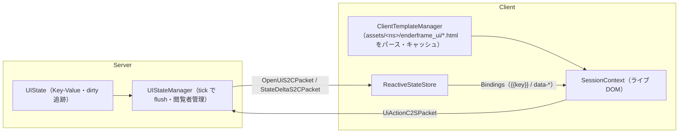
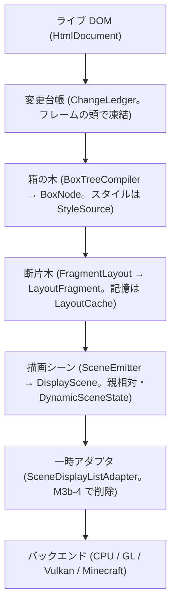

# EnderFrameLib アーキテクチャ設計書

EnderFrameLib は、ブラウザ標準（HTML / CSS / UI Events / WHATWG DOM）に沿ったレイアウト・描画パイプラインを純 Java 21 で実装した**独立の UI レンダリングエンジン**（`:core`・`:core-gl`・`:core-vulkan`・`:core-glfw`）と、その上に載る**任意の Minecraft 1.21.1（NeoForge）統合 Mod** で構成されています。

本書は、構造整理（T0〜T7）と Headless State（H0〜H4）を経た**現在の**システムの全体像、パッケージ構成、
責務分担、設計原則、および機械的に守っている管理指標を記述します。

- これから何をどの順でやるか: [計画書 ENGINE_REARCHITECTURE_PLAN.md](plan/ENGINE_REARCHITECTURE_PLAN.md)
- 性能の基準値と実測: [BENCHMARK.md](BENCHMARK.md)
- ブラウザとの差異の台帳: [FIDELITY.md](FIDELITY.md)
- 規約（言語・コメント・テスト）: [CONTRIBUTING.md](../CONTRIBUTING.md)

---

## 1. 層と依存の向き

> Gradle のモジュールは 5 つ。`:core`（`core/`）が Minecraft に依存しない `core`・`common`・`api/dom`・`api/event` などのパッケージを持ち、
> `:mod`（NeoForge の MOD。`mod/`）が `:core` を取り込んで MOD の JAR に同梱する。ルートはプラグインを持たない素の Gradle。パッケージ名はモジュールをまたいでも同じ。
> GPU の実装と窓は `:core` から分けた 3 つのモジュールにある: `:core-gl`（OpenGL 3.2。`core.paint.gl`）・`:core-vulkan`（Vulkan 1.1。
> `core.paint.vulkan`）・`:core-glfw`（GLFW の窓と単体ビューア）。`:core` はこの 3 つにも OpenGL・GLFW・Vulkan にも依存せず、
> `ServiceLoader` で見つける（無ければソフトウェア描画だけが動く。`:core:verifyCoreDependencyGraph` と `:core:runCoreOnlySmoke` が検査する）。
> `ArchitectureTest` / `ApiBoundaryTest` は両モジュールのソースを 1 本の木として検査する。
> `:core` を単体で使う方法は [core/README.md](../core/README.md) と [docs/standalone-viewer.md](standalone-viewer.md)。

```
 client/   server/            （Minecraft / NeoForge に依存する実行系）
    │  ╲     │   ╲
    │   network/  ── 登録時だけ server のハンドラを参照
    ↓      ↓
 common/                      （文書の読み込み・パイプライン）
    ↓
 core/  ──→ api/dom, api/event（純 Java の DOM / イベントのインターフェース）
    ✕
 net.minecraft / net.neoforged / com.mojang
```

| パッケージ | 依存先 | 役割・責務 |
|:---|:---|:---|
| **`core/`** | `api/dom`・`api/event` のみ | **ブラウザエンジンのコア**。HTML パーサと DOM、CSS（構文・カスケード・値）、ボックスツリーとレイアウト、描画モデル、テキストの測定。Minecraft・上位パッケージの参照は禁止（`ArchitectureTest`）。 |
| **`api/`** | Minecraft / NeoForge | **公開 API**。下流 Mod がコンパイルする面。実装パッケージ（`core` / `common` / `client` / `server` / `network`）を参照しない（`ApiBoundaryTest`）。<br>`api/dom`・`api/event` は Web IDL の形をした純 Java のインターフェースで、`core/dom` がこれを実装する。 |
| **`common/`** | `core/`, `api/` | 文書の読み込み（`DocumentLoader`・`UiDocumentCompiler`・`CustomTagExpander`・`CssResources`）、1 フレームの組み立て（`V3Frame`。1 回だけのフレームは `FrameRender`）、devkit の書き出し（`WebDevKitExporter`）。 |
| **`client/`** | `core/`, `api/`, `common/`, `network/` | **クライアント側の実行系**。セッション（`SessionContext`）、入力（`SessionInput`）、宣言的バインディングの状態（`ReactiveStateStore`）、テンプレート（`client/template`）、描画（`client/renderer`）、画面ホスト（`client/gui`）。 |
| **`server/`** | `core/`, `api/`, `common/`, `network/` | **サーバー側の実行系**。Headless State（`server/state`）、互換モードのセッション（`WebSession` / `WebSessionManager`）、Pub/Sub、コマンド、データパック、アクセス制御とレート制限。 |
| **`network/`** | `core/`, `api/` | ペイロードの型と登録（`EnderFrameNetwork`）、Headless State の値と NBT の変換とパケット上の番号化（`StateNbtConverter`。キー辞書 `KeyTable`・受信側の辞書。サーバーとクライアントの両方が使う）。登録時に `server.ServerPayloadHandler` を受け口として参照する。 |
| **`gametest/`** | `api/`, `server/` | サーバー側ライフサイクルのゲームテスト（`WebScreenGameTest`）。 |

---

## 2. 実行モデル

UI は 3 つの駆動方式で開ける。どれもクライアントの**同じライブ DOM と同じパイプライン**で描かれ、違うのは
「どこから何が届くか」だけ。

| 方式 | 入口 | サーバーが持つもの | 通信 |
|:---|:---|:---|:---|
| **Headless State**（推奨。機械 UI など定型画面） | `EnderFrameAPI.open(player, Ui.template(..))` + `UIState` | Key-Value の状態だけ（DOM ノード 0） | 初回 `OpenUiS2CPacket`（テンプレート ID + 初期状態 + キー辞書）、以後 `StateDeltaS2CPacket`（変わったキーだけを番号で。状態の破棄も知らせる）。操作は `UiActionC2SPacket` |
| **互換モード**（Ad-hoc。HTML をサーバーから送る） | `EnderFrameAPI.open(player, Ui.html/datapack)` / `hud`、`WebSessionHandle.patch*` | 文書の DOM（`WebSession`） | 初回 `WebSyncS2CPacket`（DOM の直列化）、以後 `dom_mutations`（`DomMutationRecord` の列）。操作は `WebActionC2SPacket` |
| **クライアント駆動** | `EnderFrameClientAPI.open` / `hud`（`ClientSession`） | なし | 0 |

これに加えて、Pub/Sub（`PubSubUpdateS2CPacket` / `SubscribeC2SPacket`）がチャンネル単位の値を購読者に配る。

### Headless State（`api/state` / `server/state` / `client/template`）



- サーバーは HTML を字句解析せず、DOM をヒープに置かない。状態の差分だけを tick ごとに閲覧者へ送る
  （実測は [BENCHMARK.md](BENCHMARK.md) §7）。
- テンプレートはクライアントのリソース（`assets/<namespace>/enderframe_ui/<path>.html`）から読む。
  テンプレート文書の既定の所有権はクライアント。
- アクションは閲覧者であることを `UIStateManager.handleAction` が確かめ、`ServerPayloadHandler` のレート制限を通る。

### 互換モードの同期と所有権

- 単一のライブ DOM を直接変える。以前の 3 コピー（テンプレート木・仮想木・実体木）と仮想 diff エンジンは無い。
- サーバーの更新は `DomMutationRecord`（子の挿入・削除、属性、文字データ、style）の列。全木の再同期は
  `SessionContext.adoptServerTree` が受け、文書のハンドルは変えずに中身を差し替える。
- 部分木ごとにサーバー所有 / クライアント所有を持つ（`core/dom/node/Ownership`、`data-owner`）。
  クライアント所有の部分木へのサーバー変異は適用しない。
- イベントのサーバー転送は宣言で行う（`core/dom/EventForwardDeclaration`：`data-forward` / `data-forward-action`、
  `onclick="server:…"` はその糖衣）。サーバーは送出した DOM が宣言したアクション名だけを受け付ける（`WebSession.declaresAction`）。

---

## 3. コア（`core/`）

`core/` は Minecraft に依存しないので、すべてヘッドレス（JUnit）で検証できる。

```
core/
├── css/      CSS Syntax 3 のトークンとコンポーネント値（CssSyntax）、規則の積み上げ（CssParser / AtRuleProcessor）、
│             セレクタ（SelectorParser / SelectorMatcher / InvalidationSets）、カスケード（StyleResolver）、
│             値（ValueComputer / LengthResolver / ColorParser / CustomPropertyRegistration）、
│             プロパティの知識（PropertyRegistry / ShorthandExpanders）
├── dom/      ライブ DOM（node/）、パーサ（parser/: HtmlParser・MarkdownParser）、
│             Bindings、InteractionState、MutationObserverManager、フォーム（ConstraintValidator など）
├── event/    DOM のイベントディスパッチ（EventDispatcher / CoreEvent / StandardDefaultActions）
├── kernel/   土台: memory/（AtomTable・バインディングの直接書き込みの OffHeapColumns）、style/（PackedCssValue）、gpu/（描画 API に依らないデバイス層 RHI）。
│             標準 JDK 21 のダイレクト ByteBuffer + VarHandle だけで作り、JVM フラグも追加依存も要らない
├── box/      箱の木（BoxTreeCompiler・BoxNode。変更台帳を入口に増分で作る）
├── layout/   fragment/（断片木の整形: Block / Inline / Flex / Grid / Table / 縦書き・LayoutCache）、model/、LayoutTaskPool
├── paint/    描画シーン（scene/: DisplayScene・SceneEmitter・SceneLayer・SceneChunk・DynamicSceneState）、
│             一時アダプタ（SceneDisplayListAdapter・SceneAdapterSupport）、描画モデル（DisplayItem・BoxDecorations・Gradients）
└── text/     テキストの測定（TextShaper）、書体（model/FontFace・BitmapFontFace）、
              システム書体（font/: SystemFonts・FontScanner・FontCatalog・OutlineFontFace・LoadedFace・KerningTable）
```

### ライブ DOM と単一所有権
- **Single DOM**: 1 つの `HtmlDocument` を Java のクライアントコード・サーバーの変異・宣言的バインディングの全員が同じ API で変える。
- **オブジェクト同一性**: 対話状態（`:hover` / `:focus` など、`InteractionState`）とスクロール量（`core/layout/model/ScrollState`）は
  ノードのインスタンスがキー。`InteractionState` の実体はビューの表が持ち（`WeakHashMap` は使わない）、文書の節は番号の空間
  （`NodeIds`）の番号で引く表（`NodeIds.NodeSlots`。番号が再利用されると世代で無効になる）、仮想の節は別の表に置く。
- **ノードの鍵**: `getId()` は作者が書いた id だけ（パーサは `gen_N` / `txt_N` を属性へ振らない）。描画・ネットワークで節を指す
  文字列は `HtmlNode.key()`（明示 id、無ければアリーナ番号から導く `~N`、テキストは `~tN`）。`getNodeById` が両方を解決する。
  読み込み後の番号は文書順（行きがけ順）で固定され（静的領域）、シリアライズで番号ごとクライアントへ運ぶので鍵が揃う。
  読み込み後に増えた節の番号は動的領域で、外れると再利用される。
- **木の形の正本は子の並び（`children`）と `parent` だけ**（M5-1）。子の並び（`ChildList`）は変更のたびに各子の位置
  （`indexInParent()`）を保ち、前後の兄弟・挿入位置を O(1) で引ける。番号の空間 `NodeIds` は番号と世代だけを持ち、木の形を写さない
  （以前の `DocumentArena` はオフヒープの列に木の形・タグ・Bloom を写して二重に同期していた）。描画が作る仮想の節（疑似要素・
  匿名ボックス・マーカー）は親の `children` に載らないので番号を持たない。整合は `NodeIdentityTest`・`ChildListIndexTest` が守る。
- **セレクタの足切り（`SelectorIndex`）**: 節ごとの class の atom・タグ / id / class の Bloom・子孫の Bloom（`:has()` 用の上位集合）。
  属性の変化と子の並びへの追加でその場で保つので、番号の有無に依らず切り離された木・仮想の節でも効く。作り直した木との照合の
  一致は `SelectorIndexOracleTest` が守る。
- **`HtmlNode` の分け方**: 節の欄と DOM の API の入口だけを持ち、番号と鍵（`NodeNumbering`）・木の変更と文書順と複製（`TreeOps`）・
  属性の書き込みと便利な操作（`NodeAttributes`）・文字の内容（`NodeText`）・イベント（`NodeEvents`）へ委ねる。
- **`getElementById`** は id 索引だけで引く（線形探索のフォールバックは無い）。索引に載るのは明示 id だけ。

### CSS
- 値は `CssSyntax` のコンポーネント値として読み、正規表現で再パースしない。
- カスケードは CSS Cascade 5 の順（重要度 → オリジン → レイヤー → 詳細度 → 出現順）。`@layer`・CSS ネスト・`@container`・
  `@property`・`:has()` を含む。対応範囲の一覧は README の "Supported CSS"。
- 規則は右端の複合セレクタの id / class / tag で振り分けて照合する（`StyleSheet`）。
- `SelectorMatcher` はアリーナの列を使う: 前の兄弟（`+` / `~`）は兄弟リンクで O(1)、複合セレクタの tag/id/class は節の
  `selfBloom` との AND 1 回で棄却、`:has()` は子孫 Bloom（`subtreeBloom`）で棄却する。番号を持たない木（断片・仮想の節）は
  従来どおり子の並びを走査し、結果は同じ（`SelectorArenaMigrationTest` が複製との一致を乱数変異で確かめる）。
- セレクタから作る無効化セット（`InvalidationSets`）は `StyleSheet.invalidationSets()` で組み、`InteractionState` に接続して、
  状態・属性・子の増減で汚れた要素と関係する要素だけを再スタイルの対象にする。

### テキスト
- **測定の出所は `TextShaper` 1 つ。** 描画側は測り直さない。
- `font-family` は既定でシステムの書体（`SystemFonts`、CSS Fonts 4 §5.2 の照合）に解決し、`@font-face` の TTF / OTF も
  `WebFonts` を通して同じ `OutlineFontFace` の経路で測り描きする。`minecraft:*` などの名前と、TTF / OTF 以外の `@font-face`
  だけが Minecraft のビットマップ書体（`BitmapFontFace`）で描かれる。
- OS の書体の一覧は、全ファイルを FreeType で開く走査（`FontScanner`。Windows の約 500 ファイルで 250〜400 ms）の結果を
  利用者のキャッシュのフォルダの目録（`FontCatalog`。Windows は `%LOCALAPPDATA%\EnderFrame`、macOS は `~/Library/Caches/EnderFrame`、
  それ以外は `$XDG_CACHE_HOME/enderframe`）に書き、次の起動ではフォルダの更新時刻が記録と同じなら目録だけを読む（約 25 ms）。
  目録は走査の結果をそのまま写すので、解決の結果は目録の有無で変わらない（`FontCatalogTest`）。

---

## 4. クライアント（`client/`）

### セッション状態の単一集約（`SessionContext`）
以前 10 クラス以上に分散していたセッション ID キーの static マップ（hover・drag・focus・input・scheduler など）は、
すべて 1 つの `SessionContext` インスタンスのフィールドになった。
- **`ClientWebManager`**: セッションの登録簿（取得・作成・破棄・描画キュー）だけを持つ。
- **`SessionContext.close()`**: タイマー・アニメーション・キャンバス・購読を 1 箇所で破棄する。
- **`InteractionState`**: フォーカス・ホバー・アクティブなノードの唯一の保持者。

### 入力経路の一本化（`SessionInput`）と画面の基底
GUI 画面（`AbstractEnderScreen` / `AbstractEnderContainerScreen`、共通部分は `EnderScreenDelegate` と `EnderScreenHost`）と
ワールド内 UI（ブロック面・手持ちアイテム・HUD）は、同じ `SessionInput` を通る。
- 各ホストは「ホスト固有の座標 → Web 空間の (x, y)」の変換だけを受け持つ。
- ヒットテスト、`pointerdown` / `mousedown`、解放時の `click` 合成、打鍵（`beforeinput` → 編集 → `input` / `change`）、
  ホイール、サーバーへの転送（互換モードは `WebActionC2SPacket`、Headless State は `UiActionC2SPacket`）はすべてここを通る。

### 宣言的バインディング（`core/dom/Bindings`）
`{{key}}`、`data-model` / `data-bind` / `data-if` / `data-show` / `data-for` / `data-list` / `data-class` / `data-i18n` などの評価は
`Bindings` の 1 箇所で行う。`ReactiveStateStore`（Headless State の状態もここに入る）と `ClientPubSubManager` は値を提供するスコープ。
`data-for` の行は鍵（`data-row-key` か添字）で既存ノードを再利用する。

### 描画（`client/renderer`）
MOD の面（GUI・コンテナ・HUD・ビルボード・ブロック・ホログラム・アイテム・地図）は、`SurfaceRenderer` を入口に
`MinecraftHostSurface` だけが描く（M3a で旧レンダラ `DisplayItemDrawer`・`WebSdfShader`・`LayerCompositor` ほかを撤去した）。
`SceneEmitter`（`:core`）が作った不変の `DisplayScene` から（M3b-4 まで記憶なしの一時アダプタ `SceneDisplayListAdapter` 経由で）得た項目を、Minecraft の GL コンテキストとテクスチャを共有する見えないコンテキストの
`LwjglGlRenderBackend`（コアの GPU 描画。スタンドアロンと同じコード）で面のテクスチャへ描き、1 枚の板として貼る。
角丸・グラデーション・影・フィルター・クリップ・文字はすべてコアが描く。

Minecraft だけが描ける中身（`item:`・`entity:`・`player:` の画像、`<mc-scene>`、ビットマップ書体の文字）は、
`MinecraftHostTextures` が面を描く前に Minecraft の描画で項目ごとのテクスチャ（FBO）へ描き、コアの差し込み口
`HostTextures` で項目の中身として渡す。コアは背景・枠線・クリップ・不透明度・重なりの順を自分で描き、その中身の矩形にテクスチャを貼るので、
後から重ねる形と違ってポップアップがアイテムを正しく隠す。共有コンテキストの同期は Minecraft 側のフェンスをコアが待つ（`waitForHost`）。
画像・動画・キャンバス・流体・効果のアイコンの画素は `MinecraftMediaBridge`（`ImageProvider`）、書体は `WebFontManager.McFontResolver` が渡す。
編集中の欄のキャレットは `SurfaceEditOverlay` が、スタンドアロンと同じ計算（`TextFieldOverlay`）で項目として足す。
`title` のツールチップ（`SurfaceTooltip`）と遠距離の 1 色の塗りだけは、ホストの飾りとして板の上に Minecraft の描画で重ねる。

---

## 5. 描画パイプライン（`common/V3Frame`）

スタイル解決から描画要素の生成までは `V3Frame` の 1 箇所で組み立てる（M5。経路は 1 本。旧 `RenderPipeline` / `LayoutBox` の経路は
2026-11-26 の M2c-3 で削除した。計画書 [ENGINE_REARCHITECTURE_PLAN.md](plan/ENGINE_REARCHITECTURE_PLAN.md) §3.2）。



### 増分
- **入口は変更台帳 1 本**: DOM・状態・スクロール・環境の変化は `ChangeLedger` に記録され、フレームの頭で凍結する。
  箱の木は台帳が触れた節とその範囲だけを作り直し、それ以外は前回の `BoxNode` を共有する。
- **レイアウトの記憶**: 前回の断片木そのもの。鍵は `(BoxNode ==, ConstraintSpace の値等価)` だけ（計画書 §2.3）。
- **全体の作り直し**: `markInvalidation(RELAYOUT)` は前回の木と記憶を捨てる（書体の登録の変化など、台帳に載らない変化）。
- **スクロール量だけの変化**: スクロールコンテナの中身を 1 つの節にまとめてあるので、表示リストを作らずに節を動かす。
- 正しさは「最初から作った結果と同じ」で固定する（`FrameOracle`・`IncrementalOracleTest`・`IncrementalVsFullTest`・
  `ServerClientLayoutParityTest`）。

---

## 6. 設計原則（崩さない不変条件）

- **測定の出所は 1 つ。** テキストの幅・ベースライン・折り返しは `TextShaper` が決め、描画はそれをそのまま描く。
- **幾何は float、丸めは描画の 1 箇所。**
- **プロパティの知識は 1 箇所**（`PropertyRegistry`）。
- **DOM と箱は別物**（レイアウトの入力はボックスツリー）。
- **描画順は木で決める**（CSS 2.2 付録 E のスタッキングコンテキスト）。描画とヒットテスト（`HitTestIndex`）は同じ順序を使う。
- **差は台帳に書く。** FIDELITY.md・コードの `LIMITATION`・README の "Not supported" の 3 点セット。
- **同じ処理の 2 つめの入口を作らない。** 入口が使いにくければ入口のほうを直す。

---

## 7. 管理指標とアーキテクチャの番人（ラチェット）

コードの肥大化と責務の重複の再発を防ぐため、次の指標を
[`ArchitectureTest`](../mod/src/test/java/com/nishiyu/enderframelib/core/ArchitectureTest.java) で機械的に検査し、
上限を超えたらビルドを落とす。上限は下げる方向にだけ動かす（[CONTRIBUTING.md](../CONTRIBUTING.md)）。

| 指標 | 検査対象 | 上限 |
|:---|:---|:---:|
| **M1** | セッション ID をキーにした static な状態を持つクラス | 1（`ClientWebManager` の登録簿） |
| **M2** | フォーカス状態の持ち場 | 1（`InteractionState`） |
| **M3** | `ClientWebManager` の public static メソッド | 8 |
| **M4** | テンプレート・バインディング（`{{…}}` / `data-*`）を解釈するクラス | 1（`Bindings`） |
| **M5** | スタイル → ボックス → レイアウト → ディスプレイリストを組み立てる場所 | 1（`V3Frame`） |
| **M6** | 入力をイベントに変える経路 | 1（`SessionInput`） |
| **M7** | 2 つ以上のパッケージから参照される入れ子型（`api` は除く） | 0（トップレベルへ出す） |
| **M8** | CSS の値を文字列で分割する自前の関数 | 8（新しく書かない。`CssSyntax` を使う） |
| **M1拡張** | シングルトンの static フィールドに持つ画面・セッション単位のコールバック | 0 |
| **M1拡張** | コマンド定義クラス内のサーバー状態コレクション | 0 |
| **DOM直書き** | `node/`・パーサ・直列化以外の `.attrs.put` / `.attrs.remove` 直接呼び出し | 0 |
| **R6** | シーン・表示リスト生成の一群（`SceneEmitter`・`BoxItemPainter` ほか）の `Pattern.compile` の数（型付き値と `CssSyntax` を使う） | 0 |

指標の外にも、次を同じテストで検査している。

- `core/` が Minecraft・NeoForge・上位パッケージを参照しない（import でも完全修飾名でも）。
- `client/` が `server/` を参照しない（両側で使う型は `network/` か `common/` に置く）。
- `api/` が実装パッケージを参照しない（`ApiBoundaryTest`）。
- テストのパッケージが本体のパッケージに対応する（WPT の移植ハーネスを除く）。
- README・CONTRIBUTING・docs の FIDELITY・ARCHITECTURE・BENCHMARK に、消した型の名前が残っていない。
- サーバーのセッション属性を並行マップで持たない（`WebSession` のフィールドに集約）、`EnderFrameScriptingBridge` が
  グローバルな登録簿を持たない、差分の送り方が `dom_mutations` の 1 系統である。

## 面（Surface）の描画経路

セッションを面に描くホスト（画面・コンテナ画面・HUD・ビルボード・ブロック・ホログラム・アイテム・地図）は、
姿勢（`PoseStack`）だけを作って `SurfaceRenderer.draw` を呼ぶ。同期の確認・空の判定・ホバーの取得・描画パスの
組み立ては `SurfaceRenderer` の 1 か所にあり、`PaintRequest` はその内部の値になった。描き方（ライト・描く部品・
奥行き・音・遠距離の塗り）は `SurfaceStyle` に集まり、場所ごとの既定（`gui` / `hud` / `billboard` / `world` / `item` / `overlay`）
から `with*` で 1 項目ずつ変える。世界に出す登録口は `client/Surfaces`（`block` / `item` / `map` / `hologram`）の 1 つ。
